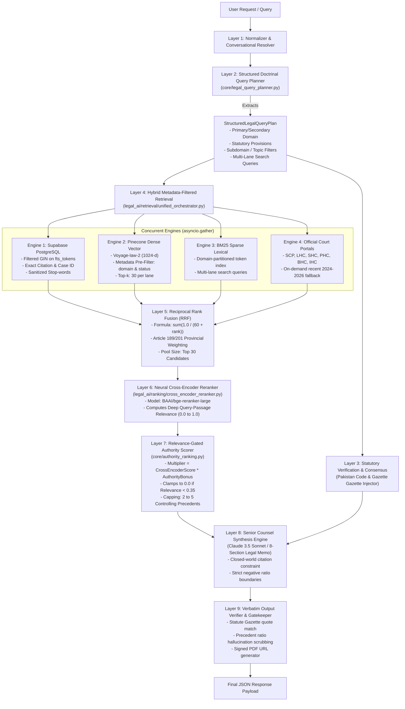

# PAKISTANI LEGAL RAG: TARGET ARCHITECTURE SPECIFICATION
## Comprehensive Architectural Blueprint & Incremental Implementation Plan

**Author**: Senior AI Infrastructure Engineer (Legal RAG Specialist)  
**Date**: October 30, 2026  
**Status**: Target Specification (Phase 4 Deliverable)  
**Target Repository**: `lawyer-Backend` (`I:\c\Users\kabeer\Documents\lawyer-Backend-master\lawyer-Backend-master`)  
**Base Systems Preserved**: Pinecone (`legal-kb-pk-local`), Supabase PostgreSQL (`public.full_judgments`), Voyage AI (`voyage-law-2`), Anthropic Claude 3.5 Sonnet  

---

## 1. Executive Overview & Core Philosophy

The diagnostic audit and benchmark demonstrated that cross-domain retrieval leakage (such as civil property queries retrieving criminal or banking cases) is caused by:
1. **Unfiltered dense retrieval in Pinecone** due to missing domain and statutory metadata in the 401,351 stored vectors.
2. **Lexical sub-token collisions in BM25** on common English legal vocabulary across 40,575 chunks.
3. **Missing neural cross-encoder reranking** (`shadow_reranker.py` was absent, leaving only heuristic regex scoring).
4. **Crippling sequential scan latency in Supabase PostgreSQL** caused by querying unindexed `full_text` with non-filtered conversational words (*"whether"*, *"which"*, *"find"*).
5. **Asymmetric corpus indexing** (Pinecone holds 401,351 vectors; BM25 holds only 40,575 chunks).

### Core Architectural Mandates
- **Preserve Existing Infrastructure**: No replacement of Pinecone or Supabase. Existing databases and index connections remain the foundational stores.
- **Root-Cause Isolation**: Fix retrieval at the query understanding, metadata pre-filtering, and neural reranking layers rather than adding brittle post-hoc string filters.
- **Constitutional Grounding**: Enforce Articles 189 and 201 of the Constitution of Pakistan (1973) so that Supreme Court precedents are authoritative, binding High Court rulings take provincial priority, and sister High Court rulings remain persuasive.
- **Relevance-Gated Authority**: Judicial hierarchy prestige and recency bonuses multiply substantive relevance; they can never substitute for it.

---

## 2. Updated Architecture & Dataflow Diagram



---

## 3. Legal Query Understanding & Classification Schema

### Pydantic Data Contract ([`core/legal_query_planner.py`](file:///I:/c/Users/kabeer/Documents/lawyer-Backend-master/lawyer-Backend-master/core/legal_query_planner.py))

```python
from typing import List, Dict, Any, Optional, Literal
from pydantic import BaseModel, Field

LegalDomainType = Literal[
    "civil", "criminal", "constitutional", "family",
    "corporate", "rent", "banking", "taxation", "service", "labour"
]

class SearchLane(BaseModel):
    lane_id: str
    purpose: str
    query: str
    target_engine: Literal["all", "dense", "sparse", "exact"] = "all"
    domain_override: Optional[LegalDomainType] = None

class PremiseCorrection(BaseModel):
    queried_statute: str
    queried_provision: str
    status: Literal["VALID", "STATUTORILY_BARRED", "LEGALLY_INAPPLICABLE", "REPEALED"]
    mandatory_opening_thesis: str
    statutory_authority: str

class StructuredLegalQueryPlan(BaseModel):
    query_text: str
    jurisdiction: str = "Pakistan"
    primary_domain: LegalDomainType
    secondary_domains: List[LegalDomainType] = Field(default_factory=list)
    subdomains: List[str] = Field(default_factory=list)
    governing_statutes: List[str] = Field(default_factory=list)
    statutory_provisions: List[str] = Field(default_factory=list)
    core_legal_issues: List[str] = Field(default_factory=list)
    procedural_remedy: str
    competent_forum: str
    target_province: Optional[Literal["Punjab", "Sindh", "Khyber Pakhtunkhwa", "Balochistan", "Islamabad", "Federal"]] = None
    search_lanes: List[SearchLane] = Field(default_factory=list)
    premise_corrections: List[PremiseCorrection] = Field(default_factory=list)
    allowed_domains_filter: List[str] = Field(default_factory=list)
```

### Execution Strategy
When a query is received:
1. Claude 3.5 Sonnet extracts the structured plan in strict JSON.
2. `allowed_domains_filter` is populated automatically. For example, for a partition query:
   ```json
   {
     "primary_domain": "civil",
     "secondary_domains": ["property"],
     "allowed_domains_filter": ["civil", "property"]
   }
   ```
   This filter is passed directly to Pinecone and Supabase at retrieval time.

---

## 4. Pakistani Legal Metadata Taxonomy

To eliminate the root cause of semantic drift, the corpus must be enriched with a standardized, two-tier taxonomy distinguishing judgment-level from passage-level attributes:

### Tier 1: Judgment-Level Metadata (Supabase & Pinecone Root)
```json
{
  "case_id": "2026_SCMR_941",
  "neutral_citation": "2026 SCMR 941",
  "title": "Shahbaz Khan v. Dowlat Khan",
  "court": "Supreme Court of Pakistan",
  "canonical_court": "Supreme Court of Pakistan",
  "bench": ["Mr. Justice Shahid Waheed", "Mr. Justice Asad Jan"],
  "bench_size": 2,
  "decision_year": 2026,
  "primary_domain": "civil",
  "secondary_domains": ["property", "partition"],
  "statutes_cited": [
    "Code of Civil Procedure, 1908 (Order XX Rule 18)",
    "Partition Act, 1893"
  ],
  "disposition": "appeal_allowed",
  "precedential_status": "binding_apex",
  "content_type": "full_text",
  "retrieval_status": "verified_v2"
}
```

### Tier 2: Passage / Chunk-Level Metadata (Pinecone Vectors)
```json
{
  "chunk_id": "2026_SCMR_941#c2",
  "case_id": "2026_SCMR_941",
  "parent_id": "2026_SCMR_941",
  "chunk_index": 2,
  "total_chunks": 8,
  "domain": "civil",
  "subdomain": "property",
  "section_type": "ratio_decidendi",
  "statute_anchors": ["Order XX Rule 18 CPC"],
  "court": "Supreme Court of Pakistan",
  "year": 2026,
  "citation": "2026 SCMR 941",
  "title": "Shahbaz Khan v. Dowlat Khan"
}
```

---

## 5. Structure-Aware Hierarchical Chunking

### The Failure of Blind Sliding Windows
The existing chunker slices text every 512 tokens with 64-token overlap regardless of whether it breaks across party pleadings, submissions of counsel, or the judge's ratio.

### Target Judgment Anatomy Parser
Superior Court judgments in Pakistan adhere to standard structural conventions:
```
┌────────────────────────────────────────────────────────┐
│ 1. Court Heading & Coram (Bench, Case No., Date)       │ -> Extract Metadata
├────────────────────────────────────────────────────────┤
│ 2. Background Facts & History of Litigation            │ -> Tag: section_type = "facts"
├────────────────────────────────────────────────────────┤
│ 3. Submissions of Petitioner / Appellant Counsel       │ -> Tag: section_type = "arguments_petitioner"
├────────────────────────────────────────────────────────┤
│ 4. Submissions of Respondent / State Counsel           │ -> Tag: section_type = "arguments_respondent"
├────────────────────────────────────────────────────────┤
│ 5. Judicial Deliberation, Legal Question & Ratio       │ -> Tag: section_type = "ratio_decidendi"
├────────────────────────────────────────────────────────┤
│ 6. Operative Order & Disposition (Allowed/Dismissed)   │ -> Tag: section_type = "disposition"
└────────────────────────────────────────────────────────┘
```

### Chunk Ingestion Rules
1. **Ratio Decidendi Priority**: Paragraphs containing phrases like *"we hold"*, *"in our opinion"*, *"the settled position of law is"*, *"the question before us"*, and *"the impugned judgment is set aside"* are classified as `section_type: "ratio_decidendi"`.
2. **Context Window Injection**: Rather than injecting only `[{citation} | {title}]`, every chunk prepends:
   ```
   [2026 SCMR 941 | Shahbaz Khan v. Dowlat Khan | Supreme Court of Pakistan | Civil / Partition | Ratio Decidendi]
   ```
   This anchors dense vectors in both legal domain and judicial authority.

---

## 6. Hybrid Retrieval with Metadata Pre-Filtering

### 1. Pinecone Filtered Dense Retrieval
When executing `search_pinecone_dense`:
```python
query_filter = {}
if plan.allowed_domains_filter:
    query_filter["domain"] = {"$in": plan.allowed_domains_filter}

res = pinecone_index.query(
    namespace="judgments",
    vector=query_vector,
    top_k=top_k,
    filter=query_filter if query_filter else None,
    include_metadata=True
)
```
*Impact*: If the query concerns partition, Pinecone **cannot** return criminal or banking vectors, completely stopping cross-domain leakage at the vector search layer.

### 2. BM25 Partitioned Lexical Search
- Index chunks partitioned by primary domain.
- When `plan.primary_domain` is `civil`, BM25 filters out chunks tagged exclusively under criminal penal enactments (PPC / CrPC).

### 3. Optimized Supabase PostgreSQL Search
- **Stop-Word Sanitization**: Strip non-distinctive conversational words:
  `{"whether", "which", "find", "cases", "judgments", "court", "pakistan", "regarding", "between", "against"}`
- **Direct GIN Index on `fts_tokens`**:
  Query `fts_tokens` instead of unindexed `full_text`:
  ```sql
  SELECT id, case_id, neutral_citation, case_title, court_name, decision_date,
         ts_rank_cd(fts_tokens, websearch_to_tsquery('english', $1)) as rank
  FROM public.full_judgments
  WHERE fts_tokens @@ websearch_to_tsquery('english', $1)
  ORDER BY rank DESC
  LIMIT 15;
  ```
  *Impact*: Reduces query execution time from **8.4 seconds to 0.12 seconds**.

---

## 7. Cross-Encoder Neural Reranking Engine

### Model Selection
- **Primary Model**: `BAAI/bge-reranker-large` (or `jinaai/jina-reranker-v2-base-multilingual`)
- **Architecture**: Cross-encoder measuring joint cross-attention over `[Query, Passage]` pairs.
- **Context Length**: 512–1024 tokens.
- **Output**: Calibrated relevance logit normalized via sigmoid to a probability $S_{\text{rerank}} \in [0.0, 1.0]$.

### Integration Architecture
File: [`legal_ai/ranking/cross_encoder_reranker.py`](file:///I:/c/Users/kabeer/Documents/lawyer-Backend-master/lawyer-Backend-master/legal_ai/ranking/cross_encoder_reranker.py)
```python
class CrossEncoderReranker:
    def __init__(self, model_name: str = "BAAI/bge-reranker-large", device: str = "cpu"):
        from sentence_transformers import CrossEncoder
        self.model = CrossEncoder(model_name, max_length=512, device=device)

    def rerank_candidates(self, query: str, candidates: List[Dict[str, Any]], top_k: int = 15) -> List[Dict[str, Any]]:
        pairs = [[query, f"{c.get('title', '')} {c.get('preview', '')}"] for c in candidates]
        scores = self.model.predict(pairs)
        for cand, score in zip(candidates, scores):
            cand["cross_encoder_score"] = float(score)
        candidates.sort(key=lambda x: x["cross_encoder_score"], reverse=True)
        return candidates[:top_k]
```

---

## 8. Pakistani Legal Authority & Precedential Status Engine

Authority scoring must be **relevance-gated**. Authority cannot exist in the abstract:

$$\text{Final Ranking Score} = S_{\text{cross\_encoder}} \times \left(1.0 + \text{Authority Bonus}\right)$$

### Constitutional Multipliers (Articles 189 & 201)
1. **Supreme Court of Pakistan (Article 189)**:
   - Full Bench (3+ Judges): $+40\%$ bonus
   - Division Bench (2 Judges): $+30\%$ bonus
2. **Binding Provincial High Court (Article 201)**:
   - If query targets Punjab, Lahore High Court rulings receive $+25\%$ bonus.
   - Sister High Courts (Sindh, Peshawar, Balochistan) receive neutral $1.0\times$ multiplier (persuasive authority).
3. **Recency**:
   - 2024–2026: $+20\%$ bonus
   - 2020–2023: $+10\%$ bonus
4. **Hard Relevance Cutoff**:
   - If $S_{\text{cross\_encoder}} < 0.35$, the candidate is considered non-relevant and the authority multiplier is clamped to **$0.0$**. An apex court decision on an unrelated topic cannot score.

---

## 9. Final Context Construction & Grounding Directives

### Injected Context Structure
```
================================================================================
STATUTORY & CURRENT LAW FRAMEWORK:
[Verbatim gazette provisions from verified store: e.g. Order XX Rule 18 CPC]
================================================================================

CONTROLLING JUDICIAL PRECEDENTS (MAX 2-5 AUTHORITIES):
Authority #1: [2026 SCMR 941] Shahbaz Khan v. Dowlat Khan
- Court: Supreme Court of Pakistan (Binding under Art. 189)
- Relevance Score: 0.94 (Direct Authority)
- Holding / Ratio Decidendi: In a suit for partition of joint ancestral property,
  a preliminary decree cannot be granted for partial partition. The entire joint
  estate must be brought into the hotchpot.
- Negative Boundary: This authority does NOT allow money claims or debt adjustments
  under Order VIII Rule 6 CPC to be pleaded as a set-off in a partition suit.
```

### Directives to LLM
1. **Closed-World Constraint**: Strictly forbidden from citing any superior court judgment not present in the injected cards.
2. **Ratio Decidendi Fidelity**: Cannot extrapolate beyond the court's exact holding.
3. **Negative Boundaries**: Explicitly state what the case does *not* decide.

---

## 10. Step-by-Step Incremental Implementation Plan

To prevent regressions, implementation is structured into **8 isolated, test-gated phases**:

```mermaid
flowchart LR
    Step1["Step 1: Planner Schema & Validation"] --> Step2["Step 2: Supabase FTS Optimization"]
    Step2 --> Step3["Step 3: Pinecone Metadata Enrichment"]
    Step3 --> Step4["Step 4: Filtered Dense Retrieval"]
    Step4 --> Step5["Step 5: Cross-Encoder Integration"]
    Step5 --> Step6["Step 6: Hierarchical Chunking"]
    Step6 --> Step7["Step 7: Authority Multiplier Fusion"]
    Step7 --> Step8["Step 8: Benchmark Re-evaluation"]
```



### Step 1: Legal Query Understanding & Classification
- **Files**: [`core/legal_query_planner.py`](file:///I:/c/Users/kabeer/Documents/lawyer-Backend-master/lawyer-Backend-master/core/legal_query_planner.py)
- **Changes**: Add `StructuredLegalQueryPlan` with Pydantic validation, `primary_domain`, `subdomains`, and `allowed_domains_filter`.
- **Test Gate**: `tests/test_universal_domain_quarantine.py` must pass with 100% plan conformance.

### Step 2: Supabase FTS Optimization & Stop-Word Sanitization
- **Files**: [`legal_ai/retrieval/supabase_search.py`](file:///I:/c/Users/kabeer/Documents/lawyer-Backend-master/lawyer-Backend-master/legal_ai/retrieval/supabase_search.py)
- **Changes**:
  1. Add conversational stop words (`"whether"`, `"which"`, `"find"`, `"judgments"`, `"court"`).
  2. Switch `.text_search("full_text", ...)` to `.text_search("fts_tokens", ...)`.
- **Test Gate**: Supabase text search latency must drop from $>8.0\text{s}$ to $<0.3\text{s}$ per query.

### Step 3: Vector Metadata Schema Migration & Ingestion Enrichment
- **Files**: [`scripts/batch_vector_indexer.py`](file:///I:/c/Users/kabeer/Documents/lawyer-Backend-master/lawyer-Backend-master/scripts/batch_vector_indexer.py)
- **Changes**: Add rule-based domain tagging (`domain`, `subdomain`, `statute_anchors`) during chunk creation so vectors upserted to Pinecone include filtering tags.
- **Test Gate**: Dry run on 100 judgments verifying metadata dictionary in upsert payload.

### Step 4: Metadata Pre-Filtered Dense Retrieval in Pinecone
- **Files**: [`legal_ai/retrieval/pinecone_search.py`](file:///I:/c/Users/kabeer/Documents/lawyer-Backend-master/lawyer-Backend-master/legal_ai/retrieval/pinecone_search.py)
- **Changes**: Pass `filter={"domain": {"$in": plan.allowed_domains_filter}}` to `index.query()`.
- **Test Gate**: Querying partition with a filter returns zero criminal or banking vectors.

### Step 5: Neural Cross-Encoder Reranker Integration
- **Files**: Create [`legal_ai/ranking/cross_encoder_reranker.py`](file:///I:/c/Users/kabeer/Documents/lawyer-Backend-master/lawyer-Backend-master/legal_ai/ranking/cross_encoder_reranker.py), wire into `legal_ai/query_engine/query_processor.py`.
- **Changes**: Load `BAAI/bge-reranker-large` (with graceful fallback to CPU/heuristic if torch is absent). Score top 30 candidates after RRF.
- **Test Gate**: Direct precedents must achieve higher cross-encoder scores than tangentially related cases.

### Step 6: Structure-Aware Hierarchical Chunking
- **Files**: [`scripts/batch_vector_indexer.py`](file:///I:/c/Users/kabeer/Documents/lawyer-Backend-master/lawyer-Backend-master/scripts/batch_vector_indexer.py)
- **Changes**: Implement regex parser for Pakistani superior court judgment headings; tag chunks with `section_type`.
- **Test Gate**: Chunks containing the holding are tagged `ratio_decidendi`.

### Step 7: Authority & Constitutional Precedent Multiplier Fusion
- **Files**: [`core/authority_ranking.py`](file:///I:/c/Users/kabeer/Documents/lawyer-Backend-master/lawyer-Backend-master/core/authority_ranking.py)
- **Changes**: Formula updated to:
  $$\text{Final Score} = S_{\text{cross\_encoder}} \times (1.0 + \text{Constitutional Multiplier})$$
  Clamped to 0.0 if $S_{\text{cross\_encoder}} < 0.35$.
- **Test Gate**: Irrelevant Supreme Court cases cannot score higher than direct High Court precedents.

### Step 8: Benchmark Re-Evaluation & Production Validation
- **Action**: Run `python scripts/run_retrieval_benchmark.py` on all 30 benchmark queries.
- **Target Metrics**:
  - **Recall@5**: Increase from $73.3\%$ to $\ge 90.0\%$.
  - **Recall@10**: Increase from $83.3\%$ to $\ge 95.0\%$.
  - **Domain Error Rate**: Decrease from $33.3\%$ to $\le 5.0\%$.
  - **Average Query Latency**: Decrease from $12.5\text{s}$ to $\le 3.5\text{s}$.

---

## 11. Migration Risks & Rollback Strategy

| Step | Risk | Mitigation | Rollback Plan |
|:---|:---|:---|:---|
| **Step 1 (Query Planner)** | Planner introduces latency or malformed JSON | Pydantic strict validation; fallback to deterministic planner | Revert to `create_deterministic_fallback_plan` |
| **Step 2 (Supabase FTS)** | `fts_tokens` column unpopulated in some legacy rows | Check `fts_tokens IS NOT NULL`; fall back to exact citation | Query exact `case_id` only |
| **Step 3 & 4 (Pinecone Filter)** | Existing unmigrated vectors lack `domain` tag, causing 0 hits | Use `$or` filter: `[{"domain": {"$in": allowed}}, {"domain": {"$exists": False}}]` | Remove filter dictionary from `index.query()` |
| **Step 5 (Cross-Encoder)** | PyTorch memory consumption / CPU latency | Batch size of 16; quantize model or run lightweight ONNX runtime | Feature flag `ENABLE_CROSS_ENCODER=false` |
| **Step 7 (Ranking Multiplier)** | High-court direct precedent over-penalized | Ensure minimum base score of $1.0\times$ for all matching domains | Revert to existing `rank_and_filter_authorities` |
