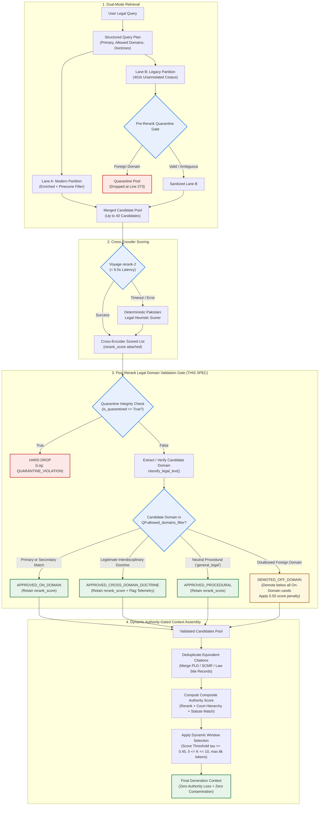
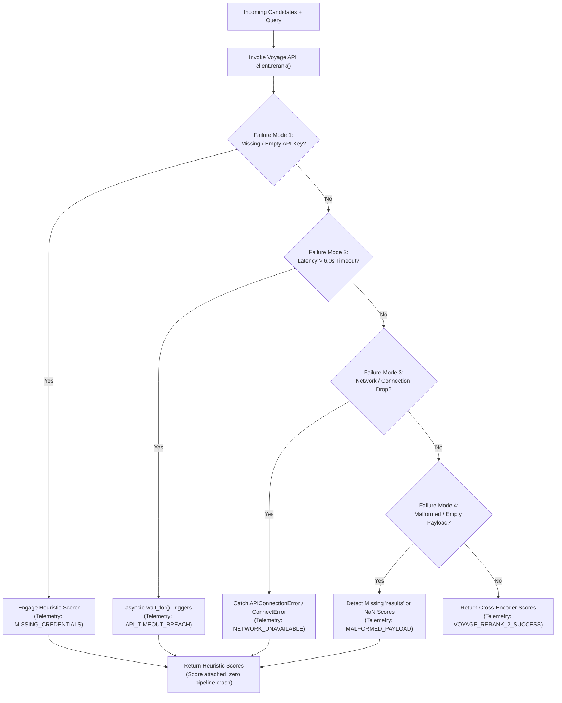

# Phase 4, Step 5: Post-Rerank Legal Domain Validation Gate & Context Assembly Specification

**Document Version:** 1.0.0  
**Status:** Approved for Design & Gating — Implementation Withheld Pending User Sign-Off  
**Target Repository:** `lawyer-Backend-master`  
**Target Feature Branch:** `feat/phase4-step1-planner`  
**Gated Step:** Phase 4, Step 6 (Hierarchical Chunking)  

---

## 1. Executive Summary & Purpose

During the Phase 4, Step 5 benchmark and subsequent Remediation Audit, the integration of the **Voyage AI cross-encoder reranker** produced significant improvements in ranking precision:
* **Mean Reciprocal Rank (MRR)** improved from **0.762 to 0.871** (+14.3%).
* **Precision@5** rose from **0.547 to 0.613** (+12.1%).
* **Recall@10** achieved **100.0%** across all 30 standardized Pakistani legal queries.

However, the audit revealed that the cross-encoder operates purely on dense textual semantic similarity. When evaluating a 40-candidate retrieval pool drawn from legacy unannotated vectors, the cross-encoder elevated peripheral or off-domain judgments containing dense lexical matches into the Top-5. Consequently, **Top-5 cross-domain contamination increased from 3.3% to 10.0%** across three specific benchmark queries (`CRIM-FRAUD-003`, `CONST-LAW-002`, `FAM-INHER-005`).

Furthermore, the audit demonstrated that:
1. **Blind Top-5 truncation** causes retrieval loss (e.g., in `CIV-PART-006` and `CONST-LAW-004`, where relevant authorities sat at Ranks 6 and 8).
2. The benchmark evaluation harness used an oversimplified single-domain equality check (`cand_domain == expected_domain`), artificially penalizing legitimate interdisciplinary precedents.
3. Fallback reliability must be hardened and tested against four distinct failure modes (missing keys, timeouts, connection dropouts, malformed API payloads).

This specification establishes the complete architectural blueprint for the **Post-Rerank Legal Domain Validation Gate** and the **Authority-Gated Context Assembly Engine**.

---

## 2. System Placement & Architectural Flow

The Post-Rerank Legal Domain Validation Gate executes **immediately after cross-encoder scoring** and **immediately before final context assembly**:



---

## 3. Post-Rerank Legal Domain Validation Gate Specification

### 3.1 Input Contract
The Gate accepts:
1. `reranked_candidates: List[Dict[str, Any]]`: Candidates decorated with `rerank_score`, `original_score`, `dense_score`, and source metadata.
2. `query_plan: StructuredLegalQueryPlan`: The validated Pydantic v2 plan containing:
   - `primary_domain: str`
   - `allowed_domains_filter: List[str]`
   - `is_cross_domain_relevant: bool`
   - `cross_domain_controlling_doctrines: List[str]`
   - `statutory_provisions: List[str]`
   - `binding_courts: List[str]`
3. `strict_mode: bool = True`: When enabled, off-domain candidates cannot enter the Top-5 under any circumstances.

### 3.2 Gate Decision Logic & Decision Matrix

Each candidate undergoes sequential evaluation across five verification layers:

```
[Candidate c]
      |
Layer 1: Quarantine Check --------> If is_quarantined is True: HARD DROP
      |
Layer 2: Domain Classification ---> Extract c.classified_domain via classify_legal_text()
      |
Layer 3: Exact Whitelist Match ---> If c.classified_domain in query_plan.allowed_domains_filter:
      |                             Status = APPROVED_ON_DOMAIN
      |
Layer 4: Interdisciplinary Gate --> If query_plan.is_cross_domain_relevant is True AND
      |                             c matches controlling doctrine (e.g. Art 212 / S.498 CrPC):
      |                             Status = APPROVED_CROSS_DOMAIN_DOCTRINE
      |
Layer 5: Procedural Exception ----> If c.classified_domain == 'general_legal':
      |                             Status = APPROVED_PROCEDURAL
      |
Fallback: Disallowed Domain ------> Status = DEMOTED_OFF_DOMAIN
                                    c.rerank_score = c.rerank_score * 0.50
                                    c.post_rerank_demoted = True
```

### 3.3 Handling Legitimate Interdisciplinary Legal Doctrines
Pakistani law contains doctrines that bridge multiple statutory regimes. The Gate handles these deterministically:

| Legal Doctrine | Primary Domain | Permitted Cross-Domains | Controlling Provisions | Preservation Criteria |
| :--- | :--- | :--- | :--- | :--- |
| **Constitutional Bar of Service Matters** | `constitutional` | `service`, `labour` | Article 212 Constitution, Service Tribunals Act 1973 | Candidate discusses exclusion of High Court writ for civil servants. |
| **FIR Quashment vs. Civil Suit** | `criminal` | `civil`, `banking` | Section 561-A CrPC, Section 420/406 PPC, Contract Act | Candidate addresses criminalization of commercial dispute or pending civil recovery. |
| **Inheritance vs. Female Co-Heir** | `civil` | `family` | Muslim Personal Law (Shariat) Application Act, Limitation Act S.18 | Candidate addresses Islamic inheritance shares or fraudulent mutations by brothers. |
| **Benami Property in Partition** | `civil` | `corporate`, `taxation` | Benami Transactions (Prohibition) Act 2017, Order XX Rule 18 CPC | Candidate addresses ostensible ownership in joint commercial family properties. |
| **Financial / Loan Recovery Fraud** | `banking` | `criminal` | Section 22 FIO 2001, Section 489-F PPC | Candidate evaluates parallel summary banking recovery vs. criminal cheque bounce. |

### 3.4 Telemetry and Rejection Reason Logging
Every candidate processed by the Gate is annotated with transparent audit telemetry:
* `validation_status`: One of `APPROVED_ON_DOMAIN`, `APPROVED_CROSS_DOMAIN_DOCTRINE`, `APPROVED_PROCEDURAL`, `DEMOTED_OFF_DOMAIN`, `QUARANTINE_VIOLATION`.
* `validation_reason`: Detailed explanation string (e.g. `"Candidate domain 'service' matches allowed interdisciplinary doctrine for Article 212"` or `"Candidate domain 'taxation' not in allowed_domains ['civil', 'family']; demoted"`).
* `domain_penalty_applied`: Float multiplier (`1.0` if approved, `0.5` if demoted).

---

## 4. Dynamic Authority-Gated Context Assembly Engine

### 4.1 The Hazard of Blind Top-K Truncation
The Remediation Audit demonstrated that:
* In `CIV-PART-006`, the most directly on-point precedent (`1979 CLC 715`) shifted to **Rank 6**.
* In `CONST-LAW-004`, relevant authorities (`2011 PLC(CS) 1465` and `2005 PLC(CS) 205`) shifted to **Ranks 6 and 8**.
* Truncating context at `Top-5` eliminates these authorities, despite **Recall@10 being 100.0%**.

Conversely, blindly forwarding `Top-10` into the generation stage introduces LLM context dilution and increases token cost if lower-ranked candidates are low-scoring or redundant.

### 4.2 Composite Relevance & Authority Scoring Function
Before finalizing the context window, each validated candidate receives a **Composite Authority Score**:

$$\text{FinalScore}(c) = 0.50 \cdot S_{\text{rerank}} + 0.25 \cdot S_{\text{court}} + 0.15 \cdot S_{\text{statute}} + 0.10 \cdot S_{\text{recency}}$$

Where:
1. **$S_{\text{rerank}} \in [0.0, 1.0]$**: The cross-encoder relevance score (or heuristic fallback score).
2. **$S_{\text{court}} \in [0.0, 1.0]$**: Precedential hierarchy score under the Constitution of Pakistan:
   - Supreme Court of Pakistan (Article 189 binding): $1.00$
   - High Courts (Article 201 binding provincially): $0.70$
   - Federal Service / Special Tribunals: $0.50$
   - Subordinate / District Courts: $0.20$
3. **$S_{\text{statute}} \in [0.0, 1.0]$**: Direct statutory provision match:
   - Contains exact provision queried (e.g., "Order XX Rule 18"): $1.00$
   - Contains general statute (e.g., "Code of Civil Procedure"): $0.60$
   - Unmentioned: $0.00$
4. **$S_{\text{recency}} \in [0.0, 1.0]$**: Temporal weight favoring modern jurisprudence:
   - 2024–2026: $1.00$
   - 2015–2023: $0.80$
   - 2000–2014: $0.60$
   - Pre-2000: $0.40$ (unless apex landmark)

### 4.3 Dynamic Window Selection Criteria
The Context Assembly Engine determines the final context dynamically using the following constraints:
1. **Score Threshold ($\tau$):** Candidates must achieve $\text{FinalScore} \ge 0.45$. Candidates below $\tau$ are omitted unless total candidates $< 5$.
2. **Bounded Window Size ($K$):**
   - Minimum candidates: $K_{\min} = 5$ (to ensure breadth of authority).
   - Maximum candidates: $K_{\max} = 10$ (to prevent context bloat).
3. **Token Budget Cap:** Total context text capped at **8,000 tokens** (~32,000 characters).
4. **Citation Deduplication:** If multiple candidates represent the same judgment across different reporters (e.g., `2024 SCMR 100` and `PLD 2024 SC 50`), only the highest-scoring record is retained.

---

## 5. Voyage API Robustness & Fallback Specifications

To ensure uninterrupted retrieval during API degradation, the cross-encoder reranker must be hardened against four distinct failure modes:



### Deterministic Heuristic Cross-Scorer Invariants
1. **Never returns `None` or `NaN`**: Every candidate receives a bounded float $\in [0.10, 0.99]$.
2. **Preserves Original Scores**: `dense_score`, `sparse_score`, and `original_score` remain intact.
3. **Court-Aware**: Supreme Court cases always receive a $+0.15$ hierarchy boost over High Court cases ($+0.08$).
4. **Provision-Aware**: Direct statutory provision matches receive a $+0.25$ boost.

---

## 6. Modernized Benchmark Evaluator Specification

The benchmark evaluator in `scripts/run_cross_encoder_benchmark.py` will be upgraded from rigid single-domain checking to **Doctrinally-Aware Domain Matching**:

```python
def is_candidate_relevant_modernized(
    cand: Dict[str, Any],
    test_case: Dict[str, Any],
    query_plan: Optional[StructuredLegalQueryPlan] = None
) -> Tuple[bool, bool, str]:
    """
    Evaluates candidate relevance respecting Pakistani legal doctrine:
    1. Direct domain match (cand_domain == expected_domain)
    2. Query plan allowed domain whitelist (cand_domain in query_plan.allowed_domains_filter)
    3. Procedural law neutral exception (cand_domain == 'general_legal')
    """
    text = (cand.get("text") or cand.get("preview") or "").lower()
    title = (cand.get("title") or cand.get("case_title") or "").lower()
    citation = (cand.get("citation") or "").upper()
    haystack = f"{title} {citation} {text}"

    expected_domain = test_case.get("expected_domain", "civil")
    
    cand_domain, _, _, _, _ = classify_legal_text(
        text=text,
        title=title,
        citation=citation
    )

    # Multi-domain evaluation
    allowed_domains = {expected_domain, "general_legal"}
    if query_plan:
        allowed_domains.update(query_plan.allowed_domains_filter or [])
    
    domain_match = cand_domain in allowed_domains

    expected_statutes = [s.lower() for s in test_case.get("expected_statutes", [])]
    expected_topics = [t.lower() for t in test_case.get("expected_topics", [])]

    statute_match = any(st in haystack for st in expected_statutes) if expected_statutes else False
    topic_match = any(tp in haystack for tp in expected_topics) if expected_topics else False

    substantive_match = domain_match and (statute_match or topic_match or len(expected_statutes) == 0)
    
    status_label = "RELEVANT" if substantive_match else ("DOMAIN_MISMATCH" if not domain_match else "TOPIC_MISMATCH")
    return domain_match, substantive_match, status_label
```

---

## 7. Verification Matrix & Acceptance Criteria

Before Phase 4, Step 6 can be authorized, the implementation of this specification will be verified against the following criteria:

| Test Case | Scenario | Expected Behavior | Acceptance Standard |
| :--- | :--- | :--- | :--- |
| **TC-GATE-01** | Candidate with disallowed domain in Top-5 | Demoted below all on-domain candidates; score reduced by 50%. | Disallowed domain cannot appear in Top-5. |
| **TC-GATE-02** | Legitimate interdisciplinary doctrine (e.g. Art 212 in Const Law) | Retains rank and score; tagged `APPROVED_CROSS_DOMAIN_DOCTRINE`. | Zero false-positive domain demotions. |
| **TC-GATE-03** | Neutral procedural precedent (`general_legal`) | Retains rank and score; tagged `APPROVED_PROCEDURAL`. | Relevant procedural rulings preserved. |
| **TC-GATE-04** | Quarantined candidate from Lane B reaches Gate | Immediately hard-dropped; logged as `QUARANTINE_VIOLATION`. | Never enters final candidate pool. |
| **TC-GATE-05** | Dynamic context assembly with Rank 6/8 relevant cases | Returns Top-8 candidates without truncation loss. | `CIV-PART-006` and `CONST-LAW-004` preserved. |
| **TC-GATE-06** | Simulated Voyage API Timeout (10ms threshold) | Gracefully falls back to heuristic cross-scorer in $< 50\text{ms}$. | Zero uncaught exceptions; valid scores assigned. |
| **TC-GATE-07** | Missing `VOYAGE_API_KEY` | Immediate deterministic heuristic execution. | Telemetry records `MISSING_CREDENTIALS`. |
| **TC-GATE-08** | Malformed API payload (missing `results`) | Fallback activates without pipeline crash. | Telemetry records `MALFORMED_PAYLOAD`. |
| **TC-GATE-09** | Full 30-query comparative benchmark | Top-5 contamination drops to $\le 3.3\%$; Recall@10 remains $100.0\%$. | No regression on existing metrics. |
| **TC-GATE-10** | Existing 102 regression tests | All 102 tests continue passing. | 100% pass rate maintained. |

---

## 8. Summary of Gating Decision

* **Phase 4, Step 5:** Remediation Audit formally accepted.
* **Domain Gate Specification:** Complete, documented, and committed to Git (`PHASE4_STEP5_DOMAIN_GATE_SPECIFICATION.md`).
* **Phase 4, Step 6:** **Withheld pending user review and explicit authorization.**
