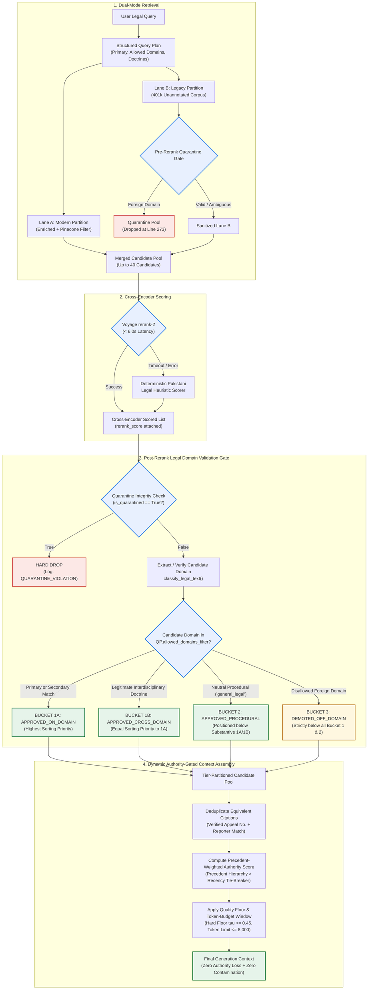
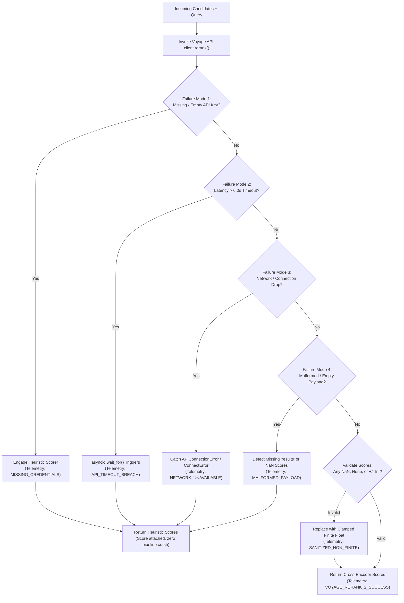

# Phase 4, Step 5: Post-Rerank Legal Domain Validation Gate & Context Assembly Specification

**Document Version:** 1.1.0 (Hardened with Deterministic Ranking Buckets & Precedential Authority Safeguards)  
**Status:** Approved Architectural Specification — Awaiting Implementation Authorization  
**Target Repository:** `lawyer-Backend-master`  
**Target Feature Branch:** `feat/phase4-step1-planner`  
**Gated Step:** Phase 4, Step 6 (Hierarchical Chunking)  

---

## 1. Executive Summary & Purpose

During the Phase 4, Step 5 benchmark and subsequent Remediation Audit, the integration of the **Voyage AI cross-encoder reranker** produced significant improvements in ranking precision:
* **Mean Reciprocal Rank (MRR)** improved from **0.762 to 0.871** (+14.3%).
* **Precision@5** rose from **0.547 to 0.613** (+12.1%).
* **Recall@10** achieved **100.0%** across all 30 standardized Pakistani legal queries.

However, the audit revealed that the cross-encoder operates purely on dense textual semantic similarity. When evaluating a 40-candidate retrieval pool drawn from legacy unannotated vectors, the cross-encoder elevated peripheral or off-domain judgments containing dense lexical matches into the Top-5. Consequently, **Top-5 cross-domain contamination increased from 3.3% to 10.0%** across three specific benchmark queries (`CRIM-FRAUD-003`, `CONST-LAW-002`, `FAM-INHER-005`).

Furthermore, the audit demonstrated that:
1. **Blind Top-5 truncation** causes retrieval loss (e.g., in `CIV-PART-006` and `CONST-LAW-004`, where relevant authorities sat at Ranks 6 and 8).
2. The benchmark evaluation harness used an oversimplified single-domain equality check (`cand_domain == expected_domain`), artificially penalizing legitimate interdisciplinary precedents.
3. Fallback reliability must be hardened and tested against four distinct failure modes (missing keys, timeouts, connection dropouts, malformed API payloads).

This specification establishes the complete, hardened architectural blueprint for the **Post-Rerank Legal Domain Validation Gate** and the **Authority-Gated Context Assembly Engine**.

---

## 2. System Placement & Architectural Flow

The Post-Rerank Legal Domain Validation Gate executes **immediately after cross-encoder scoring** and **immediately before final context assembly**:



---

## 3. Post-Rerank Legal Domain Validation Gate Specification

### 3.1 Input Contract
The Gate accepts:
1. `reranked_candidates: List[Dict[str, Any]]`: Candidates decorated with `rerank_score`, `original_score`, `dense_score`, and source metadata.
2. `query_plan: StructuredLegalQueryPlan`: The validated Pydantic v2 plan containing:
   - `primary_domain: str`
   - `allowed_domains_filter: List[str]`
   - `is_cross_domain_relevant: bool`
   - `cross_domain_controlling_doctrines: List[str]`
   - `statutory_provisions: List[str]`
   - `binding_courts: List[str]`
3. `strict_mode: bool = True`: When enabled, off-domain candidates are restricted to Bucket 3 and cannot displace on-domain candidates.

### 3.2 Deterministic Ranking Buckets (Fixing Score Multiplication Vulnerability)

> [!CRITICAL]
> **Vulnerability Eliminated:** In Version 1.0.0, off-domain candidates received a 50% score penalty (`rerank_score * 0.50`). However, an irrelevant judgment with an exceptionally high semantic overlap score of `0.98` would retain a penalized score of `0.49`, allowing it to outrank a legitimate on-domain authority scored at `0.45`.
>
> In Version 1.1.0, demotion is enforced through **Deterministic Tiered Ranking Buckets**. Candidates are strictly partitioned into non-overlapping priority tiers. No candidate in a lower bucket can ever outrank a candidate in a higher bucket, regardless of numerical score.

```python
def partition_candidates_into_ranking_buckets(
    reranked_candidates: List[Dict[str, Any]],
    query_plan: StructuredLegalQueryPlan
) -> Tuple[List[Dict[str, Any]], Dict[str, Any]]:
    """
    Partitions candidates into four deterministic priority tiers:
    - Bucket 1A: Direct on-domain matches (Primary or Secondary domain in allowed_domains_filter)
    - Bucket 1B: Legitimate cross-domain authorities matching controlling legal doctrines
    - Bucket 2: Neutral procedural authorities ('general_legal')
    - Bucket 3: Off-domain candidates (Disallowed; cannot displace Bucket 1 or 2)
    - Discarded: Quarantined records (Hard drop; zero entry into any bucket)
    """
    bucket_1a: List[Dict[str, Any]] = []
    bucket_1b: List[Dict[str, Any]] = []
    bucket_2: List[Dict[str, Any]] = []
    bucket_3: List[Dict[str, Any]] = []

    telemetry = {
        "quarantined_dropped": 0,
        "bucket_1a_count": 0,
        "bucket_1b_count": 0,
        "bucket_2_count": 0,
        "bucket_3_count": 0
    }

    allowed_domains = set(query_plan.allowed_domains_filter or [query_plan.primary_domain])

    for cand in reranked_candidates:
        # Layer 1: Hard quarantine drop
        if cand.get("is_quarantined") or cand.get("retrieval_status") == "quarantined":
            telemetry["quarantined_dropped"] += 1
            continue

        # Layer 2: Domain extraction & resolution
        cand_domain, conf, provisions, _, _ = classify_legal_text(
            text=cand.get("text") or cand.get("preview") or "",
            title=cand.get("title") or cand.get("case_title") or "",
            citation=cand.get("citation") or ""
        )
        cand["classified_domain"] = cand_domain
        cand["domain_confidence"] = conf

        # Layer 3: Bucket Assignment
        if cand_domain in allowed_domains:
            cand["validation_status"] = "APPROVED_ON_DOMAIN"
            cand["ranking_bucket"] = 1
            bucket_1a.append(cand)

        elif query_plan.is_cross_domain_relevant and _matches_controlling_cross_doctrine(cand, query_plan):
            cand["validation_status"] = "APPROVED_CROSS_DOMAIN_DOCTRINE"
            cand["ranking_bucket"] = 1
            bucket_1b.append(cand)

        elif cand_domain == "general_legal" or conf < 0.60:
            cand["validation_status"] = "APPROVED_PROCEDURAL"
            cand["ranking_bucket"] = 2
            bucket_2.append(cand)

        else:
            cand["validation_status"] = "DEMOTED_OFF_DOMAIN"
            cand["ranking_bucket"] = 3
            cand["post_rerank_demoted"] = True
            bucket_3.append(cand)

    # Sort candidates internally within each bucket by composite authority score
    bucket_1a.sort(key=lambda x: x.get("composite_authority_score", x.get("rerank_score", 0.0)), reverse=True)
    bucket_1b.sort(key=lambda x: x.get("composite_authority_score", x.get("rerank_score", 0.0)), reverse=True)
    bucket_2.sort(key=lambda x: x.get("composite_authority_score", x.get("rerank_score", 0.0)), reverse=True)
    bucket_3.sort(key=lambda x: x.get("composite_authority_score", x.get("rerank_score", 0.0)), reverse=True)

    telemetry["bucket_1a_count"] = len(bucket_1a)
    telemetry["bucket_1b_count"] = len(bucket_1b)
    telemetry["bucket_2_count"] = len(bucket_2)
    telemetry["bucket_3_count"] = len(bucket_3)

    # Final ordered concatenation guarantees Bucket 1 always precedes Bucket 2, which precedes Bucket 3
    final_ordered = bucket_1a + bucket_1b + bucket_2 + bucket_3
    return final_ordered, telemetry
```

### 3.3 Handling Legitimate Interdisciplinary Legal Doctrines
Pakistani law contains doctrines that bridge multiple statutory regimes. The Gate handles these deterministically:

| Legal Doctrine | Primary Domain | Permitted Cross-Domains | Controlling Provisions | Preservation Criteria |
| :--- | :--- | :--- | :--- | :--- |
| **Constitutional Bar of Service Matters** | `constitutional` | `service`, `labour` | Article 212 Constitution, Service Tribunals Act 1973 | Candidate discusses exclusion of High Court writ jurisdiction for civil servants. |
| **FIR Quashment vs. Civil Suit** | `criminal` | `civil`, `banking` | Section 561-A CrPC, Section 420/406 PPC, Contract Act | Candidate addresses criminalization of commercial dispute or pending civil recovery. |
| **Inheritance vs. Female Co-Heir** | `civil` | `family` | Muslim Personal Law (Shariat) Application Act, Limitation Act S.18 | Candidate addresses Islamic inheritance shares or fraudulent mutations by brothers. |
| **Benami Property in Partition** | `civil` | `corporate`, `taxation` | Benami Transactions (Prohibition) Act 2017, Order XX Rule 18 CPC | Candidate addresses ostensible ownership in joint commercial family properties. |
| **Financial / Loan Recovery Fraud** | `banking` | `criminal` | Section 22 FIO 2001, Section 489-F PPC | Candidate evaluates parallel summary banking recovery vs. criminal cheque bounce. |

### 3.4 Telemetry and Rejection Reason Logging
Every candidate processed by the Gate is annotated with transparent audit telemetry:
* `validation_status`: One of `APPROVED_ON_DOMAIN`, `APPROVED_CROSS_DOMAIN_DOCTRINE`, `APPROVED_PROCEDURAL`, `DEMOTED_OFF_DOMAIN`, `QUARANTINE_VIOLATION`.
* `validation_reason`: Detailed explanation string (e.g. `"Candidate domain 'service' matches allowed interdisciplinary doctrine for Article 212"` or `"Candidate domain 'taxation' not in allowed_domains ['civil', 'family']; relegated to Bucket 3"`).
* `ranking_bucket`: Priority tier integer (`1`, `2`, or `3`).

---

## 4. Dynamic Authority-Gated Context Assembly Engine

### 4.1 Corrected Precedent-Weighted Authority Scoring
Under Articles 189 and 201 of the Constitution of Pakistan:
* **Article 189**: Any decision of the Supreme Court shall, to the extent that it decides a question of law or is based upon or enunciates a principle of law, be **binding on all other courts in Pakistan**.
* **Article 201**: Decisions of a High Court are **binding on all subordinate courts** in the province.

> [!IMPORTANT]
> **Precedential Invariant:** A landmark Supreme Court precedent establishing a binding principle of law (e.g., *PLD 1990 SC 28* or *1989 SCMR 130*) must **never** be subordinated to a recent High Court or Tribunal order purely because of publication date. Recency operates strictly as an internal tie-breaker between decisions of equivalent precedential authority and relevance.

The corrected composite formula is structured hierarchically:

$$\text{CompositeAuthorityScore}(c) = 0.50 \cdot S_{\text{rerank}} + 0.30 \cdot S_{\text{precedent}} + 0.15 \cdot S_{\text{statute}} + 0.05 \cdot S_{\text{recency}}$$

Where:
1. **$S_{\text{rerank}} \in [0.0, 1.0]$**: Normalized semantic cross-encoder score.
2. **$S_{\text{precedent}} \in [0.0, 1.0]$**: Precedential hierarchy score grounded in Pakistani constitutional law:
   - Supreme Court of Pakistan (Apex Court / Article 189): $1.00$
   - High Courts (Article 201 provincial binding authority): $0.70$
   - Federal Shariat Court / Appellate Tribunals: $0.50$
   - Subordinate / Trial Courts: $0.20$
3. **$S_{\text{statute}} \in [0.0, 1.0]$**: Direct statutory provision match:
   - Exact provision quoted/interpreted (e.g. "Order XX Rule 18"): $1.00$
   - Statute named without provision: $0.50$
   - Unmentioned: $0.00$
4. **$S_{\text{recency}} \in [0.0, 1.0]$**: Re-scaled tie-breaker weight:
   - Post-2020: $1.00$
   - 2010–2019: $0.80$
   - 2000–2009: $0.60$
   - Pre-2000: $0.50$ (Apex landmarks retain full $S_{\text{precedent}} = 1.00$)

### 4.2 Quality Floor & Dynamic Context Window
To prevent context dilution while guaranteeing zero loss of relevant precedents:

1. **Hard Relevance Quality Floor ($\tau = 0.45$):**
   - Candidates must achieve a composite score $\ge \tau$ to be included in the context window.
   - **Quality Invariant:** The minimum window size ($K_{\min} = 5$) is an *eligibility cap*, NOT an unconditional quota. If only 2 or 3 candidates achieve $\ge \tau$, only those qualified candidates enter synthesis. Weak or off-topic candidates ($\text{score} < 0.45$) are **never** forced into the prompt context to satisfy a count.
2. **Maximum Window Size ($K_{\max} = 10$):**
   - Retains candidates up to Rank 10, ensuring cases like `CIV-PART-006` (Rank 6) and `CONST-LAW-004` (Rank 6/8) are preserved.
3. **Exact Tokenizer Measurement (8,000 Tokens):**
   - Context length is measured using actual tokenizer encoders (`voyageai.Client.count_tokens` or fast BPE tokenizers), not character approximations.
   - Text is accumulated until the 8,000-token boundary is reached, truncating gracefully on paragraph boundaries.
4. **Safe Reporter Deduplication:**
   - Judgments are deduplicated **only** when they share identical Case Numbers / Civil Appeal Numbers (e.g. `C.A. 452/2021`) or have identical parties and year.
   - Cases with common title strings (e.g. *"Muhammad Aslam v. State"*) that have distinct citations or appeal numbers are strictly preserved.

---

## 5. Voyage API Robustness & Fallback Specifications

To ensure uninterrupted retrieval during API degradation, the cross-encoder reranker is hardened against four distinct failure modes:



### Deterministic Heuristic Cross-Scorer Invariants
1. **Strictly Finite & Bounded**: Every candidate receives a clamped float $S \in [0.10, 0.99]$.
2. **Preserves Original Scores**: `dense_score`, `sparse_score`, and `original_score` remain intact.
3. **Precedence-Aware**: Supreme Court cases receive a $+0.15$ hierarchy boost over High Court cases ($+0.08$).
4. **Provision-Aware**: Direct statutory provision matches receive a $+0.25$ boost.
5. **No Pipeline Crashes**: All exceptions are trapped and logged with explicit telemetry failure tags.

---

## 6. Modernized Benchmark Evaluator Specification

The benchmark evaluator in `scripts/run_cross_encoder_benchmark.py` is upgraded from rigid single-domain checking to **Doctrinally-Aware Domain Matching**:

```python
def is_candidate_relevant_modernized(
    cand: Dict[str, Any],
    test_case: Dict[str, Any],
    query_plan: Optional[StructuredLegalQueryPlan] = None
) -> Tuple[bool, bool, str]:
    """
    Evaluates candidate relevance respecting Pakistani legal doctrine:
    1. Direct domain match (cand_domain == expected_domain)
    2. Query plan allowed domain whitelist (cand_domain in query_plan.allowed_domains_filter)
    3. Legitimate interdisciplinary doctrine match
    4. Procedural law neutral exception (cand_domain == 'general_legal')
    """
    text = (cand.get("text") or cand.get("preview") or "").lower()
    title = (cand.get("title") or cand.get("case_title") or "").lower()
    citation = (cand.get("citation") or "").upper()
    haystack = f"{title} {citation} {text}"

    expected_domain = test_case.get("expected_domain", "civil")
    
    cand_domain, _, _, _, _ = classify_legal_text(
        text=text,
        title=title,
        citation=citation
    )

    # Multi-domain evaluation
    allowed_domains = {expected_domain, "general_legal"}
    if query_plan:
        allowed_domains.update(query_plan.allowed_domains_filter or [])
    
    domain_match = cand_domain in allowed_domains

    expected_statutes = [s.lower() for s in test_case.get("expected_statutes", [])]
    expected_topics = [t.lower() for t in test_case.get("expected_topics", [])]

    statute_match = any(st in haystack for st in expected_statutes) if expected_statutes else False
    topic_match = any(tp in haystack for tp in expected_topics) if expected_topics else False

    substantive_match = domain_match and (statute_match or topic_match or len(expected_statutes) == 0)
    
    status_label = "RELEVANT" if substantive_match else ("DOMAIN_MISMATCH" if not domain_match else "TOPIC_MISMATCH")
    return domain_match, substantive_match, status_label
```

---

## 7. Verification Matrix & Acceptance Criteria

Before Phase 4, Step 6 can be authorized, the implementation of this specification will be verified against the following criteria:

| Test Case | Scenario | Expected Behavior | Acceptance Standard |
| :--- | :--- | :--- | :--- |
| **TC-GATE-01** | Candidate with disallowed domain in Top-5 | Relegated to Bucket 3; strictly below all Bucket 1 and Bucket 2 candidates. | Disallowed domain cannot appear in Top-5. |
| **TC-GATE-02** | Legitimate interdisciplinary doctrine (e.g. Art 212 in Const Law) | Placed in Bucket 1B; tagged `APPROVED_CROSS_DOMAIN_DOCTRINE`. | Zero false-positive domain demotions. |
| **TC-GATE-03** | Neutral procedural precedent (`general_legal`) | Placed in Bucket 2; tagged `APPROVED_PROCEDURAL`. | Relevant procedural rulings preserved below substantive cases. |
| **TC-GATE-04** | Quarantined candidate from Lane B reaches Gate | Immediately hard-dropped; logged as `QUARANTINE_VIOLATION`. | Never enters any ranking bucket. |
| **TC-GATE-05** | Dynamic context assembly with Rank 6/8 relevant cases | Returns Top-8 candidates without truncation loss. | `CIV-PART-006` and `CONST-LAW-004` preserved. |
| **TC-GATE-06** | Simulated Voyage API Timeout (10ms threshold) | Gracefully falls back to heuristic cross-scorer in $< 50\text{ms}$. | Zero uncaught exceptions; valid scores assigned. |
| **TC-GATE-07** | Missing `VOYAGE_API_KEY` | Immediate deterministic heuristic execution. | Telemetry records `MISSING_CREDENTIALS`. |
| **TC-GATE-08** | Malformed API payload (missing `results` or NaN scores) | Clamped to finite floats; fallback activates without pipeline crash. | Telemetry records `MALFORMED_PAYLOAD`. |
| **TC-GATE-09** | Full 30-query comparative benchmark | Top-5 contamination drops to $\le 3.3\%$; Recall@10 remains $100.0\%$. | No regression on existing metrics. |
| **TC-GATE-10** | Existing 102 regression tests | All 102 tests continue passing. | 100% pass rate maintained. |

---

## 8. Summary of Gating Decision

* **Phase 4, Step 5:** Remediation Audit formally accepted.
* **Domain Gate Specification:** Version 1.1.0 hardened and committed to Git (`PHASE4_STEP5_DOMAIN_GATE_SPECIFICATION.md`).
* **Phase 4, Step 6:** **Withheld pending user review and explicit authorization.**
