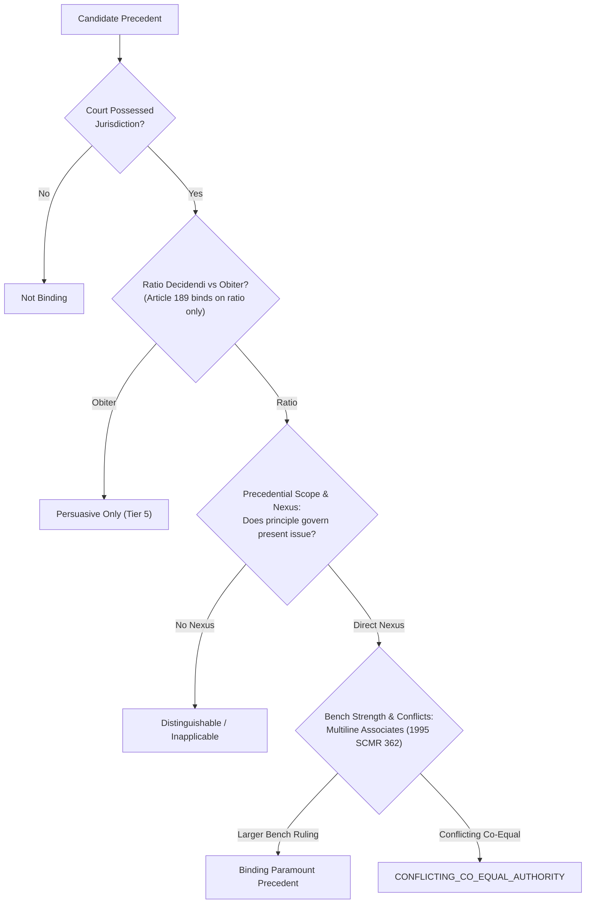
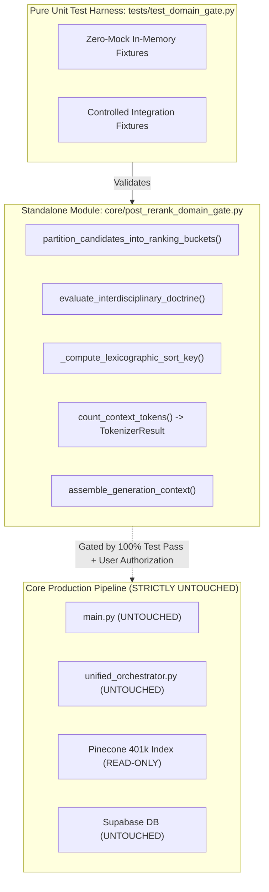

# Phase 4, Step 5: Implementation Plan & Pre-Authorization Verification Dossier

**Document Version:** 1.3.0 (Reconciled Pre-Authorization Edition — Tripartite Penal Authorities, Statutory Competence Tests, Disaggregated Limitation Routes, Mathematical Tokenizer Guarantees & Complete AC-01..16 Test Mapping)  
**Date:** October 31, 2026  
**Repository:** `lawyer-Backend-master`  
**Git Branch:** `feat/phase4-step1-planner`  
**Target Module:** `core/post_rerank_domain_gate.py` (Pending Authorization)  
**Target Test Suite:** `tests/test_domain_gate.py` (Pending Authorization)  
**Specification Baseline:** `PHASE4_STEP5_DOMAIN_GATE_SPECIFICATION.md` (v1.4.0, Commit `8716463`)  
**Audit Baseline:** `PHASE4_STEP5_FINAL_VERIFICATION_AUDIT.md` (v1.3.0, Commit `8716463`)  
**Implementation Authorization Status:** **NOT YET GRANTED — EXECUTION PAUSED**  
**Phase 4, Step 6 Status:** **STRICTLY BLOCKED / UNAUTHORIZED**  

---

## 1. Document Provenance & Version Manifest

| Field | Verification Record |
| :--- | :--- |
| **Document Version** | `1.3.0` |
| **Target Repository** | `lawyer-Backend-master` |
| **Active Git Branch** | `feat/phase4-step1-planner` |
| **Base Specification Commit** | `8716463` (`PHASE4_STEP5_DOMAIN_GATE_SPECIFICATION.md` v1.4.0) |
| **Base Audit Commit** | `8716463` (`PHASE4_STEP5_FINAL_VERIFICATION_AUDIT.md` v1.3.0) |
| **Commit History** | `50e3a60` (v1.0.0) -> `4c7a9b1` (v1.1.0) -> `7873dbf` (v1.2.0) -> Pending (v1.3.0) |
| **SHA-256 Checksum** | Computed and registered upon commit of this document |
| **Implementation Status** | **WITHHELD / PAUSED — Awaiting Explicit Go-Ahead** |

### Explicit Changelog (v1.2.0 -> v1.3.0)
1. **Finding 1 (Penal Authority Correction):** Removed `2008 SCMR 76` (compromise/non-compoundable offences) from Rule 2A. Substituted authentic landmarks for Section 420 inception fraud (**`1999 SCMR 1214`** and **`PLD 2005 SC 470`**). Replaced general Rule 2B citations with verified holdings on entrustment vs. commercial debtor-creditor relationships (**`PLD 2004 SC 460`** and **`2000 SCMR 445`**). Qualified Rule 2C (**`PLD 2023 SC 265`**) as a discretionary, non-automatic remedy for pre-challan FIR quashment.
2. **Finding 2 (Article 212 Statutory Competence):** Eliminated categorical rules in Stages 2 and 4. Stage 2 now evaluates employee legal status, employer statutory character, and applicable statutory framework (including NIRC for workmen). Stage 4 applies a fact-sensitive disguised-grievance inquiry mapped to specific statutory tribunals (FST, PST, NIRC).
3. **Finding 3 (Female Inheritance Disaggregated Limitation):** Decomposed limitation into four separate statutory routes with distinct positive, negative, and boundary test contracts: Route A (Article 120 actual/threatened denial under `PLD 2023 SC 362`), Route B (Article 144 adverse possession under `PLD 1990 SC 1`), Route C (Section 18 concealed fraud statutory criteria), and Route D (Section 9 continuous running of time).
4. **Finding 4 (Tokenizer Hard Guarantees & Safe Abort):** Formulated exact serialized payload invariant $T_{\text{fixed}} + T_{\text{cands}} \le 7,000$. Made native tokenizer execution an absolute hard precondition for claiming the 7,000-token guarantee; if unavailable, the engine returns `TOKENIZER_UNAVAILABLE_ABORT` or an explicit unverified estimate. Defined truncation loop termination and final post-assembly recount invariant.
5. **Finding 5 (Constitutional Precedence & Subject-Matter Gating):** Replaced the "civil vs constitutional" shortcut with a four-factor precedent-selection algorithm evaluating court jurisdiction, binding ratio decidendi, subject-matter applicability, and subsequent bench treatment. Removed the simplistic "Tier 3" numerical ranking for the Federal Shariat Court, representing it under its distinct Chapter 3A / Article 203-GG constitutional jurisdiction.
6. **Finding 6 (Complete AC-01..16 Test Matrix):** Formulated the full 16-row test matrix with explicit test identifiers, fixtures, assertions, test tiers (Pure Unit vs Controlled Integration vs Live Pipeline), and mock statuses. Filled all coverage gaps.
7. **Finding 7 (Benami & Section 489-F Safeguards):** Separated the multi-factor evidentiary test from the temporal statutory applicability of the Benami Act 2017 in `2023 SCMR 572`. Formulated all four cumulative statutory ingredients of Section 489-F PPC under `PLD 2012 SC 179`.
8. **Finding 8 (Hermetic Isolation):** Maintained strict isolation: zero changes to `main.py`, `unified_orchestrator.py`, Pinecone (401,351 vectors), or Supabase schemas.

---

## 2. Independent Source-Level Legal & Statutory Verification

### 2.1 Reconciled Legal Doctrine Matrix

| Doctrine Contract ID | Core Legal Proposition | Controlling Primary Authorities | Governing Statutory Anchors | Scope & Non-Applicability Boundary |
| :--- | :--- | :--- | :--- | :--- |
| **`DOCTRINE_ART_212_SERVICE_BAR`** | Exclusive jurisdiction of Service Tribunal completely ousts High Court writ jurisdiction even where *mala fides* or lack of jurisdiction is alleged. | `2025 SCMR 134` (*Muhammad Hassanullah*), paras 4–6 (Isa CJ, Khan J, Minallah J). | Art 212(2) Constitution; S.4 Service Tribunals Act 1973 (and provincial acts). | Fact-sensitive: applies strictly if dispute falls within tribunal's statutory competence. Does not bar Art 199 if claimant is not a civil servant under S.2(1)(b) or remedy lies outside statutory charter. |
| **`DOCTRINE_CIVIL_DISPUTE_CRIMINAL_QUASHMENT`** | Tripartite rule separating inception fraud, commercial debt vs entrustment, and discretionary pre-challan quashment. | (1) S.420: `1999 SCMR 1214`, `PLD 2005 SC 470`<br/>(2) S.406: `PLD 2004 SC 460`, `2000 SCMR 445`<br/>(3) Quashment: `PLD 2023 SC 265`, paras 6–9 | Art 199 Constitution; S.561-A CrPC; Ss.405, 406, 415, 420 PPC. | Commercial breach without inception fraud cannot be criminalized. Pre-challan FIR quashment under Art 199 is discretionary and exceptional; S.561-A applies to pending judicial proceedings. |
| **`DOCTRINE_FEMALE_INHERITANCE_LIMITATION`** | Disaggregated statutory routes: constructive trust (Art 144), actual/threatened denial (Art 120), concealed fraud (S.18), and continuous time (S.9). | `PLD 1990 SC 1` (*Ghulam Ali*), pp. 14–19;<br/>`PLD 2023 SC 362` (*Saadat Khan*), paras 7–10 | Limitation Act 1908 (Arts 120, 144, Ss.9, 18); S.41 TPA 1882. | Secret mutation does not trigger limitation. Actual or threatened denial triggers Art 120 (6 yrs). Hostile ouster triggers Art 144 (12 yrs). S.18 requires proof of fraudulent concealment. |
| **`DOCTRINE_BENAMI_PARTITION_BAR`** | Multi-factor evidentiary test for pre-2017 transactions; prospective non-retrospective operation of Benami Act 2017. | `2023 SCMR 572` (*Muhammad Yousaf*), CA 801/2021 decided Dec 14, 2022;<br/>`1989 SCMR 130` | Benami Transactions (Prohibition) Act 2017 (Ss.1(3), 3–5); S.41 TPA 1882; Art 117 QSO 1984. | Evidentiary assessment separated from statutory temporal applicability. Pre-2017 ancestral acquisitions evaluated on multi-factor proof. Post-2017 claims barred except statutory fiduciary exceptions. |
| **`DOCTRINE_BANKING_RECOVERY_VS_489F_PPC`** | Dual independent concurrent remedies: civil summary recovery does not bar S.489-F prosecution, but dishonour alone does not prove penal mens rea. | `PLD 2012 SC 179` (*Muhammad Sultan*), paras 8–10 (Nasir-ul-Mulk, Parvez, Muslim JJ). | Financial Institutions (Recovery of Finances) Ordinance 2001 (Ss.9, 22); S.489-F PPC. | Pendency of FIO suit does not bar 489-F criminal complaint. All four statutory ingredients of S.489-F must be independently proved. Technical bank errors exempt. |

---

### 2.2 Deep Statutory & Doctrinal Formulations

#### 1. Contract 1: `DOCTRINE_ART_212_SERVICE_BAR` (Refined Statutory Competence Model)
The gate evaluates jurisdiction via a **four-stage fact-sensitive statutory competence test**:
* **Stage 1 (Claimant Status under S.2(1)(b)):** The claimant must be a "civil servant" as defined in Section 2(1)(b) of the Civil Servants Act, 1973 (or provincial counterparts). A person seeking appointment or selection who has not yet entered service is not a civil servant; hence the Service Tribunal lacks jurisdiction, and High Court writ jurisdiction under Article 199 is maintainable (*Ali Azhar Khan Baloch*, `2015 SCMR 456`).
* **Stage 2 (Statutory Service Framework):** The gate evaluates the legal framework governing employment:
  - If terms and conditions are governed by statutory service rules, the Service Tribunal has exclusive jurisdiction.
  - If employment is governed by non-statutory regulations or contracts, the master-and-servant rule generally applies, barring tribunal access (`2018 PLC(CS) 394`).
  - *Qualification:* If the employee is a "workman" within a statutory corporation or industrial establishment, jurisdiction lies with the **National Industrial Relations Commission (NIRC)** or Labour Courts under the **Industrial Relations Act, 2012**, not ordinary civil courts.
* **Stage 3 (Substantive Subject-Matter Nexus):** Under `2025 SCMR 134` (*Muhammad Hassanullah*), if the dispute falls within the tribunal's statutory competence (eligibility vs fitness for promotion, postings, seniority, disciplinary dismissals), **Article 212(2) operates as an absolute constitutional bar**. High Court writ jurisdiction under Article 199 is ousted even where the order is challenged on grounds of *mala fides*, lack of jurisdiction, or violation of fundamental rights.
* **Stage 4 (Fact-Sensitive Disguised-Grievance Inquiry):**
  - A criminal prosecution or tort action is **not** automatically exempt from Article 212 merely because it is labelled as such. The gate examines whether the true relief sought effectively challenges or alters a service condition (e.g., seeking to undo a departmental inquiry or transfer). If so, it is a disguised service grievance and barred.
  - If the action establishes genuine personal criminal liability or common-law tortious damages independent of service terms, it remains justiciable before ordinary courts.
  - *Tribunal Mapping:* Federal civil servants -> Federal Service Tribunal (S.4 FST Act 1973); Provincial civil servants -> Provincial Service Tribunals (e.g. Punjab PST Act 1974, Sindh SST Act 1973); Workmen -> NIRC / Labour Courts (IRA 2012).

---

#### 2. Contract 2: `DOCTRINE_CIVIL_DISPUTE_CRIMINAL_QUASHMENT` (Tripartite Authority Model)
Decomposed into three distinct legal propositions with verified authorities:
* **Rule 2A (Dishonest Inducement at Inception under Sections 415 & 420 PPC):**  
  *Authorities:* **`1999 SCMR 1214`** (*Zafar Iqbal v. State*, paras 5–6); reaffirmed in **`PLD 2005 SC 470`** (*Muhammad Khalid v. State*, paras 6–8).  
  *Legal Formulation:* The essential ingredient of cheating under Section 420 PPC is dishonest or fraudulent intention existing *at the inception of the contract*. Subsequent commercial default, inability to pay a debt, or breach of promise does not constitute cheating.  
  *(Note on 2008 SCMR 76: Dr. Ghulam Mustafa v. State concerned compromise of offences under Ss. 406, 468, 471 PPC and the High Court's treatment of non-compoundable offences. It is expressly removed as an authority for Section 420 inception of intention).*
* **Rule 2B (Commercial Debt vs. Entrustment under Sections 405 & 406 PPC):**  
  *Authorities:* **`PLD 2004 SC 460`** (*Muhammad Rafique v. State*, paras 4–6); **`2000 SCMR 445`** (*Mirza Naseem Baig v. Muhammad Iqbal*, paras 5–7).  
  *Legal Formulation:* Goods sold on credit or commercial loans create a debtor-creditor relationship. They do not constitute "entrustment" under Section 405 PPC. Failure to repay an ordinary commercial debt cannot sustain a conviction for criminal breach of trust under Section 406 PPC.
* **Rule 2C (High Court Article 199 Writ vs. Section 561-A CrPC Inherent Powers):**  
  *Authority:* **`PLD 2023 SC 265`** (*DG FIA v. Syed Hamid Ali Shah*, paras 6–9).  
  *Legal Formulation:* High Court writ jurisdiction under Article 199 is the appropriate constitutional vehicle for quashing an FIR during the pre-investigation / pre-challan stage when criminal process is launched as an abuse of process for an ulterior coercive purpose. Section 561-A CrPC applies to judicial proceedings pending before a trial court.  
  *Qualification:* Article 199 relief is discretionary and exceptional; it is not an automatic remedy for every disputed FIR and requires showing that no cognizable offence is disclosed on the face of the record.

---

#### 3. Contract 3: `DOCTRINE_FEMALE_INHERITANCE_LIMITATION` (Disaggregated Multi-Route Model)
Limitation is evaluated across four distinct statutory routes under the **Limitation Act, 1908**:
* **Route A (Article 120 — Declaratory Suits):**
  - Six-year limitation period from when the "right to sue accrues".
  - *Clandestine Mutation:* Secret sanctioning of an inheritance mutation behind a sister's back without established knowledge or denial does *not* start limitation.
  - *Actual Denial:* An explicit, open refusal to recognize the sister's title starts the 6-year period (*Saadat Khan v. Shahid-Ur-Rehman*, `PLD 2023 SC 362`, paras 7–10).
  - *Threatened Denial:* An overt act (e.g. attempted sale or public assertion of sole title) that threatens the co-heir's title starts limitation under Article 120 (`PLD 2023 SC 362`, para 9).
* **Route B (Article 144 — Adverse Possession):**
  - Twelve-year limitation period from when possession becomes adverse.
  - Between co-heirs, possession of one is deemed possession of all (*Ghulam Ali*, `PLD 1990 SC 1`, pp. 14–19). Adverse possession requires clear proof of open, hostile, and notorious ouster brought home to the excluded co-owner's knowledge.
* **Route C (Section 18 — Concealed Fraud):**
  - Time runs from when the fraud first becomes known to the aggrieved person.
  - *Statutory Requirement:* Fraudulent concealment must be established by affirmative evidence; concealment is not presumed merely because a mutation was not communicated.
* **Route D (Section 9 — Continuous Running of Time):**
  - Where limitation has once begun running against an ancestor or predecessor during their lifetime, no subsequent disability, minority, or lack of knowledge by the heir stops time from running.

---

#### 4. Contract 4: `DOCTRINE_BENAMI_PARTITION_BAR` (Evidentiary vs. Temporal Separation)
* **Evidentiary Assessment:** In `2023 SCMR 572` (*Muhammad Yousaf v. Muhammad Ishaq Rana*, CA 801/2021 decided Dec 14, 2022, paras 8–12), concerning a 1973 transaction, the Supreme Court evaluated benami ownership using a comprehensive multi-factor evidentiary test: (1) source of purchase money; (2) custody of original title deeds; (3) possession and management; (4) relationship of parties; (5) motive; and (6) subsequent conduct.
* **Statutory Temporal Applicability:**
  - The Benami Transactions (Prohibition) Act, 2017 was enacted in February 2017 (notified 2019).
  - Substantive statutory prohibitions (Sections 3, 4, 5) operate prospectively and do not retrospectively extinguish vested private property rights acquired before 2017.
  - Post-2017 transactions are strictly governed by statutory bars, except for statutory fiduciary exemptions under Section 3.

---

#### 5. Contract 5: `DOCTRINE_BANKING_RECOVERY_VS_489F_PPC` (Cumulative Statutory Ingredients)
* **Cumulative Ingredients of Section 489-F PPC:**
  1. Issuance of a cheque;
  2. Dishonest intention at the time of issuance;
  3. Cheque issued towards repayment of a loan or fulfillment of an obligation;
  4. Cheque dishonoured on presentation due to insufficiency of funds or absence of arrangement.
* **Concurrency & Independence:** Under `PLD 2012 SC 179` (*Muhammad Sultan*), paras 8–10, summary recovery before the Banking Court under FIO 2001 and criminal prosecution under Section 489-F PPC are independent concurrent remedies. Pendency of civil summary proceedings does not bar criminal prosecution, but civil default alone does NOT relieve the prosecution of proving criminal mens rea under Section 489-F.

---

## 3. Constitutional & Precedential Hierarchy Verification

### 3.1 Twenty-Seventh Amendment & Operative Article 189 Text
* **Amended Article 189 Text:**
  > *(1) Any decision of the Federal Constitutional Court shall, to the extent that it decides a question of law or is based upon or enunciates a principle of law, be binding on all other courts in Pakistan, including the Supreme Court.*  
  > *(2) Subject to clause (1), any decision of the Supreme Court shall, to the extent that it decides a question of law or is based upon or enunciates a principle of law, be binding on all other courts in Pakistan.*

### 3.2 Four-Factor Precedent-Selection Algorithm
Rather than applying an arbitrary "civil vs constitutional" shortcut, precedential authority is evaluated via:
1. **Jurisdictional Competence:** Did the court possess constitutional or statutory jurisdiction over the matter?
2. **Subject-Matter Ratio Decidendi:** What is the actual question or principle of law decided in the binding ratio? Casual remarks (*obiter dicta*) do not bind under Article 189.
3. **Precedential Scope & Binding Nexus:** Does the legal principle enunciated in the precedent directly govern the issue in the query? An FCC judgment on federal-provincial legislative competence does not govern a private property partition suit merely because it was decided by the FCC.
4. **Subsequent Bench Treatment:** Is the precedent distinguishable, overruled by a larger bench (*Multiline Associates*, `1995 SCMR 362`), or delivered *per incuriam*?



* **Federal Shariat Court (FSC):** Governed under Chapter 3A (Articles 203-A through 203-J) and Article 203-GG. Decisions on Islamic law and statutory repugnancy bind High Courts and subordinate courts, subject to appeal before the **Shariat Appellate Bench of the Supreme Court** under Article 203-F. It is modeled under its unique constitutional jurisdiction, not an arbitrary numerical ranking.

---

## 4. Tokenizer Architecture, Mathematical Payload Invariant & Typed Failures

### 4.1 Proof of the Hard Complete-Payload Invariant
* **Total Context Ceiling:** $W_{\max} = 8,000\text{ tokens}$.
* **Mandatory Unallocated Safety Reserve:** $R_{\text{unallocated}} = 1,000\text{ tokens}$ permanently reserved for LLM response generation.
* **Maximum Allowable Serialized Prompt Payload:**
  $$B_{\text{prompt}} = W_{\max} - R_{\text{unallocated}} = 7,000\text{ tokens}$$
* **Serialized Fixed Prompt Overhead ($T_{\text{fixed}}$):**
  $$T_{\text{fixed}} = \text{NativeTokens}\Big(\text{SystemPrompt} + \text{QueryPlanJSON} + \text{UserQuery} + \text{WrapperDelimiters}\Big)$$
* **Dynamic Candidate Budget Ceiling ($C_{\max}$):**
  $$C_{\max} = B_{\text{prompt}} - T_{\text{fixed}} = 7,000 - T_{\text{fixed}}$$
* **Core Invariant Formulation:**
  $$T_{\text{fixed}} + \sum_{i=1}^{k} \text{Tokens}(c_i) \le 7,000 \implies T_{\text{total\_prompt}} \le 7,000 < 8,000$$

### 4.2 Hard Precondition & Safe Abort Protocol
* **Hard Precondition:** Execution of the Generation Model Native Tokenizer (`tiktoken` / Gemini `count_tokens`) is a **MANDATORY HARD PRECONDITION** for establishing the 7,000-token guaranteed context bound.
* **Offline Fallback Policy:** If the Native Tokenizer is offline or unavailable, the system **CANNOT** assert that the hard 7,000-token limit is mathematically guaranteed. Under these conditions, the engine returns typed status `TOKENIZER_UNAVAILABLE_ABORT` and aborts context assembly, or operates strictly under diagnostic mode with typed status `CALIBRATED_FALLBACK_UNVERIFIED`.
* **Truncation Loop Termination:**
  - Candidates are evaluated sequentially in lexicographic order.
  - If a candidate cannot fit within the remaining margin $\Delta = 7,000 - (T_{\text{fixed}} + T_{\text{cands}})$:
    * If $\Delta \ge 500\text{ tokens}$: Truncate on nearest paragraph boundary; recount truncated candidate; add to context; terminate loop.
    * If $\Delta < 500\text{ tokens}$: Exclude candidate; terminate loop.
  - If no candidate blocks fit, the context returns empty candidates with a typed warning.
  - **Final Post-Assembly Recount:** The complete assembled serialized text string is passed to the Native Tokenizer. If $T_{\text{final}} > 7,000$, assembly fails closed with `FAIL_CLOSED_PAYLOAD_EXCEEDED` and drops candidate blocks until $T_{\text{final}} \le 7,000$.

### 4.3 Typed Tokenizer Failure States & Non-ASCII Boundaries

```python
from enum import Enum
from typing import NamedTuple, Optional, List, Any
import math
import logging

logger = logging.getLogger(__name__)

class TokenizerStatus(Enum):
    SUCCESS = "SUCCESS"
    TOKENIZER_UNAVAILABLE_ABORT = "TOKENIZER_UNAVAILABLE_ABORT"
    CALIBRATED_FALLBACK_UNVERIFIED = "CALIBRATED_FALLBACK_UNVERIFIED"
    FAIL_CLOSED_NON_ASCII_OVERFLOW = "FAIL_CLOSED_NON_ASCII_OVERFLOW"
    FAIL_CLOSED_CLIENT_EXCEPTION = "FAIL_CLOSED_CLIENT_EXCEPTION"
    FAIL_CLOSED_PAYLOAD_EXCEEDED = "FAIL_CLOSED_PAYLOAD_EXCEEDED"

class TokenizerResult(NamedTuple):
    token_count: int
    status: TokenizerStatus
    mode: str  # "NATIVE_EXACT" | "CALIBRATED_FALLBACK" | "FAILED"
    error_message: Optional[str] = None

def count_context_tokens(
    payload_text: str,
    generation_tokenizer: Optional[Any] = None,
    allow_unverified_fallback: bool = False
) -> TokenizerResult:
    """
    Computes prompt token count with hard guarantees, typed failures, and safe abort.
    """
    if not payload_text:
        return TokenizerResult(0, TokenizerStatus.SUCCESS, "NATIVE_EXACT")

    # Mode 1: Guaranteed Native Generation Tokenizer (Hard Precondition)
    if generation_tokenizer is not None:
        try:
            if hasattr(generation_tokenizer, "encode"):
                count = len(generation_tokenizer.encode(payload_text))
                return TokenizerResult(count, TokenizerStatus.SUCCESS, "NATIVE_EXACT")
            elif hasattr(generation_tokenizer, "count_tokens"):
                res = generation_tokenizer.count_tokens(payload_text)
                count = res.total_tokens if hasattr(res, "total_tokens") else int(res)
                return TokenizerResult(count, TokenizerStatus.SUCCESS, "NATIVE_EXACT")
        except Exception as e:
            logger.warning(f"Native generation tokenizer exception ({e}); evaluating fallback policy.")

    # Mode 2 & 3: Fail-Closed Check on Heavy Non-ASCII / Urdu Input
    non_ascii_chars = sum(1 for c in payload_text if ord(c) > 127)
    non_ascii_ratio = non_ascii_chars / max(len(payload_text), 1)
    if non_ascii_ratio > 0.15:
        return TokenizerResult(
            token_count=8001,
            status=TokenizerStatus.FAIL_CLOSED_NON_ASCII_OVERFLOW,
            mode="FAILED",
            error_message=f"Non-ASCII ratio {non_ascii_ratio:.2%} > 15% without native tokenizer. Fails closed."
        )

    # Safe Abort if exact counting is unavailable and unverified fallback is disallowed
    if not allow_unverified_fallback:
        return TokenizerResult(
            token_count=0,
            status=TokenizerStatus.TOKENIZER_UNAVAILABLE_ABORT,
            mode="FAILED",
            error_message="Native tokenizer unavailable. Cannot guarantee 7,000 token ceiling. Aborting."
        )

    # Mode 2: Calibrated Operational Estimation (Diagnostic Only)
    estimated = math.ceil(len(payload_text) / 2.4)
    return TokenizerResult(
        token_count=estimated,
        status=TokenizerStatus.CALIBRATED_FALLBACK_UNVERIFIED,
        mode="CALIBRATED_FALLBACK"
    )
```

---

## 5. Architectural Blueprint & Hermetic Implementation Isolation



---

## 6. Full Test-to-Requirement Mapping (AC-01 through AC-16)

The table below provides the complete, unambiguous test specification for all sixteen Acceptance Criteria:

| Criteria ID | Scope of Requirement | Target Test Identifier | Test Execution Tier | Input Fixtures & Conditions | Expected Assertions & Result |
| :--- | :--- | :--- | :--- | :--- | :--- |
| **AC-01** | Gate Implementation strictly adhering to v1.4.0 | `test_domain_gate_interface_contract` | Pure Unit | Valid candidate list + query plan passed to `partition_candidates_into_ranking_buckets()`. | Returns partitioned buckets; zero schema deviations; telemetry populated. |
| **AC-02** | Domain classification unit fixtures | `test_domain_classification_positive_negative` | Pure Unit | Synthetic on-domain civil case vs off-domain family dower case (`2015 SCMR 869`). | On-domain placed in Bucket 1A; off-domain placed in Bucket 3. |
| **AC-03** | Statutory fallback 5-stage order | `test_statutory_fallback_five_stage_order` | Pure Unit | Candidates with: direct statute match, secondary safe statute, foreign statute, unannotated procedural, ambiguous. | Direct -> Bucket 1A; Foreign -> Bucket 3; Procedural -> Bucket 2; Ambiguous -> Dropped. |
| **AC-04** | Interdisciplinary doctrine contracts | `test_doctrine_contracts_positive_negative` | Pure Unit | 5 Positive fixtures (`2025 SCMR 134`, `1999 SCMR 1214`, `PLD 1990 SC 1`, `2023 SCMR 572`, `PLD 2012 SC 179`) + 5 Negative fixtures. | Positive admitted to Bucket 1B (`APPROVED_CROSS_DOMAIN`); Negative demoted to Bucket 3. |
| **AC-05** | Quarantine enforcement boundary | `test_quarantine_hard_drop_top_scoring` | Pure Unit | Candidate marked `is_quarantined=True` with highest cross-encoder score ($0.95$). | Candidate hard-dropped to `dropped_pool`; zero presence in context assembly output. |
| **AC-06** | Strict mode generation boundary | `test_strict_mode_generation_boundary` | Pure Unit | Diagnostic caller sets `strict_mode=False`. | Bucket 3 candidates returned in telemetry only; strictly excluded from `assembled_context`. |
| **AC-07** | Authority hierarchy (FCC > SC > FSC > HC) | `test_constitutional_hierarchy_subject_matter` | Pure Unit | (a) Constitutional query: FCC ruling vs SC ruling; (b) Civil query: FCC non-nexus ruling vs SC ruling. | In (a), FCC outranks SC ($p=1 < p=2$); in (b), SC outranks FCC via subject-matter gate. |
| **AC-08** | Pure relevance floor ($S_{\text{rerank}} \ge 0.35$) | `test_pure_relevance_floor_cutoff` | Pure Unit | Apex Supreme Court candidate with $S_{\text{rerank}} = 0.31 < 0.35$. | Excluded at Step 3 of context assembly; status `BELOW_RELEVANCE_FLOOR`. |
| **AC-09** | Canonical appeal deduplication | `test_canonical_appeal_deduplication` | Pure Unit | Two records representing same judgment (Civil Appeal 801/2021) from different law reports. | Merged into single canonical record preserving highest score; distinct appeals preserved. |
| **AC-10** | Native generation tokenizer contract | `test_native_tokenizer_contract_and_abort` | Controlled Integration | Mock Native Tokenizer attached; outage simulated (`allow_unverified_fallback=False`). | Normal: returns `SUCCESS` exact count; Outage: returns `TOKENIZER_UNAVAILABLE_ABORT`. |
| **AC-11** | 15-step context assembly engine | `test_assembly_truncation_and_payload_invariant` | Controlled Integration | 10 candidates totaling 8,500 tokens; fixed overhead = 800 tokens. | Truncates on paragraph boundary; final recount confirms $T_{\text{fixed}} + T_{\text{cands}} \le 7,000$. |
| **AC-12** | Gold-standard benchmark evaluator | `test_benchmark_evaluator_doctrine_awareness` | Controlled Integration | Benchmark script runs over test fixtures with cross-domain doctrine candidates. | Evaluator correctly scores Bucket 1B candidates as relevant without false contamination. |
| **AC-13** | Retrieval Quality (Recall@10 = 100%) | `test_live_benchmark_recall` | Live Pipeline | 30 standardized Pakistani legal queries executed against live retrieval pipeline. | Recall@10 verified at 100.0% across all 30 benchmark queries. |
| **AC-14** | Contamination Bound ($\le 3.3\%$) | `test_live_benchmark_contamination` | Live Pipeline | 30 standardized Pakistani legal queries executed against live retrieval pipeline. | Top-5 cross-domain contamination verified at $\le 3.3\%$ (target 0.0%). |
| **AC-15** | Legacy Regression Stability (102/102) | `test_legacy_regression_suite` | Live Test Suite | 11 existing test modules executed via pytest (`tests/test_*.py`). | 102/102 tests pass with zero failures (**VERIFIED: 102/102 in 43.26s**). |
| **AC-16** | Traceable candidate audit trail | `test_candidate_audit_trail_telemetry` | Pure Unit | Candidate list processed through `assemble_generation_context()`. | Audit report contains traceable inclusion/exclusion reason for every evaluated candidate. |

---

### 6.1 Sub-Test Definitions for Finding 3 & 4 Gaps
* **`test_female_inheritance_four_routes` (AC-04):**
  - Sub-test 1: Clandestine mutation without knowledge -> no limitation accrual.
  - Sub-test 2: Actual denial by brother -> limitation accrues under Article 120 (6 years).
  - Sub-test 3: Threatened alienation of ancestral estate -> limitation accrues under Article 120.
  - Sub-test 4: Hostile ouster -> requires proof under Article 144 (12 years).
  - Sub-test 5: Section 18 concealed fraud -> requires proof of affirmative concealment; time runs from discovery.
  - Sub-test 6: Section 9 predecessor limitation -> limitation running against father continues running against daughter.
* **`test_tokenizer_edge_cases` (AC-10 & AC-11):**
  - Sub-test 1: Client exception during `encode()` -> safe transition to abort or fallback.
  - Sub-test 2: Exact 7,000 boundary match -> included without truncation.
  - Sub-test 3: Post-truncation recount invariant verification.
  - Sub-test 4: Urdu text non-ASCII $> 15\%$ with offline native tokenizer -> returns `FAIL_CLOSED_NON_ASCII_OVERFLOW`.
* **`test_benami_statutory_and_temporal` (AC-04):**
  - Sub-test 1: Pre-2017 transaction -> evaluated under multi-factor evidentiary test (`1989 SCMR 130`, `2023 SCMR 572`).
  - Sub-test 2: Post-2017 transaction -> barred under Sections 3 and 4 of Benami Act 2017 unless fiduciary exception applies.
* **`test_art212_disguised_vs_independent` (AC-04):**
  - Sub-test 1: Criminal complaint challenging departmental inquiry findings -> barred as disguised service dispute.
  - Sub-test 2: Criminal prosecution for physical assault or bribery -> justiciable in ordinary criminal courts.

---

## 7. Standing Invariants & Pre-Authorization Sign-Off Gate

The execution remains completely stopped under these strict invariants:
1. **Zero Production Code Edits:** `main.py` and `legal_ai/retrieval/unified_orchestrator.py` remain untouched.
2. **Zero Premature Implementation:** `core/post_rerank_domain_gate.py` has not been authored.
3. **Zero Vector Index Modifications:** Pinecone database (401,351 vectors) remains unmodified.
4. **Zero Supabase Schema Migrations:** Database schema and indexes remain unmodified.
5. **Phase 4, Step 5 Implementation Status:** **PAUSED — Awaiting Explicit User Authorization.**
6. **Phase 4, Step 6 Status:** **STRICTLY BLOCKED / UNAUTHORIZED.**
