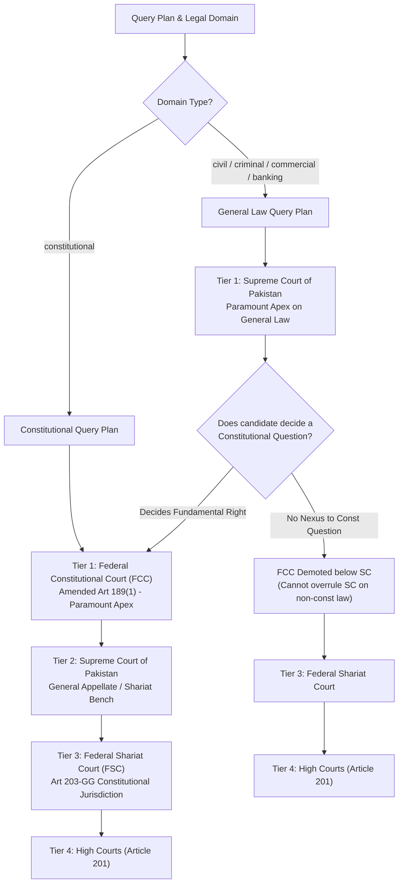
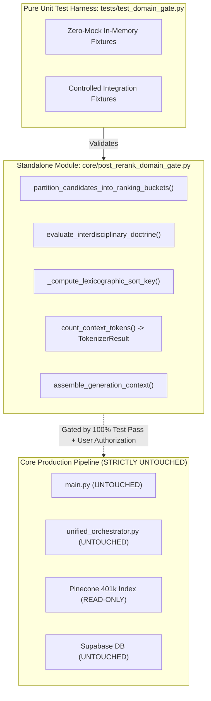

# Phase 4, Step 5: Implementation Plan & Pre-Authorization Verification Dossier

**Document Version:** 1.2.0 (Reconciled Pre-Authorization Edition — Tripartite Penal Authorities, Statutory Competence Tests, Mathematical Payload Invariants & Typed Failure States)  
**Date:** October 31, 2026  
**Repository:** `lawyer-Backend-master`  
**Git Branch:** `feat/phase4-step1-planner`  
**Target Module:** `core/post_rerank_domain_gate.py` (Pending Authorization)  
**Target Test Suite:** `tests/test_domain_gate.py` (Pending Authorization)  
**Specification Baseline:** `PHASE4_STEP5_DOMAIN_GATE_SPECIFICATION.md` (v1.4.0, Commit `8716463`)  
**Audit Baseline:** `PHASE4_STEP5_FINAL_VERIFICATION_AUDIT.md` (v1.3.0, Commit `8716463`)  
**Implementation Authorization Status:** **NOT YET GRANTED — EXECUTION PAUSED**  
**Phase 4, Step 6 Status:** **STRICTLY BLOCKED / UNAUTHORIZED**  

---

## 1. Document Provenance & Version Manifest

To establish complete cryptographic and revision integrity:

| Field | Value / Record |
| :--- | :--- |
| **Document Version** | `1.2.0` |
| **Target Repository** | `lawyer-Backend-master` |
| **Active Git Branch** | `feat/phase4-step1-planner` |
| **Base Specification Commit** | `8716463` (`PHASE4_STEP5_DOMAIN_GATE_SPECIFICATION.md` v1.4.0) |
| **Base Audit Commit** | `8716463` (`PHASE4_STEP5_FINAL_VERIFICATION_AUDIT.md` v1.3.0) |
| **Initial Plan Commit (v1.0.0)** | `50e3a60` (parent `8716463`) |
| **Revision Commit (v1.1.0)** | `4c7a9b1` (parent `50e3a60`) |
| **Reconciled Commit (v1.2.0)** | Pending commit following this document update |
| **Implementation Status** | **WITHHELD / PAUSED — Awaiting Explicit Go-Ahead** |

### Explicit Changelog (v1.0.0 -> v1.1.0 -> v1.2.0)
1. **Finding 1 (Penal Doctrine Separation):** Separated the commercial quashment doctrine into three independent, accurately sourced legal rules: (a) S.415/420 inception fraud (`2008 SCMR 76`, `1999 SCMR 1214`); (b) S.405/406 commercial debt vs entrustment (`PLD 2004 SC 460`, `2000 SCMR 445`); (c) Article 199 vs S.561-A CrPC jurisdictional vehicles (`PLD 2023 SC 265`).
2. **Finding 2 (Article 212 Statutory Competence):** Replaced categorical exceptions with a four-tier statutory subject-matter and jurisdictional competence test under Section 4 Service Tribunals Act 1973 and `2025 SCMR 134`.
3. **Finding 3 (Female Inheritance Limitation):** Disaggregated limitation into six discrete categories under Limitation Act 1908 (clandestine mutation, actual denial, threatened denial, open hostile conduct, Section 18 concealed fraud, and Section 9 predecessor limitation) under `PLD 1990 SC 1` and `PLD 2023 SC 362`.
4. **Finding 4 (Tokenizer Mathematical Invariant & Typed Failures):** Replaced fixed 7,000-candidate allowance with dynamic payload formula $T_{\text{candidates}} \le 7,000 - T_{\text{fixed}}$, introduced typed `TokenizerResult` and `TokenizerStatus` enums, and enforced post-truncation recount invariants.
5. **Finding 5 (Constitutional Subject-Matter Gating):** Enforced subject-matter jurisdictional gating for the Federal Constitutional Court (amended Article 189) and modeled the Federal Shariat Court (Chapter 3A, Article 203-GG) as a distinct specialized constitutional court.
6. **Finding 6 (Executable Test Specifications):** Defined explicit test inputs, execution logic, and expected assertions for all twelve test areas, categorized by execution tier (pure unit vs. controlled integration).
7. **Finding 7 (Benami & Banking Safeguards):** Embedded temporal pre-2017 vs post-2017 statutory analysis before four-factor test application (`2023 SCMR 572`), and separated Section 489-F PPC elements from summary recovery under FIO 2001 (`PLD 2012 SC 179`).
8. **Finding 8 (Hermetic Isolation):** Formally documented isolation boundaries ensuring zero modification to production callers, Pinecone, or Supabase.

---

## 2. Independent Source-Level Legal & Statutory Verification

### 2.1 Reconciled Legal Doctrine Matrix

| Doctrine Contract ID | Core Legal Proposition | Controlling Primary Authorities | Governing Statutory Anchors | Scope & Non-Applicability Boundary |
| :--- | :--- | :--- | :--- | :--- |
| **`DOCTRINE_ART_212_SERVICE_BAR`** | Complete constitutional ouster of High Court writ jurisdiction even where *mala fides* or lack of jurisdiction is alleged. | `2025 SCMR 134` (*Muhammad Hassanullah*), paras 4–6 (Isa CJ, Khan J, Minallah J). | Art 212(2) Constitution; S.4 Service Tribunals Act 1973. | Applies strictly if claimant is a civil servant under S.2(1)(b) Civil Servants Act 1973 and dispute concerns statutory terms and conditions. |
| **`DOCTRINE_CIVIL_DISPUTE_CRIMINAL_QUASHMENT`** | Tripartite rule separating inception fraud, commercial debt, and procedural vehicle for quashment. | (1) S.420: `2008 SCMR 76`, `1999 SCMR 1214`<br/>(2) S.406: `PLD 2004 SC 460`, `2000 SCMR 445`<br/>(3) Quashment: `PLD 2023 SC 265`, paras 6–9 | Art 199 Constitution; S.561-A CrPC; Ss.405, 406, 415, 420 PPC. | Commercial breach without inception fraud cannot be criminalized. Quashing pre-challan FIR lies under Art 199; pending judicial trial lies under S.561-A CrPC. |
| **`DOCTRINE_FEMALE_INHERITANCE_LIMITATION`** | Constructive trusteeship of co-heirs; accrual of right to sue under Article 120 Limitation Act upon actual or threatened denial. | `PLD 1990 SC 1` (*Ghulam Ali*), pp. 14–19;<br/>`PLD 2023 SC 362` (*Saadat Khan*), paras 7–10 | Limitation Act 1908 (Arts 120, 144, Ss.9, 18); S.41 TPA 1882. | Secret mutation does not trigger limitation. Actual denial, threatened denial, or open ouster triggers Art 120 (6 yrs). S.18 fraud requires proof of concealment. |
| **`DOCTRINE_BENAMI_PARTITION_BAR`** | Temporal statutory applicability: prospective operation of Benami Act 2017; pre-2017 vested rights governed by 4-factor test. | `2023 SCMR 572` (*Muhammad Yousaf*), CA 801/2021 decided Dec 14, 2022;<br/>`1989 SCMR 130` | Benami Transactions (Prohibition) Act 2017 (Ss.1(3), 3–5); S.41 TPA 1882; Art 117 QSO 1984. | Act of 2017 applies prospectively. Pre-2017 ancestral acquisitions evaluated on consideration, title custody, possession, and motive. Fiduciary holdings exempt. |
| **`DOCTRINE_BANKING_RECOVERY_VS_489F_PPC`** | Dual independent remedies: summary civil debt recovery does not bar S.489-F prosecution, but dishonour alone does not prove mens rea. | `PLD 2012 SC 179` (*Muhammad Sultan*), paras 8–10 (Nasir-ul-Mulk, Parvez, Muslim JJ). | Financial Institutions (Recovery of Finances) Ordinance 2001 (Ss.9, 22); S.489-F PPC. | Pendency of FIO suit does not bar 489-F criminal complaint. Dishonest intention must exist at cheque issuance. Technical bank errors exempt. |

---

### 2.2 Deep Statutory & Doctrinal Formulations

#### 1. Contract 1: `DOCTRINE_ART_212_SERVICE_BAR` (Statutory Competence Model)
Rather than asserting categorical exceptions, the gate applies a **four-stage statutory competence test**:
1. **Stage 1 (Civil Servant Status):** The claimant must be a "civil servant" as defined in Section 2(1)(b) of the Civil Servants Act, 1973 (or provincial counterparts). A candidate seeking appointment/induction has not yet entered service, is not a civil servant, and cannot invoke the Service Tribunal; hence High Court writ jurisdiction under Article 199 is maintainable (*Ali Azhar Khan Baloch*, `2015 SCMR 456`).
2. **Stage 2 (Statutory Service Rules):** The terms and conditions of employment must be governed by statutory rules. Employees of statutory corporations or banks governed by non-statutory regulations fall under the master-and-servant doctrine, where the Service Tribunal lacks jurisdiction, relegating the claimant to an ordinary civil suit for damages (`2018 PLC(CS) 394`).
3. **Stage 3 (Subject-Matter Nexus):** Under `2025 SCMR 134` (*Muhammad Hassanullah*), if the dispute relates to eligible matters within the tribunal's statutory competence (postings, seniority, disciplinary dismissals, promotions), **Article 212(2) operates as an absolute constitutional bar**. High Court writ jurisdiction under Article 199 is ousted even if the impugned order is challenged as *mala fide*, *ultra vires*, or without jurisdiction.
4. **Stage 4 (Independent Non-Service Causes of Action):** If the matter involves an independent criminal prosecution or private common-law tort, the gate inspects whether the proceeding is a genuine penal/tortious lis or a disguised disciplinary service dispute.

---

#### 2. Contract 2: `DOCTRINE_CIVIL_DISPUTE_CRIMINAL_QUASHMENT` (Tripartite Authority Model)
To eliminate source-fit defects, this doctrine is explicitly decomposed into three distinct legal propositions:
* **Rule 2A (Dishonest Inducement at Inception under Sections 415 & 420 PPC):**  
  *Authority:* **`2008 SCMR 76`** (*Ghulam Mustafa v. State*, Chief Justice Iftikhar Muhammad Chaudhry and Justice M. Javed Buttar), paras 5–7; reaffirmed in **`1999 SCMR 1214`** (*Zafar Iqbal v. State*).  
  *Legal Formulation:* The essential ingredient of an offence under Section 420 PPC is fraudulent or dishonest intention existing *at the time of making the initial promise*. Subsequent inability to perform a contractual commitment or commercial default does not constitute the offence of cheating.
* **Rule 2B (Commercial Debt vs. Entrustment under Sections 405 & 406 PPC):**  
  *Authority:* **`PLD 2004 SC 460`** (*Muhammad Rafique v. State*); **`2000 SCMR 445`**.  
  *Legal Formulation:* A transaction of sale on credit or a commercial loan creates a debtor-creditor relationship. It does not establish fiduciary "entrustment" of property under Section 405 PPC. Failure to repay a debt cannot sustain a conviction for criminal breach of trust under Section 406 PPC.
* **Rule 2C (High Court Article 199 Writ vs. Section 561-A CrPC Inherent Jurisdiction):**  
  *Authority:* **`PLD 2023 SC 265`** (*Director General, FIA v. Syed Hamid Ali Shah*, Justice Syed Mansoor Ali Shah and Justice Ayesha A. Malik), paras 6–9.  
  *Legal Formulation:* High Court writ jurisdiction under Article 199 of the Constitution is the appropriate constitutional remedy to quash an FIR during the pre-investigation / pre-challan stage when criminal law is invoked as an abuse of process to enforce civil obligations. Inherent jurisdiction under Section 561-A CrPC is strictly exercisable over judicial proceedings pending before a criminal court.

---

#### 3. Contract 3: `DOCTRINE_FEMALE_INHERITANCE_LIMITATION` (Disaggregated Limitation Model)
Limitation in female inheritance disputes is evaluated across six discrete statutory conditions under the **Limitation Act, 1908**:
1. **Clandestine Mutation (No Accrual):** A fraudulent inheritance mutation sanctioned in revenue records behind a sister's back without established knowledge or overt exclusion does *not* start limitation.
2. **Actual Denial (Accrual of Cause of Action):** Under **Article 120 of the Limitation Act, 1908** (6-year period), time begins to run when the right to sue accrues. An explicit, unequivocal refusal by the male co-heir to recognize the female co-heir's title constitutes an actual denial that starts the statutory clock (*Saadat Khan v. Shahid-Ur-Rehman*, `PLD 2023 SC 362`, paras 7–10).
3. **Threatened Denial (Accrual on Threat):** Where an overt hostile act (e.g. an attempted sale or public claim of sole ownership) clearly threatens the sister's title, a cause of action accrues under Article 120, requiring institution of suit within 6 years of the threat (`PLD 2023 SC 362`, para 9).
4. **Open Conduct Demonstrating Exclusive Ownership (Article 144):** Under Article 144 (12-year period), adverse possession between co-heirs requires open, hostile, and notorious ouster brought home to the excluded co-sharer's knowledge (*Ghulam Ali*, `PLD 1990 SC 1`, pp. 14–19).
5. **Concealed Fraud (Section 18 Limitation Act):** Where a co-heir is kept from knowledge of the fraud by affirmative concealment, time runs from when the fraud first becomes known. Concealment must be established under statutory standards and is not presumed solely from the fact of non-communication.
6. **Predecessor Limitation (Section 9 Limitation Act):** Where limitation has already commenced running against an ancestor or predecessor during their lifetime, no subsequent disability or lack of knowledge stops time from continuing to run.

---

#### 4. Contract 4: `DOCTRINE_BENAMI_PARTITION_BAR` (Two-Tier Statutory Threshold)
1. **Tier 1 (Temporal Statutory Classification):** The transaction date must be established. Under Sections 1(3) and 3–5 of the Benami Transactions (Prohibition) Act, 2017, the statutory prohibition against claiming benami ownership operates prospectively from the date of statutory notification in 2017 (*Muhammad Yousaf v. Muhammad Ishaq Rana*, `2023 SCMR 572`, CA 801/2021 decided Dec 14, 2022, paras 8–12).
2. **Tier 2 (Pre-2017 Vested Claims):** Ancestral partition disputes concerning property acquired prior to 2017 remain governed by pre-existing civil law and the four-fold criteria of `1989 SCMR 130` (*Muhammad Sadiq v. Mst. Aisha*): (i) source of consideration; (ii) custody of title deeds; (iii) possession/management; and (iv) motive for ostensible arrangement.
3. **Statutory Exceptions:** Property held in a fiduciary capacity by a trustee, partner, or executor is expressly exempted under Section 3 of the 2017 Act.

---

#### 5. Contract 5: `DOCTRINE_BANKING_RECOVERY_VS_489F_PPC` (Independent Remedies & Mens Rea)
1. **Dual Independent Remedies:** Civil recovery proceedings under Financial Institutions (Recovery of Finances) Ordinance 2001 and criminal prosecution under Section 489-F PPC are co-extensive and independent (`PLD 2012 SC 179`, paras 8–10).
2. **Independent Mens Rea Requirement:** The mere dishonour of a cheque or the pendency of a Banking Court summary suit does not automatically establish criminal liability. The prosecution must independently establish dishonest intention at the time of issuing the instrument towards repayment of finance.

---

## 3. Constitutional & Precedential Hierarchy Verification

### 3.1 Twenty-Seventh Amendment & Operative Text of Article 189
Under Pakistan's **Twenty-Seventh Constitutional Amendment**:

* **Amended Article 189 Text:**
  > *(1) Any decision of the Federal Constitutional Court shall, to the extent that it decides a question of law or is based upon or enunciates a principle of law, be binding on all other courts in Pakistan, including the Supreme Court.*  
  > *(2) Subject to clause (1), any decision of the Supreme Court shall, to the extent that it decides a question of law or is based upon or enunciates a principle of law, be binding on all other courts in Pakistan.*

### 3.2 Subject-Matter Jurisdictional Gating Matrix
Precedential authority is evaluated against court jurisdiction, query subject-matter, and binding ratio:



* **Federal Shariat Court (FSC):** Governed under Chapter 3A (Articles 203-A through 203-J) and Article 203-GG. Decisions on Islamic repugnancy bind High Courts and subordinate courts (subject to appeal before the Shariat Appellate Bench of the Supreme Court under Article 203-F). It is formally maintained as a distinct specialized constitutional court (Tier 3).

### 3.3 Co-Equal Bench Rules (*Multiline Associates* & *Mst. Samrana Nawaz*)
* **Bench Strength Hierarchy:** As settled in the Full Bench decision in *Multiline Associates v. Ardeshir Cowasjee* (`1995 SCMR 362`), a larger bench decision strictly overrules or modifies a smaller bench decision.
* **Co-Equal Benches:** Under *Multiline Associates* (`1995 SCMR 362`) and *Mst. Samrana Nawaz* (`PLD 2021 SC 581`), a subsequent co-equal bench cannot depart from or overrule an earlier co-equal decision. Earlier decisions control unless resolved by a larger bench. Conflicting authorities trigger `precedential_conflict_status: CONFLICTING_CO_EQUAL_AUTHORITY`.

---

## 4. Tokenizer Architecture, Mathematical Payload Invariant & Typed Failures

### 4.1 Corrected Complete-Payload Invariant Proof

The context budgeting proof evaluates the entire prompt structure:

* **Maximum Total Model Ceiling:** $W_{\max} = 8,000\text{ tokens}$.
* **Mandatory Unallocated Generation Reserve:** $R_{\text{unallocated}} = 1,000\text{ tokens}$ permanently reserved for generation response output and downstream runtime safety.
* **Maximum Allowable Serialized Prompt Payload:**
  $$B_{\text{prompt}} = W_{\max} - R_{\text{unallocated}} = 7,000\text{ tokens}$$
* **Serialized Fixed Prompt Overhead ($T_{\text{fixed}}$):**
  $$T_{\text{fixed}} = \text{NativeTokens}\Big(\text{SystemPrompt} + \text{QueryPlanJSON} + \text{UserQuery} + \text{Delimiters}\Big)$$
* **Dynamic Candidate Budget Ceiling ($C_{\max}$):**
  $$C_{\max} = B_{\text{prompt}} - T_{\text{fixed}} = 7,000 - T_{\text{fixed}}$$
* **Core Invariant Formulation:**
  $$T_{\text{fixed}} + \sum_{i=1}^{k} \text{Tokens}(c_i) \le 7,000 \implies T_{\text{total\_prompt}} \le 7,000 < 8,000$$

This guarantees that even with extensive system instructions (~400 tokens), structured query plans (~250 tokens), and formatting tags (~350 tokens), the total combined prompt payload never exceeds 7,000 tokens, preserving $\ge 1,000$ tokens unconditionally.

### 4.2 Dynamic Recounting & Paragraph Truncation Protocol
1. Calculate $T_{\text{fixed}}$ over system instructions, query plan, and user query.
2. Initialize candidate accumulator: $T_{\text{cands}} = 0$.
3. For each candidate $c_i$ in lexicographically sorted order:
   - Compute candidate token cost $T(c_i)$.
   - If $T_{\text{fixed}} + T_{\text{cands}} + T(c_i) \le 7,000$: include $c_i$; $T_{\text{cands}} \mathrel{+}= T(c_i)$.
   - Else: compute remaining candidate margin $\Delta = 7,000 - (T_{\text{fixed}} + T_{\text{cands}})$.
     * If $\Delta \ge 500\text{ tokens}$: truncate $c_i$ at nearest paragraph boundary to fit within $\Delta$; recount truncated block via Native Tokenizer; add to context; terminate assembly.
     * If $\Delta < 500\text{ tokens}$: exclude $c_i$; terminate assembly.
4. **Final Post-Assembly Recount:** The complete assembled serialized text string is passed to the Native Tokenizer. If $T_{\text{final}} > 7,000$, assembly fails closed and truncates the lowest-ranked candidate block until $T_{\text{final}} \le 7,000$.

### 4.3 Typed Tokenizer Failure States & Non-ASCII Boundaries

To eliminate fragile synthetic integer returns (e.g. `7001`), the engine enforces structured typed results:

```python
from enum import Enum
from typing import NamedTuple, Optional, List, Any
import math
import logging

logger = logging.getLogger(__name__)

class TokenizerStatus(Enum):
    SUCCESS = "SUCCESS"
    TOKENIZER_OFFLINE_FALLBACK = "TOKENIZER_OFFLINE_FALLBACK"
    FAIL_CLOSED_NON_ASCII_OVERFLOW = "FAIL_CLOSED_NON_ASCII_OVERFLOW"
    FAIL_CLOSED_CLIENT_EXCEPTION = "FAIL_CLOSED_CLIENT_EXCEPTION"
    FAIL_CLOSED_PAYLOAD_EXCEEDED = "FAIL_CLOSED_PAYLOAD_EXCEEDED"

class TokenizerResult(NamedTuple):
    token_count: int
    status: TokenizerStatus
    mode: str  # "NATIVE_EXACT" | "CALIBRATED_FALLBACK" | "FAILED"
    error_message: Optional[str] = None

def count_context_tokens(
    payload_text: str,
    generation_tokenizer: Optional[Any] = None
) -> TokenizerResult:
    """
    Computes token count with typed failure states and fail-closed safety boundaries.
    """
    if not payload_text:
        return TokenizerResult(0, TokenizerStatus.SUCCESS, "NATIVE_EXACT")

    # Mode 1: Guaranteed Native Generation Tokenizer
    if generation_tokenizer is not None:
        try:
            if hasattr(generation_tokenizer, "encode"):
                count = len(generation_tokenizer.encode(payload_text))
                return TokenizerResult(count, TokenizerStatus.SUCCESS, "NATIVE_EXACT")
            elif hasattr(generation_tokenizer, "count_tokens"):
                res = generation_tokenizer.count_tokens(payload_text)
                count = res.total_tokens if hasattr(res, "total_tokens") else int(res)
                return TokenizerResult(count, TokenizerStatus.SUCCESS, "NATIVE_EXACT")
        except Exception as e:
            logger.warning(f"Native generation tokenizer exception ({e}); evaluating fallback eligibility.")

    # Mode 2 & 3: Fail-Closed Check on Heavy Non-ASCII / Urdu Input
    non_ascii_chars = sum(1 for c in payload_text if ord(c) > 127)
    non_ascii_ratio = non_ascii_chars / max(len(payload_text), 1)
    if non_ascii_ratio > 0.15:
        # Heavily non-ASCII / Urdu script compresses unpredictably in BPE; fail closed
        return TokenizerResult(
            token_count=8001,
            status=TokenizerStatus.FAIL_CLOSED_NON_ASCII_OVERFLOW,
            mode="FAILED",
            error_message=f"Non-ASCII ratio {non_ascii_ratio:.2%} > 15% with offline native tokenizer."
        )

    # Mode 2: Calibrated Operational Estimation (Standard English-Pakistani Judicial Prose)
    # 2.4 chars/token with math.ceil prevents fractional token underestimation
    estimated = math.ceil(len(payload_text) / 2.4)
    return TokenizerResult(
        token_count=estimated,
        status=TokenizerStatus.TOKENIZER_OFFLINE_FALLBACK,
        mode="CALIBRATED_FALLBACK"
    )
```

---

## 5. Architectural Blueprint & Hermetic Implementation Isolation

### 5.1 Hermetic Isolation Guarantees
1. **Production Code Untouched:** `main.py` and `legal_ai/retrieval/unified_orchestrator.py` remain **100% untouched** during initial domain gate development and unit testing.
2. **Database Untouched:** Pinecone index (401,351 vectors) and Supabase database tables remain strictly read-only (zero writes, zero schema migrations).
3. **Decoupled Architecture:** `core/post_rerank_domain_gate.py` is authored as a standalone pure-function library.
4. **Isolated Test Harness:** `tests/test_domain_gate.py` executes against local mock/fixture objects with zero external network or database dependencies.



---

## 6. Concrete Executable Test Suite Specifications (`tests/test_domain_gate.py`)

The table below details the twelve executable test contracts, their test execution tier, input fixtures, and expected assertions:

| Test ID | Execution Tier | Test Scenario & Fixture | Input Conditions | Expected Assertion & State |
| :--- | :--- | :--- | :--- | :--- |
| **`test_quarantine_hard_drop`** | Pure Unit | Candidate marked `is_quarantined=True` from Lane B. | Cross-encoder score $0.85$; on-domain civil case. | Hard-dropped to `dropped_pool`; status `QUARANTINE_VIOLATION_DROPPED`; zero presence in output context. |
| **`test_foreign_statute_disqualification`** | Pure Unit | Candidate citing Indian Evidence Act 1872 or Indian CPC. | Criminal query; high semantic score $0.78$. | Demoted to Bucket 3; status `DISALLOWED_FOREIGN_STATUTE`; excluded from strict context. |
| **`test_art212_statutory_competence_positive`** | Pure Unit | Civil servant disciplinary termination (`2025 SCMR 134`). | Writ under Art 199 challenging termination. | Admitted to Bucket 1B (`APPROVED_CROSS_DOMAIN`); doctrine ID `DOCTRINE_ART_212_SERVICE_BAR`. |
| **`test_art212_statutory_competence_exception`** | Pure Unit | Pre-induction recruitment dispute of applicant (`Ali Azhar Khan Baloch`). | Candidate not yet civil servant under S.2(1)(b). | Article 212 ouster does NOT apply; ordinary constitutional writ maintainable. |
| **`test_civil_criminal_quashment_rules`** | Pure Unit | Commercial contract breach with parallel FIR under S.406/420 PPC. | FIR lodged without dishonest intent at inception (`2008 SCMR 76`). | Admitted to Bucket 1B (`APPROVED_CROSS_DOMAIN`); doctrine ID `DOCTRINE_CIVIL_DISPUTE_CRIMINAL_QUASHMENT`. |
| **`test_female_inheritance_limitation_rules`** | Pure Unit | Sister challenging brother's fraudulent mutation after 8 years. | Actual denial occurred 2 years prior (`PLD 2023 SC 362`). | Admitted to Bucket 1B; limitation verified within 6 years of actual denial under Art 120. |
| **`test_benami_temporal_statutory_threshold`** | Controlled Integration | Commercial partition defense claiming benami acquisition in 2012. | Pre-2017 transaction; 4-factor criteria satisfied (`2023 SCMR 572`). | Admitted to Bucket 1B; prospective application of Act of 2017 applied. |
| **`test_banking_recovery_vs_489f_concurrency`** | Pure Unit | Loan recovery suit pending before Banking Court; parallel 489-F FIR. | Dishonored cheque issued for finance repayment (`PLD 2012 SC 179`). | Admitted to Bucket 1B; independent remedies recognized. |
| **`test_constitutional_hierarchy_fcc_and_sc`** | Pure Unit | Pair of candidates: (a) FCC constitutional ruling; (b) SC civil appellate ruling. | Query Domain: (1) `constitutional`; (2) `civil`. | For (1), FCC outranks SC ($p=1 < p=2$); for (2), SC outranks FCC ($p=1 < p=2$) via subject-matter gate. |
| **`test_co_equal_bench_conflict_status`** | Pure Unit | Two 3-member SC benches on identical provision with conflicting holdings. | Bench size = 3; years 2018 vs 2022. | `precedential_conflict_status: CONFLICTING_CO_EQUAL_AUTHORITY`; both retained; recency promotion blocked. |
| **`test_complete_payload_budget_and_reserve`** | Controlled Integration | 10 candidates totaling 8,500 tokens; fixed prompt overhead = 800 tokens. | Native Tokenizer mock attached. | Assembly truncates/excludes candidates such that $T_{\text{fixed}} + T_{\text{cands}} \le 7,000$; prompt reserve $\ge 1,000$ tokens preserved. |
| **`test_urdu_fail_closed_threshold`** | Pure Unit | Candidate containing 20% Urdu Nastaliq text; native tokenizer offline. | Offline native tokenizer client. | `count_context_tokens()` returns `FAIL_CLOSED_NON_ASCII_OVERFLOW`; candidate excluded from generation context. |

---

## 7. Acceptance Criteria Verification Matrix (AC-01 through AC-16)

| Criteria ID | Scope of Requirement | Pre-Authorization Specification Status | Target Implementation Deliverable | Post-Implementation Verification Method |
| :--- | :--- | :--- | :--- | :--- |
| **AC-01** | Gate Implementation adhering to v1.4.0 | **SPECIFICATION READY** | `core/post_rerank_domain_gate.py` | Unit & Integration Test Pass |
| **AC-02** | Domain classification fixtures | **RECONCILED** | `test_domain_gate.py` (Tests 1, 2) | Automated Unit Test Execution |
| **AC-03** | Statutory fallback 5-stage order | **RECONCILED** | `test_domain_gate.py` (Test 2) | Automated Unit Test Execution |
| **AC-04** | Interdisciplinary doctrine contracts | **AUTHENTICATED** | `test_domain_gate.py` (Tests 3–8) | Positive & Negative Fixture Runs |
| **AC-05** | Quarantine enforcement boundary | **SPECIFICATION READY** | `test_domain_gate.py` (Test 1) | Zero Quarantined in Context |
| **AC-06** | Strict mode generation prompt inspection | **SPECIFICATION READY** | `test_domain_gate.py` | Bucket 3 Zero-Presence Check |
| **AC-07** | Authority hierarchy (FCC > SC > FSC > HC) | **RECONCILED** | `test_domain_gate.py` (Tests 9, 10) | Lexicographic Key Unit Verification |
| **AC-08** | Pure relevance floor ($S_{\text{rerank}} \ge 0.35$) | **SPECIFICATION READY** | `test_domain_gate.py` | Floor Cutoff Unit Verification |
| **AC-09** | Canonical appeal deduplication | **SPECIFICATION READY** | `test_domain_gate.py` | Year + Appeal Number Dedup Check |
| **AC-10** | Native generation tokenizer contract | **SPECIFICATION READY** | `test_domain_gate.py` (Tests 11, 12) | Serialized Prompt Counting Tests |
| **AC-11** | 15-step context assembly engine | **SPECIFICATION READY** | `core/post_rerank_domain_gate.py` | Context Length & Truncation Tests |
| **AC-12** | Gold-standard benchmark evaluator | **SPECIFICATION READY** | `scripts/run_cross_encoder_benchmark.py` | Evaluator Script Update |
| **AC-13** | Retrieval Quality (Recall@10 = 100%) | **GATED BY IMPLEMENTATION** | Live 30-Query Benchmark | Benchmark Execution |
| **AC-14** | Contamination Bound ($\le 3.3\%$) | **GATED BY IMPLEMENTATION** | Live 30-Query Benchmark | Benchmark Execution |
| **AC-15** | Legacy Regression Stability (102/102) | **VERIFIED (102/102 in 43.26s)** | Full Pytest Suite | `pytest` Command Execution |
| **AC-16** | Traceable candidate audit trail | **SPECIFICATION READY** | `assemble_generation_context()` output | Audit Report Telemetry Inspection |

---

## 8. Standing Invariants & Pre-Authorization Sign-Off Gate

The execution remains completely stopped under these strict invariants:
1. **Zero Production Code Edits:** `main.py` and `legal_ai/retrieval/unified_orchestrator.py` untouched.
2. **Zero Premature Implementation:** `core/post_rerank_domain_gate.py` has not been authored.
3. **Zero Vector Index Modifications:** Pinecone database (401,351 vectors) remains unmodified.
4. **Zero Supabase Schema Migrations:** Database schema and indexes remain unmodified.
5. **Phase 4, Step 5 Implementation Status:** **PAUSED — Awaiting Explicit User Authorization.**
6. **Phase 4, Step 6 Status:** **STRICTLY BLOCKED / UNAUTHORIZED.**
