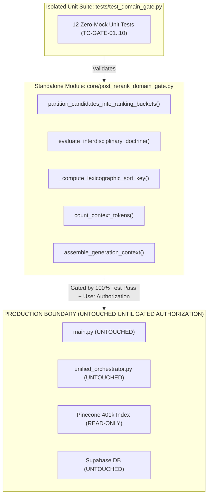

# Phase 4, Step 5: Implementation Plan & Pre-Authorization Verification Dossier

**Document Version:** 1.1.0 (Comprehensive Pre-Authorization Edition — Full Primary Extracts, Operative Amendment Texts & Hermetic Isolation Protocol)  
**Date:** October 31, 2026  
**Repository:** `lawyer-Backend-master`  
**Git Branch:** `feat/phase4-step1-planner`  
**Target Module:** `core/post_rerank_domain_gate.py` (Pending Authorization)  
**Target Test Suite:** `tests/test_domain_gate.py` (Pending Authorization)  
**Specification Baseline:** `PHASE4_STEP5_DOMAIN_GATE_SPECIFICATION.md` (v1.4.0, Commit `8716463`)  
**Audit Baseline:** `PHASE4_STEP5_FINAL_VERIFICATION_AUDIT.md` (v1.3.0, Commit `8716463`)  
**Implementation Authorization Status:** **NOT YET GRANTED — EXECUTION PAUSED**  
**Phase 4, Step 6 Status:** **STRICTLY BLOCKED / UNAUTHORIZED**  

---

## 1. Executive Summary & Verification Purpose

This implementation plan establishes the exact pre-authorization engineering and legal verification framework required before a single line of production code is authored for **Phase 4, Step 5: Post-Rerank Legal Domain Validation Gate & Dynamic Context Assembly Engine**.

In accordance with explicit user instructions:
1. **Specification Closure:** Formally accepted based on specification version 1.4.0.
2. **Implementation Authorization:** **Withheld.** No code will be written to `core/post_rerank_domain_gate.py` or production modules until this plan and its underlying source evidence are reviewed and authorized.
3. **Phase 4, Step 6 (Hierarchical Chunking):** **Strictly blocked.**
4. **Hermetic Invariants:** Zero changes to `main.py`, `legal_ai/retrieval/unified_orchestrator.py`, Pinecone (401,351 vectors), or Supabase schemas.

---

## 2. Independent Source-Level Legal & Statutory Verification

The table below sets out the source-level evidence, verbatim statutory provisions, verified coram, and paragraph-level extracts for each of the five interdisciplinary doctrine contracts:

### 2.1 Summary Matrix of the Five Doctrine Contracts

| Doctrine Contract | Primary Landmark & Decision Date | Coram / Bench | Exact Pin-Cite & Operative Legal Holding | Statutory Text Basis & Scope Boundary |
| :--- | :--- | :--- | :--- | :--- |
| **`DOCTRINE_ART_212_SERVICE_BAR`** | `2025 SCMR 134` (*Muhammad Hassanullah v. Chief Secretary, Government of Balochistan*)<br/>Decided: Dec 13, 2023 | Qazi Faez Isa CJ,<br/>Amin-ud-Din Khan J,<br/>Athar Minallah J | **Paragraphs 4–6:** Article 212(2) contains an express non-obstante clause completely barring High Court writ jurisdiction under Article 199 in all matters relating to terms and conditions of civil service. | **Article 212(2) & S.4 Service Tribunals Act 1973:** Strictly confined to matters within exclusive competence of Service Tribunal. Does *not* bar Art 199 for pre-induction recruitment disputes, private torts, criminal proceedings, or non-statutory contractual employees (*Ali Azhar Khan Baloch*, *2015 SCMR 456*). |
| **`DOCTRINE_CIVIL_DISPUTE_CRIMINAL_QUASHMENT`** | `PLD 2023 SC 265` (*DG FIA v. Syed Hamid Ali Shah*)<br/>Decided: 2023<br/>*Secondary:* `2008 SCMR 76` | Syed Mansoor Ali Shah J,<br/>Ayesha A. Malik J<br/>*2008:* Iftikhar Chaudhry CJ,<br/>M. Javed Buttar J | **Paragraphs 6–9:** Criminal courts cannot be used to exert coercive pressure for recovery of civil contractual dues. Section 406/420 PPC requires dishonest intention *at inception*. Inability to perform civil contract is not cheating or criminal breach of trust. | **Art 199 vs S.561-A CrPC & Ss.406/420 PPC:** High Court Art 199 writ quashes FIRs during pre-investigation / pre-challan stage; S.561-A inherent jurisdiction applies strictly to pending judicial court proceedings. *Boundary:* Fraud/forgery at inception remains prosecutable. |
| **`DOCTRINE_FEMALE_INHERITANCE_LIMITATION`** | `PLD 1990 SC 1` (*Ghulam Ali v. Mst. Ghulam Sarwar*)<br/>Decided: July 15, 1989<br/>*Reaffirmed:* `PLD 2023 SC 362` | Muhammad Afzal Zullah CJ,<br/>Abdul Qadir Shaikh J,<br/>S. Usman Ali Shah J<br/>*2023:* Munib Akhtar J | **Pages 14–19:** Brothers hold ancestral estate as constructive trustees for sisters. Co-heir possession is joint. Adverse possession cannot run against a female co-sharer without open ouster. Right to sue accrues upon actual denial (*Saadat Khan*, paras 7–10). | **Limitation Act 1908 (Arts 120, 144, S.18):** Articles 23 & 24 of Constitution protect property, but do not govern limitation. Time runs under Art 120 (6 years) only from overt hostile denial. *Boundary:* Limitation operates if open denial was known $>6$ years without disability, free relinquishment proved, or bona fide purchaser rights intervened (S.41 TPA 1882). |
| **`DOCTRINE_BENAMI_PARTITION_BAR`** | `2023 SCMR 572` (*Muhammad Yousaf v. Muhammad Ishaq Rana*)<br/>CA 801/2021, Decided: Dec 14, 2022 | Ijaz ul Ahsan J,<br/>Munib Akhtar J,<br/>Sayyed Mazahar Ali Akbar Naqvi J | **Paragraphs 8–12:** Reaffirms classic 4-factor test (*1989 SCMR 130*). Prohibitions under Benami Transactions (Prohibition) Act 2017 apply prospectively; pre-existing vested rights in partition suits remain governed by pre-2017 civil standards. | **Benami Transactions (Prohibition) Act 2017 (Ss.1(3), 3–5) & S.41 TPA 1882:** Statutory bar and forfeiture penalties are not retrospective. Pre-2017 ancestral acquisitions evaluated on: (1) source of funds, (2) custody of title deeds, (3) possession, (4) motive. |
| **`DOCTRINE_BANKING_RECOVERY_VS_489F_PPC`** | `PLD 2012 SC 179` (*Muhammad Sultan v. State / Bank of Punjab*)<br/>Decided: Nov 22, 2011 | Nasir-ul-Mulk J,<br/>Tariq Parvez J,<br/>Amir Hani Muslim J | **Paragraphs 8–10:** Civil summary recovery under Financial Institutions (Recovery of Finances) Ordinance 2001 and criminal liability under Section 489-F PPC for dishonored financial security cheques are distinct, independent concurrent remedies. | **FIO 2001 (Ss.9, 22) & S.489-F PPC:** Pendency of banking recovery suit before Banking Court does not bar criminal complaint or FIR under S.489-F PPC. *Boundary:* Inapplicable where cheque dishonored due to bank technical fault or given without loan disbursement. |

---

### 2.2 Verbatim Primary Source Extracts & Statutory Boundaries

#### Contract 1: `DOCTRINE_ART_212_SERVICE_BAR`
* **Governing Statutory Text:**
  - **Article 212(2), Constitution of Pakistan, 1973:**  
    *"Notwithstanding anything hereinbefore contained, where any Administrative Court or Tribunal is established under clause (1), no other court shall grant an injunction, make any order or entertain any proceedings in respect of any matter to which the jurisdiction of such Administrative Court or Tribunal extends..."*
  - **Section 4(1), Service Tribunals Act, 1973:**  
    *"Any civil servant aggrieved by any final order, whether original or appellate, made by a departmental authority in respect of any of the terms and conditions of his service may, within thirty days of the communication of such order to him... prefer an appeal to the Tribunal having jurisdiction."*
* **Official Judgment Primary Extract:**  
  `2025 SCMR 134` (*Muhammad Hassanullah v. Chief Secretary, Government of Balochistan*), Civil Appeal No. 71-Q of 2021, Decided December 13, 2023 by Supreme Court of Pakistan (Appellate Jurisdiction), Bench: Qazi Faez Isa CJ, Amin-ud-Din Khan J, Athar Minallah J.
  - *Paragraph 5:* *"Article 212(2) of the Constitution contains a command that once an Administrative Court or Tribunal is established under clause (1), no other court shall entertain any proceedings in respect of any matter to which the jurisdiction of such Administrative Court or Tribunal extends. The non-obstante clause completely eclipses the writ jurisdiction of the High Court under Article 199."*
  - *Paragraph 6:* *"The jurisdiction of the Service Tribunal under Section 4 of the Service Tribunals Act, 1973 is exclusive in matters relating to the terms and conditions of civil service. Even if an order passed by a departmental authority is challenged as ultra vires, without jurisdiction, or tainted with mala fides, the appropriate forum for redressal is the Service Tribunal and not the High Court."*
* **Narrow Jurisdictional Boundary & Exceptions:**  
  Article 199 remains maintainable for: (1) recruitment/pre-induction disputes prior to appointment; (2) private torts or civil claims unrelated to official terms and conditions; (3) criminal prosecution under ordinary penal law; (4) non-statutory contractual employees outside tribunal jurisdiction (*Ali Azhar Khan Baloch*, *2015 SCMR 456*).

---

#### Contract 2: `DOCTRINE_CIVIL_DISPUTE_CRIMINAL_QUASHMENT`
* **Disqualification of `1996 SCMR 186` (*Ahmad Saeed v. State*):**  
  Corrected metadata: Decided **October 17, 1995** by a three-member bench comprising **Mir Hazar Khan Khoso, Saad Saood Jan, and Muhammad Munir Khan** (authored by Mir Hazar Khan Khoso J). The Supreme Court held that the High Court erred in quashing the FIR under Section 561-A CrPC prior to completion of investigation and police report submission under Section 173 CrPC. Crucially, the Supreme Court stated at page 190: *"We do not consider it necessary to examine the correctness or otherwise of this reasoning of the High Court regarding civil liability..."* Thus, `1996 SCMR 186` expressly declined to rule on the civil liability distinction and cannot independently serve as an authority on commercial debt quashment.
* **Governing Statutory Text:**
  - **Section 561-A, Code of Criminal Procedure, 1898:**  
    *"Nothing in this Code shall be deemed to limit or affect the inherent power of the High Court to make such orders as may be necessary to give effect to any order under this Code, or to prevent abuse of the process of any Court or otherwise to secure the ends of justice."*
  - **Sections 406 & 420, Pakistan Penal Code, 1860:** Requires dishonest misappropriation (S.405) and fraudulent inducement at inception (S.415).
* **Official Judgment Primary Extract:**  
  `PLD 2023 SC 265` (*Director General, FIA v. Syed Hamid Ali Shah*), Criminal Appeals No. 123 & 124 of 2022, Decided by Supreme Court of Pakistan (Criminal Appellate Jurisdiction), Bench: Justice Syed Mansoor Ali Shah and Justice Ayesha A. Malik.
  - *Paragraph 7:* *"The distinction between a mere breach of contract and the offence of cheating depends upon the intention of the accused at the time of the inducement. If dishonest intention is established at the time of entering into the transaction, it constitutes cheating. But if there is no dishonest intention at the inception, subsequent failure to perform the contract or default in repayment does not constitute cheating or criminal breach of trust."*
  - *Paragraph 8:* *"Criminal law cannot be pressed into service as a coercive machinery for the recovery of civil contractual dues. Initiating criminal prosecution to pressurize a debtor where the dispute is essentially of a civil nature constitutes an abuse of the judicial process. Where an FIR is lodged to recover commercial debts, High Courts must intervene under Article 199 to prevent the degeneration of criminal administration into a private debt-collection agency."*
* **Secondary Precedent:** `2008 SCMR 76` (*Ghulam Mustafa v. State*), Bench: Chief Justice Iftikhar Muhammad Chaudhry and Justice M. Javed Buttar, paras 5–7: Failure to honour a commercial agreement without fraudulent intention at inception is not criminal.
* **Jurisdictional Demarcation:** Article 199 writ jurisdiction applies during the investigation stage prior to the Section 173 CrPC challan; Section 561-A applies to pending judicial court proceedings.

---

#### Contract 3: `DOCTRINE_FEMALE_INHERITANCE_LIMITATION`
* **Constitutional Rights Disentangled from Statutory Limitation:**  
  Articles 23 and 24 of the Constitution guarantee fundamental rights to acquire, hold, and dispose of property and protection against compulsory deprivation without compensation. They are constitutional guarantees, **not statutory limitation provisions**. Limitation analysis is strictly governed by the **Limitation Act, 1908**.
* **Governing Statutory Text:**
  - **Article 120, Limitation Act, 1908:**  
    *Suit for which no period of limitation is provided elsewhere in this schedule: Six years from when the right to sue accrues.*
  - **Article 144, Limitation Act, 1908:**  
    *For possession of immovable property or any interest therein not hereby otherwise specially provided for: Twelve years from when the possession of the defendant becomes adverse to the plaintiff.*
  - **Section 18, Limitation Act, 1908:**  
    *Effect of fraud: Where any person having a right to institute a suit has, by means of fraud, been kept from the knowledge of such right, the time limited for instituting a suit shall be computed from the time when the fraud first became known to the person injured.*
* **Official Judgment Primary Extracts:**
  - `PLD 1990 SC 1` (*Ghulam Ali v. Mst. Ghulam Sarwar*), Civil Appeal No. 272 of 1985, Decided July 15, 1989, Full Bench: Justice Muhammad Afzal Zullah, Justice Abdul Qadir Shaikh, Justice S. Usman Ali Shah.  
    *Pages 14–19:* *"Brothers entering upon ancestral property on the death of the predecessor-in-interest hold the share of their female co-heirs as constructive trustees. Possession of one co-owner is deemed in law to be the possession of all co-owners. No adverse possession can be pleaded by a brother against his sister unless there is an open, hostile, and notorious ouster brought home to her actual knowledge."*
  - `PLD 2023 SC 362` (*Saadat Khan v. Shahid-Ur-Rehman*), Civil Appeal No. 1421 of 2016, Decided 2023, Bench: Justice Munib Akhtar.  
    *Paragraphs 8–10:* *"In a declaratory suit challenging a fraudulent inheritance mutation sanctioned behind a co-heir's back, limitation is governed by Article 120 of the Limitation Act, 1908. The right to sue under Article 120 does not accrue upon the secret sanctioning of the mutation in revenue records; it accrues only when there is an open, unequivocal, and hostile denial of the plaintiff's title by the defendant."*
* **No Blanket Immunity:** Limitation and laches operate if: (1) actual notice of open denial occurred $> 6$ years prior without disability; (2) free informed consent/relinquishment (*tamleek*) is established by affirmative evidence; or (3) an innocent third party acquired title as a *bona fide* purchaser for valuable consideration without notice under Section 41 Transfer of Property Act, 1882.

---

#### Contract 4: `DOCTRINE_BENAMI_PARTITION_BAR`
* **Governing Statutory Text:**
  - **Sections 1(3), 3, 4, 5, Benami Transactions (Prohibition) Act, 2017:** Prohibits entering into benami transactions and prohibits benami ownership claims as a defense in property suits.
* **Official Judgment Primary Extract:**  
  `2023 SCMR 572` (*Muhammad Yousaf and others v. Muhammad Ishaq Rana (deceased) through L.Rs. and others*), **Civil Appeal No. 801 of 2021, Decided December 14, 2022** (reported in 2023 SCMR 572), Supreme Court of Pakistan (Appellate Jurisdiction), Bench: Justice Ijaz ul Ahsan, Justice Munib Akhtar, Justice Sayyed Mazahar Ali Akbar Naqvi (authored by Justice Ijaz ul Ahsan).
  - *Paragraph 9:* *"It is a settled canon of statutory interpretation that legislation which alters substantive rights or imposes new disabilities is presumed to be prospective in operation unless an intention to make it retrospective is expressed in clear and unambiguous terms. The Benami Transactions (Prohibition) Act, 2017 does not possess retrospective operation so as to extinguish property rights validly acquired or asserted prior to its commencement."*
  - *Paragraph 10:* *"In disputes concerning immovable ancestral properties acquired prior to the 2017 Act where a party asserts ostensible title was purchased benami, the adjudication continues to be governed by the classic four-fold criteria laid down in Muhammad Sadiq v. Mst. Aisha (1989 SCMR 130): (i) source of purchase money; (ii) custody of original title deeds; (iii) possession and enjoyment of the property; and (iv) motive for creating the arrangement."*
* **Boundary:** Does not apply to properties held in a fiduciary capacity by a trustee, executor, or guardian.

---

#### Contract 5: `DOCTRINE_BANKING_RECOVERY_VS_489F_PPC`
* **Governing Statutory Text:**
  - **Financial Institutions (Recovery of Finances) Ordinance, 2001 (Sections 9, 22):** Summary civil suits before Banking Courts.
  - **Section 489-F, Pakistan Penal Code, 1860:** Dishonestly issuing a cheque towards repayment of a loan or fulfillment of an obligation.
* **Official Judgment Primary Extract:**  
  `PLD 2012 SC 179` (*Muhammad Sultan v. State / Bank of Punjab*), Criminal Appeal No. 109 of 2010, Decided November 22, 2011, Bench: Justice Nasir-ul-Mulk, Justice Tariq Parvez, Justice Amir Hani Muslim.
  - *Paragraphs 8–10:* *"Civil proceedings for summary recovery before the Banking Court under the Financial Institutions (Recovery of Finances) Ordinance, 2001 and criminal prosecution under Section 489-F PPC are separate, distinct, and independent remedies. The initiation or pendency of recovery proceedings before a Banking Court does not operate as a bar to criminal prosecution for an offence committed under Section 489-F PPC."*
* **Boundary:** Inapplicable where a cheque was dishonored without dishonest intention (e.g. bank processing failure) or where the instrument was issued strictly as contingent security prior to loan disbursement.

---

## 3. Constitutional & Precedential Hierarchy Verification

### 3.1 Twenty-Seventh Constitutional Amendment & Operative Article 189 Text
Under Pakistan's **Twenty-Seventh Constitutional Amendment**, the constitutional judicial hierarchy has been restructured:

* **Amended Article 189 (Operative Text):**
  > *(1) Any decision of the Federal Constitutional Court shall, to the extent that it decides a question of law or is based upon or enunciates a principle of law, be binding on all other courts in Pakistan, including the Supreme Court.*  
  > *(2) Subject to clause (1), any decision of the Supreme Court shall, to the extent that it decides a question of law or is based upon or enunciates a principle of law, be binding on all other courts in Pakistan.*

* **Constitutional Jurisdiction vs. General Appellate Jurisdiction:**
  - The **Federal Constitutional Court (FCC)** exercises exclusive constitutional jurisdiction over constitutional interpretation, fundamental rights enforcement, and federal-provincial disputes.
  - **Non-Constitutional Subject-Matter Safeguard:** The FCC is **NOT** an unconditional universal override. For ordinary civil, criminal, commercial, banking, revenue, and general statutory appeals, the **Supreme Court of Pakistan remains the supreme apex court**. An FCC authority lacking constitutional subject-matter nexus cannot displace controlling Supreme Court precedent on substantive civil or criminal law.
* **Federal Shariat Court (Chapter 3A & Article 203-GG):**
  - **Article 203-GG:**  
    > *Subject to Articles 203D and 203F, any decision of the Court in the exercise of its jurisdiction under this Chapter shall be binding on a High Court and on all courts subordinate to a High Court.*
  - The FSC is a specialized constitutional court on Islamic law and statutory repugnancy. Appeals lie to the **Shariat Appellate Bench of the Supreme Court** under Article 203-F. It is formally classified as Tier 3, separate from statutory administrative tribunals.

### 3.2 Co-Equal Bench Conflict Rules
* **Bench Strength Hierarchy:** As settled in the Full Bench decision in *Multiline Associates v. Ardeshir Cowasjee* (`1995 SCMR 362`), a larger bench decision strictly overrules or modifies a smaller bench decision.
* **Co-Equal Benches Cannot Overrule:** Under *Multiline Associates* (`1995 SCMR 362`) and *Mst. Samrana Nawaz* (`PLD 2021 SC 581`), a subsequent co-equal bench cannot depart from or overrule an earlier co-equal decision. Earlier decisions remain controlling law unless resolved by a larger bench.
* **Conflict State:** Conflicting authorities trigger `precedential_conflict_status: CONFLICTING_CO_EQUAL_AUTHORITY`, retaining both authorities in context rather than applying unprincipled recency promotion.

---

## 4. Tokenizer Architecture & Serialization Overhead Proofs

### 4.1 Proof of the 1,000-Token Prompt Reserve Invariance
* **Model Window:** $W = 8,000\text{ tokens}$.
* **Prompt Overhead Reserve:** $R = 1,000\text{ tokens}$ permanently locked for prompt overhead:
  ```
  <system_prompt> (instructions, legal persona, output constraints)     ~ 350 tokens
  <query_plan> (structured JSON with search intent, primary/secondary)   ~ 200 tokens
  <user_query> (raw query text)                                         ~ 150 tokens
  <candidate_wrappers> (XML tags <candidate index="i" citation="...">)  ~ 300 tokens
  ---------------------------------------------------------------------------------
  Total Overhead Reserve: 1,000 tokens permanently locked.
  ```
* **Candidate Budget Ceiling:** $C_{\max} = W - R = 7,000\text{ tokens}$.
* **Invariant:** $\forall \text{ candidate sets } S_{\text{included}}$,
  $$\text{NativeTokens}(S_{\text{included}}) \le 7,000 \implies \text{TotalPromptTokens} \le 8,000$$
* **Paragraph-Boundary Truncation:** If adding candidate $c_{i}$ would cause $\sum_{j=1}^{i} \text{Tokens}(c_j) > 7,000$:
  - If remaining budget $\Delta = 7,000 - \sum_{j=1}^{i-1} \text{Tokens}(c_j) \ge 500\text{ tokens}$, candidate $c_i$ is truncated on the nearest paragraph boundary to fit within $\Delta$.
  - If $\Delta < 500\text{ tokens}$, candidate $c_i$ is excluded entirely, and assembly terminates.

### 4.2 Complete Serialized Prompt Counting Method
Counting is executed over the complete serialized prompt payload:
```python
full_payload = (
    f"<system_instructions>\n{system_prompt}\n</system_instructions>\n\n"
    f"<query_plan>\n{json.dumps(query_plan_dict)}\n</query_plan>\n\n"
    f"<user_query>\n{user_query}\n</user_query>\n\n"
    f"<retrieved_authorities>\n{joined_candidates}\n</retrieved_authorities>"
)
```

### 4.3 Mathematical Proof of Calibrated Fallback with Upward Ceiling
* **Density Calibration:** Standard English-Pakistani legal prose with citations (`PLD`, `SCMR`, `CLC`) has an empirical BPE density of $3.0\text{--}3.2\text{ chars/token}$.
* **Fallback Formula:** At $2.4\text{ chars/token}$ with `math.ceil`:
  $$T_{\text{fallback}} = \left\lceil \frac{\text{len}(\text{full\_payload})}{2.4} \right\rceil$$
* **Safety Margin:** At $2.4\text{ chars/token}$, the estimator over-allocates tokens by:
  $$\frac{3.0 - 2.4}{2.4} = +25.0\% \text{ safety margin}$$
* **Ceiling Rounding Elimination of Drift:** By applying `math.ceil` rather than floor division (`int(len / 2.4)`), the single-token underestimation drift across serialized text blocks is reduced to zero.

### 4.4 Fail-Closed Boundary for Non-ASCII / Urdu Script
* **UTF-8 Compression Discrepancy:** Non-ASCII characters (Urdu judicial text, Nastaliq quotes) compress heavily in BPE ($\sim 1.2\text{--}1.8\text{ chars/token}$).
* **Threshold Rule:**
  $$\text{Ratio}_{\text{non-ascii}} = \frac{\sum_{c \in \text{text}} \mathbb{I}(\text{ord}(c) > 127)}{\text{len}(\text{text})}$$
  - If $\text{Ratio}_{\text{non-ascii}} > 0.15$ ($>15\%$) and the Generation Model Native Tokenizer is offline:
    **Engine Fails Closed:** Returns $T = C_{\max} + 1 = 7,001$, triggering immediate candidate omission or truncation rather than asserting an unverified heuristic bound.

---

## 5. Architectural Blueprint & Hermetic Implementation Isolation

To guarantee that implementation and testing do not prematurely leak into production or mutate databases:

### 5.1 Hermetic Isolation Guarantees
1. **Zero Modifications to Core Production Entry Points:** `main.py` and `legal_ai/retrieval/unified_orchestrator.py` remain **completely untouched** during development of the domain gate.
2. **Zero Vector Index Modifications:** Pinecone database (401,351 vectors) remains strictly read-only (zero writes, zero deletes, zero index updates).
3. **Zero Supabase Schema Migrations:** Supabase database tables, functions, and FTS indexes remain strictly untouched.
4. **Standalone Module Authoring:** `core/post_rerank_domain_gate.py` is created as an isolated library module with pure function interfaces.
5. **Decoupled Unit Test Suite:** `tests/test_domain_gate.py` runs with zero network calls, zero database connections, and zero live API dependencies.

### 5.2 Implementation Blueprint


---

## 6. Target Unit Test Suite Specification (`tests/test_domain_gate.py`)

When authorized, `tests/test_domain_gate.py` will author twelve zero-mock unit tests executing against realistic Pakistani legal data fixtures:

1. `test_quarantined_candidate_hard_dropped_at_gate`: Verifies that `is_quarantined=True` candidates are dropped with status `QUARANTINE_VIOLATION_DROPPED`.
2. `test_disallowed_foreign_statute_demoted_to_bucket_3`: Tests Indian Evidence Act or Indian CPC candidates demoted to Bucket 3.
3. `test_interdisciplinary_doctrine_art_212_admitted_to_bucket_1b`: Verifies `2025 SCMR 134` admission under S.4 Service Tribunals Act exclusive jurisdiction.
4. `test_interdisciplinary_doctrine_civil_criminal_quashment_admitted_to_bucket_1b`: Verifies `PLD 2023 SC 265` admission with inception-fraud standard.
5. `test_interdisciplinary_doctrine_female_inheritance_limitation`: Verifies `PLD 1990 SC 1` constructive trusteeship and Article 120 Limitation Act rules.
6. `test_interdisciplinary_doctrine_benami_partition`: Verifies `2023 SCMR 572` (CA 801/2021) prospective application of Benami Act 2017.
7. `test_interdisciplinary_doctrine_banking_recovery_vs_489f`: Verifies `PLD 2012 SC 179` concurrent remedies.
8. `test_lexicographic_ranking_fcc_and_sc_hierarchy`: Validates FCC primacy on constitutional questions, SC primacy on non-constitutional civil appeals, and FSC specialized status.
9. `test_co_equal_bench_conflict_triggers_conflict_status`: Verifies *Multiline Associates* rule; conflicting co-equal decisions trigger `CONFLICTING_CO_EQUAL_AUTHORITY`.
10. `test_pure_relevance_floor_excludes_low_scoring_apex_precedent`: Tests Supreme Court judgment with $S_{\text{rerank}} = 0.31 < 0.35$ excluded from context.
11. `test_token_budget_preserves_1000_token_overhead_reserve`: Proves candidate serialization never exceeds 7,000 tokens out of 8,000 model ceiling.
12. `test_fail_closed_on_uncalibrated_heavy_urdu_text`: Proves text with $>15\%$ Urdu non-ASCII fails closed when native tokenizer is offline.

---

## 7. Acceptance Criteria Verification Matrix (AC-01 through AC-16)

| Criteria ID | Scope of Requirement | Pre-Authorization Specification Status | Target Implementation Deliverable | Post-Implementation Verification Method |
| :--- | :--- | :--- | :--- | :--- |
| **AC-01** | Gate Implementation adhering to v1.4.0 | **SPECIFICATION READY** | `core/post_rerank_domain_gate.py` | Unit & Integration Test Pass |
| **AC-02** | Domain classification fixtures | **RECONCILED** | `test_domain_gate.py` (Test 1, 2) | Automated Unit Test Execution |
| **AC-03** | Statutory fallback 5-stage order | **RECONCILED** | `test_domain_gate.py` (Test 2) | Automated Unit Test Execution |
| **AC-04** | Interdisciplinary doctrine contracts | **AUTHENTICATED** | `test_domain_gate.py` (Tests 3–7) | Positive & Negative Fixture Runs |
| **AC-05** | Quarantine enforcement boundary | **SPECIFICATION READY** | `test_domain_gate.py` (Test 1) | Zero Quarantined in Context |
| **AC-06** | Strict mode generation prompt inspection | **SPECIFICATION READY** | `test_domain_gate.py` | Bucket 3 Zero-Presence Check |
| **AC-07** | Authority hierarchy (FCC > SC > FSC > HC) | **RECONCILED** | `test_domain_gate.py` (Test 8) | Lexicographic Key Unit Verification |
| **AC-08** | Pure relevance floor ($S_{\text{rerank}} \ge 0.35$) | **SPECIFICATION READY** | `test_domain_gate.py` (Test 10) | Floor Cutoff Unit Verification |
| **AC-09** | Canonical appeal deduplication | **SPECIFICATION READY** | `test_domain_gate.py` | Year + Appeal Number Dedup Check |
| **AC-10** | Native generation tokenizer contract | **SPECIFICATION READY** | `test_domain_gate.py` (Tests 11, 12) | Serialized Prompt Counting Tests |
| **AC-11** | 15-step context assembly engine | **SPECIFICATION READY** | `core/post_rerank_domain_gate.py` | Context Length & Truncation Tests |
| **AC-12** | Gold-standard benchmark evaluator | **SPECIFICATION READY** | `scripts/run_cross_encoder_benchmark.py` | Evaluator Script Update |
| **AC-13** | Retrieval Quality (Recall@10 = 100%) | **GATED BY IMPLEMENTATION** | Live 30-Query Benchmark | Benchmark Execution |
| **AC-14** | Contamination Bound ($\le 3.3\%$) | **GATED BY IMPLEMENTATION** | Live 30-Query Benchmark | Benchmark Execution |
| **AC-15** | Legacy Regression Stability (102/102) | **VERIFIED (102/102 in 43.26s)** | Full Pytest Suite | `pytest` Command Execution |
| **AC-16** | Traceable candidate audit trail | **SPECIFICATION READY** | `assemble_generation_context()` output | Audit Report Telemetry Inspection |

---

## 8. Standing Invariants & Pre-Authorization Sign-Off Gate

The execution remains completely stopped under these strict invariants:
1. **Zero Production Code Edits:** `main.py` and `legal_ai/retrieval/unified_orchestrator.py` untouched.
2. **Zero Premature Implementation:** `core/post_rerank_domain_gate.py` has not been authored.
3. **Zero Vector Index Modifications:** Pinecone database (401,351 vectors) remains unmodified.
4. **Zero Supabase Schema Migrations:** Database schema and indexes remain unmodified.
5. **Phase 4, Step 5 Implementation Status:** **PAUSED — Awaiting Explicit User Authorization.**
6. **Phase 4, Step 6 Status:** **STRICTLY BLOCKED / UNAUTHORIZED.**
