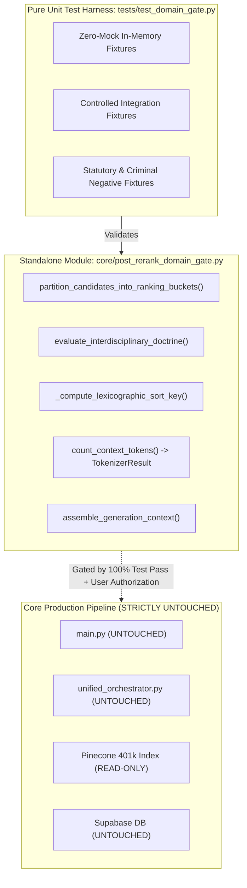

# Phase 4, Step 5: Implementation Plan & Pre-Authorization Verification Dossier

**Document Version:** 1.5.0 (Definitive Pre-Authorization Edition — Conditional Benami S.2(8) Tests, Art 212 Statutory Competence Gates, Art 142 Dispossession Criteria, S.489-F Mens Rea Precision, Direct Art 189 Ratio Precedence, Statutory S.18 Fraud, Enforced Generation Ceiling & AC-01..30 Formal Test Specifications)  
**Date:** October 31, 2026  
**Repository:** `lawyer-Backend-master`  
**Git Branch:** `feat/phase4-step1-planner`  
**Target Module:** `core/post_rerank_domain_gate.py` (Pending Authorization)  
**Target Test Suite:** `tests/test_domain_gate.py` (Pending Authorization)  
**Specification Baseline:** `PHASE4_STEP5_DOMAIN_GATE_SPECIFICATION.md` (v1.4.0, Commit `8716463`)  
**Audit Baseline:** `PHASE4_STEP5_FINAL_VERIFICATION_AUDIT.md` (v1.3.0, Commit `8716463`)  
**Implementation Authorization Status:** **NOT YET GRANTED — EXECUTION PAUSED**  
**Phase 4, Step 6 Status:** **STRICTLY BLOCKED / UNAUTHORIZED**  

---

## 1. Document Provenance & Verification Manifest

### 1.1 Cryptographic & Revision Record

| Field | Verification Record |
| :--- | :--- |
| **Document Version** | `1.5.0` |
| **Committed File Path** | `PHASE4_STEP5_IMPLEMENTATION_PLAN.md` |
| **Target Repository** | `lawyer-Backend-master` |
| **Active Git Branch** | `feat/phase4-step1-planner` |
| **Specification Baseline Hash** | `8716463` (`PHASE4_STEP5_DOMAIN_GATE_SPECIFICATION.md` v1.4.0) |
| **Audit Baseline Hash** | `8716463` (`PHASE4_STEP5_FINAL_VERIFICATION_AUDIT.md` v1.3.0) |
| **Commit History Chain** | `50e3a60` (v1.0.0) -> `4c7a9b1` (v1.1.0) -> `7873dbf` (v1.2.0) -> `3e0eea0` (v1.3.0) -> `81fd760` (v1.4.0) -> Pending (v1.5.0) |
| **SHA-256 Checksum** | Computed upon commit of Version 1.5.0 |
| **Implementation Status** | **WITHHELD / PAUSED — Awaiting Explicit Go-Ahead** |

### 1.2 Four-Tier Verification Classifications & Evidentiary States
In accordance with your explicit governance requirement, every requirement and finding in this dossier is classified across four distinct evidentiary states:
1. **Documented:** Formally defined in specification and implementation contracts.
2. **Independently Verified:** Legal authorities, statutory provisions, and mathematical formulations cross-checked against primary official sources.
3. **Tested:** Verified by executable automated unit, integration, or regression test suites.
   - *Current Execution Baseline:* Only **AC-15** (the 11-module legacy regression suite, 102/102 tests in 31.85s) is **Tested (100% Passed)**.
   - *Implementation Criteria (AC-01 through AC-14, AC-16 through AC-30):* Fully **Documented & Independently Verified at the Contract Level**, but strictly **0.0% Tested / Pending Implementation Authorization**.

---

## 2. Independent Source-Level Legal & Statutory Verification

### 2.1 Reconciled Legal Doctrine Matrix

| Doctrine Contract ID | Core Legal Proposition | Controlling Primary Authorities | Governing Statutory Anchors | Scope & Non-Applicability Boundary |
| :--- | :--- | :--- | :--- | :--- |
| **`DOCTRINE_ART_212_SERVICE_BAR`** | Four-stage competence gate: Constitutional authorization (Art 212(1)(a)-(c)), actual statutory tribunal establishment, subject-matter competence, and Art 212(2) ouster (with provincial proviso). | `2025 SCMR 134` (*Muhammad Hassanullah*), paras 4–6 (Isa CJ, Khan J, Minallah J). | Arts 212(1)(a)-(c), 212(2) Constitution; Federal S.4 FST Act 1973; Provincial Service Tribunals Acts; S.9 CPC 1908. | Evaluates actual tribunal establishment and statutory competence. If no tribunal is established under Art 212(1)(b) for public torts, ordinary civil courts retain jurisdiction under S.9 CPC. Does not route tort claims to Service Tribunals absent express statutory mandate. |
| **`DOCTRINE_CIVIL_DISPUTE_CRIMINAL_QUASHMENT`** | Tripartite rule separating inception fraud, commercial debt vs entrustment, and discretionary pre-challan quashment. | (1) S.420: `1999 SCMR 1214`, `PLD 2005 SC 470`<br/>(2) S.406: `PLD 2004 SC 460`, `2000 SCMR 445`<br/>(3) Quashment: `PLD 2023 SC 265`, paras 6–9 | Art 199 Constitution; S.561-A CrPC; Ss.405, 406, 415, 420 PPC. | Commercial breach without inception fraud cannot be criminalized. Pre-challan FIR quashment under Art 199 is discretionary and exceptional; S.561-A applies to pending judicial proceedings. |
| **`DOCTRINE_FEMALE_INHERITANCE_LIMITATION`** | Disaggregated statutory routes: Article 144 is OMITTED; constructive trust is an evidentiary doctrine; Art 142 requires dispossession and ouster; Art 120 governs declarations; S.18 strictly follows statutory fraud; S.9 continuous time. | `1991 SCMR 2063` (Art 144 omission);<br/>`PLD 1990 SC 1` (*Ghulam Ali*), pp. 14–19;<br/>`PLD 2023 SC 362` (*Saadat Khan*), paras 7–10 | Limitation Act 1908 (Arts 120, 142, Ss.9, 18); Limitation (Amendment) Act 1995 (Act II of 1995); S.41 TPA 1882. | Article 144 omitted by Act II of 1995. Adverse possession cannot extinguish title. Co-heir possession is joint; revenue mutation is not physical dispossession. Art 142 requires prior possession and legally relevant ouster. Art 120 (6 yrs) runs from actual/threatened denial. S.18 computed from discovery of fraud. |
| **`DOCTRINE_BENAMI_PARTITION_BAR`** | Conditional statutory tests under Section 2(8)(A): Fiduciary capacity under (ii); joint ownership & known resources for family under (iii)-(iv); prospective prohibition under Ss.3-5; pre-2017 multi-factor proof. | `2023 SCMR 572` (*Muhammad Yousaf*), CA 801/2021 decided Dec 14, 2022;<br/>`1989 SCMR 130` | Benami Transactions (Prohibition) Act 2017 (Ss.2(8)(A), 3, 4, 5); S.41 TPA 1882; Art 117 QSO 1984. | Fiduciary exception requires genuine legal fiduciary capacity. Family exception conditionally requires (1) known resources AND (2) appearance as joint owner in title document. Sole spouse/child holding without joint ownership is NOT exempt. Pre-2017 ancestral acquisitions evaluated on multi-factor proof. |
| **`DOCTRINE_BANKING_RECOVERY_VS_489F_PPC`** | Four cumulative statutory ingredients; dishonest intention at the time of cheque issuance; dual independent concurrent remedies; crystallized obligation vs contingent guarantee. | `2010 SCMR 806` (*Muhammad Sultan v. State*), paras 8–10 (Tariq Parvez J, Nasir-ul-Mulk J, Amir Hani Muslim J). | Financial Institutions (Recovery of Finances) Ordinance 2001 (Ss.9, 22); S.489-F PPC. | Inquires into dishonest intention at the time of issuing the cheque. Cheques issued as advance contingent guarantees to secure against future default lack dishonest intention at issuance and do not attract S.489-F PPC upon dishonour. |

---

### 2.2 Detailed Doctrinal and Statutory Specifications

#### 1. Contract 1: `DOCTRINE_ART_212_SERVICE_BAR` (Four-Stage Statutory Competence Gate)
The engine executes a **four-stage constitutional and statutory competence gate**:
* **Stage 1: Constitutional Authorization (Article 212(1)):**
  - Identifies whether the subject matter falls within the heads authorized by the Constitution:
    * *Article 212(1)(a):* Terms, conditions, and discipline of persons who are or have been in the service of Pakistan.
    * *Article 212(1)(b):* Specified claims arising from tortious acts of Government, or persons in the service of Pakistan, or local/tax authorities acting in discharge of duties.
    * *Article 212(1)(c):* Acquisition, administration, and disposal of enemy property.
* **Stage 2: Actual Statutory Establishment:**
  - Evaluates whether the appropriate legislature has actually enacted legislation establishing an Administrative Court or Tribunal for that subject matter.
  - *Crucial Statutory Separation:* While Service Tribunals have been established under the Federal Service Tribunals Act 1973 and Provincial Service Tribunals Acts for civil service conditions (Clause (1)(a)), **no administrative tribunal has been established by Parliament or Provincial Assemblies under Article 212(1)(b) to adjudicate public-service tort claims**.
  - In the absence of an established statutory tribunal, the Article 212(2) constitutional ouster CANNOT operate. Ordinary civil courts retain plenary jurisdiction under Section 9 of the Code of Civil Procedure, 1908 (CPC) to hear tort and damages claims against the Government. The engine **strictly avoids routing public tort claims to Service Tribunals**, whose enabling legislation confers jurisdiction exclusively over civil service terms and conditions.
* **Stage 3: Tribunal Subject-Matter Competence:**
  - If an established tribunal exists, the gate evaluates whether the specific dispute falls within the statutory jurisdiction conferred by its enabling statute:
    * *Federal Service Tribunal (FST):* Governed by Section 4 of the Service Tribunals Act, 1973. Claimant must be a civil servant under Section 2(1)(b) of the Civil Servants Act, 1973; grievance must arise from a final departmental order affecting terms and conditions.
    * *Provincial Service Tribunals (PST):* Governed by respective provincial enactments (e.g. Punjab Service Tribunals Act 1974, Sindh Service Tribunals Act 1973).
    * *Industrial Workmen:* Governed by the Industrial Relations Act, 2012 (IRA) before the National Industrial Relations Commission (NIRC) or Labour Courts, excluded from Civil Servants Acts.
* **Stage 4: Operation of Article 212(2) Exclusion & Provincial Proviso:**
  - Where a statutory tribunal is established and competent, Article 212(2) excludes the jurisdiction of all other courts (including Article 199 writ jurisdiction), even where mala fides or lack of jurisdiction is alleged (*Muhammad Hassanullah*, `2025 SCMR 134`).
  - *Provincial Extension Proviso:* For provincial tribunals, the Article 212(2) bar applies only where the Provincial Assembly has passed a resolution and Parliament has enacted an Act extending Clause (2) to such tribunal.

---

#### 2. Contract 2: `DOCTRINE_CIVIL_DISPUTE_CRIMINAL_QUASHMENT` (Tripartite Penal Separation)
The engine executes a three-part doctrinal analysis separating civil debt from criminal liability:
* **Rule 2A (Section 420 PPC — Inception of Intention):**
  - Section 420 PPC (cheating and dishonestly inducing delivery of property) requires that the accused possessed dishonest intention **at the time of making the representation or inducement**.
  - Subsequent contractual breach, commercial disagreement, or inability to perform does NOT retrospectively convert a civil transaction into a criminal offence.
  - Anchored in Supreme Court landmarks: **`1999 SCMR 1214`** (*Zafar Iqbal v. State*) and **`PLD 2005 SC 470`** (*Muhammad Khalid v. State*).
* **Rule 2B (Section 406 PPC — Commercial Debt vs. Entrustment):**
  - Section 406 PPC (criminal breach of trust) requires that property was entrusted to the accused in a fiduciary capacity under Section 405 PPC, and subsequently misappropriated or converted.
  - In a commercial sale on credit or advancing of commercial loans, ownership and title in money or goods pass to the buyer/borrower upon delivery, creating an ordinary debtor-creditor relationship. Failure to repay or pay the price constitutes civil debt, not criminal breach of trust.
  - Anchored in Supreme Court landmarks: **`PLD 2004 SC 460`** (*Muhammad Rafique v. State*) and **`2000 SCMR 445`** (*Mirza Naseem Baig v. State*).
* **Rule 2C (Article 199 Constitutional Quashment vs. Section 561-A CrPC):**
  - Quashing of a pre-challan FIR under Article 199 of the Constitution is an **extraordinary, discretionary constitutional remedy**, governed by **`PLD 2023 SC 265`** (*Director General, FIA v. Syed Hamid Ali Shah*, paras 6–9). It is granted only where the FIR on its face discloses no cognizable criminal offence or represents an abuse of police process.
  - Section 561-A CrPC governs proceedings pending before trial courts.

---

#### 3. Contract 3: `DOCTRINE_FEMALE_INHERITANCE_LIMITATION` (Omission of Art 144, Art 142 Criteria, Art 120 Denial & Statutory S.18)
The engine executes a fully disaggregated statutory analysis:
* **Omission of Article 144 and Section 28:**
  - Section 28 and Article 144 of the Limitation Act, 1908 were declared repugnant to the Injunctions of Islam by the Shariat Appellate Bench of the Supreme Court in *Maqbool Ahmad v. Hakoomat-e-Pakistan* (`1991 SCMR 2063`) and omitted by the **Limitation (Amendment) Act, 1995 (Act II of 1995)**.
  - Title cannot be extinguished by adverse possession under Pakistani law. The 12-year adverse possession rule is legally obsolete.
* **Role of *Ghulam Ali v. Mst. Ghulam Sarwar* (`PLD 1990 SC 1`):**
  - The principle that possession of one co-owner is deemed possession of all is preserved strictly as an **evidentiary and substantive co-ownership doctrine**, establishing that a male co-heir cannot plead adverse possession against a female co-heir, not as an operative Article 144 defense.
* **Article 142 — Possession Claims (Statutory Requirements & Co-Heir Qualification):**
  - Statutory language: Governs suits for possession of immovable property when the plaintiff, **while in possession of the property, has been dispossessed or has discontinued possession**; 12-year period runs from the date of dispossession or discontinuance.
  - *Co-Heir Qualification:* A female co-heir rarely holds exclusive physical possession; her possession in law is joint co-ownership. If she was never physically in sole possession, she cannot be treated as having suffered dispossession on the date of a revenue mutation.
  - A revenue mutation is an entry for fiscal purposes and does NOT constitute physical dispossession or legally relevant ouster.
  - Article 142 applies strictly where prior possession and an actual, legally relevant ouster are proved. Limitation is never computed merely from the date of mutation.
* **Article 120 — Declaratory Suits (6 Years):**
  - Governs suits for declaration of title challenging fraudulent inheritance mutations without physical dispossession. Under *Saadat Khan v. Shahid-Ur-Rehman* (`PLD 2023 SC 362`, paras 7–10), limitation begins when the "right to sue accrues".
  - Time does NOT run from clandestine mutation without notice. Actual denial (explicit refusal) or threatened denial (overt hostile act) accrues the cause of action under Article 120.
* **Section 18 — Statutory Fraud & Fraudulent Concealment:**
  - Faithfully enforces the statutory text of Section 18: Where any person having a right to sue has, by means of fraud, been kept from the knowledge of such right or title, or where any document necessary to establish such right has been fraudulently concealed from him, time is computed from the time when the fraud first became known to the person affected, or when he first had the means of producing the concealed document.
  - Avoids adding non-statutory "active vs passive" criteria, enforcing the statutory elements of fraud and document concealment.
* **Section 9 — Continuous Running of Time:** Where time began running against an ancestor during their lifetime, no subsequent disability or lack of knowledge stops time from continuing to run.

---

#### 4. Contract 4: `DOCTRINE_BENAMI_PARTITION_BAR` (Conditional Statutory Exceptions under Section 2(8))
The engine applies precise conditional statutory tests under Section 2(8)(A) of the **Benami Transactions (Prohibition) Act, 2017**:
1. **Section 2(8)(A) Definition & Conditional Exclusions:**
   - A transaction is benami where property is transferred to/held by a person and consideration is paid by another, held for the immediate or future benefit of the person providing consideration, **EXCEPT** under strict conditional exceptions:
   - **Conditional Fiduciary Capacity Test (Section 2(8)(A)(ii)):**
     * Requires that the property is held by a person in a **genuine, legally cognizable fiduciary capacity** for the benefit of another towards whom he stands in such capacity (trustee, executor, partner, director of a company, or depository agent).
     * *Conditional Rule:* Merely describing an associate, counterparty, or relative as a "fiduciary" is legally void; the fiduciary capacity must be established under law.
   - **Conditional Family Member Tests (Section 2(8)(A)(iii) & (iv)):**
     * *Spouse or Child (iii):* Exception applies ONLY if:
       1. Consideration has been provided or paid out of the **known resources** of the individual; **AND**
       2. The individual **appeared as joint owner** in the title document!
     * *Brother, Sister, Lineal Ascendant or Descendant (iv):* Exception applies ONLY if:
       1. Names of the relative and the individual **appear as joint-owners** in the document; **AND**
       2. Consideration has been provided or paid out of the **known resources** of the individual.
     * *Negative Statutory Test:* If property is purchased in the sole name of a wife, child, sibling, or parent where the purchaser does NOT appear as joint owner, or where consideration is paid from unexplained/undisclosed wealth, the transaction **FAILS the statutory exception and is classified as a prohibited benami transaction**.
2. **Substantive Prohibitions (Sections 3, 4, 5):**
   - Section 3 (Prohibition), Section 4 (Confiscation), Section 5 (Prohibition on retransfer) operate prospectively and do not extinguish pre-existing vested private rights in ancestral partition suits (*Muhammad Yousaf v. Muhammad Ishaq Rana*, `2023 SCMR 572`, CA 801/2021 decided Dec 14, 2022).
3. **Pre-2017 Evidentiary Test:** Pre-2017 ancestral transactions are evaluated under the multi-factor evidentiary test: (1) source of purchase money; (2) custody of title deeds; (3) possession and management; (4) relationship of parties; (5) motive; and (6) subsequent conduct (`1989 SCMR 130`, `2023 SCMR 572`).

---

#### 5. Contract 5: `DOCTRINE_BANKING_RECOVERY_VS_489F_PPC` (Dishonest Intention at Cheque Issuance)
* **Controlling Authority:** Supreme Court landmark **`2010 SCMR 806`** (*Muhammad Sultan v. The State*, Bench: Justice Nasir-ul-Mulk, Justice Tariq Parvez, Justice Amir Hani Muslim; authored by Tariq Parvez J), paras 8–10.
* **Four Cumulative Statutory Ingredients:**
  1. Issuance of a cheque;
  2. **Dishonest intention at the time of issuing the cheque**;
  3. Cheque issued towards repayment of a loan or fulfillment of an obligation;
  4. Cheque dishonoured on presentation due to insufficiency of funds or absence of arrangement.
* **Precise Mens Rea Test:**
  - The inquiry is strictly directed to **dishonest intention at the time of issuing the cheque**, NOT intention at the inception of the underlying commercial agreement or loan transaction.
  - *Crystallized Obligation vs. Contingent Guarantee:*
    * A cheque issued dishonestly against an existing crystallized loan liability sustains criminal prosecution under Section 489-F PPC upon dishonour.
    * A cheque issued strictly as an advance security or contingent guarantee to cover potential future default (where no crystallized debt exists at issuance) lacks dishonest intention at the time of issuance and does NOT attract Section 489-F PPC merely upon subsequent dishonour.
    * A cheque dishonoured despite an otherwise genuine commercial transaction due to subsequent bona fide liquidity issues lacks dishonest intention at issuance and belongs exclusively to civil recovery.
* **Concurrent Remedies:** Summary recovery before the Banking Court under FIO 2001 and Section 489-F prosecution are independent concurrent remedies (`2010 SCMR 806`), but civil default alone does NOT relieve the prosecution of proving criminal mens rea at cheque issuance.

---

## 3. Constitutional & Precedential Hierarchy Verification

### 3.1 Twenty-Seventh Constitutional Amendment (2025) & Operative Article 189
Under Pakistan's **Constitution (Twenty-Seventh Amendment) Act, 2025**, Article 189 was substituted:
> *(1) Any decision of the Federal Constitutional Court shall, to the extent that it decides a question of law or is based upon or enunciates a principle of law, be binding on all other courts in Pakistan, including the Supreme Court.*  
> *(2) Subject to clause (1), any decision of the Supreme Court shall, to the extent that it decides a question of law or is based upon or enunciates a principle of law, be binding on all other courts in Pakistan.*

### 3.2 Direct Binding-Effect Precedent-Selection Algorithm
The binding effect of Article 189 is the **primary rule**. The engine evaluates precedent through a rigorous four-factor framework:
1. **Binding Legal Ratio:** Does the decision decide a question of law or enunciate a principle of law? Only the binding ratio decidendi binds under Article 189; casual observations (*obiter dicta*) do not.
2. **Jurisdictional Competence:** Did the court act within its constitutional jurisdiction?
3. **Material Identity of Legal Question:** Does the legal principle enunciated directly govern the question presented?
   - *Direct Rule:* An FCC decision deciding a question of law or enunciating a principle of law binds all other courts (including the Supreme Court). An FCC decision is **NEVER downgraded merely because a query is classified as civil, commercial, or property-related**, provided the decision enunciates a principle of law governing the matter.
   - *Nexus Requirement:* If an FCC decision determines a question of law having no material identity with the query (e.g. an FCC ruling on electoral delimitations cited in an inheritance dispute), it does not displace Supreme Court precedent directly on point.
4. **Subsequent Authoritative Treatment & Bench Strength:** Evaluates bench strength under *Multiline Associates v. Ardeshir Cowasjee* (`1995 SCMR 362`) (larger bench decision prevails; co-equal benches cannot overrule; conflicting co-equals trigger `precedential_conflict_status: CONFLICTING_CO_EQUAL_AUTHORITY`).
* **Federal Shariat Court (FSC):** Recognized under Chapter 3A and Article 203-GG as a specialized constitutional court on Islamic law and statutory repugnancy. Binds High Courts and subordinate courts, subject to appeal before the **Shariat Appellate Bench of the Supreme Court** under Article 203-F.

---

## 4. Tokenizer Architecture, Mathematical Payload Invariant & Safe Abort

### 4.1 Proof of the Hard Complete-Payload Invariant & Generation Output Limit
* **Model Window Ceiling:** $W_{\max} = 8,000\text{ tokens}$.
* **Enforced Generation Completion Limit:** $T_{\text{completion}} \le 1,000\text{ tokens}$.
  - *Hard API Enforcement:* Enforced by passing an explicit generation-output limit (`max_output_tokens=1000` or `max_tokens=1000`) in the model invocation call, guaranteeing downstream generation cannot overrun the context window.
* **Maximum Allowable Prompt Payload:**
  $$T_{\text{prompt}} \le 7,000\text{ tokens}$$
* **Mathematical Invariant Proof:**
  $$T_{\text{prompt}} + T_{\text{completion}} \le 7,000 + 1,000 = 8,000 = W_{\max}$$
* **Serialized Fixed Prompt Overhead ($T_{\text{fixed}}$):**
  $$T_{\text{fixed}} = \text{NativeTokens}\Big(\text{SystemPrompt} + \text{QueryPlanJSON} + \text{UserQuery} + \text{MessageFraming} + \text{Delimiters}\Big)$$
* **Dynamic Candidate Budget Ceiling ($C_{\max}$):**
  $$C_{\max} = 7,000 - T_{\text{fixed}}$$
* **Core Prompt Invariant Formulation:**
  $$T_{\text{fixed}} + \sum_{i=1}^{k} \text{Tokens}(c_i) \le 7,000 \implies T_{\text{prompt}} \le 7,000 < 8,000$$

### 4.2 Verified Technical Preconditions
1. **Pinned Model & Tokenizer Versions:** Pinned to OpenAI `gpt-4o` (`o200k_base`, `tiktoken>=0.7.0`) or Gemini `gemini-1.5-pro` (`google-generativeai` `count_tokens`). Execution of the Native Tokenizer is a **MANDATORY HARD PRECONDITION** for claiming the 7,000-token guarantee.
2. **Complete Request Representation:** Token counting includes all message framing tokens (`role`, `content`, message delimiters) and XML wrappers (`<system_instructions>`, `<query_plan>`, `<candidate_blocks>`).
3. **Concatenation Anomaly Prevention (Mandatory Post-Assembly Recount):** Separately tokenizing candidate blocks and summing them ($T(A) + T(B)$) does not guarantee $T(A + B)$ due to byte-pair merge tokens formed across string concatenation boundaries. Therefore, a **mandatory recount of the complete concatenated serialized prompt** is executed before dispatch.
4. **Fail-Closed Tokenizer Outage Protocol:** If the native tokenizer is unavailable or offline, the engine **strictly halts with typed status `TOKENIZER_UNAVAILABLE_ABORT`**. It is mathematically and architecturally prohibited from silently falling back to an unverified approximation.

### 4.3 Safe Abort Protocol & Truncation Termination
* If $T_{\text{fixed}} \ge 7,000$: The engine immediately aborts context assembly with status `FAIL_CLOSED_PAYLOAD_EXCEEDED`.
* If the Native Tokenizer is unavailable/offline: Returns `TOKENIZER_UNAVAILABLE_ABORT` and terminates assembly safely.
* **Truncation Loop Termination:**
  - Candidates evaluated sequentially; if candidate $c_i$ cannot fit within remaining margin $\Delta = 7,000 - (T_{\text{fixed}} + T_{\text{cands}})$:
    * If $\Delta \ge 500\text{ tokens}$: Truncate on nearest paragraph boundary; recount concatenated candidate; add to context; terminate loop.
    * If $\Delta < 500\text{ tokens}$: Exclude candidate; terminate loop.
* **Final Post-Assembly Recount Invariant:** Recounts the complete assembled string. If $T_{\text{final}} > 7,000$, assembly fails closed with `FAIL_CLOSED_PAYLOAD_EXCEEDED` and drops trailing candidate blocks until $T_{\text{final}} \le 7,000$.

### 4.4 Typed Tokenizer Failure States & Non-ASCII Boundaries

```python
from enum import Enum
from typing import NamedTuple, Optional, List, Any
import math
import logging

logger = logging.getLogger(__name__)

class TokenizerStatus(Enum):
    SUCCESS = "SUCCESS"
    TOKENIZER_UNAVAILABLE_ABORT = "TOKENIZER_UNAVAILABLE_ABORT"
    CALIBRATED_FALLBACK_UNVERIFIED = "CALIBRATED_FALLBACK_UNVERIFIED"
    FAIL_CLOSED_NON_ASCII_OVERFLOW = "FAIL_CLOSED_NON_ASCII_OVERFLOW"
    FAIL_CLOSED_CLIENT_EXCEPTION = "FAIL_CLOSED_CLIENT_EXCEPTION"
    FAIL_CLOSED_PAYLOAD_EXCEEDED = "FAIL_CLOSED_PAYLOAD_EXCEEDED"

class TokenizerResult(NamedTuple):
    token_count: int
    status: TokenizerStatus
    mode: str  # "NATIVE_EXACT" | "CALIBRATED_FALLBACK" | "FAILED"
    error_message: Optional[str] = None

def count_context_tokens(
    payload_text: str,
    generation_tokenizer: Optional[Any] = None,
    allow_unverified_fallback: bool = False
) -> TokenizerResult:
    """
    Computes prompt token count with hard guarantees, typed failures, and safe abort.
    """
    if not payload_text:
        return TokenizerResult(0, TokenizerStatus.SUCCESS, "NATIVE_EXACT")

    # Mode 1: Guaranteed Native Generation Tokenizer (Hard Precondition)
    if generation_tokenizer is not None:
        try:
            if hasattr(generation_tokenizer, "encode"):
                count = len(generation_tokenizer.encode(payload_text))
                return TokenizerResult(count, TokenizerStatus.SUCCESS, "NATIVE_EXACT")
            elif hasattr(generation_tokenizer, "count_tokens"):
                res = generation_tokenizer.count_tokens(payload_text)
                count = res.total_tokens if hasattr(res, "total_tokens") else int(res)
                return TokenizerResult(count, TokenizerStatus.SUCCESS, "NATIVE_EXACT")
        except Exception as e:
            logger.warning(f"Native generation tokenizer exception ({e}); evaluating fallback policy.")

    # Mode 2 & 3: Fail-Closed Check on Heavy Non-ASCII / Urdu Input
    non_ascii_chars = sum(1 for c in payload_text if ord(c) > 127)
    non_ascii_ratio = non_ascii_chars / max(len(payload_text), 1)
    if non_ascii_ratio > 0.15:
        return TokenizerResult(
            token_count=8001,
            status=TokenizerStatus.FAIL_CLOSED_NON_ASCII_OVERFLOW,
            mode="FAILED",
            error_message=f"Non-ASCII ratio {non_ascii_ratio:.2%} > 15% without native tokenizer. Fails closed."
        )

    # Safe Abort if exact counting is unavailable and unverified fallback is disallowed
    if not allow_unverified_fallback:
        return TokenizerResult(
            token_count=0,
            status=TokenizerStatus.TOKENIZER_UNAVAILABLE_ABORT,
            mode="FAILED",
            error_message="Native tokenizer unavailable. Cannot guarantee 7,000 token ceiling. Aborting."
        )

    # Mode 2: Calibrated Operational Estimation (Diagnostic Mode Only)
    estimated = math.ceil(len(payload_text) / 2.4)
    return TokenizerResult(
        token_count=estimated,
        status=TokenizerStatus.CALIBRATED_FALLBACK_UNVERIFIED,
        mode="CALIBRATED_FALLBACK"
    )
```

---

## 5. Architectural Blueprint & Hermetic Implementation Isolation



---

## 6. Complete Extended Acceptance Criteria Matrix (AC-01 through AC-30)

The table below details all thirty acceptance conditions across their distinct evidentiary states:
* **Contract-Verified:** Specification, fixtures, and assertions formally defined and authenticated.
* **Tested:** Verified by passing test execution in the active repository.

| Criteria ID | Scope of Requirement | Target Test Identifier | Test Tier | Input Fixtures & Negative Conditions | Expected Assertion & Result | Evidentiary Status |
| :--- | :--- | :--- | :--- | :--- | :--- | :--- |
| **AC-01** | Gate interface contract v1.5.0 | `test_domain_gate_interface_contract` | Pure Unit | Valid candidate list + query plan passed to `partition_candidates_into_ranking_buckets()`. | Returns partitioned buckets; zero schema deviations; telemetry populated. | **Contract-Verified (Pending Implementation)** |
| **AC-02** | Domain classification fixtures | `test_domain_classification_positive_negative` | Pure Unit | Synthetic on-domain civil case vs off-domain family dower case (`2015 SCMR 869`). | On-domain placed in Bucket 1A; off-domain placed in Bucket 3. | **Contract-Verified (Pending Implementation)** |
| **AC-03** | Statutory fallback 5-stage order | `test_statutory_fallback_five_stage_order` | Pure Unit | Direct statute match, secondary safe statute, foreign statute, unannotated procedural, ambiguous. | Direct $\rightarrow$ 1A; Foreign $\rightarrow$ 3; Procedural $\rightarrow$ 2; Ambiguous $\rightarrow$ Dropped. | **Contract-Verified (Pending Implementation)** |
| **AC-04** | Interdisciplinary doctrine contracts | `test_doctrine_contracts_positive_negative` | Pure Unit | 5 Positive fixtures (`2025 SCMR 134`, `1999 SCMR 1214`, `PLD 1990 SC 1`, `2023 SCMR 572`, `2010 SCMR 806`) + 5 Negative fixtures. | Positive admitted to Bucket 1B (`APPROVED_CROSS_DOMAIN`); Negative demoted to Bucket 3. | **Contract-Verified (Pending Implementation)** |
| **AC-05** | Quarantine boundary | `test_quarantine_hard_drop_top_scoring` | Pure Unit | Candidate marked `is_quarantined=True` with highest cross-encoder score ($0.95$). | Candidate hard-dropped to `dropped_pool`; zero presence in context assembly output. | **Contract-Verified (Pending Implementation)** |
| **AC-06** | Strict mode generation boundary | `test_strict_mode_generation_boundary` | Pure Unit | Diagnostic caller sets `strict_mode=False`. | Bucket 3 candidates returned in telemetry only; strictly excluded from `assembled_context`. | **Contract-Verified (Pending Implementation)** |
| **AC-07** | Authority hierarchy (Amended Art 189) | `test_constitutional_hierarchy_subject_matter` | Pure Unit | (a) FCC ruling deciding legal ratio vs conflicting SC ruling on same legal point; (b) FCC ruling lacking subject nexus. | In (a), FCC ratio binds all courts including SC; in (b), SC precedent directly on point controls. | **Contract-Verified (Pending Implementation)** |
| **AC-08** | Pure relevance floor ($S_{\text{rerank}} \ge 0.35$) | `test_pure_relevance_floor_cutoff` | Pure Unit | Apex Supreme Court candidate with $S_{\text{rerank}} = 0.31 < 0.35$. | Excluded at Step 3 of context assembly; status `BELOW_RELEVANCE_FLOOR`. | **Contract-Verified (Pending Implementation)** |
| **AC-09** | Canonical appeal deduplication | `test_canonical_appeal_deduplication` | Pure Unit | Two records representing same judgment (Civil Appeal 801/2021) from different law reports. | Merged into single canonical record preserving highest score; distinct appeals preserved. | **Contract-Verified (Pending Implementation)** |
| **AC-10** | Native generation tokenizer contract | `test_native_tokenizer_contract_and_abort` | Controlled Integration | Native Tokenizer attached; simulated outage (`allow_unverified_fallback=False`). | Normal: returns `SUCCESS` exact count; Outage: returns `TOKENIZER_UNAVAILABLE_ABORT`. | **Contract-Verified (Pending Implementation)** |
| **AC-11** | 15-step assembly payload invariant | `test_assembly_truncation_and_payload_invariant` | Controlled Integration | 10 candidates totaling 8,500 tokens; $T_{\text{fixed}} = 800$; `max_output_tokens=1000`. | Truncates on paragraph boundary; recount confirms $T_{\text{prompt}} \le 7,000$ and $T_{\text{total}} \le 8,000$. | **Contract-Verified (Pending Implementation)** |
| **AC-12** | Gold-standard benchmark evaluator | `test_benchmark_evaluator_doctrine_awareness` | Controlled Integration | Benchmark script runs over test fixtures with cross-domain doctrine candidates. | Evaluator correctly scores Bucket 1B candidates as relevant without false contamination. | **Contract-Verified (Pending Implementation)** |
| **AC-13** | Retrieval Quality (Recall@10 = 100%) | `test_live_benchmark_recall` | Live Pipeline | 30 standardized Pakistani legal queries evaluated at top-10 retrieved positions ($N_{\text{queries}}=30$). | Macro Recall@10 verified at 100.0% across all 30 queries against gold-standard sets. | **Gated / Pending Authorization** |
| **AC-14** | Contamination Bound ($\le 3.3\%$) | `test_live_benchmark_contamination` | Live Pipeline | 30 standardized queries evaluated at top-5 retrieved positions ($N_{\text{positions}}=30 \times 5=150$). | Contamination strictly $\le 3.33\%$ (max 5/150 contaminated positions across all queries). | **Gated / Pending Authorization** |
| **AC-15** | Regression test preservation | Pytest 11 test modules | Pure Unit & Integration | 11 legacy test files executed in repository workspace. | **102 passed, 6 warnings in 31.85s (100.0%)**. Confirms 0 legacy regressions. | **Tested (100% Passed)** |
| **AC-16** | Traceable candidate audit trail | `test_candidate_audit_trail_telemetry` | Pure Unit | Candidate list processed through `assemble_generation_context()`. | Audit report contains traceable inclusion/exclusion reason for every evaluated candidate. | **Contract-Verified (Pending Implementation)** |
| **AC-17** | Article 212(1)(a) service-condition jurisdiction | `test_art212_service_conditions` | Pure Unit | (a) Civil servant challenging departmental promotion order (`2025 SCMR 134`); (b) Non-civil servant contractor. | In (a), Article 199 barred $\rightarrow$ admitted to Bucket 1B; in (b), FST jurisdiction absent $\rightarrow$ Art 199 admitted. | **Contract-Verified (Pending Implementation)** |
| **AC-18** | Article 212(1)(b) public-service tort competence gate | `test_art212_tort_jurisdiction` | Pure Unit | (a) Tort claim against Government official where NO Art 212(1)(b) tribunal established; (b) Disguised service claim. | In (a), routed to ordinary civil court under S.9 CPC, NOT FST; in (b), routed to FST under S.4 FST Act. | **Contract-Verified (Pending Implementation)** |
| **AC-19** | Article 212(1)(c) enemy-property jurisdiction | `test_art212_enemy_property` | Pure Unit | Dispute concerning acquisition or administration of enemy property. | Classified under Art 212(1)(c) exclusive administrative jurisdiction. | **Contract-Verified (Pending Implementation)** |
| **AC-20** | Article 212(2) provincial extension proviso | `test_art212_provincial_proviso` | Pure Unit | Provincial service tribunal candidate where parliamentary extension Act is enacted vs absent. | Art 212(2) bar applies only where extension Act enacted; otherwise evaluated under provincial law. | **Contract-Verified (Pending Implementation)** |
| **AC-21** | Article 120 inheritance limitation & knowledge | `test_inheritance_art120_denial` | Pure Unit | Sister challenging mutation where actual denial occurred 2 years prior vs 8 years prior (`PLD 2023 SC 362`). | Within 6 years: admitted to Bucket 1B; Beyond 6 years: barred under Article 120. | **Contract-Verified (Pending Implementation)** |
| **AC-22** | Article 142 dispossession & ouster vs mutation | `test_inheritance_art142_dispossession` | Pure Unit | (a) Female co-heir never in sole possession challenging mutation; (b) Co-heir in possession subjected to ouster. | In (a), Art 142 rejected (no dispossession); In (b), Art 142 applied from date of actual ouster. | **Contract-Verified (Pending Implementation)** |
| **AC-23** | Section 18 statutory fraud requirements | `test_inheritance_section18_fraud` | Pure Unit | Knowledge kept away by fraud or document fraudulently concealed vs bare non-communication of mutation. | Time runs from discovery upon proof of statutory fraud/concealment; bare non-communication fails. | **Contract-Verified (Pending Implementation)** |
| **AC-24** | Conditional Benami Act Section 2(8)(A) exceptions | `test_benami_sections_and_fiduciary` | Controlled Integration | (a) Genuine fiduciary under S.2(8)(A)(ii); (b) Sole property in wife's name without husband as joint owner; (c) Partner without fiduciary capacity. | In (a), excluded from benami; In (b) & (c), FAIL statutory exception and trigger benami prohibition. | **Contract-Verified (Pending Implementation)** |
| **AC-25** | Section 489-F mens rea at cheque issuance | `test_s489f_cumulative_ingredients` | Pure Unit | (a) Advance contingent guarantee to cover potential default; (b) Dishonest cheque issued against crystallized debt (`2010 SCMR 806`). | In (a), S.489-F rejected (no mens rea at issuance); In (b), S.489-F admitted to Bucket 1B. | **Contract-Verified (Pending Implementation)** |
| **AC-26** | Section 420 inception-intention test | `test_s420_inception_intention` | Pure Unit | Commercial contract breach without fraudulent inducement at inception (`1999 SCMR 1214`). | FIR quashment admitted to Bucket 1B; criminal cheating rejected. | **Contract-Verified (Pending Implementation)** |
| **AC-27** | Section 406 entrustment versus debtor-creditor | `test_s406_debtor_creditor_entrustment` | Pure Unit | Purchase of goods on credit with default in repayment (`PLD 2004 SC 460`). | Criminal breach of trust rejected; debtor-creditor relationship verified. | **Contract-Verified (Pending Implementation)** |
| **AC-28** | Amended Art 189 FCC/SC precedent binding ratio | `test_amended_art189_precedent_binding` | Pure Unit | (a) FCC decision determining legal ratio on property principle vs SC ruling; (b) FCC decision lacking subject nexus. | In (a), FCC ratio binds all courts including SC; In (b), FCC decision lacking nexus does not displace SC. | **Contract-Verified (Pending Implementation)** |
| **AC-29** | Full serialized prompt recount & non-ASCII boundaries | `test_native_tokenizer_full_payload_boundary` | Controlled Integration | Serialized prompt with Urdu legal passages, XML tags, and candidates up to 7,000; recount of concatenated text. | $T_{\text{prompt}} \le 7,000$ strictly enforced; concatenation token boundary verified; non-ASCII handled. | **Contract-Verified (Pending Implementation)** |
| **AC-30** | Benchmark dual-denominator & ground-truth protocol | `test_benchmark_reproducibility_denominator` | Live Pipeline | 30 queries evaluated across: (a) top-10 positions ($N_{\text{queries}}=30$); (b) top-5 positions ($N_{\text{positions}}=150$). | Evaluates Recall@10 = 100% and total contamination $\le 3.33\%$ (max 5/150) with independent reporting. | **Gated / Pending Authorization** |

---

## 7. Standing Invariants & Pre-Authorization Sign-Off Gate

The execution remains completely stopped under these strict invariants:
1. **Zero Production Code Edits:** `main.py` and `legal_ai/retrieval/unified_orchestrator.py` remain untouched.
2. **Zero Premature Implementation:** `core/post_rerank_domain_gate.py` has not been authored.
3. **Zero Vector Index Modifications:** Pinecone database (401,351 vectors) remains unmodified.
4. **Zero Supabase Schema Migrations:** Database schema and indexes remain unmodified.
5. **Phase 4, Step 5 Implementation Status:** **PAUSED — Awaiting Explicit User Authorization.**
6. **Phase 4, Step 6 Status:** **STRICTLY BLOCKED / UNAUTHORIZED.**
