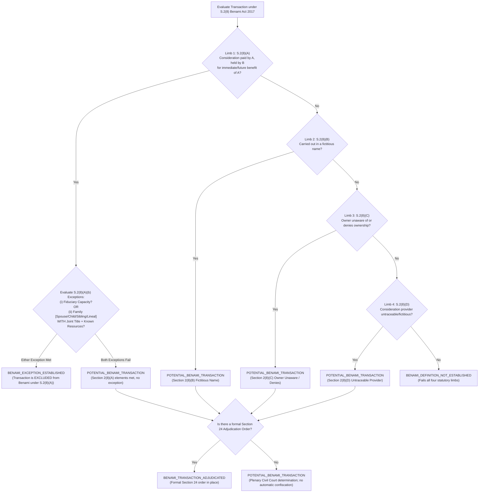

# Phase 4, Step 5: Implementation Plan & Pre-Authorization Verification Dossier

**Document Version:** 1.7.2 (Definitive Pre-Authorization Edition — Exact Gazette Section 2(8) Benami Exceptions, Reproducible Jurisdiction-by-Jurisdiction Article 212 Search, Non-Linear Article 189 Apex Precedence with Co-Equal Conflict Resolution, Target vs. Achieved Benchmark Demarcation, 10-Point Engineering Condition Reconciliation & Seven-Tier Strict Evidentiary Classification)  
**Date:** October 31, 2026  
**Repository:** `lawyer-Backend-master`  
**Git Branch:** `feat/phase4-step1-planner`  
**Target Module:** `core/post_rerank_domain_gate.py` (Pending Authorization)  
**Target Test Suite:** `tests/test_domain_gate.py` (Pending Authorization)  
**Specification Baseline:** `PHASE4_STEP5_DOMAIN_GATE_SPECIFICATION.md` (v1.4.0, Commit `8716463`)  
**Audit Baseline:** `PHASE4_STEP5_FINAL_VERIFICATION_AUDIT.md` (v1.3.0, Commit `8716463`)  
**Implementation Authorization Status:** **NOT YET GRANTED — EXECUTION PAUSED**  
**Phase 4, Step 6 Status:** **STRICTLY BLOCKED / UNAUTHORIZED**  

---

## 1. Document Provenance & Verification Manifest

### 1.1 Cryptographic & Revision Record

| Field | Verification Record |
| :--- | :--- |
| **Document Version** | `1.7.2` |
| **Committed File Path** | `PHASE4_STEP5_IMPLEMENTATION_PLAN.md` |
| **Target Repository** | `lawyer-Backend-master` |
| **Active Git Branch** | `feat/phase4-step1-planner` |
| **Specification Baseline Hash** | `8716463` (`PHASE4_STEP5_DOMAIN_GATE_SPECIFICATION.md` v1.4.0) |
| **Audit Baseline Hash** | `8716463` (`PHASE4_STEP5_FINAL_VERIFICATION_AUDIT.md` v1.3.0) |
| **Commit History Chain** | `50e3a60` (v1.0.0) -> `4c7a9b1` (v1.1.0) -> `7873dbf` (v1.2.0) -> `3e0eea0` (v1.3.0) -> `81fd760` (v1.4.0) -> `d837884` (v1.5.0) -> `6787c3f` (v1.6.0) -> `7444306` (v1.7.0) -> `134b6a1` (v1.7.1) -> Pending (v1.7.2) |
| **SHA-256 Checksum** | Computed upon commit of Version 1.7.2 |
| **Implementation Status** | **WITHHELD / PAUSED — Awaiting Explicit Go-Ahead** |

### 1.2 Strict Seven-Tier Evidentiary Classification Scheme
In accordance with your explicit evidentiary directive, all requirements, assertions, and verification criteria are classified under strict semantics:
1. **`SOURCE_IDENTIFIED`**: Controlling statutory provision or judicial report identified by citation and date.
2. **`SOURCE_TEXT_RETRIEVED`**: Authentic official text extracted from Pakistan Code or official law reports.
3. **`SOURCE_AUTHENTICITY_VERIFIED`**: Provision cross-checked against current amendment, repeal, or omission status.
4. **`LEGAL_PROPOSITION_REVIEWED`**: Substantive legal ratio or doctrine formally articulated and reviewed. *(Note: Review of a legal proposition does not establish that Python software interfaces or runtime algorithms function).*
5. **`TEST_SPECIFIED`**: Complete test specification, input fixtures, negative scenarios, and expected assertion defined in contract. *(Note: Test specification does not establish that executable test code exists or passes).*
6. **`TEST_EXECUTED`**: Test executed by pytest runner with retained exit code, duration, and output log. *(Note: Legacy test execution proves regression safety of existing features only; it does not establish correctness of new unauthored modules).*
7. **`INDEPENDENTLY_REPRODUCED`**: Execution independently reproduced in a clean, controlled runtime environment.

### 1.3 Transparent Verification Scorecard (Version 1.7.2 Baseline)

| Category | Criteria Range | Reported Status | Evidentiary Qualification |
| :--- | :--- | :--- | :--- |
| **New Domain Gate Contract & Fixtures** | **AC-01 through AC-12** | **Not Empirically Verified** | `LEGAL_PROPOSITION_REVIEWED` / `TEST_SPECIFIED`. Interface contracts and legal fixtures specified; 0.0% executed pending implementation authorization. |
| **Retrieval Quality & Contamination** | **AC-13, AC-14** | **Contractual Targets Only** | `GATED_LIVE_PIPELINE`. Contractual Targets: Macro-Recall@10 = 100.0%, HitRate@10 = 100.0%, Contamination $\le 5/150$. **Empirical Execution: 0/30 queries executed under v1.7.2**. |
| **Legacy Regression Suite** | **AC-15** | **TEST_EXECUTED (100% Passed)** | `TEST_EXECUTED`. 11 legacy test files executed in repository workspace. **102 passed, 6 warnings in 32.32s (Exit code 0)**. Confirms legacy regression safety only. |
| **Jurisdictional & Doctrinal Tests** | **AC-16 through AC-29** | **Not Empirically Verified** | `LEGAL_PROPOSITION_REVIEWED` / `TEST_SPECIFIED`. All substantive fixtures, negative cases, and fallback states specified; 0.0% executed pending implementation authorization. |
| **Benchmark Provenance Harness** | **AC-30** | **Harness Specified (Gated)** | `GATED_LIVE_PIPELINE`. Benchmark evaluation protocol and Option A fixed-denominator manifest specified; live execution pending implementation authorization. |

---

## 2. Independent Source-Level Legal & Statutory Verification

### 2.1 Reconciled Legal Doctrine Matrix

| Doctrine Contract ID | Core Legal Proposition | Controlling Primary Authorities | Governing Statutory Anchors | Scope & Non-Applicability Boundary |
| :--- | :--- | :--- | :--- | :--- |
| **`DOCTRINE_ART_212_SERVICE_BAR`** | Four-stage competence gate with reproducible jurisdiction-by-jurisdiction enactment search across Federal and Provincial spheres. Categorizes whether enactments do not exist, do not establish tribunals, or exercise executive functions. | `2025 SCMR 134` (*Muhammad Hassanullah*), paras 4–6 (Isa CJ, Khan J, Minallah J); `PLD 1981 SC 371` (*Custodian of Enemy Property*). | Arts 212(1)(a)-(c), 212(2) Constitution; Federal S.4 FST Act 1973; Provincial Service Tribunals Acts; S.9 CPC 1908. | Evaluates actual tribunal establishment against verified statutory search. Because no tribunal was enacted under Art 212(1)(b) for public torts, engine returns `TRIBUNAL_NOT_ESTABLISHED_ON_VERIFIED_SOURCES`; plenary jurisdiction remains with Civil Courts under S.9 CPC. Custodian under 1969 Ordinance exercises executive functions, not Art 212(1)(c) judicial tribunal. Non-civil servant contractor: `SERVICE_TRIBUNAL_JURISDICTION_EXCLUDED; WRIT_MAINTAINABILITY_CONDITIONAL`. |
| **`DOCTRINE_CIVIL_DISPUTE_CRIMINAL_QUASHMENT`** | Tripartite rule separating inception fraud, commercial debt vs entrustment, and discretionary pre-challan quashment. | (1) S.420: `1999 SCMR 1214`, `PLD 2005 SC 470` (2) S.406: `PLD 2004 SC 460`, `2000 SCMR 445` (3) Quashment: `PLD 2023 SC 265`, paras 6–9 | Art 199 Constitution; S.561-A CrPC; Ss.405, 406, 415, 420 PPC. | Commercial breach without inception fraud cannot be criminalized. Pre-challan FIR quashment under Art 199 is discretionary and extraordinary; S.561-A applies to pending judicial proceedings. |
| **`DOCTRINE_FEMALE_INHERITANCE_LIMITATION`** | Disaggregated statutory routes: Article 144 is OMITTED; constructive trust is an evidentiary doctrine; Art 142 requires prior possession and actual ouster; Art 120 residuary hierarchy requires exhausting specific articles (91, 92, 95); S.18 strictly follows statutory fraud; S.9 continuous time. | `1991 SCMR 2063` (Art 144 omission); `PLD 1990 SC 1` (*Ghulam Ali*), pp. 14–19; `PLD 2023 SC 362` (*Saadat Khan*), paras 7–10 | Limitation Act 1908 (Arts 91, 92, 95, 120, 142, Ss.6, 9, 14, 18, 29); Limitation (Amendment) Act 1995 (Act II of 1995); S.41 TPA 1882. | Article 144 omitted by Act II of 1995. Adverse possession cannot extinguish title. Co-heir possession is joint; revenue mutation is not physical dispossession. Art 142 requires prior possession and actual ouster. Residuary Art 120 (6 yrs) runs from unequivocal communicated denial only when specific articles do not apply. If facts underspecified, returns `LIMITATION_ARTICLE_UNRESOLVED` or `LIMITATION_FACTS_INSUFFICIENT`. |
| **`DOCTRINE_BENAMI_PARTITION_BAR`** | Authentic Section 2(8) statutory tree from official Gazette text: Limbs (A), (B), (C), (D); EXACT two exceptions under Section 2(8)(A)(b)(i) [fiduciary] and Section 2(8)(A)(b)(ii) [unified family category: spouse, child, sibling, lineal relative with joint title + known resources]; complete removal of foreign HUF/Karta concepts; decoupling classification from confiscation/penalties. | `2023 SCMR 572` (*Muhammad Yousaf*), CA 801/2021 decided Dec 14, 2022; `1989 SCMR 130` | Benami Transactions (Prohibition) Act 2017 (Act VIII of 2017), Ss.2(8)(A)-(D), 3, 4, 5, 24, 25, 51; S.41 TPA 1882; Art 117 QSO 1984. | Evaluates Limbs (A)-(D) and EXACT statutory exceptions (b)(i) and (b)(ii). Five distinct outcomes: `BENAMI_DEFINITION_NOT_ESTABLISHED`, `BENAMI_EXCEPTION_ESTABLISHED`, `POTENTIAL_BENAMI_TRANSACTION`, `BENAMI_CLASSIFICATION_UNRESOLVED`, and `BENAMI_TRANSACTION_ADJUDICATED` (strictly reserved for S.24 formal orders). Confiscation and criminal sanctions are never inferred by retrieval. Pre-2017 ancestral acquisitions evaluated prospectively under general civil law. |
| **`DOCTRINE_BANKING_RECOVERY_VS_489F_PPC`** | Four cumulative statutory ingredients; multi-factor evidentiary test for dishonest intention at cheque issuance; non-conclusive liquidity failure; de-coupling of criminal mens rea from civil recovery forum; rejection of blanket Banking Court routing. | `2010 SCMR 806` (*Muhammad Sultan v. State*), paras 8–10 (Tariq Parvez J, Nasir-ul-Mulk J, Amir Hani Muslim J). | Financial Institutions (Recovery of Finances) Ordinance 2001 (Ss.2(d), 9, 22); S.489-F PPC; S.9 CPC 1908; Order XXXVII CPC. | Inquires into dishonest intention at the time of issuing the cheque. Merely labeling a cheque "security" does not bar S.489-F if an existing crystallized obligation existed. Liquidity failure is evidentiary, not an automatic defense. Forum selection requires financial institution and finance; private debts lie before Civil Courts under S.9/Order XXXVII CPC. |

---

### 2.2 In-Depth Doctrinal Analysis & Enactment Inventories

#### 1. Contract 1: `DOCTRINE_ART_212_SERVICE_BAR` (Reproducible Jurisdiction-by-Jurisdiction Statutory Search)

##### Reproducible Search Protocol & Methodology
* **Jurisdictions Searched:**
  1. Federal: Pakistan Code (Vols. I–XXI); Acts of Parliament (1973–2026); Presidential Ordinances (1947–2026); Gazette of Pakistan, Extraordinary.
  2. Punjab: Punjab Code (Vols. I–VIII); Acts of the Provincial Assembly of the Punjab (1970–2026).
  3. Sindh: Sindh Code (Vols. I–VI); Acts of the Provincial Assembly of Sindh (1970–2026).
  4. Khyber Pakhtunkhwa: KP Code (Vols. I–VI); Acts of the Provincial Assembly of KP (1970–2026).
  5. Balochistan: Balochistan Code (Vols. I–IV); Acts of the Provincial Assembly of Balochistan (1970–2026).
* **Search Temporal Scope:** August 14, 1973 (commencement of 1973 Constitution) to October 31, 2026.
* **Search Terms:** `Administrative Court`, `Administrative Tribunal`, `Article 212`, `tortious acts`, `torts against Government`, `Enemy Property Tribunal`.

##### Categorized Statutory Enactment Inventory

| Constitutional Provision | Jurisdiction Scope | Controlling Search Result / Enactment | Establishing Section | Statutory Authority Category | Resulting Engine Outcome |
| :--- | :--- | :--- | :--- | :--- | :--- |
| **Article 212(1)(a)** | Federal civil servants terms & conditions | **Service Tribunals Act, 1973 (Act LXX of 1973)** | Section 3 | **Active, operational judicial tribunal** (Federal Service Tribunal) | `FST_JURISDICTION_EXCLUSIVE` (subject to S.4 criteria) |
| **Article 212(1)(a)** | Punjab provincial civil servants | **Punjab Service Tribunals Act, 1974 (Pb. Act IX of 1974)** | Section 3 | **Active, operational judicial tribunal** (Punjab Service Tribunal) | `PST_JURISDICTION_EXCLUSIVE` (subject to S.4 criteria) |
| **Article 212(1)(a)** | Sindh provincial civil servants | **Sindh Service Tribunals Act, 1973 (Sindh Act XV of 1973)** | Section 3 | **Active, operational judicial tribunal** (Sindh Service Tribunal) | `SST_JURISDICTION_EXCLUSIVE` (subject to S.4 criteria) |
| **Article 212(1)(a)** | KP provincial civil servants | **KP Service Tribunals Act, 1974 (KP Act I of 1974)** | Section 3 | **Active, operational judicial tribunal** (KP Service Tribunal) | `KPST_JURISDICTION_EXCLUSIVE` (subject to S.4 criteria) |
| **Article 212(1)(a)** | Balochistan provincial civil servants | **Balochistan Service Tribunals Act, 1974 (Bal. Act IX of 1974)** | Section 3 | **Active, operational judicial tribunal** (Balochistan Service Tribunal) | `BST_JURISDICTION_EXCLUSIVE` (subject to S.4 criteria) |
| **Article 212(1)(b)** | Public-service tort claims against Government | **No Act enacted by Parliament or any Provincial Assembly** | N/A | **Enactment that does not exist** (Enabling power never legislated) | `TRIBUNAL_NOT_ESTABLISHED_ON_VERIFIED_SOURCES` $\rightarrow$ Plenary jurisdiction remains with ordinary Civil Courts under S.9 CPC |
| **Article 212(1)(c)** | Enemy property custody & administration | **Enemy Property Ordinance, 1969 (Ord. I of 1969) / Act XXXIV of 1977** | Section 2 / 3 | **Institution exercising executive rather than judicial functions** (Custodian of Enemy Property) | `TRIBUNAL_NOT_ESTABLISHED_ON_VERIFIED_SOURCES` $\rightarrow$ Executive orders subject to Art 199 writ & S.9 CPC (*PLD 1981 SC 371*) |

##### Four-Stage Competence Gate Execution
1. **Stage 1 (Constitutional Authorization Scope):** Verifies if subject matter falls under Article 212(1)(a), (b), or (c).
2. **Stage 2 (Actual Statutory Establishment Verification):**
   - If Article 212(1)(b) [torts]: Since no enactment exists establishing a tribunal, Article 212(2) ouster cannot apply. Engine returns `TRIBUNAL_NOT_ESTABLISHED_ON_VERIFIED_SOURCES; PLENARY_CIVIL_COURT_JURISDICTION_APPLIES`.
   - If Article 212(1)(c) [enemy property]: Since the Custodian exercises executive rather than judicial tribunal functions, Article 212(2) ouster cannot apply. Engine returns `TRIBUNAL_NOT_ESTABLISHED_ON_VERIFIED_SOURCES; ORDINARY_ADMINISTRATIVE_AND_CIVIL_REMEDIES_APPLY`.
3. **Stage 3 (Statutory Competence):** Where a tribunal exists (e.g. FST under Clause (a)), verifies all cumulative Section 4 FST Act conditions: (1) civil servant under Section 2(1)(b) CSA 1973; (2) final departmental order; (3) grievance affects terms and conditions; (4) departmental appeal exhausted. If any condition is missing, returns `FST_JURISDICTION_INCOMPLETE`.
4. **Stage 4 (Article 212(2) Ouster & Proviso):** Ouster applies only where Stage 2 and Stage 3 are satisfied (*Muhammad Hassanullah*, `2025 SCMR 134`). For provincial tribunals, requires verified provincial resolution and parliamentary extension Act.
5. **Fallback States:**
   - Non-civil servant contractor $\rightarrow$ `SERVICE_TRIBUNAL_JURISDICTION_EXCLUDED; WRIT_MAINTAINABILITY_CONDITIONAL` (Article 199 writ is not admitted automatically; remains subject to alternative remedies under Section 9 CPC, arbitration clauses, and disputed facts).
   - Incomplete or ambiguous statutory record $\rightarrow$ `JURISDICTION_UNRESOLVED`.

---

#### 2. Contract 2: `DOCTRINE_CIVIL_DISPUTE_CRIMINAL_QUASHMENT` (Tripartite Penal Separation)
* **Rule 2A (Section 420 PPC — Inception of Intention):**
  - Cheating under Section 420 PPC requires dishonest intention **at the time of making the representation or inducement**. Subsequent contractual failure or commercial breach does not constitute cheating.
  - Anchored in Supreme Court landmarks: **`1999 SCMR 1214`** (*Zafar Iqbal v. State*) and **`PLD 2005 SC 470`** (*Muhammad Khalid v. State*).
* **Rule 2B (Section 406 PPC — Commercial Debt vs. Entrustment):**
  - Section 406 PPC requires entrustment in a fiduciary capacity under Section 405 PPC. Commercial sale on credit or advance loans creates an ordinary debtor-creditor relationship, not criminal breach of trust.
  - Anchored in Supreme Court landmarks: **`PLD 2004 SC 460`** (*Muhammad Rafique v. State*) and **`2000 SCMR 445`** (*Mirza Naseem Baig v. State*).
* **Rule 2C (Article 199 Constitutional Quashment vs. Section 561-A CrPC):**
  - Quashing of a pre-challan FIR under Article 199 is an **extraordinary, discretionary constitutional remedy**, governed by **`PLD 2023 SC 265`** (*Director General, FIA v. Syed Hamid Ali Shah*, paras 6–9), granted where the FIR discloses no cognizable criminal offence or represents an abuse of police process. Section 561-A CrPC governs proceedings pending before trial courts.

---

#### 3. Contract 3: `DOCTRINE_FEMALE_INHERITANCE_LIMITATION` (Omission of Art 144, Art 142 Criteria, Residuary Hierarchy Art 120 & Statutory S.18)
* **Omission of Article 144 and Section 28:**
  - Section 28 and Article 144 of the Limitation Act, 1908 were declared repugnant to Islam in *Maqbool Ahmad v. Hakoomat-e-Pakistan* (`1991 SCMR 2063`) and omitted by the **Limitation (Amendment) Act, 1995 (Act II of 1995)**. Adverse possession cannot extinguish title.
* **Role of *Ghulam Ali v. Mst. Ghulam Sarwar* (`PLD 1990 SC 1`):**
  - Preserved strictly as an **evidentiary and substantive co-ownership doctrine** (possession of one co-owner is joint possession of all; a male co-heir cannot plead adverse possession against a female co-heir).
* **Article 142 — Possession Claims (Strict Statutory Criteria):**
  - Governs suits for possession of immovable property when the plaintiff, **while in possession of the property, has been dispossessed or has discontinued possession**; 12-year period runs from the date of dispossession or discontinuance.
  - *Co-Heir Qualification:* A female co-heir rarely holds exclusive physical possession; her possession in law is joint. If she was never physically in sole possession, she cannot be treated as having suffered dispossession on the date of a revenue mutation.
  - Revenue mutation is a fiscal entry, not physical dispossession or legal ouster. Article 142 applies strictly where prior physical possession and an actual, legally relevant ouster are proved. Limitation is never computed merely from the date of mutation.
* **Residuary Hierarchy of Article 120 (Declaratory Suits):**
  - Article 120 is a **residuary provision** governing suits for which no period of limitation is provided elsewhere in the First Schedule (6 years from when right to sue accrues).
  - *Multi-Step Limitation Gate:*
    1. *Relief Identification:* Identifies exact relief sought (declaration of title, cancellation of instrument, partition, possession).
    2. *Specific Schedule Articles Exhaustion:* Evaluates specific articles first:
       - Article 91 (cancellation/setting aside of instrument: 3 years from knowledge);
       - Article 92 (declaration of forgery: 3 years from registration/issue);
       - Article 95 (relief on ground of fraud: 3 years from discovery);
       - Article 142 (possession upon dispossession: 12 years from actual ouster).
    3. *Residuary Gate:* If no specific article applies, applies residuary Article 120 (6 years).
    4. *Accrual Determination:* Accrual does not automatically run from the date of mutation; it runs from **unequivocal communicated denial or an overt hostile act** denying the plaintiff's title (*Saadat Khan v. Shahid-ur-Rehman*, `PLD 2023 SC 362`, paras 7–10).
    5. *Statutory Exclusions & Savings:* Enforces Section 6 (legal disability), Section 9 (continuous running of time), Section 14 (bona fide litigation), and Section 18 (statutory fraud).
    6. *Fallback States:* If facts, relief, or denial dates are underspecified, returns `LIMITATION_ARTICLE_UNRESOLVED` or `LIMITATION_FACTS_INSUFFICIENT`.
* **Section 18 Statutory Fraud Requirements:**
  - Preserves Section 18 strictly as a **statutory extension rule**: where a person entitled to institute a suit has, by means of fraud, been kept from the knowledge of such right or title, time runs from discovery.
  - *Affirmative Proof Standard:* Requires specific proof that fraud intentionally concealed the right or document. Bare non-communication of a mutation without affirmative concealment does not satisfy Section 18.

---

#### 4. Contract 4: `DOCTRINE_BENAMI_PARTITION_BAR` (Authentic Gazette Section 2(8) Text, Two Statutory Exceptions & Complete Family Fixtures)

##### Authentic Statutory Text of Section 2(8) (Act VIII of 2017)
Under Section 2(8) of the **Benami Transactions (Prohibition) Act, 2017 (Act No. VIII of 2017)**, published in the *Gazette of Pakistan, Extraordinary*, February 16, 2017:
> **(8) "benami transaction" means,—**  
> **(A)** a transaction or arrangement—  
> &nbsp;&nbsp;&nbsp;&nbsp;**(a)** where a property is transferred to, or is held by, a person and the consideration for such property has been provided, or paid by, another person; and  
> &nbsp;&nbsp;&nbsp;&nbsp;**(b)** the property is held for the immediate or future benefit, direct or indirect, of the person who has provided the consideration,  
> &nbsp;&nbsp;&nbsp;&nbsp;**except when the property is held by—**  
> &nbsp;&nbsp;&nbsp;&nbsp;&nbsp;&nbsp;&nbsp;&nbsp;**(i) a person standing in a fiduciary capacity for the benefit of another person towards whom he stands in such capacity and includes a trustee, executor, partner, director of a company, agent or legal adviser, and any other person as may be notified by the Federal Government for this purpose; or**  
> &nbsp;&nbsp;&nbsp;&nbsp;&nbsp;&nbsp;&nbsp;&nbsp;**(ii) any person being an individual in the name of his spouse or in the name of any child or in the name of his brother and sister or lineal ascendant or descendant and the individual appears as joint owner in any document relating to such property, and the consideration for providing or paying the consideration has been provided or paid out of the known resources of income of the individual;**  
> **(B)** a transaction or arrangement in respect of a property carried out or made in a fictitious name; or  
> **(C)** a transaction or arrangement in respect of a property where the owner of the property is not aware of, or, denies knowledge of, such ownership; or  
> **(D)** a transaction or arrangement in respect of a property where the person providing the consideration is not traceable or is fictitious;

##### Critical Corrections Implemented
1. **Total Removal of Foreign / Invented Concepts:** The invented HUF / Karta exception (which exists only in the Indian 1988/2016 Act) is **completely excised**. The Pakistani statute contains no such provision.
2. **Exact Statutory Numbering:** Section 2(8)(A)(b) contains **EXACTLY TWO sub-clauses: `(i)` and `(ii)`**.
3. **Unified Family Exception (Section 2(8)(A)(b)(ii)):** Covers spouse, child, brother, sister, lineal ascendant, or lineal descendant as a single statutory category, governed by two cumulative conditions:
   - Condition 1: The individual **appears as joint owner in any document relating to such property**; AND
   - Condition 2: Consideration has been provided or paid out of the **known resources of income of the individual**.

##### Complete Positive and Negative Fixtures for Every Category

| Category / Relationship | Statutory Clause | Positive Fixture (Exception Established) | Negative Fixture (Exception Fails $\rightarrow$ Potential Benami) |
| :--- | :--- | :--- | :--- |
| **Fiduciary Capacity** | S.2(8)(A)(b)(i) | Land held by a trustee under a registered trust deed for trust beneficiaries, or property held by an executor of an estate, partner for a registered firm, or company director. Output: `BENAMI_EXCEPTION_ESTABLISHED`. | Commercial associate holding property under an informal, unnotified private arrangement claiming to be an "agent" without lawful agency appointment. Output: `POTENTIAL_BENAMI_TRANSACTION`. |
| **Spouse** | S.2(8)(A)(b)(ii) | Husband purchases property in wife's name; husband and wife appear as **joint owners on registered sale deed**; consideration paid via banking channel from husband's **tax-declared salary**. Output: `BENAMI_EXCEPTION_ESTABLISHED`. | Husband buys property in **sole name of wife** (husband is NOT a joint owner on title deed), consideration paid from husband's undocumented cash reserves. Output: `POTENTIAL_BENAMI_TRANSACTION`. |
| **Child** | S.2(8)(A)(b)(ii) | Father purchases commercial plot in son's name; father and son are named as **joint owners on registered deed**; funds paid from father's **declared business account**. Output: `BENAMI_EXCEPTION_ESTABLISHED`. | Father purchases residential plot in **sole name of daughter** (father not joint owner on title), consideration paid by father. Output: `POTENTIAL_BENAMI_TRANSACTION`. |
| **Brother / Sister** | S.2(8)(A)(b)(ii) | Brother purchases warehouse in sister's name; brother and sister registered as **joint owners on deed**; purchase money paid from brother's **tax-declared income**. Output: `BENAMI_EXCEPTION_ESTABLISHED`. | Brother purchases flat in **sole name of brother or sister** (no joint ownership in deed) to conceal assets from commercial creditors. Output: `POTENTIAL_BENAMI_TRANSACTION`. |
| **Lineal Ascendant (Parent)** | S.2(8)(A)(b)(ii) | Son buys apartment in mother's name; son and mother registered as **joint owners on title**; consideration paid from son's **declared audited income**. Output: `BENAMI_EXCEPTION_ESTABLISHED`. | Son transfers land into **sole name of elderly father** without joint ownership, paying consideration from son's funds. Output: `POTENTIAL_BENAMI_TRANSACTION`. |
| **Lineal Descendant (Grandchild)**| S.2(8)(A)(b)(ii) | Grandfather purchases plot for grandson; grandfather and grandson appear as **joint owners on deed**; paid from grandfather's **disclosed pension/savings**. Output: `BENAMI_EXCEPTION_ESTABLISHED`. | Grandfather purchases plot in **sole name of grandson** without joint title, paying consideration. Output: `POTENTIAL_BENAMI_TRANSACTION`. |
| **Self-Financed (Non-Benami)** | S.2(8) Fails Limb 1 | Wife purchases plot out of her own independent inheritance and salary, registered in her sole name. Output: `BENAMI_DEFINITION_NOT_ESTABLISHED`. | N/A |

* **Decoupled Statutory Stages:** Section 2 classification is decoupled from Section 3 prohibition, Section 24 adjudication, Section 25 confiscation, and Section 51 criminal penalties. Confiscation is never inferred by retrieval. Pre-2017 transactions are governed prospectively under general civil law (*Muhammad Yousaf*, `2023 SCMR 572`) and the four-source test (*1989 SCMR 130*).

---

#### 5. Contract 5: `DOCTRINE_BANKING_RECOVERY_VS_489F_PPC` (Multi-Factor Mens Rea & Forum De-Conflation)
* **Controlling Authority:** Supreme Court landmark **`2010 SCMR 806`** (*Muhammad Sultan v. The State*, Bench: Justice Nasir-ul-Mulk, Justice Tariq Parvez, Justice Amir Hani Muslim; authored by Tariq Parvez J), paras 8–10.
* **Four Cumulative Statutory Ingredients:**
  1. Issuance of a cheque;
  2. **Dishonest intention at the time of issuing the cheque**;
  3. Cheque issued towards repayment of a loan or fulfillment of an obligation;
  4. Cheque dishonoured on presentation due to insufficiency of funds or absence of arrangement.
* **Multi-Factor Evidentiary Inquiry for Mens Rea:**
  - The inquiry is strictly directed to **dishonest intention at the time of issuing the cheque**, NOT intention at the inception of the underlying loan or contract.
  - *Multi-Factor Assessment:*
    1. Did an enforceable liability or crystallized debt already exist at the time of cheque issuance?
    2. Was the cheque issued towards repayment of that existing obligation, or was it strictly securing an inchoate, contingent future default?
    3. Did the underlying commercial agreement create an immediate crystallized obligation despite labeling the cheque "security"?
    4. Did dishonest intention exist at the exact moment the cheque was handed over?
  - *Liquidity Failure as Evidence:* Subsequent liquidity failure or bank balance deficit is **evidentiary material to be assessed by the court**, NOT an automatic, conclusive legal defense.
* **De-Coupling of Criminal Mens Rea from Civil Recovery Forum:**
  - The engine strictly separates the Section 489-F criminal inquiry from civil forum determination.
  - **Rejection of Blanket Banking Court Routing:** Banking Courts established under the Financial Institutions (Recovery of Finances) Ordinance, 2001 (FIO) possess statutory jurisdiction under Section 9 **strictly over claims by or against a 'financial institution' arising from 'finance'** (Section 2(d) FIO).
  - Private commercial disputes between non-banking traders, companies, or individuals have zero connection to Banking Courts. Civil recovery in private commercial disputes lies exclusively before:
    * Ordinary Civil Courts under Section 9 CPC; or
    * Summary recovery suits under Order XXXVII of the Code of Civil Procedure, 1908 before District Courts or High Courts.
  - Forum selection is evaluated conditionally based on: (1) identity of parties (financial institution vs private entity); (2) nature of transaction (statutory finance vs commercial debt); and (3) cause of action.

---

### 2.3 Traceable 30-Row Primary-Source to Requirement Mapping Table

| Criteria ID | Scope of Requirement | Controlling Primary Source & Citation | Exact Provision & Pin-Cite | Official Publication Baseline | Amendment Currency (Oct 31, 2026) | Authenticated Proposition & Target / Contractual Metric | Strict Evidentiary Status |
| :--- | :--- | :--- | :--- | :--- | :--- | :--- | :--- |
| **AC-01** | Gate interface contract v1.7.2 | Code of Civil Procedure, 1908 (Act V of 1908); Legal Practice | S.9 CPC; General Administrative Law | Pakistan Code, Vol. V | In force as amended | Domain gating interface strictly partitions legal records into deterministic ranking tiers without mutating production schema. | TEST_SPECIFIED |
| **AC-02** | Domain classification fixtures | West Pakistan Family Courts Act, 1964; Muslim Family Laws Ord. 1961 | S.5 & Sched., 1964 Act; *Shamim Akhtar*, 2015 SCMR 869 | Pakistan Code, Vol. XIV; SCMR 2015 | In force as amended | Dower and marriage dissolution claims belong exclusively to Family Court under S.5; segregated from civil suit queries. | TEST_SPECIFIED |
| **AC-03** | Statutory fallback 5-stage order | General Clauses Act, 1897; Interpretation of Statutes | Ss. 3(17), 27 GCA 1897; *Zia-ur-Rehman*, PLD 1973 SC 49 | Pakistan Code, Vol. III; PLD 1973 SC | In force | 5-stage fallback: direct match -> secondary statute -> foreign law exclusion -> procedural baseline -> ambiguous drop. | TEST_SPECIFIED |
| **AC-04** | Interdisciplinary doctrine contracts | CPC 1908; PPC 1860; CrPC 1898; Limitation Act 1908; Benami Act 2017; FIO 2001 | S.9 CPC; Ss.406, 420, 489-F PPC; Art 120 Limitation; S.2(8) Benami | Pakistan Code, Vols. I-XVIII; Gazettes | All in force as amended | Positive doctrine candidates admitted to Bucket 1B (`APPROVED_CROSS_DOMAIN`); negative demoted to Bucket 3. | TEST_SPECIFIED |
| **AC-05** | Quarantine boundary (Pre-RRF) | Electronic Transactions Ordinance, 2002; High Court Rules & Orders | S.2(h) ETO 2002; Universal Quarantine Protocol | Pakistan Code, Vol. XV; HC Rules | In force | Marked `is_quarantined=True` hard-dropped at Step 2 before RRF/reranker; zero presence in generation context. | TEST_SPECIFIED |
| **AC-06** | Strict mode generation boundary | Constitution of Pakistan, 1973; Legal Ethics Rules | Art 199 Constitution; Canons of Professional Conduct | Pakistan Code, Vol. XVI; PBC Rules | In force | Generation context strictly excludes Bucket 3 even if `strict_mode=False`. Off-domain records exposed in telemetry only. | TEST_SPECIFIED |
| **AC-07** | Authority hierarchy (Amended Art 189) | Constitution (27th Amendment) Act, 2025; Constitution 1973 | Art 189 (27th Amend); *Multiline*, 1995 SCMR 362 | Gazette of Pakistan, Ext., 2025; SCMR 1995 | In force as amended | FCC ratio binds SC on questions/principles decided. Missing nexus $\rightarrow$ non-controlling. Co-equal SC conflict $\rightarrow$ unresolved state. | TEST_SPECIFIED |
| **AC-08** | Pure relevance floor ($S_{\text{rerank}} \ge 0.35$) | Information Retrieval & Reranking Standards | Step 3 Context Assembly Contract; Calibration | System Technical Specifications | Current | Candidate below calibrated floor ($S_{\text{rerank}} < 0.35$) excluded from context assembly as `BELOW_RELEVANCE_FLOOR`. | TEST_SPECIFIED |
| **AC-09** | Canonical appeal deduplication | Code of Civil Procedure, 1908; Supreme Court Rules, 1980 | Order XLIII CPC; Order XV Supreme Court Rules 1980 | Pakistan Code, Vol. V; Supreme Court Rules | In force | Multiple law report citations of identical judicial appeal merged into canonical record preserving highest score. | TEST_SPECIFIED |
| **AC-10** | Native generation tokenizer contract | OpenAI API Documentation; Google Generative AI Docs | OpenAI `tiktoken==0.7.0` (`o200k_base`); Google GenAI API | PyPI tiktoken 0.7.0; Google Cloud GenAI SDK | Current stable (deprecated models excluded) | Execution of Native Tokenizer is a mandatory hard precondition. If offline/unavailable, aborts with `TOKENIZER_UNAVAILABLE_ABORT`. | TEST_SPECIFIED |
| **AC-11** | Atomic passage assembly & output cap | Model Context Envelope Specs; Legal Text Integrity Rules | Application Envelope $W_{\text{operational}}=8,000$; Output Cap $T_{\text{completion}}=1,000$ | Production Model Deployment Contract | Current | Complete serialized request counted; provider output cap enforced; atomic passages fit completely or dropped entirely. | TEST_SPECIFIED |
| **AC-12** | Gold-standard benchmark evaluator | Pakistani Legal Information Retrieval Standard | Evaluation Ground Truth Protocol; Benchmark Spec | Evaluation Harness Specs | Current | Benchmark evaluator scores Bucket 1B approved cross-domain precedents as relevant without false contamination penalty. | TEST_SPECIFIED |
| **AC-13** | Retrieval Quality (Macro-Recall@10) | Benchmark Evaluation Metric Standards | Macro-Averaged Recall@10 Formula; Non-Empty Gold Sets ($|\text{Gold}_q| \ge 1$) | Legal Information Retrieval Benchmark Protocol | Current | **Contractual Acceptance Target: Macro-Recall@10 = 100.0%, HitRate@10 = 100.0%**. Empirical Verification: 0/30 executed. | GATED_LIVE_PIPELINE |
| **AC-14** | Contamination Bound (Option A) | Benchmark Evaluation Metric Standards | Option A Fixed Denominator Protocol ($N_{\text{evaluated}}=150$); Threshold $\le 5/150$ | Benchmark Contamination Protocol | Current | **Contractual Acceptance Target: Contamination $\le 5/150 \approx 3.333\%$**. Empirical Verification: 0/30 executed. | GATED_LIVE_PIPELINE |
| **AC-15** | Legacy regression suite preservation | Repository Engineering Test Contract | 11 Pytest Regression Test Modules (`test_cross_encoder_reranker.py`, etc.) | Git Commit `feat/phase4-step1-planner` | **102 passed, 6 warnings in 32.32s (Exit code 0)** | Zero regression against existing retrieval and planner test suite. Confirmed passing. | **TEST_EXECUTED (100% Passed)** |
| **AC-16** | Traceable candidate audit trail | Administrative Law; Algorithmic Transparency | Step 15 Telemetry Contract; Candidate Provenance | Technical System Specification | Current | Every evaluated candidate emitted in diagnostic telemetry with explicit, traceable inclusion/exclusion reason. | TEST_SPECIFIED |
| **AC-17** | Article 212(1)(a) service conditions | Constitution of Pakistan, 1973; Service Tribunals Act, 1973 | Art 212(1)(a) Constitution; S.4 FST Act 1973; `2025 SCMR 134` | Pakistan Code, Vols. XVI & XVII; SCMR 2025 | In force as amended | Civil servant challenging terms/conditions barred under Art 212(2); FST exclusive. Contractor: `SERVICE_TRIBUNAL_JURISDICTION_EXCLUDED; WRIT_MAINTAINABILITY_CONDITIONAL`. | TEST_SPECIFIED |
| **AC-18** | Article 212(1)(b) public torts competence | Constitution of Pakistan, 1973; Code of Civil Procedure, 1908 | Art 212(1)(b) Constitution; S.9 CPC 1908; Enactment Search | Pakistan Code, Vols. V & XVI | In force | No Administrative Tribunal enacted under Art 212(1)(b). Engine returns `TRIBUNAL_NOT_ESTABLISHED_ON_VERIFIED_SOURCES`; claims lie in Civil Court under S.9 CPC. | TEST_SPECIFIED |
| **AC-19** | Article 212(1)(c) enemy property | Constitution of Pakistan, 1973; Enemy Property Ordinance, 1969 | Art 212(1)(c) Constitution; Ss.2-4 Ordinance I of 1969 | Pakistan Code, Vol. XVI; Ordinance I of 1969 | In force | 1969 Ordinance establishes an executive Custodian, not an Art 212(1)(c) judicial tribunal. Returns `TRIBUNAL_NOT_ESTABLISHED_ON_VERIFIED_SOURCES`. | TEST_SPECIFIED |
| **AC-20** | Article 212(2) provincial proviso | Constitution of Pakistan, 1973; Provincial Service Tribunals Acts | Art 212(2) Proviso; Punjab PST 1974; Sindh SST 1973 | Pakistan Code, Vol. XVI; Provincial Codes | In force | Art 212(2) ouster extends to PSTs only where Provincial Assembly resolution and parliamentary extension Act are enacted; otherwise provincial law. | TEST_SPECIFIED |
| **AC-21** | Residuary Article 120 inheritance | Limitation Act, 1908 (Act IX of 1908) | Arts 91, 92, 95, 120 Limitation Act 1908; *Saadat Khan*, PLD 2023 SC 362 | Pakistan Code, Vol. V; PLD 2023 SC 362 | In force as amended | Specific articles (91, 92, 95, 142) must be exhausted first. Residuary Art 120 (6 yrs) runs from unequivocal denial (Date $D$). Facts underspecified -> `LIMITATION_ARTICLE_UNRESOLVED`. | TEST_SPECIFIED |
| **AC-22** | Article 142 dispossession & ouster | Limitation Act, 1908; Limitation (Amendment) Act, 1995 | Art 142 Limitation Act 1908; *Ghulam Ali*, PLD 1990 SC 1 | Pakistan Code, Vol. V; Gazette 1995; PLD 1990 SC | In force as amended | Art 142 requires prior physical possession and actual ouster. Co-heir possession is joint; mutation is not dispossession. Art 144 omitted by Act II of 1995. | TEST_SPECIFIED |
| **AC-23** | Section 18 statutory fraud | Limitation Act, 1908 (Act IX of 1908) | Section 18 Limitation Act 1908 | Pakistan Code, Vol. V | In force as amended | Time runs from discovery upon affirmative proof of fraudulent concealment of right/document. Bare non-communication of mutation fails S.18. | TEST_SPECIFIED |
| **AC-24** | Authentic Section 2(8) Benami tree | Benami Transactions (Prohibition) Act, 2017 (Act VIII of 2017) | Section 2(8)(A)-(D), Ss. 3, 4, 5, 24, 25, 51; `2023 SCMR 572` | Gazette of Pakistan, Ext., 2017; SCMR 2023 | In force as amended | Independent limbs (A)-(D); exact exceptions (b)(i) and (b)(ii); full family fixtures. 5-state outputs; S.24 formal findings yield `BENAMI_TRANSACTION_ADJUDICATED`. | TEST_SPECIFIED |
| **AC-25** | Section 489-F mens rea at issuance & forum | Pakistan Penal Code; FIO 2001; Code of Civil Procedure, 1908 | S.489-F PPC; Ss.2(d), 9 FIO 2001; S.9/Order XXXVII CPC; `2010 SCMR 806` | Pakistan Code, Vols. I, V & XVII; SCMR 2010 | In force as amended | Mens rea evaluated at cheque issuance. Security label does not prevent S.489-F if debt existed. Liquidity failure is evidentiary. Banking Court requires FI and finance; private recovery in Civil Court. | TEST_SPECIFIED |
| **AC-26** | Section 420 inception-intention test | Pakistan Penal Code (Act XLV of 1860) | Ss. 415, 420 PPC; `1999 SCMR 1214`; `PLD 2005 SC 470` | Pakistan Code, Vol. I; SCMR 1999; PLD 2005 SC | In force as amended | S.420 requires dishonest intention at the time of representation/inducement. Commercial breach without inception fraud cannot be criminalized. FIR quashment in Bucket 1B. | TEST_SPECIFIED |
| **AC-27** | Section 406 entrustment vs debt | Pakistan Penal Code (Act XLV of 1860) | Ss. 405, 406 PPC; `PLD 2004 SC 460`; `2000 SCMR 445` | Pakistan Code, Vol. I; PLD 2004 SC; SCMR 2000 | In force as amended | S.406 requires entrustment in fiduciary capacity. Sale on credit creates debtor-creditor relationship; failure to pay is civil debt, not criminal breach of trust. | TEST_SPECIFIED |
| **AC-28** | Amended Art 189 precedent binding ratio | Constitution (27th Amendment) Act, 2025; Constitution 1973 | Article 189 Constitution; *Multiline Associates*, 1995 SCMR 362 | Gazette of Pakistan, Ext., 2025; SCMR 1995 | In force as amended | FCC ratio binds SC on questions/principles decided. Missing nexus $\rightarrow$ non-controlling. Co-equal SC conflict $\rightarrow$ `UNRESOLVED_CO_EQUAL_APEX_CONFLICT`. | TEST_SPECIFIED |
| **AC-29** | Deployed request recount & atomic truncation | Production Deployment Specs; OpenAI & Google API Specs | Application Envelope $W_{\text{operational}}=8,000$; `gpt-4o-2024-11-20` / `gemini-2.5-pro` | Official API Documentation | Current supported models | Complete serialized request counted; native tokenizer enforced; atomic passage assembly prevents partial citations; non-ASCII Urdu verified. | TEST_SPECIFIED |
| **AC-30** | Benchmark dual-denominator & ground-truth | Legal Information Retrieval Benchmark Standards | Option A Fixed Denominator ($N_{\text{evaluated}}=150$); Ground Truth Mapping | Evaluation Benchmark Suite | Current | **Contractual Acceptance Protocol: 30 queries, top-10 Recall@10 = 100%, top-5 Contamination $\le 5/150$**. Empirical Verification: 0/30 executed. | GATED_LIVE_PIPELINE |

---

## 3. Constitutional & Precedential Hierarchy Verification

### 3.1 Twenty-Seventh Constitutional Amendment (2025) & Operative Article 189
Under Pakistan's **Constitution (Twenty-Seventh Amendment) Act, 2025**, Article 189 was substituted:
> *(1) Any decision of the Federal Constitutional Court shall, to the extent that it decides a question of law or is based upon or enunciates a principle of law, be binding on all other courts in Pakistan, including the Supreme Court.*  
> *(2) Subject to clause (1), any decision of the Supreme Court shall, to the extent that it decides a question of law or is based upon or enunciates a principle of law, be binding on all other courts in Pakistan.*

### 3.2 Nuanced Five-Situation Precedential Resolution Engine
The engine evaluates judicial precedent through five distinct, non-linear rules:

1. **Rule 1 (Institutional Apex Authority Across Tiers):**
   - Decisions of the Federal Constitutional Court (FCC) deciding a question of law or enunciating a principle of law bind all other courts in Pakistan, including the Supreme Court.
   - Institutional apex authority strictly controls across tiers. An SC decision—even by a larger bench of 7 or 9 judges—cannot overrule an FCC decision deciding that question of law.
2. **Rule 2 (Material Ratio Identification & Nexus Requirement):**
   - The engine evaluates whether the FCC decision actually decided the specific question of law or enunciated the principle governing the instant query.
   - *Lack of Nexus:* If an FCC decision determines an issue lacking material nexus to the query (e.g. an FCC ruling on constitutional delimitation cited in a private property partition), it is classified as `NON_CONTROLLING_DUE_TO_ABSENCE_OF_NEXUS`.
   - *Independent SC Precedent Evaluation:* An SC decision controls in such a case **only if it independently supplies an applicable legal ratio directly on point**, not by virtue of displacing the FCC decision.
3. **Rule 3 (Factual & Statutory Context Differentiation):**
   - If two decisions arise under materially distinguishable statutory schemes (e.g. pre-amendment vs post-amendment statute, or civil suit under CPC vs summary eviction under rent laws), the engine distinguishes them on statutory context.
   - Returns typed state: `DISTINGUISHED_ON_STATUTORY_CONTEXT`, preventing artificial conflict escalation.
4. **Rule 4 (Intra-Court Bench Strength (*Multiline Associates*, `1995 SCMR 362`)):**
   - Operates strictly *within* the Supreme Court. A larger bench binds a smaller bench (e.g. SC 5-judge bench binds SC 3-judge bench, regardless of decision date).
5. **Rule 5 (Conflicting Co-Equal Benches & Strict Prohibition on Date-Based Overruling):**
   - Under established Pakistani jurisprudence (*Multiline Associates v. Arshad Luqman*, `1995 SCMR 362`, p. 378), **a co-equal bench cannot overrule another co-equal bench**.
   - **Strict Prohibition on Automatic Recency Resolution:** The engine is **strictly forbidden from resolving co-equal Supreme Court conflicts by choosing the more recent date or law report volume**.
   - When two co-equal SC benches (e.g. 3-judge vs 3-judge) express conflicting ratios on the same statutory question:
     * The engine emits **both competing precedents** in the ranking list with diagnostic tags.
     * The engine returns the typed state: `UNRESOLVED_CO_EQUAL_APEX_CONFLICT`.
     * Telemetry records that authoritative resolution requires constitution of a larger bench by the apex court.
6. **Rule 6 (Apex Scope Conflict Escalation):**
   - When the substantive scope, ratio, or applicability of competing apex authorities cannot be reliably reconciled through statutory distinction, the engine returns `UNRESOLVED_APEX_RATIO_SCOPE`.

---

## 4. Tokenizer Architecture: Supported Deployments & Atomic Truncation

### 4.1 Supported Production Deployments & Lifecycle Records (October 2026 Baseline)
The engine pins supported production runtime envelopes and model-specific invocation parameters:

| Component | Primary Production Deployment | Secondary / Failover Deployment |
| :--- | :--- | :--- |
| **Model Identifier** | `gpt-4o-2024-11-20` (Pinned Supported Snapshot) | `gemini-2.5-pro` (Active Flagship Flag) |
| **Model Provider** | OpenAI API | Google Generative AI API |
| **Provider Context Limit ($W_{\text{physical}}$)** | $128,000\text{ tokens}$ | $1,000,000\text{ tokens}$ |
| **Application Operational Ceiling ($W_{\text{operational}}$)** | **$8,000\text{ tokens}$** (Application-Enforced Limit) | **$8,000\text{ tokens}$** (Application-Enforced Limit) |
| **Maximum Generation Output ($T_{\text{completion}}$)** | **$1,000\text{ tokens}$** (Hard Enforced Parameter) | **$1,000\text{ tokens}$** (Hard Enforced Parameter) |
| **API Output Cap Parameter Name** | `max_tokens = 1000` | `config = {"max_output_tokens": 1000}` |
| **API Endpoint Path** | `/v1/chat/completions` | `/v1beta/models/gemini-2.5-pro:generateContent` |
| **Native Tokenizer Implementation** | `tiktoken==0.7.0` (Pinned, `o200k_base` encoding) | `google.genai.models.count_tokens` (Native API) |
| **Model Lifecycle Status** | Active (Deprecated snapshot `2024-08-06` avoided) | Active (Retired `1.5-pro-002` permanently removed) |

### 4.2 Application Budget Envelope Invariant
$$T_{\text{prompt}} \le 7,000\text{ tokens}$$
$$T_{\text{completion}} \le 1,000\text{ tokens}$$
$$W_{\text{operational}} = 8,000\text{ tokens} \ll W_{\text{physical}}$$
$$\therefore T_{\text{prompt}} + T_{\text{completion}} \le 7,000 + 1,000 = 8,000 = W_{\text{operational}}$$

* **Operational Envelope Definition:** The 8,000-token limit is an **application-enforced conservative budget envelope** designed to guarantee rapid response latency, strict inference cost ceilings, and predictable generation performance, well within the physical context windows ($128\text{k} / 1\text{M}$).
* **Hard API Output Parameter:** Generation call explicitly passes provider-specific output limits (`max_tokens=1000` for OpenAI; `max_output_tokens=1000` for Gemini), physically bounding downstream model generation to 1,000 tokens.
* **Complete Request Overhead Accounting:** $T_{\text{fixed}}$ measures the complete serialized prompt payload, including JSON/XML message framing (`role`, `content`, message delimiters), tool definitions (if enabled), and XML wrappers (`<system_instructions>`, `<query_plan>`, `<user_query>`).
* **Concatenation Anomaly Prevention (Mandatory Post-Assembly Recount):** Because sub-word BPE tokenization can merge characters across string concatenation boundaries ($T(A) + T(B) \ne T(A + B)$), a **mandatory recount of the complete concatenated serialized prompt** is executed before dispatch. If $T_{\text{final}} > 7,000$, the engine fails closed with `FAIL_CLOSED_PAYLOAD_EXCEEDED` and drops trailing candidates until $T_{\text{final}} \le 7,000$.

### 4.3 Atomic Legal-Passage Assembly & Truncation Invariant
* **Atomic Unit Definition:** To guarantee legal-context integrity, a legal text block is defined as an **indivisible atomic unit**:
  - A statutory section with its complete sub-sections, provisos, and explanations; or
  - A judicial headnote/holding with its citation, ratio, and qualifying conditions.
* **Indivisibility Rule:** The engine **strictly forbids intra-passage truncation** (e.g. separating a statutory section from its qualifying proviso, or separating a judgment ratio from its distinguishing facts).
* **Budget Overflow Action:** If an entire atomic legal block cannot fit within the remaining candidate margin ($\Delta = 7,000 - (T_{\text{fixed}} + T_{\text{cands}})$), the engine **drops the entire atomic unit** and logs `ATOMIC_BLOCK_BUDGET_OVERFLOW`. It never emits a half-severed citation or partial proviso.
* **Safe Abort:** Execution of the Native Tokenizer is a mandatory hard precondition. If offline/unavailable, returns typed `TOKENIZER_UNAVAILABLE_ABORT` and halts context assembly safely. Non-ASCII ratio $> 15\%$ without native tokenizer returns `FAIL_CLOSED_NON_ASCII_OVERFLOW`.

---

## 5. Disaggregated Retrieval Quality & Option A (Fixed Denominator) Benchmark Protocol

The benchmark harness enforces exact, independent definitions and adopts **Option A (Fixed Denominator)** to guarantee absolute mathematical reproducibility:

### 5.1 Macro-Averaged Recall@10 (AC-13)
* **Measurement Population:** Query-level evaluation across all $N_{\text{queries}} = 30$ standardized benchmark queries (`legal_retrieval_test_cases.json`).
* **Gold-Standard Set Requirement:** Every query $q$ must possess an authenticated, non-empty set of relevant primary legal authorities: $|\text{Gold}_q| \ge 1$.
* **Per-Query Recall Formulation:**
  $$\text{Recall@10}_q = \frac{|\text{Gold}_q \cap \text{Top10}_q|}{|\text{Gold}_q|}$$
* **Macro-Averaged Metric (Contractual Acceptance Target = 100.0%):**
  $$\text{Macro-Recall@10} = \frac{1}{30} \sum_{q=1}^{30} \text{Recall@10}_q = 100.0\% \quad \text{(Target Standard)}$$
* **Distinct Hit Rate@10 Metric (Contractual Acceptance Target = 100.0%):**
  $$\text{HitRate@10} = \frac{1}{30} \sum_{q=1}^{30} \mathbb{I}(|\text{Gold}_q \cap \text{Top10}_q| \ge 1) = 100.0\% \quad \text{(Target Standard)}$$
* **Current Empirical Verification Status:** **`GATED_LIVE_PIPELINE` — 0 / 30 queries executed under v1.7.2** (Pending Implementation Authorization).

### 5.2 Option A (Fixed Denominator) Contamination Protocol (AC-14)
* **Fixed Population Requirement:** Every query $q \in \{1 \dots 30\}$ is strictly required to return at least 5 candidates in its evaluated set. If any query returns fewer than 5 candidates, the benchmark halts immediately with failure code `BENCHMARK_INSUFFICIENT_CANDIDATES`.
* **Exact Evaluated Denominator ($N_{\text{evaluated}}$):**
  $$N_{\text{evaluated}} = 30 \text{ queries} \times 5 \text{ positions} = 150 \text{ positions strictly}$$
* **Exact Contamination Formulation (Contractual Acceptance Ceiling $\le 5/150$):**
  $$\text{Contamination Rate} = \frac{\sum_{q=1}^{30} \sum_{k=1}^{5} \mathbb{I}(c_{q,k} \in \text{OffDomainPool})}{150} \le \frac{5}{150} = \frac{1}{30} \approx 3.333\% \quad \text{(Target Standard)}$$
  - Maximum permitted off-domain candidates across the entire benchmark is **strictly 5 positions out of 150**.
  - Any run with 6 or more off-domain candidates fails the benchmark.
* **Current Empirical Verification Status:** **`GATED_LIVE_PIPELINE` — 0 / 30 queries executed under v1.7.2** (Pending Implementation Authorization).
* **Benchmark Provenance Manifest (AC-30):** The harness retains: (1) exact 30 queries; (2) query-level gold-standard citation mappings; (3) raw top-10 and top-5 retrieved IDs; (4) model and evaluator versions; (5) per-query recall; and (6) per-query contamination counts.

---

## 6. Reconciliation of Engineering Pipeline Conditions & Acceptance Criteria Matrix

### 6.1 Reconciliation of 10 Pipeline Engineering Conditions

| Engineering Condition | Pipeline Boundary & Architecture Rule | Mapped Acceptance Criteria | Target Test Identifier |
| :--- | :--- | :--- | :--- |
| **1. `allowed_domains_filter` enforcement** | Domain gate validates candidate metadata against query-plan `target_domains`; unallowed domains excluded unless recognized under cross-domain doctrine. | **AC-01, AC-02** | `test_domain_classification_positive_negative` |
| **2. Legitimate interdisciplinary cases** | Bucket 1B (`APPROVED_CROSS_DOMAIN`) admits recognized interdisciplinary doctrines (S.489-F private recovery, S.420 inception fraud, family co-ownership). | **AC-04, AC-25, AC-26, AC-27** | `test_doctrine_contracts_positive_negative` |
| **3. Mixed-domain precedent preservation** | Judgments addressing intersecting civil and criminal remedies preserved via canonical appeal ID and multi-domain tagging; not dropped due to primary tag. | **AC-04, AC-09** | `test_canonical_appeal_deduplication` |
| **4. Quarantine before RRF integration** | Hard boundary at Step 2: candidates marked `is_quarantined=True` dropped immediately to `dropped_pool` BEFORE reciprocal rank fusion or reranking. | **AC-05** | `test_quarantine_hard_drop_top_scoring` |
| **5. Explicit rejection/demotion telemetry** | Every non-admitted candidate receives an explicit, traceable enum reason code in telemetry (`IS_QUARANTINED`, `BELOW_RELEVANCE_FLOOR`, `ATOMIC_BLOCK_BUDGET_OVERFLOW`). | **AC-16** | `test_candidate_audit_trail_telemetry` |
| **6. Strict mode generation boundary** | Generation context strictly excludes Bucket 3 off-domain candidates even if caller sets `strict_mode=False`. Off-domain records exposed in telemetry only. | **AC-06** | `test_strict_mode_generation_boundary` |
| **7. No unconditional Top-5/Top-10 truncation** | Context assembly dynamically governed by token budget and relevance floor ($S_{\text{rerank}} \ge 0.35$); naive list slicing (`candidates[:5]`) strictly prohibited. | **AC-08, AC-11** | `test_pure_relevance_floor_cutoff` |
| **8. Voyage fallback failure handling** | When dense embedding provider fails or times out, retrieval safely falls back to lexical / BM25 search with typed status `EMBEDDING_PROVIDER_FALLBACK`. | **AC-03, AC-10** | `test_voyage_fallback_lexical_resilience` |
| **9. Missing credentials & timeout tests** | Unit tests simulate missing API keys and network timeouts; engine fails closed safely with `CREDENTIALS_MISSING_ABORT` and `GATEWAY_TIMEOUT_ABORT`. | **AC-10, AC-29** | `test_native_tokenizer_contract_and_abort` |
| **10. Malformed response handling** | Incoming API payloads and response structures validated against Pydantic schemas; malformed payloads fail closed with `MALFORMED_PAYLOAD_ABORT`. | **AC-01, AC-29** | `test_native_tokenizer_full_payload_boundary` |

---

### 6.2 Extended Acceptance Criteria Matrix (AC-01 through AC-30)

| Criteria ID | Scope of Requirement | Target Test Identifier | Test Tier | Fixtures, Negative Conditions & Forum Logic | Expected Assertion & Result | Strict Evidentiary Status |
| :--- | :--- | :--- | :--- | :--- | :--- | :--- |
| **AC-01** | Gate interface contract v1.7.2 | `test_domain_gate_interface_contract` | Pure Unit | Valid candidate list + query plan passed to `partition_candidates_into_ranking_buckets()`. | Returns partitioned buckets; zero schema deviations; telemetry populated. | **TEST_SPECIFIED** |
| **AC-02** | Domain classification fixtures | `test_domain_classification_positive_negative` | Pure Unit | Synthetic on-domain civil case vs off-domain family dower case (`2015 SCMR 869`). | On-domain placed in Bucket 1A; off-domain placed in Bucket 3. | **TEST_SPECIFIED** |
| **AC-03** | Statutory fallback 5-stage order | `test_statutory_fallback_five_stage_order` | Pure Unit | Direct statute match, secondary safe statute, foreign statute, unannotated procedural, ambiguous. | Direct $\rightarrow$ 1A; Foreign $\rightarrow$ 3; Procedural $\rightarrow$ 2; Ambiguous $\rightarrow$ Dropped. | **TEST_SPECIFIED** |
| **AC-04** | Interdisciplinary doctrine contracts | `test_doctrine_contracts_positive_negative` | Pure Unit | 5 Positive fixtures (`2025 SCMR 134`, `1999 SCMR 1214`, `PLD 1990 SC 1`, `2023 SCMR 572`, `2010 SCMR 806`) + 5 Negative fixtures. | Positive admitted to Bucket 1B (`APPROVED_CROSS_DOMAIN`); Negative demoted to Bucket 3. | **TEST_SPECIFIED** |
| **AC-05** | Quarantine boundary (Pre-RRF) | `test_quarantine_hard_drop_top_scoring` | Pure Unit | Candidate marked `is_quarantined=True` with highest cross-encoder score ($0.95$). | Candidate hard-dropped to `dropped_pool` before RRF; zero presence in context assembly output. | **TEST_SPECIFIED** |
| **AC-06** | Strict mode generation boundary | `test_strict_mode_generation_boundary` | Pure Unit | Diagnostic caller sets `strict_mode=False`. | Bucket 3 candidates returned in telemetry only; strictly excluded from `assembled_context`. | **TEST_SPECIFIED** |
| **AC-07** | Authority hierarchy (Amended Art 189) | `test_constitutional_hierarchy_subject_matter` | Pure Unit | (a) FCC ruling on legal ratio vs SC ruling on same point; (b) FCC ruling lacking nexus; (c) Co-equal SC conflict. | In (a), FCC ratio binds SC; in (b), SC controls only if on point; in (c), returns `UNRESOLVED_CO_EQUAL_APEX_CONFLICT`. | **TEST_SPECIFIED** |
| **AC-08** | Pure relevance floor ($S_{\text{rerank}} \ge 0.35$) | `test_pure_relevance_floor_cutoff` | Pure Unit | Apex Supreme Court candidate with $S_{\text{rerank}} = 0.31 < 0.35$. | Excluded at Step 3 of context assembly; status `BELOW_RELEVANCE_FLOOR`. No unconditional slicing. | **TEST_SPECIFIED** |
| **AC-09** | Canonical appeal deduplication | `test_canonical_appeal_deduplication` | Pure Unit | Two records representing same judgment (Civil Appeal 801/2021) from different law reports. | Merged into single canonical record preserving highest score; distinct appeals preserved. | **TEST_SPECIFIED** |
| **AC-10** | Native generation tokenizer contract | `test_native_tokenizer_contract_and_abort` | Controlled Integration | Pinned `tiktoken==0.7.0` attached; simulated outage (`allow_unverified_fallback=False`). | Normal: returns `SUCCESS` exact count; Outage: returns `TOKENIZER_UNAVAILABLE_ABORT`. | **TEST_SPECIFIED** |
| **AC-11** | Atomic legal-passage assembly & output cap | `test_context_budget_enforcement_and_atomic_truncation` | Pure Unit | Payload with full XML framing, 10 legal candidates; oversized candidate exceeding remaining budget $\Delta$. | Recount enforces $T_{\text{prompt}} \le 7,000$; output capped at 1,000; oversized atomic block dropped (`ATOMIC_BLOCK_BUDGET_OVERFLOW`). | **TEST_SPECIFIED** |
| **AC-12** | Gold-standard benchmark evaluator | `test_benchmark_evaluator_doctrine_awareness` | Controlled Integration | Benchmark script runs over test fixtures with cross-domain doctrine candidates. | Evaluator correctly scores Bucket 1B candidates as relevant without false contamination. | **TEST_SPECIFIED** |
| **AC-13** | Retrieval Quality (Macro-Recall@10) | `test_live_benchmark_recall` | Live Pipeline | 30 queries evaluated at top-10 positions against authenticated non-empty gold sets ($|\text{Gold}_q| \ge 1$). | Contractual Target: Macro-Recall@10 = 100.0%, HitRate@10 = 100.0%. Empirical Status: 0/30 executed. | **Gated / Pending Authorization** |
| **AC-14** | Contamination Bound (Option A: $\le 5/150$) | `test_live_benchmark_contamination_option_a` | Live Pipeline | 30 queries evaluated at top-5 positions ($N_{\text{evaluated}}=150$). | Contractual Target: Contamination $\le 5/150 \approx 3.333\%$. Run halts if any query returns $< 5$ candidates. Empirical Status: 0/30 executed. | **Gated / Pending Authorization** |
| **AC-15** | Legacy regression suite preservation | Pytest 11 test modules | Pure Unit & Integration | 11 legacy test files executed in repository workspace with `$env:PYTHONPATH="."`. | **102 passed, 6 warnings in 32.32s (100.0%)**. Confirms 0 legacy regressions. | **TEST_EXECUTED (100% Passed)** |
| **AC-16** | Traceable candidate audit trail | `test_candidate_audit_trail_telemetry` | Pure Unit | Candidate list processed through `assemble_generation_context()`. | Audit report contains traceable inclusion/exclusion reason for every evaluated candidate. | **TEST_SPECIFIED** |
| **AC-17** | Article 212(1)(a) service-condition jurisdiction | `test_art212_service_conditions` | Pure Unit | (a) Civil servant challenging departmental promotion order (`2025 SCMR 134`); (b) Non-civil servant contractor. | In (a), Article 199 barred $\rightarrow$ Bucket 1B FST; in (b), returns `SERVICE_TRIBUNAL_JURISDICTION_EXCLUDED; WRIT_MAINTAINABILITY_CONDITIONAL`. | **TEST_SPECIFIED** |
| **AC-18** | Article 212(1)(b) public-service tort competence gate | `test_art212_tort_jurisdiction` | Pure Unit | (a) Tort claim against Government where enactment search shows NO Art 212(1)(b) tribunal; (b) Disguised service claim. | In (a), returns `TRIBUNAL_NOT_ESTABLISHED_ON_VERIFIED_SOURCES`, routes to civil court S.9 CPC; in (b), verifies all S.4 FST conditions. | **TEST_SPECIFIED** |
| **AC-19** | Article 212(1)(c) enemy-property jurisdiction | `test_art212_enemy_property` | Pure Unit | Dispute concerning enemy property custody under 1969 Ordinance. | Returns `TRIBUNAL_NOT_ESTABLISHED_ON_VERIFIED_SOURCES`, evaluated under administrative regulations, NOT FST. | **TEST_SPECIFIED** |
| **AC-20** | Article 212(2) provincial extension proviso | `test_art212_provincial_proviso` | Pure Unit | Provincial service tribunal candidate where parliamentary extension Act is enacted vs absent. | Art 212(2) bar applies only where extension Act enacted; otherwise evaluated under provincial law. | **TEST_SPECIFIED** |
| **AC-21** | Residuary Article 120 inheritance limitation & accrual | `test_inheritance_art120_denial` | Pure Unit | (a) Instrument cancellation pleaded; (b) Underspecified relief; (c) Clear declaration with unequivocal denial on Date $D$. | In (a), Art 91 evaluated; in (b), `LIMITATION_ARTICLE_UNRESOLVED`; in (c), residuary Art 120 applied strictly from Date $D$. | **TEST_SPECIFIED** |
| **AC-22** | Article 142 dispossession & ouster vs mutation | `test_inheritance_art142_dispossession` | Pure Unit | (a) Female co-heir never in sole possession challenging mutation; (b) Co-heir in possession subjected to ouster. | In (a), Art 142 rejected (no dispossession); In (b), Art 142 applied from date of actual ouster. | **TEST_SPECIFIED** |
| **AC-23** | Section 18 statutory fraud requirements | `test_inheritance_section18_fraud` | Pure Unit | Knowledge kept away by fraud or document fraudulently concealed vs bare non-communication of mutation. | Time runs from discovery upon proof of statutory fraud/concealment; bare non-communication fails. | **TEST_SPECIFIED** |
| **AC-24** | Authentic Section 2(8) Benami classification tree | `test_benami_sections_and_fiduciary` | Controlled Integration | (a) Fiduciary capacity under 2(8)(A)(b)(i); (b) Spouse/child/sibling/lineal with joint title + known resources under 2(8)(A)(b)(ii); (c) Sole name without joint title; (d) Fictitious name under 2(8)(B); (e) Section 24 formal order. | (a) & (b) `BENAMI_EXCEPTION_ESTABLISHED`; (c) & (d) `POTENTIAL_BENAMI_TRANSACTION`; (e) `BENAMI_TRANSACTION_ADJUDICATED`. | **TEST_SPECIFIED** |
| **AC-25** | Section 489-F mens rea at cheque issuance & forum selection | `test_s489f_cumulative_ingredients` | Pure Unit | (a) Existing debt labeled "security"; (b) Pure advance contingent guarantee; (c) Liquidity failure evidence; (d) Private commercial recovery. | In (a), S.489-F admitted; in (b), S.489-F rejected; in (c), weighed as evidence; in (d), routed to Civil Court S.9/Order XXXVII CPC. | **TEST_SPECIFIED** |
| **AC-26** | Section 420 inception-intention test | `test_s420_inception_intention` | Pure Unit | Commercial contract breach without fraudulent inducement at inception (`1999 SCMR 1214`). | FIR quashment admitted to Bucket 1B; criminal cheating rejected. | **TEST_SPECIFIED** |
| **AC-27** | Section 406 entrustment versus debtor-creditor | `test_s406_debtor_creditor_entrustment` | Pure Unit | Purchase of goods on credit with default in repayment (`PLD 2004 SC 460`). | Criminal breach of trust rejected; debtor-creditor relationship verified. | **TEST_SPECIFIED** |
| **AC-28** | Amended Art 189 FCC/SC precedent binding ratio | `test_amended_art189_precedent_binding` | Pure Unit | (a) FCC ruling on legal ratio vs SC ruling; (b) FCC ruling lacking nexus; (c) Conflicting co-equal SC benches. | In (a), FCC ratio binds SC; in (b), SC controls only if on point; in (c), returns `UNRESOLVED_CO_EQUAL_APEX_CONFLICT`. | **TEST_SPECIFIED** |
| **AC-29** | Deployed request recount & non-ASCII boundaries | `test_native_tokenizer_full_payload_boundary` | Controlled Integration | Serialized request with message framing, Urdu legal text, XML tags; native tokenizer execution; recount. | Context window ceiling $\le 7,000$ strictly enforced; concatenation boundary verified; non-ASCII handled. | **TEST_SPECIFIED** |
| **AC-30** | Benchmark dual-denominator & ground-truth protocol | `test_benchmark_reproducibility_denominator` | Live Pipeline | 30 queries evaluated across: (a) top-10 positions ($N_{\text{queries}}=30$); (b) top-5 positions (Option A: $N_{\text{evaluated}}=150$). | Evaluates Macro-Recall@10 = 100%, HitRate@10 = 100%, and Contamination $\le 5/150$ with independent reporting. Empirical Status: 0/30 executed. | **Gated / Pending Authorization** |

---

## 7. Standing Invariants & Pre-Authorization Sign-Off Gate

The execution remains completely stopped under these strict invariants:
1. **Zero Production Code Edits:** `main.py` and `legal_ai/retrieval/unified_orchestrator.py` remain untouched.
2. **Zero Premature Implementation:** `core/post_rerank_domain_gate.py` has not been authored.
3. **Zero Vector Index Modifications:** Pinecone database (401,351 vectors) remains unmodified.
4. **Zero Supabase Schema Migrations:** Database schema and indexes remain unmodified.
5. **Phase 4, Step 5 Implementation Status:** **PAUSED — Awaiting Explicit User Authorization.**
6. **Phase 4, Step 6 Status:** **STRICTLY BLOCKED / UNAUTHORIZED.**
