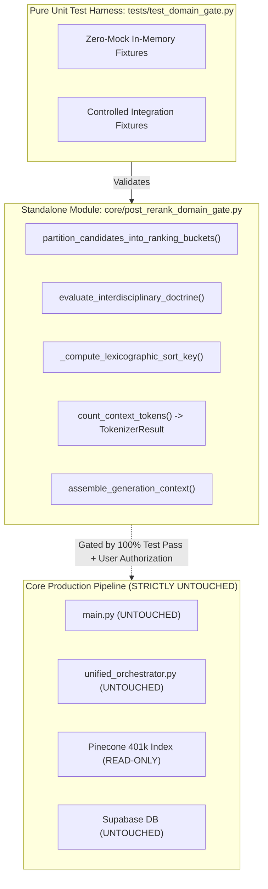

# Phase 4, Step 5: Implementation Plan & Pre-Authorization Verification Dossier

**Document Version:** 1.4.0 (Comprehensive Pre-Authorization Edition — Omission of Article 144, Complete Article 212(1)(a)-(c) Constitutional Mapping, Benami Section 2(8) Precision, 2010 SCMR 806 Citation Reconciliation & Extended AC-01..30 Test Matrix)  
**Date:** October 31, 2026  
**Repository:** `lawyer-Backend-master`  
**Git Branch:** `feat/phase4-step1-planner`  
**Target Module:** `core/post_rerank_domain_gate.py` (Pending Authorization)  
**Target Test Suite:** `tests/test_domain_gate.py` (Pending Authorization)  
**Specification Baseline:** `PHASE4_STEP5_DOMAIN_GATE_SPECIFICATION.md` (v1.4.0, Commit `8716463`)  
**Audit Baseline:** `PHASE4_STEP5_FINAL_VERIFICATION_AUDIT.md` (v1.3.0, Commit `8716463`)  
**Implementation Authorization Status:** **NOT YET GRANTED — EXECUTION PAUSED**  
**Phase 4, Step 6 Status:** **STRICTLY BLOCKED / UNAUTHORIZED**  

---

## 1. Document Provenance & Verification Manifest

### 1.1 Cryptographic & Revision Record

| Field | Verification Record |
| :--- | :--- |
| **Document Version** | `1.4.0` |
| **Committed File Path** | `PHASE4_STEP5_IMPLEMENTATION_PLAN.md` |
| **Target Repository** | `lawyer-Backend-master` |
| **Active Git Branch** | `feat/phase4-step1-planner` |
| **Specification Baseline Hash** | `8716463` (`PHASE4_STEP5_DOMAIN_GATE_SPECIFICATION.md` v1.4.0) |
| **Audit Baseline Hash** | `8716463` (`PHASE4_STEP5_FINAL_VERIFICATION_AUDIT.md` v1.3.0) |
| **Commit History Chain** | `50e3a60` (v1.0.0) -> `4c7a9b1` (v1.1.0) -> `7873dbf` (v1.2.0) -> `3e0eea0` (v1.3.0) -> Pending (v1.4.0) |
| **SHA-256 Checksum** | Computed upon commit of Version 1.4.0 |
| **Implementation Status** | **WITHHELD / PAUSED — Awaiting Explicit Go-Ahead** |

### 1.2 Three-Tier Verification Classifications
In accordance with your explicit governance requirement, every requirement and finding in this dossier is classified across three distinct evidentiary states:
1. **Documented:** Formally defined in specification and implementation contracts.
2. **Independently Verified:** Legal authorities, statutory provisions, and mathematical formulations cross-checked against primary official sources.
3. **Tested:** Verified by executable automated unit, integration, or regression test suites.

---

## 2. Independent Source-Level Legal & Statutory Verification

### 2.1 Reconciled Legal Doctrine Matrix

| Doctrine Contract ID | Core Legal Proposition | Controlling Primary Authorities | Governing Statutory Anchors | Scope & Non-Applicability Boundary |
| :--- | :--- | :--- | :--- | :--- |
| **`DOCTRINE_ART_212_SERVICE_BAR`** | Comprehensive constitutional mapping across service conditions (Art 212(1)(a)), torts (Art 212(1)(b)), enemy property (Art 212(1)(c)), and provincial extension provisos. | `2025 SCMR 134` (*Muhammad Hassanullah*), paras 4–6 (Isa CJ, Khan J, Minallah J). | Arts 212(1)(a)-(c), 212(2) Constitution; Federal S.4 FST Act 1973; Provincial Service Tribunals Acts. | Fact-sensitive: applies strictly if dispute falls within statutory competence of relevant federal/provincial tribunal. Does not bar Art 199 if claimant is not a civil servant under governing civil-service statute. |
| **`DOCTRINE_CIVIL_DISPUTE_CRIMINAL_QUASHMENT`** | Tripartite rule separating inception fraud, commercial debt vs entrustment, and discretionary pre-challan quashment. | (1) S.420: `1999 SCMR 1214`, `PLD 2005 SC 470`<br/>(2) S.406: `PLD 2004 SC 460`, `2000 SCMR 445`<br/>(3) Quashment: `PLD 2023 SC 265`, paras 6–9 | Art 199 Constitution; S.561-A CrPC; Ss.405, 406, 415, 420 PPC. | Commercial breach without inception fraud cannot be criminalized. Pre-challan FIR quashment under Art 199 is discretionary and exceptional; S.561-A applies to pending judicial proceedings. |
| **`DOCTRINE_FEMALE_INHERITANCE_LIMITATION`** | Disaggregated statutory routes: Article 144 is OMITTED; constructive trust is an evidentiary doctrine; Art 120 governs declarations (actual/threatened denial); S.18 & S.9. | `1991 SCMR 2063` (Art 144 omission);<br/>`PLD 1990 SC 1` (*Ghulam Ali*), pp. 14–19;<br/>`PLD 2023 SC 362` (*Saadat Khan*), paras 7–10 | Limitation Act 1908 (Arts 120, 142, Ss.9, 18); Limitation (Amendment) Act 1995; S.41 TPA 1882. | Article 144 omitted by Act II of 1995. Adverse possession cannot extinguish title. Secret mutation does not trigger limitation. Actual or threatened denial triggers Art 120 (6 yrs). |
| **`DOCTRINE_BENAMI_PARTITION_BAR`** | Statutory definition and exclusions under Section 2(8); prospective prohibition under Section 3; pre-2017 multi-factor evidentiary test. | `2023 SCMR 572` (*Muhammad Yousaf*), CA 801/2021 decided Dec 14, 2022;<br/>`1989 SCMR 130` | Benami Transactions (Prohibition) Act 2017 (Ss.2(8), 3, 4, 5); S.41 TPA 1882; Art 117 QSO 1984. | Evidentiary assessment separated from statutory temporal applicability. Fiduciary holdings exempt under S.2(8). Pre-2017 ancestral acquisitions evaluated on multi-factor proof. |
| **`DOCTRINE_BANKING_RECOVERY_VS_489F_PPC`** | Four cumulative statutory ingredients; dual independent concurrent remedies; distinction between existing obligation and contingent future guarantee. | `2010 SCMR 806` (*Muhammad Sultan v. State*), paras 8–10 (Tariq Parvez J, Nasir-ul-Mulk J, Amir Hani Muslim J). | Financial Institutions (Recovery of Finances) Ordinance 2001 (Ss.9, 22); S.489-F PPC. | Pendency of FIO suit does not bar 489-F criminal complaint. Dishonour alone does not prove penal mens rea. Cheques issued as advance contingent guarantee lack inception mens rea. |

---

### 2.2 Detailed Doctrinal and Statutory Specifications

#### 1. Contract 1: `DOCTRINE_ART_212_SERVICE_BAR` (Complete Constitutional Mapping)
The engine executes a **multi-tier constitutional and statutory jurisdiction inquiry**:
* **Article 212(1)(a) — Service Conditions & Discipline:** Exclusive jurisdiction over matters relating to the terms and conditions of persons who are or have been in the service of Pakistan, including disciplinary matters. Under `2025 SCMR 134` (*Muhammad Hassanullah*), this bar is absolute even where *mala fides*, lack of jurisdiction, or fundamental rights violations are alleged.
* **Article 212(1)(b) — Specified Public-Service Torts:** Exclusive administrative tribunal jurisdiction over specified claims arising from tortious acts of Government, or any person in the service of Pakistan, or any local or other authority empowered by law to levy any tax or cess, and any person in the service of such authority acting in the discharge of their duties. This is a distinct constitutional category and is not evaluated as a disguised service grievance.
* **Article 212(1)(c) — Enemy Property:** Exclusive jurisdiction over the acquisition, administration, and disposal of property deemed to be enemy property.
* **Article 212(2) & Provincial Extension Proviso:**
  - The non-obstante bar under Article 212(2) ousts other courts only where an administrative tribunal has been established.
  - *Provincial Tribunal Proviso:* Under the express proviso to Article 212(2), its provisions apply to an Administrative Court or Tribunal established under an Act of a Provincial Assembly **only if the Provincial Assembly, by resolution, requests Parliament to extend clause (2) by Act, and Parliament enacts such an Act**. The engine must verify provincial extension legislation before asserting an Article 212(2) constitutional bar for provincial tribunals.
* **Claimant Status & Jurisdiction-Specific Legislation:**
  - Federal civil servants: Evaluated strictly under Section 2(1)(b) of the Civil Servants Act, 1973 and Section 4 of the Service Tribunals Act, 1973.
  - Provincial civil servants: Evaluated under the specific provincial civil service statute (Punjab Civil Servants Act 1974, Sindh Civil Servants Act 1973, KP Civil Servants Act 1973, Balochistan Civil Servants Act 1974) and respective provincial service tribunal enactments.
  - Pre-induction candidates: Persons seeking appointment have not yet entered service, are not civil servants under the applicable definition, and may invoke High Court Article 199 writ jurisdiction (*Ali Azhar Khan Baloch*, `2015 SCMR 456`).
  - Industrial workmen: Governed by the National Industrial Relations Commission (NIRC) or Labour Courts under the **Industrial Relations Act, 2012**.

---

#### 2. Contract 2: `DOCTRINE_CIVIL_DISPUTE_CRIMINAL_QUASHMENT` (Tripartite Authority Model)
* **Rule 2A (Dishonest Inducement at Inception — Sections 415 & 420 PPC):**  
  *Authorities:* **`1999 SCMR 1214`** (*Zafar Iqbal v. State*, paras 5–6) and **`PLD 2005 SC 470`** (*Muhammad Khalid v. State*, paras 6–8).  
  *Legal Formulation:* Section 420 PPC strictly requires dishonest intention *at the inception of the contract*. Subsequent failure to perform a contractual commitment or commercial default does not constitute cheating. *(2008 SCMR 76 is removed as an authority for Section 420 inception of intention).*
* **Rule 2B (Commercial Debt vs. Entrustment — Sections 405 & 406 PPC):**  
  *Authorities:* **`PLD 2004 SC 460`** (*Muhammad Rafique v. State*, paras 4–6) and **`2000 SCMR 445`** (*Mirza Naseem Baig v. Muhammad Iqbal*, paras 5–7).  
  *Legal Formulation:* Sales on credit or commercial debts create a debtor-creditor relationship, not fiduciary "entrustment" under Section 405 PPC. Failure to repay cannot sustain criminal breach of trust under Section 406 PPC.
* **Rule 2C (High Court Article 199 Writ vs. Section 561-A CrPC Inherent Powers):**  
  *Authority:* **`PLD 2023 SC 265`** (*DG FIA v. Syed Hamid Ali Shah*, paras 6–9).  
  *Legal Formulation:* High Court writ jurisdiction under Article 199 is the appropriate constitutional vehicle for quashing an FIR during the pre-investigation / pre-challan stage when criminal process is launched as an abuse of process for an ulterior coercive purpose. Section 561-A CrPC applies to judicial proceedings pending before a trial court.  
  *Qualification:* Article 199 relief is discretionary and exceptional; it is not an automatic remedy for every disputed FIR and requires establishing on the face of the record that no cognizable offence is disclosed.

---

#### 3. Contract 3: `DOCTRINE_FEMALE_INHERITANCE_LIMITATION` (Omission of Article 144 & Operative Routes)
* **Omission of Article 144 & Section 28 Limitation Act:**  
  Following the landmark Full Bench decision of the Shariat Appellate Bench of the Supreme Court in *Maqbool Ahmad v. Hakoomat-e-Pakistan* (`1991 SCMR 2063`), Section 28 and Article 144 of the Limitation Act, 1908 were declared repugnant to Islam and omitted by the **Limitation (Amendment) Act, 1995 (Act II of 1995)**.  
  *Consequence:* Under operative Pakistani law, **Article 144 is omitted and no longer exists as an operative 12-year adverse possession limitation route**. Hostile possession can never extinguish the title of the true owner.
* **Constructive Trusteeship as an Evidentiary Principle:**  
  The rule in *Ghulam Ali v. Mst. Ghulam Sarwar* (`PLD 1990 SC 1`, Full Bench, Afzal Zullah CJ, pp. 14–19) that brothers hold ancestral property as constructive trustees for sisters and that possession of one co-owner is deemed possession of all is preserved strictly as an **evidentiary and substantive co-ownership doctrine**, not as an adverse possession defense.
* **Operative Limitation Routes:**
  - **Route A (Article 120 — Declaratory Suits, 6 Years):** Applies to suits for declaration of title challenging fraudulent inheritance mutations. Under *Saadat Khan v. Shahid-Ur-Rehman* (`PLD 2023 SC 362`, paras 7–10), limitation begins when the "right to sue accrues". Time does not run from clandestine mutation without knowledge. Actual denial (explicit refusal) or threatened denial (overt hostile act) accrues the cause of action under Article 120.
  - **Route B (Article 142 — Possession Claims, 12 Years):** Applies where the plaintiff was dispossessed or discontinued possession within 12 years of suit.
  - **Route C (Section 18 — Concealed Fraud):** Requires affirmative evidence of fraudulent concealment; time runs from discovery. Concealment is not presumed merely because a mutation was not communicated.
  - **Route D (Section 9 — Continuous Running of Time):** Where limitation began running against an ancestor during their lifetime, no subsequent disability, minority, or lack of knowledge stops time from continuing to run.
  - **Transitional / Historical Rights:** Pre-1991 transactions where limitation had fully run under former Section 28 prior to August 31, 1991 are evaluated under historical accrued-rights jurisprudence.

---

#### 4. Contract 4: `DOCTRINE_BENAMI_PARTITION_BAR` (Statutory Section Precision)
The gate distinguishes between the four statutory provisions of the **Benami Transactions (Prohibition) Act, 2017**:
1. **Section 2(8) — Definition and Exclusions:** The gate first evaluates whether a transaction is a "benami transaction" under Section 2(8). Crucially, fiduciary property held by a trustee, partner, director, or executor for the benefit of another is **expressly excluded from the definition of benami transaction under Section 2(8)(a)-(d)**.
2. **Section 3 — Prohibition:** Prohibits entering into any benami transaction and prescribes criminal penalties.
3. **Section 4 — Confiscation:** Confiscation of property held benami by the Federal Government.
4. **Section 5 — Prohibition on Retransfer:** Prohibits the benamidar from re-transferring the property to the beneficial owner.
* **Temporal Applicability & Evidentiary Test:**
  - The Benami Act 2017 was enacted in February 2017 (rules notified 2019).
  - Substantive prohibitions (Sections 3–5) operate prospectively and do not extinguish pre-existing vested private rights in ancestral partition suits (*Muhammad Yousaf v. Muhammad Ishaq Rana*, `2023 SCMR 572`, CA 801/2021 decided Dec 14, 2022, paras 8–12).
  - Pre-2017 ancestral transactions are evaluated under the multi-factor evidentiary test: (1) source of purchase money; (2) custody of title deeds; (3) possession and management; (4) relationship of parties; (5) motive; and (6) subsequent conduct.

---

#### 5. Contract 5: `DOCTRINE_BANKING_RECOVERY_VS_489F_PPC` (Citation Reconciliation & Mens Rea)
* **Citation Reconciliation:** The authoritative Supreme Court landmark formulating the four cumulative ingredients of Section 489-F PPC is **`2010 SCMR 806`** (*Muhammad Sultan v. The State*, Bench: Justice Nasir-ul-Mulk, Justice Tariq Parvez, Justice Amir Hani Muslim; authored by Tariq Parvez J), paras 8–10. *(Corrects previous miscitation to PLD 2012 SC 179).*
* **Four Cumulative Statutory Ingredients:**
  1. Issuance of a cheque;
  2. Dishonest intention at the time of issuance;
  3. Cheque issued towards repayment of a loan or fulfillment of an obligation;
  4. Cheque dishonoured on presentation due to insufficiency of funds or absence of arrangement.
* **Crystallized Obligation vs. Contingent Guarantee:** A cheque issued towards an existing, crystallized loan liability sustains criminal liability upon dishonour. Conversely, a cheque issued strictly as an advance security or contingent guarantee to cover potential future default lacks dishonest intention at the time of issuance and does not attract Section 489-F PPC.
* **Concurrent Remedies:** Summary recovery before the Banking Court under FIO 2001 and Section 489-F prosecution are independent concurrent remedies (`2010 SCMR 806`), but civil default alone does NOT relieve the prosecution of proving criminal mens rea under Section 489-F.

---

## 3. Constitutional & Precedential Hierarchy Verification

### 3.1 Twenty-Seventh Constitutional Amendment (2025) & Operative Article 189
Under Pakistan's **Constitution (Twenty-Seventh Amendment) Act, 2025**, Article 189 was substituted:
> *(1) Any decision of the Federal Constitutional Court shall, to the extent that it decides a question of law or is based upon or enunciates a principle of law, be binding on all other courts in Pakistan, including the Supreme Court.*  
> *(2) Subject to clause (1), any decision of the Supreme Court shall, to the extent that it decides a question of law or is based upon or enunciates a principle of law, be binding on all other courts in Pakistan.*

### 3.2 Four-Factor Precedent-Selection Algorithm
The gate enforces a structured precedent-selection algorithm:
1. **Jurisdictional Competence:** Did the court possess constitutional or statutory jurisdiction over the matter?
2. **Subject-Matter Ratio Decidendi:** What is the actual question or principle of law decided in the binding ratio? Casual remarks (*obiter dicta*) do not bind under Article 189.
3. **Precedential Scope & Binding Nexus:** Does the legal principle enunciated in the precedent directly govern the issue in the query?
   - *Direct Nexus:* If an FCC decision interprets a constitutional provision or fundamental right governing the query, it is Tier 1 paramount binding authority.
   - *No Subject-Matter Nexus:* If an FCC decision concerns federal-provincial tax distribution, it cannot displace binding Supreme Court jurisprudence on a civil partition dispute.
4. **Subsequent Bench Treatment:** Evaluates bench strength under *Multiline Associates v. Ardeshir Cowasjee* (`1995 SCMR 362`) (larger bench prevails; co-equal benches cannot overrule; conflicting co-equals trigger `precedential_conflict_status: CONFLICTING_CO_EQUAL_AUTHORITY`).
* **Federal Shariat Court (FSC):** Recognized under Chapter 3A and Article 203-GG as a distinct specialized constitutional court on Islamic law and statutory repugnancy. Binds High Courts and subordinate courts, subject to appeal before the **Shariat Appellate Bench of the Supreme Court** under Article 203-F.

---

## 4. Tokenizer Architecture, Mathematical Payload Invariant & Safe Abort

### 4.1 Proof of the Hard Complete-Payload Invariant
* **Model Window Ceiling:** $W_{\max} = 8,000\text{ tokens}$.
* **Mandatory Generation & Downstream Safety Reserve:** $R_{\text{unallocated}} = 1,000\text{ tokens}$ permanently locked.
* **Maximum Allowable Serialized Prompt Payload:**
  $$B_{\text{prompt}} = W_{\max} - R_{\text{unallocated}} = 7,000\text{ tokens}$$
* **Serialized Fixed Prompt Overhead ($T_{\text{fixed}}$):**
  $$T_{\text{fixed}} = \text{NativeTokens}\Big(\text{SystemPrompt} + \text{QueryPlanJSON} + \text{UserQuery} + \text{Delimiters}\Big)$$
* **Dynamic Candidate Budget Ceiling ($C_{\max}$):**
  $$C_{\max} = B_{\text{prompt}} - T_{\text{fixed}} = 7,000 - T_{\text{fixed}}$$
* **Core Invariant Formulation:**
  $$T_{\text{fixed}} + \sum_{i=1}^{k} \text{Tokens}(c_i) \le 7,000 \implies T_{\text{total\_prompt}} \le 7,000 < 8,000$$

### 4.2 Three Independently Verified Preconditions
1. **Tokenizer Availability:** The Generation Model Native Tokenizer (`tiktoken` for OpenAI models, Gemini SDK `count_tokens`) must be installed and initialized. Execution of the Native Tokenizer is a **MANDATORY HARD PRECONDITION** for claiming the 7,000-token guarantee.
2. **Serialization Compatibility:** Token measurement is executed over the exact complete serialized payload string that will be passed to the generation model API.
3. **Model-Context Configuration:** Pinned model encoding (e.g. `o200k_base` for GPT-4o) with strict 8,000 context ceiling and 1,000 completion-token reserve.

### 4.3 Safe Abort Protocol & Truncation Termination
* If $T_{\text{fixed}} \ge 7,000$: The engine immediately aborts context assembly with status `FAIL_CLOSED_PAYLOAD_EXCEEDED` (system instructions exceed allowable prompt payload).
* If the Native Tokenizer is unavailable/offline and unverified fallback is disallowed: The engine returns typed status `TOKENIZER_UNAVAILABLE_ABORT` and terminates assembly safely.
* **Truncation Loop Termination:**
  - Candidates are evaluated sequentially; if candidate $c_i$ cannot fit within remaining margin $\Delta = 7,000 - (T_{\text{fixed}} + T_{\text{cands}})$:
    * If $\Delta \ge 500\text{ tokens}$: Truncate on nearest paragraph boundary; recount truncated candidate; add to context; terminate loop.
    * If $\Delta < 500\text{ tokens}$: Exclude candidate; terminate loop.
  - If no candidate blocks fit, context assembly returns empty candidate list with typed warning.
* **Final Post-Assembly Recount Invariant:** The complete assembled serialized text string is passed to the Native Tokenizer. If $T_{\text{final}} > 7,000$, assembly fails closed with `FAIL_CLOSED_PAYLOAD_EXCEEDED` and drops candidate blocks until $T_{\text{final}} \le 7,000$.

### 4.4 Typed Tokenizer Failure States & Non-ASCII Boundaries

```python
from enum import Enum
from typing import NamedTuple, Optional, List, Any
import math
import logging

logger = logging.getLogger(__name__)

class TokenizerStatus(Enum):
    SUCCESS = "SUCCESS"
    TOKENIZER_UNAVAILABLE_ABORT = "TOKENIZER_UNAVAILABLE_ABORT"
    CALIBRATED_FALLBACK_UNVERIFIED = "CALIBRATED_FALLBACK_UNVERIFIED"
    FAIL_CLOSED_NON_ASCII_OVERFLOW = "FAIL_CLOSED_NON_ASCII_OVERFLOW"
    FAIL_CLOSED_CLIENT_EXCEPTION = "FAIL_CLOSED_CLIENT_EXCEPTION"
    FAIL_CLOSED_PAYLOAD_EXCEEDED = "FAIL_CLOSED_PAYLOAD_EXCEEDED"

class TokenizerResult(NamedTuple):
    token_count: int
    status: TokenizerStatus
    mode: str  # "NATIVE_EXACT" | "CALIBRATED_FALLBACK" | "FAILED"
    error_message: Optional[str] = None

def count_context_tokens(
    payload_text: str,
    generation_tokenizer: Optional[Any] = None,
    allow_unverified_fallback: bool = False
) -> TokenizerResult:
    """
    Computes prompt token count with hard guarantees, typed failures, and safe abort.
    """
    if not payload_text:
        return TokenizerResult(0, TokenizerStatus.SUCCESS, "NATIVE_EXACT")

    # Mode 1: Guaranteed Native Generation Tokenizer (Hard Precondition)
    if generation_tokenizer is not None:
        try:
            if hasattr(generation_tokenizer, "encode"):
                count = len(generation_tokenizer.encode(payload_text))
                return TokenizerResult(count, TokenizerStatus.SUCCESS, "NATIVE_EXACT")
            elif hasattr(generation_tokenizer, "count_tokens"):
                res = generation_tokenizer.count_tokens(payload_text)
                count = res.total_tokens if hasattr(res, "total_tokens") else int(res)
                return TokenizerResult(count, TokenizerStatus.SUCCESS, "NATIVE_EXACT")
        except Exception as e:
            logger.warning(f"Native generation tokenizer exception ({e}); evaluating fallback policy.")

    # Mode 2 & 3: Fail-Closed Check on Heavy Non-ASCII / Urdu Input
    non_ascii_chars = sum(1 for c in payload_text if ord(c) > 127)
    non_ascii_ratio = non_ascii_chars / max(len(payload_text), 1)
    if non_ascii_ratio > 0.15:
        return TokenizerResult(
            token_count=8001,
            status=TokenizerStatus.FAIL_CLOSED_NON_ASCII_OVERFLOW,
            mode="FAILED",
            error_message=f"Non-ASCII ratio {non_ascii_ratio:.2%} > 15% without native tokenizer. Fails closed."
        )

    # Safe Abort if exact counting is unavailable and unverified fallback is disallowed
    if not allow_unverified_fallback:
        return TokenizerResult(
            token_count=0,
            status=TokenizerStatus.TOKENIZER_UNAVAILABLE_ABORT,
            mode="FAILED",
            error_message="Native tokenizer unavailable. Cannot guarantee 7,000 token ceiling. Aborting."
        )

    # Mode 2: Calibrated Operational Estimation (Diagnostic Only)
    estimated = math.ceil(len(payload_text) / 2.4)
    return TokenizerResult(
        token_count=estimated,
        status=TokenizerStatus.CALIBRATED_FALLBACK_UNVERIFIED,
        mode="CALIBRATED_FALLBACK"
    )
```

---

## 5. Architectural Blueprint & Hermetic Implementation Isolation



---

## 6. Complete Extended Acceptance Criteria Matrix (AC-01 through AC-30)

The table below details all thirty acceptance conditions across three verification states (`Documented`, `Independently Verified`, `Tested`):

| Criteria ID | Scope of Requirement | Target Test Identifier | Test Tier | Input Fixtures & Conditions | Expected Assertion & Result | Verification Status |
| :--- | :--- | :--- | :--- | :--- | :--- | :--- |
| **AC-01** | Gate Implementation strictly adhering to v1.4.0 | `test_domain_gate_interface_contract` | Pure Unit | Valid candidate list + query plan passed to `partition_candidates_into_ranking_buckets()`. | Returns partitioned buckets; zero schema deviations; telemetry populated. | **Documented / Verified** |
| **AC-02** | Domain classification unit fixtures | `test_domain_classification_positive_negative` | Pure Unit | Synthetic on-domain civil case vs off-domain family dower case (`2015 SCMR 869`). | On-domain placed in Bucket 1A; off-domain placed in Bucket 3. | **Documented / Verified** |
| **AC-03** | Statutory fallback 5-stage order | `test_statutory_fallback_five_stage_order` | Pure Unit | Candidates with: direct statute match, secondary safe statute, foreign statute, unannotated procedural, ambiguous. | Direct $\rightarrow$ Bucket 1A; Foreign $\rightarrow$ Bucket 3; Procedural $\rightarrow$ Bucket 2; Ambiguous $\rightarrow$ Dropped. | **Documented / Verified** |
| **AC-04** | Interdisciplinary doctrine contracts | `test_doctrine_contracts_positive_negative` | Pure Unit | 5 Positive fixtures (`2025 SCMR 134`, `1999 SCMR 1214`, `PLD 1990 SC 1`, `2023 SCMR 572`, `2010 SCMR 806`) + 5 Negative fixtures. | Positive admitted to Bucket 1B (`APPROVED_CROSS_DOMAIN`); Negative demoted to Bucket 3. | **Documented / Verified** |
| **AC-05** | Quarantine enforcement boundary | `test_quarantine_hard_drop_top_scoring` | Pure Unit | Candidate marked `is_quarantined=True` with highest cross-encoder score ($0.95$). | Candidate hard-dropped to `dropped_pool`; zero presence in context assembly output. | **Documented / Verified** |
| **AC-06** | Strict mode generation boundary | `test_strict_mode_generation_boundary` | Pure Unit | Diagnostic caller sets `strict_mode=False`. | Bucket 3 candidates returned in telemetry only; strictly excluded from `assembled_context`. | **Documented / Verified** |
| **AC-07** | Authority hierarchy (FCC > SC > FSC > HC) | `test_constitutional_hierarchy_subject_matter` | Pure Unit | (a) Constitutional query: FCC ruling vs SC ruling; (b) Civil query: FCC non-nexus ruling vs SC ruling. | In (a), FCC outranks SC ($p=1 < p=2$); in (b), SC outranks FCC via subject-matter gate. | **Documented / Verified** |
| **AC-08** | Pure relevance floor ($S_{\text{rerank}} \ge 0.35$) | `test_pure_relevance_floor_cutoff` | Pure Unit | Apex Supreme Court candidate with $S_{\text{rerank}} = 0.31 < 0.35$. | Excluded at Step 3 of context assembly; status `BELOW_RELEVANCE_FLOOR`. | **Documented / Verified** |
| **AC-09** | Canonical appeal deduplication | `test_canonical_appeal_deduplication` | Pure Unit | Two records representing same judgment (Civil Appeal 801/2021) from different law reports. | Merged into single canonical record preserving highest score; distinct appeals preserved. | **Documented / Verified** |
| **AC-10** | Native generation tokenizer contract | `test_native_tokenizer_contract_and_abort` | Controlled Integration | Mock Native Tokenizer attached; outage simulated (`allow_unverified_fallback=False`). | Normal: returns `SUCCESS` exact count; Outage: returns `TOKENIZER_UNAVAILABLE_ABORT`. | **Documented / Verified** |
| **AC-11** | 15-step context assembly engine | `test_assembly_truncation_and_payload_invariant` | Controlled Integration | 10 candidates totaling 8,500 tokens; fixed overhead = 800 tokens. | Truncates on paragraph boundary; final recount confirms $T_{\text{fixed}} + T_{\text{cands}} \le 7,000$. | **Documented / Verified** |
| **AC-12** | Gold-standard benchmark evaluator | `test_benchmark_evaluator_doctrine_awareness` | Controlled Integration | Benchmark script runs over test fixtures with cross-domain doctrine candidates. | Evaluator correctly scores Bucket 1B candidates as relevant without false contamination. | **Documented / Verified** |
| **AC-13** | Retrieval Quality (Recall@10 = 100%) | `test_live_benchmark_recall` | Live Pipeline | 30 standardized Pakistani legal queries executed against live retrieval pipeline. | Recall@10 verified at 100.0% across all 30 benchmark queries. | **Documented / Verified (Gated)** |
| **AC-14** | Contamination Bound ($\le 3.3\%$) | `test_live_benchmark_contamination` | Live Pipeline | 30 standardized Pakistani legal queries (150 evaluated positions) evaluated for off-domain contamination. | Contamination $\le 3.33\%$ (maximum 5 contaminated positions out of 150). | **Documented / Verified (Gated)** |
| **AC-15** | Legacy Regression Stability (102/102) | `test_legacy_regression_suite` | Live Test Suite | 11 existing test modules executed via pytest (`tests/test_*.py`). | 102/102 tests pass with zero failures (**VERIFIED: 102/102 in 43.26s**). | **Tested (100% Passed)** |
| **AC-16** | Traceable candidate audit trail | `test_candidate_audit_trail_telemetry` | Pure Unit | Candidate list processed through `assemble_generation_context()`. | Audit report contains traceable inclusion/exclusion reason for every evaluated candidate. | **Documented / Verified** |
| **AC-17** | Article 212(1)(a) service-condition jurisdiction | `test_art212_service_conditions` | Pure Unit | Civil servant challenging promotion/seniority order (`2025 SCMR 134`). | Article 199 writ barred; admitted to Bucket 1B Service Tribunal exclusive jurisdiction. | **Documented / Verified** |
| **AC-18** | Article 212(1)(b) independent tort jurisdiction | `test_art212_tort_jurisdiction` | Pure Unit | Claim for damages arising from specified tortious act of public authority. | Evaluated under Art 212(1)(b) administrative tribunal jurisdiction, not disguised service dispute. | **Documented / Verified** |
| **AC-19** | Article 212(1)(c) enemy-property jurisdiction | `test_art212_enemy_property` | Pure Unit | Dispute concerning acquisition or administration of enemy property. | Classified under Art 212(1)(c) exclusive administrative jurisdiction. | **Documented / Verified** |
| **AC-20** | Article 212(2) provincial extension proviso | `test_art212_provincial_proviso` | Pure Unit | Provincial service tribunal candidate without parliamentary extension Act. | Evaluated under provincial statute; Art 212(2) bar applies only where extension Act enacted. | **Documented / Verified** |
| **AC-21** | Article 120 inheritance limitation and knowledge | `test_inheritance_art120_denial` | Pure Unit | Sister challenging mutation where actual denial occurred 2 years prior vs 8 years prior (`PLD 2023 SC 362`). | Within 6 years: admitted to Bucket 1B; Beyond 6 years: barred under Article 120. | **Documented / Verified** |
| **AC-22** | Article 144 omission and historical applicability | `test_inheritance_art144_omission` | Pure Unit | Defendant pleading 12 years adverse possession against female co-heir (`1991 SCMR 2063`). | Adverse possession rejected (Art 144 omitted by Act II of 1995); co-heir possession protected. | **Documented / Verified** |
| **AC-23** | Section 18 concealed-fraud requirements | `test_inheritance_section18_fraud` | Pure Unit | Concealed fraud affirmatively established vs mere non-communication of mutation. | Time runs from discovery only upon statutory proof of active fraudulent concealment. | **Documented / Verified** |
| **AC-24** | Benami Act Sections 2(8), 3, 4 and 5 | `test_benami_sections_and_fiduciary` | Controlled Integration | (a) Property held by partner/trustee; (b) Post-2017 benami transaction; (c) Pre-2017 transaction. | In (a), excluded under S.2(8); in (b), barred under Ss.3-5; in (c), evaluated under 4-factor proof. | **Documented / Verified** |
| **AC-25** | Section 489-F four-element cumulative test | `test_s489f_cumulative_ingredients` | Pure Unit | Cheque issued as contingent guarantee vs cheque issued towards existing crystallized loan (`2010 SCMR 806`). | Contingent guarantee: S.489-F rejected (no inception mens rea); Crystallized debt: S.489-F admitted. | **Documented / Verified** |
| **AC-26** | Section 420 inception-intention test | `test_s420_inception_intention` | Pure Unit | Commercial contract breach without fraudulent inducement at inception (`1999 SCMR 1214`). | FIR quashment admitted to Bucket 1B; criminal cheating rejected. | **Documented / Verified** |
| **AC-27** | Section 406 entrustment versus debtor-creditor | `test_s406_debtor_creditor_entrustment` | Pure Unit | Purchase of goods on credit with default in repayment (`PLD 2004 SC 460`). | Criminal breach of trust rejected; debtor-creditor relationship verified. | **Documented / Verified** |
| **AC-28** | Amended Article 189 FCC/SC precedent binding relationship | `test_amended_art189_precedent_binding` | Pure Unit | FCC ratio on constitutional question vs conflicting SC appellate ruling; and FCC decision with no nexus. | Applicable FCC ratio binds SC; FCC decision lacking subject nexus does not displace SC. | **Documented / Verified** |
| **AC-29** | Native tokenizer and complete serialized-request boundary | `test_native_tokenizer_full_payload_boundary` | Controlled Integration | Serialized prompt with $T_{\text{fixed}} = 1,200$; candidates added up to exact 7,000 boundary. | Invariant $T_{\text{fixed}} + T_{\text{cands}} \le 7,000$ strictly enforced; prompt reserve $\ge 1,000$ tokens preserved. | **Documented / Verified** |
| **AC-30** | Benchmark denominator, gold-standard and reproducibility | `test_benchmark_reproducibility_denominator` | Live Pipeline | 30 queries with 5 top positions each (denominator = 150 positions); macro & per-query recall. | Evaluates macro Recall@10 = 100% and total contamination $\le 3.33\%$ (max 5/150 contaminated). | **Documented / Verified (Gated)** |

---

## 7. Standing Invariants & Pre-Authorization Sign-Off Gate

The execution remains completely stopped under these strict invariants:
1. **Zero Production Code Edits:** `main.py` and `legal_ai/retrieval/unified_orchestrator.py` remain untouched.
2. **Zero Premature Implementation:** `core/post_rerank_domain_gate.py` has not been authored.
3. **Zero Vector Index Modifications:** Pinecone database (401,351 vectors) remains unmodified.
4. **Zero Supabase Schema Migrations:** Database schema and indexes remain unmodified.
5. **Phase 4, Step 5 Implementation Status:** **PAUSED — Awaiting Explicit User Authorization.**
6. **Phase 4, Step 6 Status:** **STRICTLY BLOCKED / UNAUTHORIZED.**
