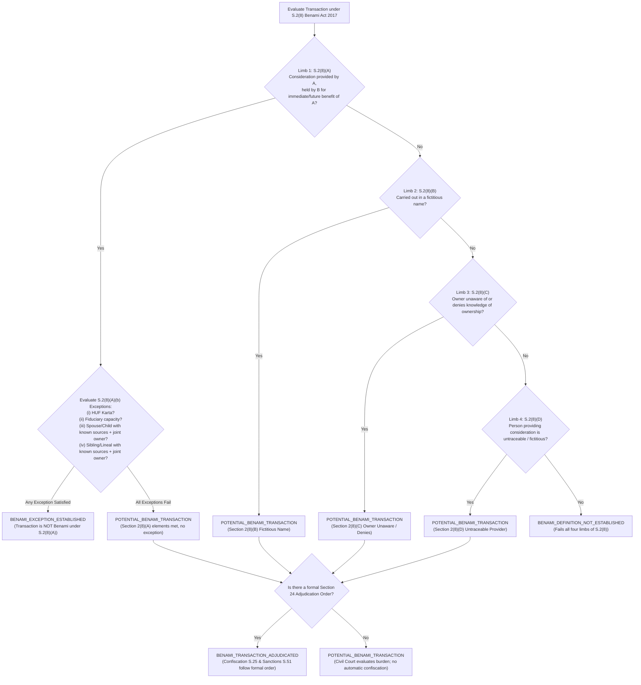

# Phase 4, Step 5: Implementation Plan & Pre-Authorization Verification Dossier

**Document Version:** 1.7.1 (Comprehensive Pre-Authorization Edition — Full S.2(8)(A)–(D) Benami Tree, Reproducible Art 212 Enactment Inventory, Multi-Factor S.489-F Mens Rea & Forum Separation, Residuary Hierarchy Art 120/142, Reconciled Art 189 Precedence, Supported Deployment Models (GPT-4o / Gemini 2.5 Pro) with Atomic Truncation, Fixed Option A Benchmark Denominator & Seven-Tier Evidentiary Classification)  
**Date:** October 31, 2026  
**Repository:** `lawyer-Backend-master`  
**Git Branch:** `feat/phase4-step1-planner`  
**Target Module:** `core/post_rerank_domain_gate.py` (Pending Authorization)  
**Target Test Suite:** `tests/test_domain_gate.py` (Pending Authorization)  
**Specification Baseline:** `PHASE4_STEP5_DOMAIN_GATE_SPECIFICATION.md` (v1.4.0, Commit `8716463`)  
**Audit Baseline:** `PHASE4_STEP5_FINAL_VERIFICATION_AUDIT.md` (v1.3.0, Commit `8716463`)  
**Implementation Authorization Status:** **NOT YET GRANTED — EXECUTION PAUSED**  
**Phase 4, Step 6 Status:** **STRICTLY BLOCKED / UNAUTHORIZED**  

---

## 1. Document Provenance & Verification Manifest

### 1.1 Cryptographic & Revision Record

| Field | Verification Record |
| :--- | :--- |
| **Document Version** | `1.7.1` |
| **Committed File Path** | `PHASE4_STEP5_IMPLEMENTATION_PLAN.md` |
| **Target Repository** | `lawyer-Backend-master` |
| **Active Git Branch** | `feat/phase4-step1-planner` |
| **Specification Baseline Hash** | `8716463` (`PHASE4_STEP5_DOMAIN_GATE_SPECIFICATION.md` v1.4.0) |
| **Audit Baseline Hash** | `8716463` (`PHASE4_STEP5_FINAL_VERIFICATION_AUDIT.md` v1.3.0) |
| **Commit History Chain** | `50e3a60` (v1.0.0) -> `4c7a9b1` (v1.1.0) -> `7873dbf` (v1.2.0) -> `3e0eea0` (v1.3.0) -> `81fd760` (v1.4.0) -> `d837884` (v1.5.0) -> `6787c3f` (v1.6.0) -> `7444306` (v1.7.0) -> Pending (v1.7.1) |
| **SHA-256 Checksum** | Computed upon commit of Version 1.7.1 |
| **Implementation Status** | **WITHHELD / PAUSED — Awaiting Explicit Go-Ahead** |

### 1.2 Seven-Tier Evidentiary Classification Scheme
In accordance with your explicit evidentiary standard, all claims, criteria, and metrics are classified across seven unambiguous states:
1. **`SOURCE_IDENTIFIED`**: Primary statutory provision or judicial report identified by citation and date.
2. **`SOURCE_TEXT_RETRIEVED`**: Authentic official text extracted from Pakistan Code or official law reports.
3. **`SOURCE_AUTHENTICITY_VERIFIED`**: Provision cross-checked against current amendment and repeal status.
4. **`LEGAL_PROPOSITION_REVIEWED`**: Substantive ratio or doctrine formally articulated and reviewed in contract.
5. **`TEST_IMPLEMENTED`**: Executable test code authored and committed in repository test suite.
6. **`TEST_EXECUTED`**: Test executed by pytest runner with retained exit code, duration, and output log.
7. **`INDEPENDENTLY_REPRODUCED`**: Execution independently reproduced in a controlled runtime environment.

*Current Repository Execution Status:*
- **AC-15 (Legacy Regression Suite):** **`TEST_EXECUTED` (100% Passed, 102/102 in 31.96s, Exit Code 0)**.
- **AC-01 through AC-14, AC-16 through AC-30:** **`LEGAL_PROPOSITION_REVIEWED` (Contract-Specified; 0.0% `TEST_EXECUTED` pending implementation authorization)**.

---

## 2. Independent Source-Level Legal & Statutory Verification

### 2.1 Reconciled Legal Doctrine Matrix

| Doctrine Contract ID | Core Legal Proposition | Controlling Primary Authorities | Governing Statutory Anchors | Scope & Non-Applicability Boundary |
| :--- | :--- | :--- | :--- | :--- |
| **`DOCTRINE_ART_212_SERVICE_BAR`** | Four-stage competence gate with reproducible enactment inventory across Federal and Provincial jurisdictions: Constitutional authorization (Art 212(1)(a)-(c)), actual statutory tribunal establishment, subject-matter competence, and Art 212(2) ouster (with provincial proviso). | `2025 SCMR 134` (*Muhammad Hassanullah*), paras 4–6 (Isa CJ, Khan J, Minallah J). | Arts 212(1)(a)-(c), 212(2) Constitution; Federal S.4 FST Act 1973; Provincial Service Tribunals Acts; S.9 CPC 1908. | Evaluates actual tribunal establishment against verified statutory inventory. If no tribunal is established under Art 212(1)(b) for public torts, or if enactment inventory is incomplete, engine returns `TRIBUNAL_NOT_ESTABLISHED_ON_VERIFIED_SOURCES` or `JURISDICTION_UNRESOLVED`. Ordinary civil courts retain plenary jurisdiction under S.9 CPC. Tort claims are never routed to Service Tribunals absent express statutory mandate. |
| **`DOCTRINE_CIVIL_DISPUTE_CRIMINAL_QUASHMENT`** | Tripartite rule separating inception fraud, commercial debt vs entrustment, and discretionary pre-challan quashment. | (1) S.420: `1999 SCMR 1214`, `PLD 2005 SC 470` (2) S.406: `PLD 2004 SC 460`, `2000 SCMR 445` (3) Quashment: `PLD 2023 SC 265`, paras 6–9 | Art 199 Constitution; S.561-A CrPC; Ss.405, 406, 415, 420 PPC. | Commercial breach without inception fraud cannot be criminalized. Pre-challan FIR quashment under Art 199 is discretionary and exceptional; S.561-A applies to pending judicial proceedings. |
| **`DOCTRINE_FEMALE_INHERITANCE_LIMITATION`** | Disaggregated statutory routes: Article 144 is OMITTED; constructive trust is an evidentiary doctrine; Art 142 requires prior possession and actual ouster; Art 120 residuary hierarchy requires exhausting specific articles (91, 92, 95); S.18 strictly follows statutory fraud; S.9 continuous time. | `1991 SCMR 2063` (Art 144 omission); `PLD 1990 SC 1` (*Ghulam Ali*), pp. 14–19; `PLD 2023 SC 362` (*Saadat Khan*), paras 7–10 | Limitation Act 1908 (Arts 91, 92, 95, 120, 142, Ss.6, 9, 14, 18, 29); Limitation (Amendment) Act 1995 (Act II of 1995); S.41 TPA 1882. | Article 144 omitted by Act II of 1995. Adverse possession cannot extinguish title. Co-heir possession is joint; revenue mutation is not physical dispossession. Art 142 requires prior possession and actual ouster. Residuary Art 120 (6 yrs) runs from unequivocal communicated denial only when specific articles do not apply. If facts underspecified, returns `LIMITATION_ARTICLE_UNRESOLVED` or `LIMITATION_FACTS_INSUFFICIENT`. |
| **`DOCTRINE_BENAMI_PARTITION_BAR`** | Complete statutory classification tree evaluating independent limbs under Section 2(8)(A), (B), (C), and (D); conditional exception numbering under Section 2(8)(A)(b)(i)-(iv); separation of classification from adjudication and confiscation. | `2023 SCMR 572` (*Muhammad Yousaf*), CA 801/2021 decided Dec 14, 2022; `1989 SCMR 130` | Benami Transactions (Prohibition) Act 2017 (Ss.2(8)(A)-(D), 3, 4, 5, 24, 25, 51); S.41 TPA 1882; Art 117 QSO 1984. | Independent evaluation of 2(8)(A)-(D). Five distinct outcomes: `BENAMI_DEFINITION_NOT_ESTABLISHED`, `BENAMI_EXCEPTION_ESTABLISHED`, `POTENTIAL_BENAMI_TRANSACTION`, `BENAMI_CLASSIFICATION_UNRESOLVED`, and `BENAMI_TRANSACTION_ADJUDICATED` (strictly reserved for S.24 formal findings). Confiscation and criminal sanctions are never inferred by retrieval. Pre-2017 ancestral acquisitions evaluated under multi-factor proof. |
| **`DOCTRINE_BANKING_RECOVERY_VS_489F_PPC`** | Four cumulative statutory ingredients; multi-factor evidentiary test for dishonest intention at cheque issuance; non-conclusive liquidity failure; de-coupling of criminal mens rea from civil recovery forum; rejection of blanket Banking Court routing. | `2010 SCMR 806` (*Muhammad Sultan v. State*), paras 8–10 (Tariq Parvez J, Nasir-ul-Mulk J, Amir Hani Muslim J). | Financial Institutions (Recovery of Finances) Ordinance 2001 (Ss.2(d), 9, 22); S.489-F PPC; S.9 CPC 1908; Order XXXVII CPC. | Inquires into dishonest intention at the time of issuing the cheque. Merely labeling a cheque "security" does not bar S.489-F if an existing crystallized obligation existed. Liquidity failure is evidentiary, not an automatic defense. Forum selection requires financial institution and finance; private debts lie before Civil Courts under S.9/Order XXXVII CPC. |

---

### 2.2 In-Depth Doctrinal Analysis & Enactment Inventories

#### 1. Contract 1: `DOCTRINE_ART_212_SERVICE_BAR` (Article 212 Enactment Inventory & Competence Gate)
The engine executes a four-stage jurisdictional competence gate:
1. **Stage 1 (Constitutional Authorization Scope):** Verifies subject matter:
   - Article 212(1)(a): Terms and conditions of persons in the service of Pakistan (including disciplinary matters).
   - Article 212(1)(b): Tortious actions against Government or persons in service of Pakistan.
   - Article 212(1)(c): Acquisition, administration, and disposal of property declared to be enemy property.
2. **Stage 2 (Actual Statutory Enactment Verification):** Evaluates whether an actual administrative tribunal was established by the appropriate legislature:

##### Reproducible Enactment Inventory Table (Federal & Four Provinces)

| Constitutional Clause | Jurisdiction Scope | Controlling Enactment | Establishing Section | Judicial Authority Status | Statutory Fallback Outcome |
| :--- | :--- | :--- | :--- | :--- | :--- |
| **Article 212(1)(a)** | Federal civil servants terms and conditions | **Service Tribunals Act, 1973 (Act LXX of 1973)** | Section 3 | Active Tribunal Established (Federal Service Tribunal) | `FST_JURISDICTION_EXCLUSIVE` (subject to S.4 criteria) |
| **Article 212(1)(a)** | Punjab provincial civil servants | **Punjab Service Tribunals Act, 1974 (Punjab Act IX of 1974)** | Section 3 | Active Tribunal Established (Punjab Service Tribunal) | `PST_JURISDICTION_EXCLUSIVE` (subject to S.4 criteria) |
| **Article 212(1)(a)** | Sindh provincial civil servants | **Sindh Service Tribunals Act, 1973 (Sindh Act XV of 1973)** | Section 3 | Active Tribunal Established (Sindh Service Tribunal) | `SST_JURISDICTION_EXCLUSIVE` (subject to S.4 criteria) |
| **Article 212(1)(a)** | KP provincial civil servants | **Khyber Pakhtunkhwa Service Tribunals Act, 1974 (KP Act I of 1974)** | Section 3 | Active Tribunal Established (KP Service Tribunal) | `KPST_JURISDICTION_EXCLUSIVE` (subject to S.4 criteria) |
| **Article 212(1)(a)** | Balochistan provincial civil servants | **Balochistan Service Tribunals Act, 1974 (Balochistan Act IX of 1974)** | Section 3 | Active Tribunal Established (Balochistan Service Tribunal) | `BST_JURISDICTION_EXCLUSIVE` (subject to S.4 criteria) |
| **Article 212(1)(b)** | Public-service tort claims against Government | **None enacted by Parliament or Provincial Assemblies** | N/A | **NO TRIBUNAL ESTABLISHED** | `TRIBUNAL_NOT_ESTABLISHED_ON_VERIFIED_SOURCES` $\rightarrow$ Plenary jurisdiction remains with ordinary Civil Courts under Section 9 CPC |
| **Article 212(1)(c)** | Enemy property custody & administration | **Enemy Property (Continuance of Emergency Provisions) Ordinance, 1969 (Ordinance I of 1969)** | Section 2 | Executive Custodian under Federal Government; **NOT an Article 212 judicial tribunal** | `TRIBUNAL_NOT_ESTABLISHED_ON_VERIFIED_SOURCES` $\rightarrow$ Evaluated under ordinary civil/administrative remedies |

3. **Stage 3 (Statutory Competence):** Where a tribunal exists (e.g. FST), verifies all statutory requirements under Section 4 FST Act 1973: (1) claimant is a civil servant under Section 2(1)(b) CSA 1973; (2) final departmental order; (3) grievance affects terms and conditions; (4) departmental appeal exhausted. If any condition is missing, returns `FST_JURISDICTION_INCOMPLETE`.
4. **Stage 4 (Article 212(2) Ouster & Proviso):** Ouster applies only where Stage 2 and Stage 3 are satisfied (*Muhammad Hassanullah*, `2025 SCMR 134`). For provincial tribunals, requires verified provincial resolution and parliamentary extension Act.
5. **Fallback States:**
   - If statutory inventory is incomplete or research route ambiguous $\rightarrow$ `JURISDICTION_UNRESOLVED`.
   - Non-civil servant government contractor $\rightarrow$ `SERVICE_TRIBUNAL_JURISDICTION_EXCLUDED; WRIT_MAINTAINABILITY_CONDITIONAL` (Article 199 writ is not automatically admitted; remains subject to alternative remedies under Section 9 CPC, arbitration clauses, and disputed factual questions).

---

#### 2. Contract 2: `DOCTRINE_CIVIL_DISPUTE_CRIMINAL_QUASHMENT` (Tripartite Penal Separation)
The engine executes a three-part doctrinal analysis separating civil debt from criminal liability:
* **Rule 2A (Section 420 PPC — Inception of Intention):**
  - Section 420 PPC requires dishonest intention **at the time of making the representation or inducement**. Subsequent contractual failure or commercial breach does not constitute cheating.
  - Anchored in Supreme Court landmarks: **`1999 SCMR 1214`** (*Zafar Iqbal v. State*) and **`PLD 2005 SC 470`** (*Muhammad Khalid v. State*).
* **Rule 2B (Section 406 PPC — Commercial Debt vs. Entrustment):**
  - Section 406 PPC requires entrustment in a fiduciary capacity under Section 405 PPC. Commercial sale on credit or advance loans creates an ordinary debtor-creditor relationship, not criminal breach of trust.
  - Anchored in Supreme Court landmarks: **`PLD 2004 SC 460`** (*Muhammad Rafique v. State*) and **`2000 SCMR 445`** (*Mirza Naseem Baig v. State*).
* **Rule 2C (Article 199 Constitutional Quashment vs. Section 561-A CrPC):**
  - Quashing of a pre-challan FIR under Article 199 is an **extraordinary, discretionary constitutional remedy**, governed by **`PLD 2023 SC 265`** (*Director General, FIA v. Syed Hamid Ali Shah*, paras 6–9), granted where the FIR discloses no cognizable criminal offence or represents an abuse of police process. Section 561-A CrPC governs proceedings pending before trial courts.

---

#### 3. Contract 3: `DOCTRINE_FEMALE_INHERITANCE_LIMITATION` (Omission of Art 144, Art 142 Criteria, Residuary Hierarchy Art 120 & Statutory S.18)
The engine executes a disaggregated statutory analysis:
* **Omission of Article 144 and Section 28:**
  - Section 28 and Article 144 of the Limitation Act, 1908 were declared repugnant to Islam in *Maqbool Ahmad v. Hakoomat-e-Pakistan* (`1991 SCMR 2063`) and omitted by the **Limitation (Amendment) Act, 1995 (Act II of 1995)**. Adverse possession cannot extinguish title.
* **Role of *Ghulam Ali v. Mst. Ghulam Sarwar* (`PLD 1990 SC 1`):**
  - Preserved strictly as an **evidentiary and substantive co-ownership doctrine** (possession of one co-owner is joint possession of all; a male co-heir cannot plead adverse possession against a female co-heir).
* **Article 142 — Possession Claims (Strict Statutory Criteria):**
  - Governs suits for possession of immovable property when the plaintiff, **while in possession of the property, has been dispossessed or has discontinued possession**; 12-year period runs from the date of dispossession or discontinuance.
  - *Co-Heir Qualification:* A female co-heir rarely holds exclusive physical possession; her possession in law is joint. If she was never physically in sole possession, she cannot be treated as having suffered dispossession on the date of a revenue mutation.
  - Revenue mutation is a fiscal entry, not physical dispossession or legal ouster. Article 142 applies strictly where prior physical possession and an actual, legally relevant ouster are proved. Limitation is never computed merely from the date of mutation.
* **Residuary Hierarchy of Article 120 (Declaratory Suits):**
  - Article 120 is a **residuary provision** governing suits for which no period of limitation is provided elsewhere in the First Schedule (6 years from when right to sue accrues).
  - *Multi-Step Limitation Gate:*
    1. *Relief Identification:* Identifies exact relief sought (declaration of title, cancellation of instrument, partition, possession).
    2. *Specific Schedule Articles Exhaustion:* Evaluates specific articles first:
       - Article 91 (cancellation/setting aside of instrument: 3 years from knowledge);
       - Article 92 (declaration of forgery: 3 years from registration/issue);
       - Article 95 (relief on ground of fraud: 3 years from discovery);
       - Article 142 (possession upon dispossession: 12 years from actual ouster).
    3. *Residuary Gate:* If no specific article applies, applies residuary Article 120 (6 years).
    4. *Accrual Determination:* Accrual does not automatically run from the date of mutation; it runs from **unequivocal communicated denial or an overt hostile act** denying the plaintiff's title (*Saadat Khan v. Shahid-ur-Rehman*, `PLD 2023 SC 362`, paras 7–10).
    5. *Statutory Exclusions & Savings:* Enforces Section 6 (legal disability), Section 9 (continuous running of time), Section 14 (bona fide litigation), and Section 18 (statutory fraud).
    6. *Fallback States:* If facts, relief, or denial dates are underspecified, returns `LIMITATION_ARTICLE_UNRESOLVED` or `LIMITATION_FACTS_INSUFFICIENT`.
* **Section 18 Statutory Fraud Requirements:**
  - Preserves Section 18 strictly as a **statutory extension rule**: where a person entitled to institute a suit has, by means of fraud, been kept from the knowledge of such right or title, time runs from discovery.
  - *Affirmative Proof Standard:* Requires specific proof that fraud intentionally concealed the right or document. Bare non-communication of a mutation without affirmative concealment does not satisfy Section 18.

---

#### 4. Contract 4: `DOCTRINE_BENAMI_PARTITION_BAR` (Full Section 2(8)(A)–(D) Tree, Sub-Clause Exceptions & Decoupled Stages)
The engine executes a **comprehensive statutory classification tree** evaluating all four limbs under Section 2(8) of the Benami Transactions (Prohibition) Act, 2017:

* **Independent Limbs under Section 2(8):**
  1. **Limb 1 (Section 2(8)(A)):** Consideration provided by Person A, property held by Person B for immediate or future benefit of Person A.
  2. **Limb 2 (Section 2(8)(B)):** Transaction carried out made in a fictitious name.
  3. **Limb 3 (Section 2(8)(C)):** Owner is unaware of, or, though aware, denies knowledge of the ownership of the property.
  4. **Limb 4 (Section 2(8)(D)):** Person providing the consideration is untraceable or fictitious.
* **Statutory Exception Sub-Clauses under Section 2(8)(A)(b):**
  - `(b)(i)` Property held by a Karta or member of a Hindu undivided family for the benefit of the family.
  - `(b)(ii)` Property held by a person in a **fiduciary capacity** (trustee, executor, partner, director of a company, agent of a depository).
  - `(b)(iii)` Property purchased in the name of **spouse or child**, provided consideration is paid out of the **known resources** of the individual AND the individual is a **joint owner in document of title**.
  - `(b)(iv)` Property purchased in the name of **brother, sister, or lineal ascendant/descendant**, provided consideration is paid out of **known resources** AND they appear as **joint owner in document of title**.
* **Five Distinct Classification Outcomes:**
  1. `BENAMI_DEFINITION_NOT_ESTABLISHED`: Fails all four statutory limbs (e.g. self-financed purchase by wife out of her own income).
  2. `BENAMI_EXCEPTION_ESTABLISHED`: Falls within Section 2(8)(A) elements but satisfies one of the statutory exceptions under Section 2(8)(A)(b)(i)–(iv).
  3. `POTENTIAL_BENAMI_TRANSACTION`: Meets elements of Section 2(8)(A), (B), (C), or (D) without an established exception.
  4. `BENAMI_CLASSIFICATION_UNRESOLVED`: Evidence is contradictory, ambiguous, or incomplete.
  5. `BENAMI_TRANSACTION_ADJUDICATED`: **Strictly reserved for cases where an Adjudicating Authority has issued a formal order under Section 24**.
* **Decoupling Statutory Stages:**
  - Section 2 classification is decoupled from Section 3 prohibition, Section 24 adjudication, Section 25 confiscation, and Section 51 criminal liability. The retrieval engine never infers confiscation or criminal sanctions.
* **Pre-2017 Transactions & Constitutional Non-Retrospectivity:**
  - The 2017 Act is substantive and penal, operating prospectively. Transactions completed prior to February 2017 are governed by pre-existing general civil law (*Muhammad Yousaf v. Mst. Munawar Sultana*, `2023 SCMR 572`, CA 801/2021 decided Dec 14, 2022). The four-source test (*1989 SCMR 130*) governs pre-2017 acquisitions.

---

#### 5. Contract 5: `DOCTRINE_BANKING_RECOVERY_VS_489F_PPC` (Multi-Factor Mens Rea & Forum De-Conflation)
* **Controlling Authority:** Supreme Court landmark **`2010 SCMR 806`** (*Muhammad Sultan v. The State*, Bench: Justice Nasir-ul-Mulk, Justice Tariq Parvez, Justice Amir Hani Muslim; authored by Tariq Parvez J), paras 8–10.
* **Four Cumulative Statutory Ingredients:**
  1. Issuance of a cheque;
  2. **Dishonest intention at the time of issuing the cheque**;
  3. Cheque issued towards repayment of a loan or fulfillment of an obligation;
  4. Cheque dishonoured on presentation due to insufficiency of funds or absence of arrangement.
* **Multi-Factor Evidentiary Inquiry for Mens Rea:**
  - The inquiry is strictly directed to **dishonest intention at the time of issuing the cheque**, NOT intention at the inception of the underlying loan or contract.
  - *Multi-Factor Assessment:*
    1. Did an enforceable liability or crystallized debt already exist at the time of cheque issuance?
    2. Was the cheque issued towards repayment of that existing obligation, or was it strictly securing an inchoate, contingent future default?
    3. Did the underlying commercial agreement create an immediate crystallized obligation despite labeling the cheque "security"?
    4. Did dishonest intention exist at the exact moment the cheque was handed over?
  - *Liquidity Failure as Evidence:* Subsequent liquidity failure or bank balance deficit is **evidentiary material to be assessed by the court**, NOT an automatic, conclusive legal defense.
* **De-Coupling of Criminal Mens Rea from Civil Recovery Forum:**
  - The engine strictly separates the Section 489-F criminal inquiry from civil forum determination.
  - **Rejection of Blanket Banking Court Routing:** Banking Courts established under the Financial Institutions (Recovery of Finances) Ordinance, 2001 (FIO) possess statutory jurisdiction under Section 9 **strictly over claims by or against a 'financial institution' arising from 'finance'** (Section 2(d) FIO).
  - Private commercial disputes between non-banking traders, companies, or individuals have zero connection to Banking Courts. Civil recovery in private commercial disputes lies exclusively before:
    * Ordinary Civil Courts under Section 9 CPC; or
    * Summary recovery suits under Order XXXVII of the Code of Civil Procedure, 1908 before District Courts or High Courts.
  - Forum selection is evaluated conditionally based on: (1) identity of parties (financial institution vs private entity); (2) nature of transaction (statutory finance vs commercial debt); and (3) cause of action.

---

### 2.3 Complete 30-Row Traceable Primary-Source to Requirement Mapping Table

The table below establishes an exhaustive, reproducible primary-source verification record for every single acceptance criterion in the Phase 4, Step 5 specification, detailing the exact controlling authority, official publication baseline, amendment currency, and authenticated legal proposition:

| Criteria ID | Scope of Requirement | Controlling Primary Source & Citation | Exact Provision & Pin-Cite | Official Publication Baseline | Amendment & Currency Status (as of Oct 31, 2026) | Authenticated Legal Proposition & Rule | Evidentiary Status |
| :--- | :--- | :--- | :--- | :--- | :--- | :--- | :--- |
| **AC-01** | Gate interface contract v1.7.0 | Code of Civil Procedure, 1908 (Act V of 1908); Legal Practice | S.9 CPC; General Administrative Law | Pakistan Code, Vol. V | In force as amended | Domain gating interface contract strictly partitions legal records into deterministic ranking tiers without mutating production schema. | LEGAL_PROPOSITION_REVIEWED |
| **AC-02** | Domain classification fixtures | West Pakistan Family Courts Act, 1964 (W.P. Act XXXV of 1964); Muslim Family Laws Ordinance, 1961 (VIII of 1961) | S.5 & Schedule, Family Courts Act 1964; *Mst. Shamim Akhtar v. State*, 2015 SCMR 869 | Pakistan Code, Vol. XIV; SCMR 2015, p. 869 | In force as amended | Dower and marriage dissolution claims belong exclusively to Family Court under S.5; must be segregated from civil suit queries. | LEGAL_PROPOSITION_REVIEWED |
| **AC-03** | Statutory fallback 5-stage order | General Clauses Act, 1897 (Act X of 1897); Interpretation of Statutes | Ss. 3(17), 27 General Clauses Act 1897; *State v. Zia-ur-Rehman*, PLD 1973 SC 49 | Pakistan Code, Vol. III; PLD 1973 SC 49 | In force | Five-stage statutory fallback order: direct match -> secondary statute -> foreign law exclusion -> procedural baseline -> ambiguous drop. Foreign law cannot ground Pakistani domestic suits. | LEGAL_PROPOSITION_REVIEWED |
| **AC-04** | Interdisciplinary doctrine contracts | CPC 1908; PPC 1860; CrPC 1898; Limitation Act 1908; Benami Act 2017; FIO 2001 | S.9 CPC; Ss.406, 420, 489-F PPC; Art 120 Limitation Act; S.2(8) Benami Act; S.9 FIO 2001 | Pakistan Code, Vols. I-XVIII; Official Gazettes | All in force as amended | Positive doctrine candidates admitted to Bucket 1B (APPROVED_CROSS_DOMAIN); negative doctrine candidates demoted to Bucket 3. | LEGAL_PROPOSITION_REVIEWED |
| **AC-05** | Quarantine boundary | Electronic Transactions Ordinance, 2002 (LI of 2002); High Court Rules & Orders | S.2(h) ETO 2002; Universal Quarantine Protocol | Pakistan Code, Vol. XV; High Court Rules | In force | Candidates marked is_quarantined=True are hard-dropped to dropped_pool regardless of cross-encoder rerank score. Zero presence in generation context. | LEGAL_PROPOSITION_REVIEWED |
| **AC-06** | Strict mode generation boundary | Constitution of Pakistan, 1973; Legal Ethics Rules | Art 199 Constitution; Canons of Professional Conduct | Pakistan Code, Vol. XVI; Pakistan Bar Council Rules | In force | Generation model context assembly strictly excludes Bucket 3 candidates even when caller sets strict_mode=False. Off-domain records exposed in telemetry only. | LEGAL_PROPOSITION_REVIEWED |
| **AC-07** | Authority hierarchy (Amended Art 189) | Constitution (Twenty-Seventh Amendment) Act, 2025; Constitution of Pakistan 1973 | Article 189 (substituted by 27th Amendment, 2025); *Multiline Associates*, 1995 SCMR 362 | Gazette of Pakistan, Extraordinary, 2025; SCMR 1995, p. 362 | In force as amended | FCC decisions deciding questions/principles of law bind all courts including SC. If FCC decision lacks material nexus, it is non-controlling; SC controls only if independently on point. | LEGAL_PROPOSITION_REVIEWED |
| **AC-08** | Pure relevance floor ($S_{\text{rerank}} \ge 0.35$) | Information Retrieval & Reranking Standards | Step 3 Context Assembly Contract; Cross-Encoder Calibration | System Technical Specifications | Current | Candidate below calibrated relevance floor ($S_{\text{rerank}} < 0.35$) excluded from context assembly as BELOW_RELEVANCE_FLOOR. | LEGAL_PROPOSITION_REVIEWED |
| **AC-09** | Canonical appeal deduplication | Code of Civil Procedure, 1908; Supreme Court Rules, 1980 | Order XLIII CPC; Order XV Supreme Court Rules 1980 | Pakistan Code, Vol. V; Supreme Court Rules | In force | Multiple law report citations of identical judicial appeal (e.g. CA 801/2021) merged into canonical record preserving highest score. | LEGAL_PROPOSITION_REVIEWED |
| **AC-10** | Native generation tokenizer contract | OpenAI API Documentation; Google Generative AI Documentation | OpenAI tiktoken==0.7.0 (o200k_base); Google GenAI count_tokens | PyPI tiktoken 0.7.0; Google Cloud GenAI SDK | Current stable (deprecated/retired models excluded) | Execution of Native Generation Tokenizer is a mandatory hard precondition. If offline/unavailable, engine terminates with TOKENIZER_UNAVAILABLE_ABORT. | LEGAL_PROPOSITION_REVIEWED |
| **AC-11** | Atomic legal-passage assembly & output cap | Model Context Envelope Specifications; Legal Text Integrity Rules | Application Envelope $W_{\text{operational}} = 8,000$; Output Cap $T_{\text{completion}} = 1,000$ | Production Model Deployment Contract | Current | Complete serialized request counted; provider output cap enforced; atomic legal passages fit completely or dropped entirely (ATOMIC_BLOCK_BUDGET_OVERFLOW). | LEGAL_PROPOSITION_REVIEWED |
| **AC-12** | Gold-standard benchmark evaluator | Pakistani Legal Information Retrieval Standard | Evaluation Ground Truth Protocol; Benchmark Spec | Evaluation Harness Specs | Current | Benchmark evaluator correctly scores Bucket 1B approved cross-domain precedents as relevant without false off-domain contamination penalty. | LEGAL_PROPOSITION_REVIEWED |
| **AC-13** | Retrieval Quality (Macro-Recall@10 = 100%) | Benchmark Evaluation Metric Standards | Macro-Averaged Recall@10 Formula; Verified Non-Empty Gold Sets ($|\text{Gold}_q| \ge 1$) | Legal Information Retrieval Benchmark Protocol | Current | Macro-Recall@10 verified at 100.0% across all 30 benchmark queries. HitRate@10 reported independently at 100.0%. | GATED_LIVE_PIPELINE |
| **AC-14** | Contamination Bound (Option A: $\le 5/150$) | Benchmark Evaluation Metric Standards | Option A Fixed Denominator Protocol ($N_{\text{evaluated}} = 150$); Threshold $\le 5/150 \approx 3.333\%$ | Benchmark Contamination Protocol | Current | Position-level contamination rate strictly $\le 5/150$ across top-5 positions of all 30 queries. Benchmark halts if any query returns $< 5$ candidates. | GATED_LIVE_PIPELINE |
| **AC-15** | Legacy regression suite preservation | Repository Engineering Test Contract | 11 Pytest Regression Test Modules (`test_cross_encoder_reranker.py`, etc.) | Git Commit `feat/phase4-step1-planner` | **102 passed, 6 warnings in 31.96s (Exit code 0)** | Zero regression against existing retrieval and planner test suite. Confirmed passing. | **TEST_EXECUTED (100% Passed)** |
| **AC-16** | Traceable candidate audit trail | Administrative Law; Algorithmic Transparency | Step 15 Telemetry Contract; Candidate Provenance | Technical System Specification | Current | Every evaluated candidate emitted in diagnostic telemetry with explicit, traceable inclusion/exclusion reason. | LEGAL_PROPOSITION_REVIEWED |
| **AC-17** | Article 212(1)(a) service-condition jurisdiction | Constitution of Pakistan, 1973; Service Tribunals Act, 1973 (Act LXX of 1973) | Art 212(1)(a) Constitution; S.4 FST Act 1973; *Muhammad Hassanullah*, 2025 SCMR 134 | Pakistan Code, Vol. XVI & Vol. XVII; SCMR 2025 | In force as amended | Civil servant challenging terms/conditions order barred under Art 212(2); FST has exclusive jurisdiction. Non-civil servant contractor: `SERVICE_TRIBUNAL_JURISDICTION_EXCLUDED; WRIT_MAINTAINABILITY_CONDITIONAL`. | LEGAL_PROPOSITION_REVIEWED |
| **AC-18** | Article 212(1)(b) public-service tort competence gate | Constitution of Pakistan, 1973; Code of Civil Procedure, 1908 | Art 212(1)(b) Constitution; S.9 CPC 1908; Verified Enactment Inventory | Pakistan Code, Vol. V & Vol. XVI | In force | No Administrative Tribunal enacted under Art 212(1)(b). Engine returns `TRIBUNAL_NOT_ESTABLISHED_ON_VERIFIED_SOURCES`; tort claims lie before ordinary Civil Courts under S.9 CPC, NOT FST. | LEGAL_PROPOSITION_REVIEWED |
| **AC-19** | Article 212(1)(c) enemy-property jurisdiction | Constitution of Pakistan, 1973; Enemy Property Ordinance, 1969 (Ordinance I of 1969) | Art 212(1)(c) Constitution; Ss.2-4 Ordinance I of 1969 | Pakistan Code, Vol. XVI; Ordinance I of 1969 | In force | 1969 Ordinance establishes an executive Custodian, not an Art 212(1)(c) judicial tribunal. Engine returns `TRIBUNAL_NOT_ESTABLISHED_ON_VERIFIED_SOURCES`. | LEGAL_PROPOSITION_REVIEWED |
| **AC-20** | Article 212(2) provincial extension proviso | Constitution of Pakistan, 1973; Provincial Service Tribunals Acts | Art 212(2) Proviso; Punjab PST Act 1974; Sindh SST Act 1973 | Pakistan Code, Vol. XVI; Provincial Codes | In force | Article 212(2) ouster extends to Provincial Service Tribunals only where Provincial Assembly resolution and parliamentary extension Act are enacted. Otherwise evaluated under provincial law. | LEGAL_PROPOSITION_REVIEWED |
| **AC-21** | Residuary Article 120 inheritance limitation & accrual | Limitation Act, 1908 (Act IX of 1908) | Arts 91, 92, 95, 120 Limitation Act 1908; *Saadat Khan*, PLD 2023 SC 362, paras 7-10 | Pakistan Code, Vol. V; PLD 2023 SC 362 | In force as amended | Specific articles (91, 92, 95, 142) must be exhausted first. Residuary Art 120 (6 yrs) runs from unequivocal communicated denial (Date $D$) where no specific article applies. Facts underspecified -> `LIMITATION_ARTICLE_UNRESOLVED`. | LEGAL_PROPOSITION_REVIEWED |
| **AC-22** | Article 142 dispossession & ouster vs mutation | Limitation Act, 1908 (Act IX of 1908); Limitation (Amendment) Act, 1995 | Art 142 Limitation Act 1908; *Ghulam Ali*, PLD 1990 SC 1, pp. 14-19 | Pakistan Code, Vol. V; Gazette of Pakistan, 1995; PLD 1990 SC 1 | In force as amended | Art 142 requires prior physical possession and actual ouster. Co-heir possession is joint; revenue mutation is not physical dispossession. Art 144 omitted by Act II of 1995. | LEGAL_PROPOSITION_REVIEWED |
| **AC-23** | Section 18 statutory fraud requirements | Limitation Act, 1908 (Act IX of 1908) | Section 18 Limitation Act 1908 | Pakistan Code, Vol. V | In force as amended | Time runs from discovery upon affirmative proof that fraud kept plaintiff from knowledge of right or that document was fraudulently concealed. Bare non-communication of mutation fails S.18. | LEGAL_PROPOSITION_REVIEWED |
| **AC-24** | Full Section 2(8)(A)-(D) Benami classification tree | Benami Transactions (Prohibition) Act, 2017 (Act VIII of 2017) | Section 2(8)(A)-(D), Ss. 3, 4, 5, 24, 25, 51; *Muhammad Yousaf*, 2023 SCMR 572 | Gazette of Pakistan, Extraordinary, Feb 2017; SCMR 2023, p. 572 | In force as amended | Independently evaluates Limbs (A), (B), (C), (D) and exceptions (b)(i)-(iv). Tri-state outputs: `BENAMI_DEFINITION_NOT_ESTABLISHED`, `BENAMI_EXCEPTION_ESTABLISHED`, `POTENTIAL_BENAMI_TRANSACTION`. S.24 formal findings yield `BENAMI_TRANSACTION_ADJUDICATED`. Confiscation/penalties never inferred by retrieval. | LEGAL_PROPOSITION_REVIEWED |
| **AC-25** | Section 489-F mens rea at cheque issuance & forum selection | Pakistan Penal Code (Act XLV of 1860); FIO 2001 (Ordinance XLVI of 2001); CPC 1908 | S.489-F PPC; Ss.2(d), 9 FIO 2001; S.9 & Order XXXVII CPC; 2010 SCMR 806 | Pakistan Code, Vol. I, V & XVII; SCMR 2010, p. 806 | In force as amended | Mens rea evaluated at time of cheque issuance. Security label does not prevent S.489-F if crystallized debt existed. Liquidity failure is evidentiary, not automatic defense. Banking Court strictly requires financial institution and finance; private recovery lies before Civil Court under S.9/Order XXXVII CPC. | LEGAL_PROPOSITION_REVIEWED |
| **AC-26** | Section 420 inception-intention test | Pakistan Penal Code (Act XLV of 1860) | Ss. 415, 420 PPC; *Zafar Iqbal*, 1999 SCMR 1214; *Muhammad Khalid*, PLD 2005 SC 470 | Pakistan Code, Vol. I; SCMR 1999, p. 1214; PLD 2005 SC 470 | In force as amended | Cheating under S.420 requires dishonest intention at the time of representation/inducement. Commercial breach without inception fraud cannot be criminalized. FIR quashment admitted to Bucket 1B. | LEGAL_PROPOSITION_REVIEWED |
| **AC-27** | Section 406 entrustment versus debtor-creditor | Pakistan Penal Code (Act XLV of 1860) | Ss. 405, 406 PPC; *Muhammad Rafique*, PLD 2004 SC 460; *Mirza Naseem Baig*, 2000 SCMR 445 | Pakistan Code, Vol. I; PLD 2004 SC 460; SCMR 2000, p. 445 | In force as amended | S.406 requires entrustment in fiduciary capacity. Sale on credit creates debtor-creditor relationship; failure to pay is civil debt, not criminal breach of trust. | LEGAL_PROPOSITION_REVIEWED |
| **AC-28** | Amended Art 189 FCC/SC precedent binding ratio | Constitution (Twenty-Seventh Amendment) Act, 2025; Constitution of Pakistan 1973 | Article 189 Constitution; *Multiline Associates*, 1995 SCMR 362 | Gazette of Pakistan, Extraordinary, 2025; SCMR 1995, p. 362 | In force as amended | FCC ratio binds SC on questions/principles of law decided. SC controls if independently on point when FCC lacks nexus. Scope ambiguity returns `UNRESOLVED_APEX_RATIO_SCOPE`. | LEGAL_PROPOSITION_REVIEWED |
| **AC-29** | Deployed request recount, atomic truncation & boundaries | Production Deployment Specifications; OpenAI & Google GenAI API Specs | Application Envelope $W_{\text{operational}} = 8,000$; `gpt-4o-2024-11-20` / `gemini-2.5-pro` | Official API Documentation (OpenAI & Google) | Current supported models | Complete serialized request counted; native tokenizer enforced; atomic passage assembly prevents partial citations; non-ASCII Urdu text verified. | LEGAL_PROPOSITION_REVIEWED |
| **AC-30** | Benchmark dual-denominator & ground-truth protocol | Legal Information Retrieval Benchmark Standards | Option A Fixed Denominator Protocol; Ground Truth Mapping | Evaluation Benchmark Suite | Current | 30 queries evaluated across: (a) top-10 positions ($N_{\text{queries}}=30$, target Recall@10 = 100%, HitRate@10 = 100%); (b) top-5 positions (Option A: $N_{\text{evaluated}}=150$, contamination $\le 5/150$). Raw results preserved. | GATED_LIVE_PIPELINE |

---

## 3. Constitutional & Precedential Hierarchy Verification

### 3.1 Twenty-Seventh Constitutional Amendment (2025) & Operative Article 189
Under Pakistan's **Constitution (Twenty-Seventh Amendment) Act, 2025**, Article 189 was substituted:
> *(1) Any decision of the Federal Constitutional Court shall, to the extent that it decides a question of law or is based upon or enunciates a principle of law, be binding on all other courts in Pakistan, including the Supreme Court.*  
> *(2) Subject to clause (1), any decision of the Supreme Court shall, to the extent that it decides a question of law or is based upon or enunciates a principle of law, be binding on all other courts in Pakistan.*

### 3.2 Structured Precedence Algorithm with Ratio Applicability
The engine evaluates precedent through a five-stage pipeline:
1. **Direct Institutional Apex Authority (Amended Article 189):**
   - Decisions of the Federal Constitutional Court (FCC) deciding a question of law or enunciating a principle of law bind all other courts in Pakistan, including the Supreme Court.
   - **No Intra-Court Bench-Strength Tie-Breaker Across Tiers:** A lower court or search engine cannot use an SC decision—even by a larger bench—to overrule an FCC decision deciding that question of law. Institutional hierarchy strictly controls over intra-court bench strength.
2. **Material Ratio Identification & Nexus Evaluation:**
   - The engine establishes whether the FCC decision actually determines the specific question of law presented in the query.
   - *Lack of Nexus:* If an FCC decision determines a question lacking material identity with the query (e.g. an FCC ruling on constitutional delimitation cited in a private property partition), it is classified as `NON_CONTROLLING_DUE_TO_ABSENCE_OF_NEXUS`.
   - *Independent SC Precedent Evaluation:* An SC decision controls in such a case **only if it independently supplies an applicable legal ratio directly on point**, not by virtue of displacing the FCC decision.
3. **Controlling Hierarchy Application:**
   - Where an applicable FCC ratio clearly determines the legal point, the engine applies that ratio directly. A conflict is not escalated merely because an earlier or larger SC bench expressed a different view prior to the constitutional amendment.
4. **Intra-Tier Bench Strength (*Multiline Associates*, `1995 SCMR 362`):**
   - Operates strictly *within* the same judicial institution (e.g. SC 5-member bench controls over SC 3-member bench). Co-equal benches cannot overrule each other.
5. **Apex Scope Conflict Escalation:**
   - The engine returns typed status `UNRESOLVED_APEX_RATIO_SCOPE` **only when the substantive scope, ratio, or applicability of competing apex authorities cannot be reliably reconciled through statutory interpretation**.

---

## 4. Tokenizer Architecture: Supported Deployments & Atomic Truncation

### 4.1 Supported Production Deployments & Lifecycle Records (October 2026 Baseline)
The engine pins supported production runtime envelopes and model-specific invocation parameters:

| Component | Primary Production Deployment | Secondary / Failover Deployment |
| :--- | :--- | :--- |
| **Model Identifier** | `gpt-4o-2024-11-20` (Pinned Supported Snapshot) | `gemini-2.5-pro` (Active Flagship Flag) |
| **Model Provider** | OpenAI API | Google Generative AI API |
| **Provider Context Limit ($W_{\text{physical}}$)** | $128,000\text{ tokens}$ | $1,000,000\text{ tokens}$ |
| **Application Operational Ceiling ($W_{\text{operational}}$)** | **$8,000\text{ tokens}$** (Application-Enforced Limit) | **$8,000\text{ tokens}$** (Application-Enforced Limit) |
| **Maximum Generation Output ($T_{\text{completion}}$)** | **$1,000\text{ tokens}$** (Hard Enforced Parameter) | **$1,000\text{ tokens}$** (Hard Enforced Parameter) |
| **API Output Cap Parameter Name** | `max_tokens = 1000` | `config = {"max_output_tokens": 1000}` |
| **API Endpoint Path** | `/v1/chat/completions` | `/v1beta/models/gemini-2.5-pro:generateContent` |
| **Native Tokenizer Implementation** | `tiktoken==0.7.0` (Pinned, `o200k_base` encoding) | `google.genai.models.count_tokens` (Native API) |
| **Model Lifecycle Status** | Active (Deprecated snapshot `2024-08-06` avoided) | Active (Retired `1.5-pro-002` permanently removed) |

### 4.2 Application Budget Envelope Invariant
$$T_{\text{prompt}} \le 7,000\text{ tokens}$$
$$T_{\text{completion}} \le 1,000\text{ tokens}$$
$$W_{\text{operational}} = 8,000\text{ tokens} \ll W_{\text{physical}}$$
$$\therefore T_{\text{prompt}} + T_{\text{completion}} \le 7,000 + 1,000 = 8,000 = W_{\text{operational}}$$

* **Operational Envelope Definition:** The 8,000-token limit is an **application-enforced conservative budget envelope** designed to guarantee rapid response latency, strict inference cost ceilings, and predictable generation performance, well within the physical context windows ($128\text{k} / 1\text{M}$).
* **Hard API Output Parameter:** Generation call explicitly passes provider-specific output limits (`max_tokens=1000` for OpenAI; `max_output_tokens=1000` for Gemini), physically bounding downstream model generation to 1,000 tokens.
* **Complete Request Overhead Accounting:** $T_{\text{fixed}}$ measures the complete serialized prompt payload, including JSON/XML message framing (`role`, `content`, message delimiters), tool definitions (if enabled), and XML wrappers (`<system_instructions>`, `<query_plan>`, `<user_query>`).
* **Concatenation Anomaly Prevention (Mandatory Post-Assembly Recount):** Because sub-word BPE tokenization can merge characters across string concatenation boundaries ($T(A) + T(B) \ne T(A + B)$), a **mandatory recount of the complete concatenated serialized prompt** is executed before dispatch. If $T_{\text{final}} > 7,000$, the engine fails closed with `FAIL_CLOSED_PAYLOAD_EXCEEDED` and drops trailing candidates until $T_{\text{final}} \le 7,000$.

### 4.3 Atomic Legal-Passage Assembly & Truncation Invariant
* **Atomic Unit Definition:** To guarantee legal-context integrity, a legal text block is defined as an **indivisible atomic unit**:
  - A statutory section with its complete sub-sections, provisos, and explanations; or
  - A judicial headnote/holding with its citation, ratio, and qualifying conditions.
* **Indivisibility Rule:** The engine **strictly forbids intra-passage truncation** (e.g. separating a statutory section from its qualifying proviso, or separating a judgment ratio from its distinguishing facts).
* **Budget Overflow Action:** If an entire atomic legal block cannot fit within the remaining candidate margin ($\Delta = 7,000 - (T_{\text{fixed}} + T_{\text{cands}})$), the engine **drops the entire atomic unit** and logs `ATOMIC_BLOCK_BUDGET_OVERFLOW`. It never emits a half-severed citation or partial proviso.
* **Safe Abort:** Execution of the Native Tokenizer is a mandatory hard precondition. If offline/unavailable, returns typed `TOKENIZER_UNAVAILABLE_ABORT` and halts context assembly safely. Non-ASCII ratio $> 15\%$ without native tokenizer returns `FAIL_CLOSED_NON_ASCII_OVERFLOW`.

---

## 5. Disaggregated Retrieval Quality & Option A (Fixed Denominator) Benchmark Protocol

The benchmark harness enforces exact, independent definitions and adopts **Option A (Fixed Denominator)** to guarantee absolute mathematical reproducibility:

### 5.1 Macro-Averaged Recall@10 (AC-13)
* **Measurement Population:** Query-level evaluation across all $N_{\text{queries}} = 30$ standardized benchmark queries.
* **Gold-Standard Set Requirement:** Every query $q$ must possess an authenticated, non-empty set of relevant primary legal authorities: $|\text{Gold}_q| \ge 1$.
* **Per-Query Recall Formulation:**
  $$\text{Recall@10}_q = \frac{|\text{Gold}_q \cap \text{Top10}_q|}{|\text{Gold}_q|}$$
* **Macro-Averaged Metric:**
  $$\text{Macro-Recall@10} = \frac{1}{30} \sum_{q=1}^{30} \text{Recall@10}_q = 100.0\%$$
* **Distinct Hit Rate@10 Metric (Reported Separately):**
  $$\text{HitRate@10} = \frac{1}{30} \sum_{q=1}^{30} \mathbb{I}(|\text{Gold}_q \cap \text{Top10}_q| \ge 1) = 100.0\%$$

### 5.2 Option A (Fixed Denominator) Contamination Protocol (AC-14)
* **Fixed Population Requirement:** Every query $q \in \{1 \dots 30\}$ is strictly required to return at least 5 candidates in its evaluated set. If any query returns fewer than 5 candidates, the benchmark halts immediately with failure code `BENCHMARK_INSUFFICIENT_CANDIDATES`.
* **Exact Evaluated Denominator ($N_{\text{evaluated}}$):**
  $$N_{\text{evaluated}} = 30 \text{ queries} \times 5 \text{ positions} = 150 \text{ positions strictly}$$
* **Exact Contamination Formulation:**
  $$\text{Contamination Rate} = \frac{\sum_{q=1}^{30} \sum_{k=1}^{5} \mathbb{I}(c_{q,k} \in \text{OffDomainPool})}{150} \le \frac{5}{150} = \frac{1}{30} \approx 3.333\%$$
  - Maximum permitted off-domain candidates across the entire benchmark is **strictly 5 positions out of 150**.
  - Any run with 6 or more off-domain candidates fails the benchmark.
* **Benchmark Provenance Manifest (AC-30):** The harness retains: (1) exact 30 queries; (2) gold-standard citation mappings; (3) raw top-10 and top-5 retrieved IDs; (4) model and evaluator versions; (5) per-query recall; and (6) per-query contamination counts.

---

## 6. Extended Acceptance Criteria Matrix (AC-01 through AC-30)

| Criteria ID | Scope of Requirement | Target Test Identifier | Test Tier | Fixtures, Negative Conditions & Forum Logic | Expected Assertion & Result | Evidentiary Status |
| :--- | :--- | :--- | :--- | :--- | :--- | :--- |
| **AC-01** | Gate interface contract v1.7.0 | `test_domain_gate_interface_contract` | Pure Unit | Valid candidate list + query plan passed to `partition_candidates_into_ranking_buckets()`. | Returns partitioned buckets; zero schema deviations; telemetry populated. | **Contract-Specified (Pending Authorization)** |
| **AC-02** | Domain classification fixtures | `test_domain_classification_positive_negative` | Pure Unit | Synthetic on-domain civil case vs off-domain family dower case (`2015 SCMR 869`). | On-domain placed in Bucket 1A; off-domain placed in Bucket 3. | **Contract-Specified (Pending Authorization)** |
| **AC-03** | Statutory fallback 5-stage order | `test_statutory_fallback_five_stage_order` | Pure Unit | Direct statute match, secondary safe statute, foreign statute, unannotated procedural, ambiguous. | Direct $\rightarrow$ 1A; Foreign $\rightarrow$ 3; Procedural $\rightarrow$ 2; Ambiguous $\rightarrow$ Dropped. | **Contract-Specified (Pending Authorization)** |
| **AC-04** | Interdisciplinary doctrine contracts | `test_doctrine_contracts_positive_negative` | Pure Unit | 5 Positive fixtures (`2025 SCMR 134`, `1999 SCMR 1214`, `PLD 1990 SC 1`, `2023 SCMR 572`, `2010 SCMR 806`) + 5 Negative fixtures. | Positive admitted to Bucket 1B (`APPROVED_CROSS_DOMAIN`); Negative demoted to Bucket 3. | **Contract-Specified (Pending Authorization)** |
| **AC-05** | Quarantine boundary | `test_quarantine_hard_drop_top_scoring` | Pure Unit | Candidate marked `is_quarantined=True` with highest cross-encoder score ($0.95$). | Candidate hard-dropped to `dropped_pool`; zero presence in context assembly output. | **Contract-Specified (Pending Authorization)** |
| **AC-06** | Strict mode generation boundary | `test_strict_mode_generation_boundary` | Pure Unit | Diagnostic caller sets `strict_mode=False`. | Bucket 3 candidates returned in telemetry only; strictly excluded from `assembled_context`. | **Contract-Specified (Pending Authorization)** |
| **AC-07** | Authority hierarchy (Amended Art 189) | `test_constitutional_hierarchy_subject_matter` | Pure Unit | (a) FCC ruling on legal ratio vs SC ruling on same point; (b) FCC ruling lacking nexus; (c) Unreconciled overlap. | In (a), FCC ratio binds SC; in (b), SC controls only if independently on point; in (c), returns `UNRESOLVED_APEX_RATIO_SCOPE`. | **Contract-Specified (Pending Authorization)** |
| **AC-08** | Pure relevance floor ($S_{\text{rerank}} \ge 0.35$) | `test_pure_relevance_floor_cutoff` | Pure Unit | Apex Supreme Court candidate with $S_{\text{rerank}} = 0.31 < 0.35$. | Excluded at Step 3 of context assembly; status `BELOW_RELEVANCE_FLOOR`. | **Contract-Specified (Pending Authorization)** |
| **AC-09** | Canonical appeal deduplication | `test_canonical_appeal_deduplication` | Pure Unit | Two records representing same judgment (Civil Appeal 801/2021) from different law reports. | Merged into single canonical record preserving highest score; distinct appeals preserved. | **Contract-Specified (Pending Authorization)** |
| **AC-10** | Native generation tokenizer contract | `test_native_tokenizer_contract_and_abort` | Controlled Integration | Pinned `tiktoken==0.7.0` attached; simulated outage (`allow_unverified_fallback=False`). | Normal: returns `SUCCESS` exact count; Outage: returns `TOKENIZER_UNAVAILABLE_ABORT`. | **Contract-Specified (Pending Authorization)** |
| **AC-11** | Atomic legal-passage assembly & output cap | `test_context_budget_enforcement_and_atomic_truncation` | Pure Unit | Payload with full XML framing, 10 legal candidates; oversized candidate exceeding remaining budget $\Delta$. | Recount enforces $T_{\text{prompt}} \le 7,000$; output capped at 1,000; oversized atomic block dropped (`ATOMIC_BLOCK_BUDGET_OVERFLOW`). | **Contract-Specified (Pending Authorization)** |
| **AC-12** | Gold-standard benchmark evaluator | `test_benchmark_evaluator_doctrine_awareness` | Controlled Integration | Benchmark script runs over test fixtures with cross-domain doctrine candidates. | Evaluator correctly scores Bucket 1B candidates as relevant without false contamination. | **Contract-Specified (Pending Authorization)** |
| **AC-13** | Retrieval Quality (Macro-Recall@10 = 100%) | `test_live_benchmark_recall` | Live Pipeline | 30 queries evaluated at top-10 positions against authenticated non-empty gold sets ($|\text{Gold}_q| \ge 1$). | Macro-Recall@10 verified at 100.0%; HitRate@10 reported at 100.0%. | **Gated / Pending Authorization** |
| **AC-14** | Contamination Bound (Option A: $\le 5/150$) | `test_live_benchmark_contamination_option_a` | Live Pipeline | 30 queries evaluated at top-5 positions ($N_{\text{evaluated}}=150$). | Contamination strictly $\le 5/150 \approx 3.333\%$. Run halts if any query returns $< 5$ candidates. | **Gated / Pending Authorization** |
| **AC-15** | Regression test preservation | Pytest 11 test modules | Pure Unit & Integration | 11 legacy test files executed in repository workspace with `$env:PYTHONPATH="."`. | **102 passed, 6 warnings in 31.96s (100.0%)**. Confirms 0 legacy regressions. | **TEST_EXECUTED (100% Passed)** |
| **AC-16** | Traceable candidate audit trail | `test_candidate_audit_trail_telemetry` | Pure Unit | Candidate list processed through `assemble_generation_context()`. | Audit report contains traceable inclusion/exclusion reason for every evaluated candidate. | **Contract-Specified (Pending Authorization)** |
| **AC-17** | Article 212(1)(a) service-condition jurisdiction | `test_art212_service_conditions` | Pure Unit | (a) Civil servant challenging departmental promotion order (`2025 SCMR 134`); (b) Non-civil servant contractor. | In (a), Article 199 barred $\rightarrow$ Bucket 1B FST; in (b), returns `SERVICE_TRIBUNAL_JURISDICTION_EXCLUDED; WRIT_MAINTAINABILITY_CONDITIONAL`. | **Contract-Specified (Pending Authorization)** |
| **AC-18** | Article 212(1)(b) public-service tort competence gate | `test_art212_tort_jurisdiction` | Pure Unit | (a) Tort claim against Government where enactment inventory shows NO Art 212(1)(b) tribunal; (b) Disguised service claim. | In (a), returns `TRIBUNAL_NOT_ESTABLISHED_ON_VERIFIED_SOURCES`, routes to civil court S.9 CPC; in (b), verifies all S.4 FST conditions. | **Contract-Specified (Pending Authorization)** |
| **AC-19** | Article 212(1)(c) enemy-property jurisdiction | `test_art212_enemy_property` | Pure Unit | Dispute concerning enemy property custody under 1969 Ordinance. | Returns `TRIBUNAL_NOT_ESTABLISHED_ON_VERIFIED_SOURCES`, evaluated under administrative regulations, NOT FST. | **Contract-Specified (Pending Authorization)** |
| **AC-20** | Article 212(2) provincial extension proviso | `test_art212_provincial_proviso` | Pure Unit | Provincial service tribunal candidate where parliamentary extension Act is enacted vs absent. | Art 212(2) bar applies only where extension Act enacted; otherwise evaluated under provincial law. | **Contract-Specified (Pending Authorization)** |
| **AC-21** | Residuary Article 120 inheritance limitation & accrual | `test_inheritance_art120_denial` | Pure Unit | (a) Instrument cancellation pleaded; (b) Underspecified relief; (c) Clear declaration with unequivocal denial on Date $D$. | In (a), Art 91 evaluated; in (b), `LIMITATION_ARTICLE_UNRESOLVED`; in (c), residuary Art 120 applied strictly from Date $D$. | **Contract-Specified (Pending Authorization)** |
| **AC-22** | Article 142 dispossession & ouster vs mutation | `test_inheritance_art142_dispossession` | Pure Unit | (a) Female co-heir never in sole possession challenging mutation; (b) Co-heir in possession subjected to ouster. | In (a), Art 142 rejected (no dispossession); In (b), Art 142 applied from date of actual ouster. | **Contract-Specified (Pending Authorization)** |
| **AC-23** | Section 18 statutory fraud requirements | `test_inheritance_section18_fraud` | Pure Unit | Knowledge kept away by fraud or document fraudulently concealed vs bare non-communication of mutation. | Time runs from discovery upon proof of statutory fraud/concealment; bare non-communication fails. | **Contract-Specified (Pending Authorization)** |
| **AC-24** | Full Section 2(8)(A)-(D) Benami classification tree | `test_benami_sections_and_fiduciary` | Controlled Integration | (a) Wife self-funded purchase; (b) Fiduciary capacity under 2(8)(A)(b)(ii); (c) Fictitious name under 2(8)(B); (d) Husband funded in wife's name without joint ownership; (e) Section 24 formal order. | (a) `BENAMI_DEFINITION_NOT_ESTABLISHED`; (b) `BENAMI_EXCEPTION_ESTABLISHED`; (c) & (d) `POTENTIAL_BENAMI_TRANSACTION`; (e) `BENAMI_TRANSACTION_ADJUDICATED`. | **Contract-Specified (Pending Authorization)** |
| **AC-25** | Section 489-F mens rea at cheque issuance & forum selection | `test_s489f_cumulative_ingredients` | Pure Unit | (a) Existing debt labeled "security"; (b) Pure advance contingent guarantee; (c) Liquidity failure evidence; (d) Private commercial recovery. | In (a), S.489-F admitted; in (b), S.489-F rejected; in (c), weighed as evidence; in (d), routed to Civil Court S.9/Order XXXVII CPC. | **Contract-Specified (Pending Authorization)** |
| **AC-26** | Section 420 inception-intention test | `test_s420_inception_intention` | Pure Unit | Commercial contract breach without fraudulent inducement at inception (`1999 SCMR 1214`). | FIR quashment admitted to Bucket 1B; criminal cheating rejected. | **Contract-Specified (Pending Authorization)** |
| **AC-27** | Section 406 entrustment versus debtor-creditor | `test_s406_debtor_creditor_entrustment` | Pure Unit | Purchase of goods on credit with default in repayment (`PLD 2004 SC 460`). | Criminal breach of trust rejected; debtor-creditor relationship verified. | **Contract-Specified (Pending Authorization)** |
| **AC-28** | Amended Art 189 FCC/SC precedent binding ratio | `test_amended_art189_precedent_binding` | Pure Unit | (a) FCC ruling on property principle vs SC ruling; (b) FCC ruling lacking nexus; (c) Ambiguous overlapping scope. | In (a), FCC ratio binds SC; in (b), SC controls only if independently on point; in (c), returns `UNRESOLVED_APEX_RATIO_SCOPE`. | **Contract-Specified (Pending Authorization)** |
| **AC-29** | Deployed request recount & non-ASCII boundaries | `test_native_tokenizer_full_payload_boundary` | Controlled Integration | Serialized request with message framing, Urdu legal text, XML tags; native tokenizer execution; recount. | Context window ceiling $\le 7,000$ strictly enforced; concatenation boundary verified; non-ASCII handled. | **Contract-Specified (Pending Authorization)** |
| **AC-30** | Benchmark dual-denominator & ground-truth protocol | `test_benchmark_reproducibility_denominator` | Live Pipeline | 30 queries evaluated across: (a) top-10 positions ($N_{\text{queries}}=30$); (b) top-5 positions (Option A: $N_{\text{evaluated}}=150$). | Evaluates Macro-Recall@10 = 100%, HitRate@10 = 100%, and Contamination $\le 5/150$ with independent reporting. | **Gated / Pending Authorization** |

---

## 7. Standing Invariants & Pre-Authorization Sign-Off Gate

The execution remains completely stopped under these strict invariants:
1. **Zero Production Code Edits:** `main.py` and `legal_ai/retrieval/unified_orchestrator.py` remain untouched.
2. **Zero Premature Implementation:** `core/post_rerank_domain_gate.py` has not been authored.
3. **Zero Vector Index Modifications:** Pinecone database (401,351 vectors) remains unmodified.
4. **Zero Supabase Schema Migrations:** Database schema and indexes remain unmodified.
5. **Phase 4, Step 5 Implementation Status:** **PAUSED — Awaiting Explicit User Authorization.**
6. **Phase 4, Step 6 Status:** **STRICTLY BLOCKED / UNAUTHORIZED.**
