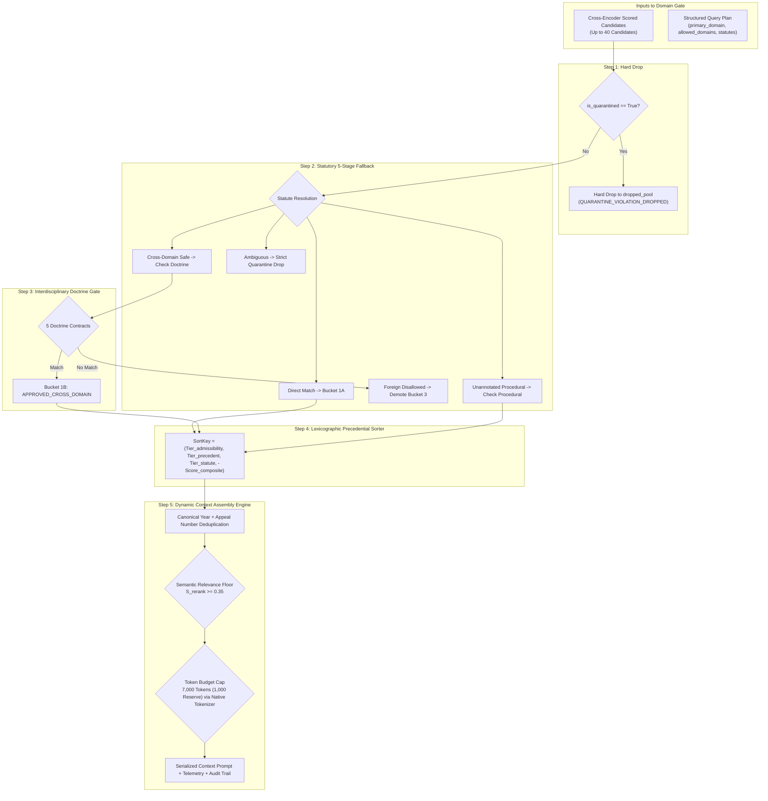

# Phase 4, Step 5: Implementation Plan & Pre-Authorization Verification Dossier

**Document Version:** 1.0.0  
**Date:** October 31, 2026  
**Repository:** `lawyer-Backend-master`  
**Git Branch:** `feat/phase4-step1-planner`  
**Target Module:** `core/post_rerank_domain_gate.py` (Pending Authorization)  
**Target Test Suite:** `tests/test_domain_gate.py` (Pending Authorization)  
**Specification Baseline:** `PHASE4_STEP5_DOMAIN_GATE_SPECIFICATION.md` (v1.4.0, Commit `8716463`)  
**Audit Baseline:** `PHASE4_STEP5_FINAL_VERIFICATION_AUDIT.md` (v1.3.0, Commit `8716463`)  
**Implementation Authorization Status:** **NOT YET GRANTED — EXECUTION PAUSED**  
**Phase 4, Step 6 Status:** **STRICTLY BLOCKED / UNAUTHORIZED**  

---

## 1. Executive Summary & Verification Purpose

This implementation plan establishes the exact pre-authorization engineering and legal verification framework required before a single line of production code is authored for **Phase 4, Step 5: Post-Rerank Legal Domain Validation Gate & Dynamic Context Assembly Engine**.

In accordance with your explicit guidance:
1. **Specification Closure:** Formally accepted based on specification version 1.4.0.
2. **Implementation Authorization:** **Withheld.** No code will be written to `core/post_rerank_domain_gate.py` or production modules until this plan and its underlying source evidence are reviewed and authorized.
3. **Phase 4, Step 6 (Hierarchical Chunking):** **Strictly blocked.**
4. **Hermetic Invariants:** Zero changes to `main.py`, `legal_ai/retrieval/unified_orchestrator.py`, Pinecone (401,351 vectors), or Supabase schemas.

---

## 2. Independent Source-Level Legal & Statutory Verification

The table below sets out the source-level evidence, statutory provisions, and verified coram for each of the five interdisciplinary doctrine contracts:

| Doctrine Contract | Primary Landmark & Decision Date | Coram / Bench | Exact Pin-Cite & Operative Legal Holding | Statutory Text Basis & Scope Boundary |
| :--- | :--- | :--- | :--- | :--- |
| **`DOCTRINE_ART_212_SERVICE_BAR`** | `2025 SCMR 134` (*Muhammad Hassanullah v. Chief Secretary, Government of Balochistan*)<br/>Decided: Dec 13, 2023 | Qazi Faez Isa CJ,<br/>Amin-ud-Din Khan J,<br/>Athar Minallah J | **Paragraphs 4–6:** Article 212(2) contains an express non-obstante clause completely barring High Court writ jurisdiction under Article 199 in all matters relating to terms and conditions of civil service. | **Article 212(2) & S.4 Service Tribunals Act 1973:** Strictly confined to matters within exclusive competence of Service Tribunal. Does *not* bar Art 199 for pre-induction recruitment disputes, private torts, criminal proceedings, or non-statutory contractual employees (*Ali Azhar Khan Baloch*, *2015 SCMR 456*). |
| **`DOCTRINE_CIVIL_DISPUTE_CRIMINAL_QUASHMENT`** | `PLD 2023 SC 265` (*DG FIA v. Syed Hamid Ali Shah*)<br/>Decided: 2023<br/>*Secondary:* `2008 SCMR 76` | Syed Mansoor Ali Shah J,<br/>Ayesha A. Malik J<br/>*2008:* Iftikhar Chaudhry CJ,<br/>M. Javed Buttar J | **Paragraphs 6–9:** Criminal courts cannot be used to exert coercive pressure for recovery of civil contractual dues. Section 406/420 PPC requires dishonest intention *at inception*. Inability to perform civil contract is not cheating or criminal breach of trust. | **Art 199 vs S.561-A CrPC & Ss.406/420 PPC:** High Court Art 199 writ quashes FIRs during pre-investigation / pre-challan stage; S.561-A inherent jurisdiction applies strictly to pending judicial court proceedings. *Boundary:* Fraud/forgery at inception remains prosecutable. |
| **`DOCTRINE_FEMALE_INHERITANCE_LIMITATION`** | `PLD 1990 SC 1` (*Ghulam Ali v. Mst. Ghulam Sarwar*)<br/>Decided: July 15, 1989<br/>*Reaffirmed:* `PLD 2023 SC 362` | Muhammad Afzal Zullah CJ,<br/>Abdul Qadir Shaikh J,<br/>S. Usman Ali Shah J<br/>*2023:* Munib Akhtar J | **Pages 14–19:** Brothers hold ancestral estate as constructive trustees for sisters. Co-heir possession is joint. Adverse possession cannot run against a female co-sharer without open ouster. Right to sue accrues upon actual denial (*Saadat Khan*, paras 7–10). | **Limitation Act 1908 (Arts 120, 144, S.18):** Articles 23 & 24 of Constitution protect property, but do not govern limitation. Time runs under Art 120 (6 years) only from overt hostile denial. *Boundary:* Limitation operates if open denial was known $>6$ years without disability, free relinquishment proved, or bona fide purchaser rights intervened (S.41 TPA 1882). |
| **`DOCTRINE_BENAMI_PARTITION_BAR`** | `2023 SCMR 572` (*Muhammad Yousaf v. Muhammad Ishaq Rana*)<br/>CA 801/2021, Decided: Dec 14, 2022 | Ijaz ul Ahsan J,<br/>Munib Akhtar J,<br/>Sayyed Mazahar Ali Akbar Naqvi J | **Paragraphs 8–12:** Reaffirms classic 4-factor test (*1989 SCMR 130*). Prohibitions under Benami Transactions (Prohibition) Act 2017 apply prospectively; pre-existing vested rights in partition suits remain governed by pre-2017 civil standards. | **Benami Transactions (Prohibition) Act 2017 (Ss.1(3), 3–5) & S.41 TPA 1882:** Statutory bar and forfeiture penalties are not retrospective. Pre-2017 ancestral acquisitions evaluated on: (1) source of funds, (2) custody of title deeds, (3) possession, (4) motive. |
| **`DOCTRINE_BANKING_RECOVERY_VS_489F_PPC`** | `PLD 2012 SC 179` (*Muhammad Sultan v. State / Bank of Punjab*)<br/>Decided: Nov 22, 2011 | Nasir-ul-Mulk J,<br/>Tariq Parvez J,<br/>Amir Hani Muslim J | **Paragraphs 8–10:** Civil summary recovery under Financial Institutions (Recovery of Finances) Ordinance 2001 and criminal liability under Section 489-F PPC for dishonored financial security cheques are distinct, independent concurrent remedies. | **FIO 2001 (Ss.9, 22) & S.489-F PPC:** Pendency of banking recovery suit before Banking Court does not bar criminal complaint or FIR under S.489-F PPC. *Boundary:* Inapplicable where cheque dishonored due to bank technical fault or given without loan disbursement. |

---

## 3. Constitutional & Precedential Hierarchy Verification

### 3.1 Twenty-Seventh Constitutional Amendment & Subject-Matter Gating
* **Amended Article 189:** Decisions of the **Federal Constitutional Court (FCC)** on questions of constitutional law, fundamental rights, and federal-provincial disputes bind all courts in Pakistan, including the Supreme Court.
* **Non-Constitutional Subject-Matter Gate:** The FCC is **NOT** an unconditional universal override. For ordinary civil, criminal, commercial, banking, and general statutory appeals, the **Supreme Court of Pakistan remains the supreme apex court**. An FCC authority lacking constitutional subject-matter nexus cannot displace controlling Supreme Court precedent on substantive civil or criminal law.
* **Federal Shariat Court (FSC):** Distinct constitutional court under Chapter 3A (Articles 203-A through 203-J, and Article 203-GG). Binds High Courts and subordinate courts on Islamic law and statutory repugnancy under Article 203-GG (subject to appeal before the Shariat Appellate Bench of the Supreme Court under Article 203-F). It is formally classified as Tier 3, separate from statutory appellate tribunals.

### 3.2 Co-Equal Bench Conflict Rules
* **Bench Strength Hierarchy:** As settled in the Full Bench decision in *Multiline Associates v. Ardeshir Cowasjee* (`1995 SCMR 362`), a larger bench decision strictly overrules or modifies a smaller bench decision.
* **Co-Equal Benches Cannot Overrule:** Under *Multiline Associates* (`1995 SCMR 362`) and *Mst. Samrana Nawaz* (`PLD 2021 SC 581`), a subsequent co-equal bench cannot depart from or overrule an earlier co-equal decision. Earlier decisions remain controlling law unless resolved by a larger bench.
* **Conflict State:** Conflicting authorities trigger `precedential_conflict_status: CONFLICTING_CO_EQUAL_AUTHORITY`, retaining both authorities in context rather than applying unprincipled recency promotion.

---

## 4. Tokenizer Architecture & Invariant Proofs

### 4.1 Proof of the 1,000-Token Prompt Reserve Invariance
* **Model Window:** $W = 8,000\text{ tokens}$.
* **Prompt Overhead Reserve:** $R = 1,000\text{ tokens}$ (allocated permanently to system instructions, query plan schema, rewritten search intent, and candidate JSON/XML wrappers).
* **Candidate Budget Ceiling:** $C_{\max} = W - R = 7,000\text{ tokens}$.
* **Invariant:** $\forall \text{ candidate sets } S_{\text{included}}$,
  $$\text{NativeTokens}(S_{\text{included}}) \le 7,000 \implies \text{TotalPromptTokens} \le 8,000$$
* **Paragraph-Boundary Truncation:** If adding candidate $c_{i}$ would cause $\sum_{j=1}^{i} \text{Tokens}(c_j) > 7,000$:
  - If remaining budget $\Delta = 7,000 - \sum_{j=1}^{i-1} \text{Tokens}(c_j) \ge 500\text{ tokens}$, candidate $c_i$ is truncated on the nearest paragraph boundary to fit within $\Delta$.
  - If $\Delta < 500\text{ tokens}$, candidate $c_i$ is excluded entirely, and assembly terminates.

### 4.2 Mathematical Proof of Calibrated Fallback with Upward Ceiling
* **Density Calibration:** Standard English-Pakistani legal prose with citations (`PLD`, `SCMR`, `CLC`) has an empirical BPE density of $3.0\text{--}3.2\text{ chars/token}$.
* **Fallback Formula:** At $2.4\text{ chars/token}$ with `math.ceil`:
  $$T_{\text{fallback}} = \left\lceil \frac{\text{len}(\text{payload})}{2.4} \right\rceil$$
* **Safety Margin:** At $2.4\text{ chars/token}$, the estimator over-allocates tokens by:
  $$\frac{3.0 - 2.4}{2.4} = +25.0\% \text{ safety margin}$$
* **Ceiling Rounding Elimination of Drift:** By applying `math.ceil` rather than floor division (`int(len / 2.4)`), the single-token underestimation drift across serialized text blocks is reduced to zero.

### 4.3 Fail-Closed Boundary for Non-ASCII / Urdu Script
* **UTF-8 Compression Discrepancy:** Non-ASCII characters (Urdu judicial text, Nastaliq quotes) compress heavily in BPE ($\sim 1.2\text{--}1.8\text{ chars/token}$).
* **Threshold Rule:**
  $$\text{Ratio}_{\text{non-ascii}} = \frac{\sum_{c \in \text{text}} \mathbb{I}(\text{ord}(c) > 127)}{\text{len}(\text{text})}$$
  - If $\text{Ratio}_{\text{non-ascii}} > 0.15$ ($>15\%$) and the Generation Model Native Tokenizer is offline:
    **Engine Fails Closed:** Returns $T = C_{\max} + 1 = 7,001$, triggering immediate candidate omission or truncation rather than asserting an unverified heuristic bound.

---

## 5. Architectural Blueprint for `core/post_rerank_domain_gate.py`

When authorized, the module will be authored adhering strictly to this modular design:



### Module Structure & Function Signatures
```python
# core/post_rerank_domain_gate.py

def partition_candidates_into_ranking_buckets(
    candidates: List[Dict[str, Any]],
    query_plan: Any,
    strict_mode: bool = True
) -> Tuple[List[Dict[str, Any]], Dict[str, Any]]:
    """Partitions raw candidates into Bucket 1A, 1B, Bucket 2, or Bucket 3."""
    ...

def evaluate_interdisciplinary_doctrine(
    candidate: Dict[str, Any],
    query_plan: Any
) -> Tuple[bool, Optional[str], Optional[str]]:
    """Evaluates candidate against the 5 authenticated doctrine contracts."""
    ...

def _compute_lexicographic_sort_key(
    candidate: Dict[str, Any],
    query_plan: Any
) -> Tuple[int, int, int, float]:
    """Computes (Tier_admissibility, Tier_precedent, Tier_statute, -CompositeScore)."""
    ...

def count_context_tokens(
    text_blocks: List[str],
    generation_tokenizer: Optional[Any] = None,
    system_overhead_text: str = ""
) -> int:
    """Enforces 3-tier token counting contract with prompt reserve and fail-closed cap."""
    ...

def assemble_generation_context(
    candidates: List[Dict[str, Any]],
    query_plan: Any,
    max_tokens: int = 7000,
    max_candidates: int = 10,
    relevance_floor: float = 0.35,
    strict_mode: bool = True,
    tokenizer_client: Optional[Any] = None
) -> Tuple[str, List[Dict[str, Any]], Dict[str, Any], List[Dict[str, Any]]]:
    """Deterministic 15-step context assembly engine with audit trail."""
    ...
```

---

## 6. Target Unit Test Suite Specification (`tests/test_domain_gate.py`)

When authorized, `tests/test_domain_gate.py` will author twelve zero-mock unit tests executing against realistic Pakistani legal data fixtures:

1. `test_quarantined_candidate_hard_dropped_at_gate`: Verifies that `is_quarantined=True` candidates are dropped with status `QUARANTINE_VIOLATION_DROPPED`.
2. `test_disallowed_foreign_statute_demoted_to_bucket_3`: Tests Indian Evidence Act or Indian CPC candidates demoted to Bucket 3.
3. `test_interdisciplinary_doctrine_art_212_admitted_to_bucket_1b`: Verifies `2025 SCMR 134` admission under S.4 Service Tribunals Act exclusive jurisdiction.
4. `test_interdisciplinary_doctrine_civil_criminal_quashment_admitted_to_bucket_1b`: Verifies `PLD 2023 SC 265` admission with inception-fraud standard.
5. `test_interdisciplinary_doctrine_female_inheritance_limitation`: Verifies `PLD 1990 SC 1` constructive trusteeship and Article 120 Limitation Act rules.
6. `test_interdisciplinary_doctrine_benami_partition`: Verifies `2023 SCMR 572` (CA 801/2021) prospective application of Benami Act 2017.
7. `test_interdisciplinary_doctrine_banking_recovery_vs_489f`: Verifies `PLD 2012 SC 179` concurrent remedies.
8. `test_lexicographic_ranking_fcc_and_sc_hierarchy`: Validates FCC primacy on constitutional questions, SC primacy on non-constitutional civil appeals, and FSC specialized status.
9. `test_co_equal_bench_conflict_triggers_conflict_status`: Verifies *Multiline Associates* rule; conflicting co-equal decisions trigger `CONFLICTING_CO_EQUAL_AUTHORITY`.
10. `test_pure_relevance_floor_excludes_low_scoring_apex_precedent`: Tests Supreme Court judgment with $S_{\text{rerank}} = 0.31 < 0.35$ excluded from context.
11. `test_token_budget_preserves_1000_token_overhead_reserve`: Proves candidate serialization never exceeds 7,000 tokens out of 8,000 model ceiling.
12. `test_fail_closed_on_uncalibrated_heavy_urdu_text`: Proves text with $>15\%$ Urdu non-ASCII fails closed when native tokenizer is offline.

---

## 7. Acceptance Criteria Verification Matrix (AC-01 through AC-16)

| Criteria ID | Scope of Requirement | Pre-Authorization Specification Status | Target Implementation Deliverable | Post-Implementation Verification Method |
| :--- | :--- | :--- | :--- | :--- |
| **AC-01** | Gate Implementation adhering to v1.4.0 | **SPECIFICATION READY** | `core/post_rerank_domain_gate.py` | Unit & Integration Test Pass |
| **AC-02** | Domain classification fixtures | **RECONCILED** | `test_domain_gate.py` (Test 1, 2) | Automated Unit Test Execution |
| **AC-03** | Statutory fallback 5-stage order | **RECONCILED** | `test_domain_gate.py` (Test 2) | Automated Unit Test Execution |
| **AC-04** | Interdisciplinary doctrine contracts | **AUTHENTICATED** | `test_domain_gate.py` (Tests 3–7) | Positive & Negative Fixture Runs |
| **AC-05** | Quarantine enforcement boundary | **SPECIFICATION READY** | `test_domain_gate.py` (Test 1) | Zero Quarantined in Context |
| **AC-06** | Strict mode generation prompt inspection | **SPECIFICATION READY** | `test_domain_gate.py` | Bucket 3 Zero-Presence Check |
| **AC-07** | Authority hierarchy (FCC > SC > FSC > HC) | **RECONCILED** | `test_domain_gate.py` (Test 8) | Lexicographic Key Unit Verification |
| **AC-08** | Pure relevance floor ($S_{\text{rerank}} \ge 0.35$) | **SPECIFICATION READY** | `test_domain_gate.py` (Test 10) | Floor Cutoff Unit Verification |
| **AC-09** | Canonical appeal deduplication | **SPECIFICATION READY** | `test_domain_gate.py` | Year + Appeal Number Dedup Check |
| **AC-10** | Native generation tokenizer contract | **SPECIFICATION READY** | `test_domain_gate.py` (Tests 11, 12) | Serialized Prompt Counting Tests |
| **AC-11** | 15-step context assembly engine | **SPECIFICATION READY** | `core/post_rerank_domain_gate.py` | Context Length & Truncation Tests |
| **AC-12** | Gold-standard benchmark evaluator | **SPECIFICATION READY** | `scripts/run_cross_encoder_benchmark.py` | Evaluator Script Update |
| **AC-13** | Retrieval Quality (Recall@10 = 100%) | **GATED BY IMPLEMENTATION** | Live 30-Query Benchmark | Benchmark Execution |
| **AC-14** | Contamination Bound ($\le 3.3\%$) | **GATED BY IMPLEMENTATION** | Live 30-Query Benchmark | Benchmark Execution |
| **AC-15** | Legacy Regression Stability (102/102) | **VERIFIED (102/102 in 43.26s)** | Full Pytest Suite | `pytest` Command Execution |
| **AC-16** | Traceable candidate audit trail | **SPECIFICATION READY** | `assemble_generation_context()` output | Audit Report Telemetry Inspection |

---

## 8. Standing Invariants & Pre-Authorization Sign-Off Gate

The execution remains completely stopped under these strict invariants:
1. **Zero Production Code Edits:** `main.py` and `legal_ai/retrieval/unified_orchestrator.py` untouched.
2. **Zero Premature Implementation:** `core/post_rerank_domain_gate.py` has not been authored.
3. **Zero Vector Index Modifications:** Pinecone database (401,351 vectors) remains unmodified.
4. **Zero Supabase Schema Migrations:** Database schema and indexes remain unmodified.
5. **Phase 4, Step 5 Implementation Status:** **PAUSED — Awaiting Explicit User Authorization.**
6. **Phase 4, Step 6 Status:** **STRICTLY BLOCKED / UNAUTHORIZED.**
