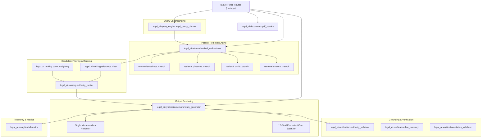

# REFACTOR PLAN: SINGLE SOURCE OF TRUTH LEGAL AI ARCHITECTURE
**System**: Section AI / Lawyer Backend  
**Audit Reference**: `ARCHITECTURE_AUDIT.md`  
**Execution Status**: PENDING USER APPROVAL (DO NOT EXECUTE WITHOUT AUTHORIZATION)  

---

## 1. TARGET ARCHITECTURE SPECIFICATION

The goal of this refactor is to untangle the 7,436-line `main.py` monolith and 30+ fragmented `core/` modules into a clean, predictable, single-source-of-truth package:

```text
legal_ai/
├── __init__.py
├── config.py                     # Centralized environment variables, client singletons, model names
│
├── query_engine/
│   ├── __init__.py
│   ├── legal_query_planner.py    # Query intent, statutory anchor extraction, search lane generation
│   └── issue_extractor.py        # Factual matrix decomposition & compound query analysis
│
├── retrieval/
│   ├── __init__.py
│   ├── unified_orchestrator.py   # Single parallel orchestrator (asyncio.gather across all engines)
│   ├── supabase_search.py        # Proactive Postgres full-text keyword search driver
│   ├── pinecone_search.py        # Pinecone dense semantic vector search driver
│   ├── bm25_search.py            # Local sparse BM25 keyword driver (40k chunks)
│   └── external_search.py        # Portal / web fallback search driver
│
├── ranking/
│   ├── __init__.py
│   ├── authority_ranker.py       # Multi-factor judicial scoring (hierarchy, recency, issue match)
│   ├── relevance_filter.py       # Hard-rejection quality gate (caption-only, stubs, wrong jurisdiction)
│   └── court_weighting.py        # Single source of truth for court taxonomy, tiers, and normalizations
│
├── verification/
│   ├── __init__.py
│   ├── citation_validator.py     # Canonical citation parser, volume/page regex, OCR repair
│   ├── law_currency.py           # Pakistan Code statutory in-force verification & amendment alerts
│   ├── quote_verifier.py         # Verbatim judicial quote-attribution verification
│   └── authority_validator.py    # Independent judicial review gate (Claude temperature 0 checker)
│
├── synthesis/
│   ├── __init__.py
│   ├── memorandum_generator.py   # Senior Counsel 8-part legal opinion synthesis & reflection loop
│   └── pleading_generator.py     # Court pleading drafting driver (petitions, plaints, bail applications)
│
├── documents/
│   ├── __init__.py
│   └── pdf_service.py            # Direct PDF streaming, Supabase Storage download, ReportLab fallback
│
└── analytics/
    ├── __init__.py
    └── telemetry.py              # Exact structured logging block & JSONL metrics tracking
```

---

## 2. DEPENDENCY MAP



---

## 3. COMPONENT REFACTORING & MIGRATION MATRIX

| Target Module | Current File(s) to Ingest / Deprecate | Extracted Functionality |
| :--- | :--- | :--- |
| **`legal_ai/config.py`** | `main.py` (lines 50–100), `core/search_provider.py` | Shared Supabase client, Pinecone client, Anthropic client, model names, environment validation. |
| **`legal_ai/query_engine/`** | `core/legal_query_planner.py`, `main.py` (`expand_legal_query_doctrinally`) | Single query planner producing immutable `LegalQueryPlan` with statutory provisions and lanes. |
| **`legal_ai/retrieval/`** | `hybrid_search.py`, `main.py` (`LegalSearchPipeline`, `fallback_supabase_fulltext`), `core/recent_judgments_search.py` | Parallel multi-source retrieval (Postgres FTS + Pinecone Dense + BM25 Sparse + External) into unified candidate pool. |
| **`legal_ai/ranking/`** | `core/candidate_quality_filter.py`, `core/authority_ranking.py`, `core/court_taxonomy.py`, `main.py` (`get_court_hierarchy_tier`, `is_usable_precedent`, `passes_minimum_quality_threshold`) | Single source of truth for hard rejections (relevance filter), court tiers, and multi-factor scoring (authority ranker). |
| **`legal_ai/verification/`** | `core/final_review_gate.py`, `core/quote_verifier.py`, `core/statute_currency.py`, `core/current_law_verifier.py`, `core/header_citation_extractor.py`, `core/title_parser.py` | Dedicated validators for legal claims (review gate), in-force statutes, citation parsing, and verbatim quotes. |
| **`legal_ai/synthesis/`** | `main.py` (`process_query_job` synthesis loop), `core/legal_proposition_extractor.py`, `prompts/pleading_generator.py` | Decoupled prompt loader, 8-part legal memo generator, reflection loop, and zero-warning markdown renderer. |
| **`legal_ai/documents/`** | `core/pdf_resolver.py`, `main.py` (`build_judgment_pdf_bytes`, `find_judgment_by_id_or_canonical`) | Direct binary PDF streaming, Supabase storage byte retrieval, ReportLab case report generator. |
| **`legal_ai/analytics/`** | `analytics/legal_ai_metrics.py`, `main.py` (telemetry string builder), `core/retrieval_logger.py` | Telemetry block logger (with exact source percentages) and pipeline performance telemetry tracker. |
| **`main.py`** | Lines 1–7,436 (slimming down to ~600 lines) | Pure FastAPI router: HTTP endpoints, Clerk authentication, background job dispatching, CORS. |

---

## 4. RECOMMENDED EXECUTION ORDER

To prevent regressions, the refactoring must be executed in **5 strict phases**. Automated unit tests and benchmark checks run at each milestone:

```text
Phase 1: Foundation & Non-Destructive Modules
  1.1 Create legal_ai/ package structure
  1.2 Create legal_ai/config.py (centralized clients & env)
  1.3 Create legal_ai/documents/pdf_service.py (consolidate PDF generation & streaming)
  1.4 Create legal_ai/analytics/telemetry.py (consolidate metrics & telemetry logging)
  1.5 Create prompts/ directory with markdown prompt files
  --> TEST: Run test_legal_ai_pipeline.py & 100-judgment PDF test (Must be 100% pass)

Phase 2: Retrieval & Ranking Layer Consolidation
  2.1 Implement legal_ai/ranking/court_weighting.py (single source of truth for court tiers)
  2.2 Implement legal_ai/ranking/relevance_filter.py (single hard-reject quality gate)
  2.3 Implement legal_ai/ranking/authority_ranker.py (multi-factor scoring)
  2.4 Implement legal_ai/retrieval/ drivers (supabase, pinecone, bm25, external)
  2.5 Implement legal_ai/retrieval/unified_orchestrator.py (parallel search & merging)
  --> TEST: Verify multi-source retrieval telemetry block on Query 1 (Exact log match)

Phase 3: Verification & Synthesis Layer Decoupling
  3.1 Implement legal_ai/verification/ (citation_validator, law_currency, authority_validator)
  3.2 Implement legal_ai/synthesis/memorandum_generator.py (pure synthesis & reflection)
  3.3 Implement Single Memorandum Renderer (zero warning banners guaranteed)
  --> TEST: Verify reflection loop & review gate with 0 banner pollution

Phase 4: Main Router Slimming
  4.1 Refactor process_query_job in main.py to call legal_ai modules
  4.2 Remove duplicated helper functions in main.py (court cleaners, title sanitizers, FTS fallbacks)
  4.3 Reduce main.py from 7,436 lines down to clean FastAPI endpoint routing (~600 lines)
  --> TEST: Run complete unit test suite (All 9 tests pass)

Phase 5: Final Validation & Archive Clean-Up
  5.1 Run full benchmark suite across Queries 1–3
  5.2 Archive dead/one-off root scripts into scripts/migrations/archive/
  5.3 Git commit, push, and verify Railway production deployment
```

---

## 5. SAFETY & ZERO-REGRESSION CONTROLS

1. **Non-Destructive Shadowing**: During Phase 1 and Phase 2, `legal_ai/` modules will be built alongside existing code. Existing endpoints remain intact until verified by unit tests.
2. **Benchmark Gating**: Every phase transition requires running Queries 1–3 to ensure:
   - Authorities admitted $\ge 2$
   - Supreme Court / High Court prioritization maintained
   - Direct PDF streaming 100% operational
   - Warning banners = 0
   - Memorandum headings complete
3. **Rollback Readiness**: Work will be conducted on a dedicated branch (`hardening-refactor-phase1`), with master remaining production-stable until all 5 phases pass.
