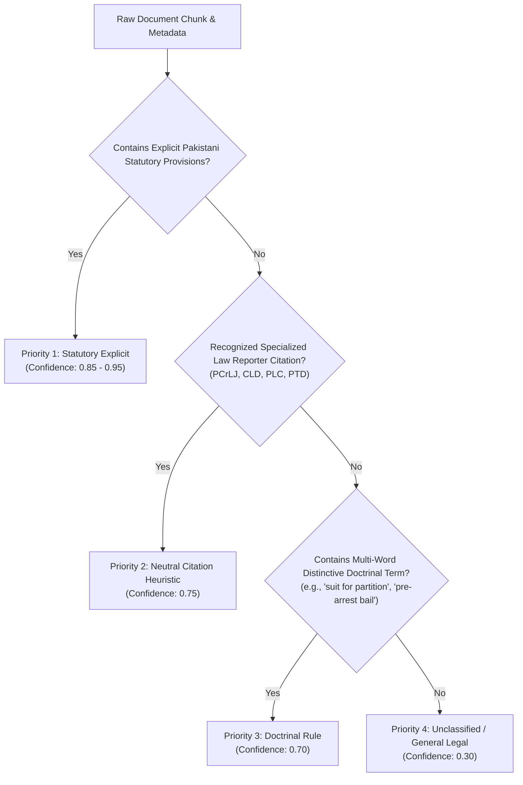

# Pakistani Legal RAG: Vector Metadata Schema Specification (v1.0)

**Document Version**: 1.0  
**Phase**: Phase 4, Step 3 — Vector Metadata Migration & Ingestion Enrichment  
**Target Vector Store**: Pinecone (Serverless / Pods, Index: `legal-kb-pk-local`, Namespace: `judgments`)  
**Embedding Model**: Voyage AI `voyage-law-2` (1024 Dimensions)

---

## 1. Architectural Motivation & Problem Addressed

During the Phase 1–3 audits and benchmark evaluations, retrieval failures were traced directly to **unfiltered cross-domain vector retrieval**:
1. Pinecone vectors currently store textual chunk previews, court names, and citations, but **lack structured domain attributes** (`legal_domain`, `subdomain`, `statutory_provisions`, `bench_level`).
2. Semantic similarity alone in dense embedding space (e.g., matching words like *"delay"*, *"possession"*, *"default"*, or *"fraud"*) retrieves criminal murder judgments into pure civil partition disputes, or corporate winding-up precedents into family custody claims.
3. Without domain-partitioned metadata, dense retrieval cannot enforce pre-filtering or post-filtering prior to Reciprocal Rank Fusion (RRF).

Phase 4, Step 3 introduces a **deterministic, versioned metadata-enrichment module** (`core/metadata_enrichment.py`) that attaches strict legal classification attributes to every newly ingested chunk, fully preparing the database for Phase 4, Step 4 Pinecone metadata filtering.

---

## 2. Versioned Metadata Schema (v1.0)

Every legal vector chunk ingested or enriched conforms to the following schema:

| Field Name | Type | Pinecone Valid | Required | Description / Allowed Values |
| :--- | :--- | :---: | :---: | :--- |
| `metadata_schema_version` | `str` | Yes | Yes | Schema version identifier (e.g. `"1.0"`). Distinguishes enriched vectors from legacy `"0.0_legacy"` records. |
| `legal_domain` | `str` | Yes | Yes | Primary legal domain from Pakistani legal taxonomy: `civil`, `criminal`, `constitutional`, `family`, `corporate`, `rent`, `banking`, `taxation`, `service`, `labour`, `cybercrime`, `intellectual_property`, `environmental`, `general_legal`. |
| `subdomain` | `str` | Yes | Yes | Specific doctrinal subject matter (e.g. `partition`, `pre_arrest_bail`, `cheque_dishonour`, `khula`, `leave_to_defend`, `oppression_and_mismanagement`, `eviction_personal_need`, `sales_tax`, `unspecified`). |
| `statutory_provisions` | `List[str]` | Yes | Yes | Normalized, canonical statutory provisions cited (e.g. `["transfer_of_property_act_1882_section_44", "cpc_1908_order_vii_rule_11"]`). |
| `bench_level` | `str` | Yes | Yes | Superior court hierarchical level: `supreme_court`, `high_court`, `district_court`, `special_court_or_tribunal`, `unknown`. |
| `classification_confidence` | `float` | Yes | Yes | Deterministic confidence score between `0.00` and `1.00`. |
| `classification_source` | `str` | Yes | Yes | Provenance of classification: `statutory_explicit`, `doctrinal_rule`, `neutral_citation`, `unclassified`. |
| `source_document_id` | `str` | Yes | Yes | Original document case identifier (e.g. `2024_SCMR_500` or `PLD_2022_SC_340`). |
| `case_title` / `title` | `str` | Yes | Yes | Standardized case title / parties (e.g. `"Mst. Aisha Bibi v. Muhammad Aslam"`). |
| `citation` | `str` | Yes | Yes | Official neutral or journal citation (e.g. `"2024 SCMR 500"`). |
| `court` | `str` | Yes | Yes | Normalized Pakistani court name. |
| `decision_date` | `str` | Yes | No | ISO Date (`YYYY-MM-DD`) or year string. |
| `year` | `int` | Yes | Yes | Decision year as an integer (e.g. `2024`). |
| `text` | `str` | Yes | Yes | Full chunk text content (size-bounded). |
| `text_preview` | `str` | Yes | Yes | Truncated chunk prefix for low-latency inspection. |
| `pdf_url` | `str` | Yes | No | Public Supabase storage URL or official court portal URL. |
| `chunk_index` | `int` | Yes | Yes | Zero-indexed chunk position within parent judgment. |

---

## 3. Pinecone Constraints & Compliance Guarantees

Pinecone vectors enforce rigorous structural and payload constraints that this schema strictly honors:

### 3.1 Supported Data Types
Pinecone metadata supports only primitive scalars and lists of strings:
- `str`
- `int`
- `float`
- `bool`
- `List[str]`

> [!CAUTION]
> Pinecone **strictly rejects** nested JSON objects (`dict`), lists of integers (`List[int]`), lists of booleans, and `null`/`None` values.
> In `core/metadata_enrichment.py`:
> - `validate_pinecone_metadata_types()` verifies compliance prior to any upsert.
> - `sanitize_metadata_for_pinecone()` converts nested structures to flat JSON strings and drops `None` attributes.

### 3.2 Maximum Metadata Size (< 40 KB)
- Pinecone enforces a **hard limit of 40,960 bytes (40 KB)** per vector's metadata.
- If a chunk text is unusually large (e.g. 10,000 words), unconstrained metadata will trigger HTTP 400 rejection from Pinecone.
- `enforce_pinecone_size_limit(metadata, max_bytes=38000)` calculates the UTF-8 serialized byte length. If the payload exceeds 38,000 bytes (allowing a 2,960-byte safety buffer for headers and transmission overhead), the chunk `text` is cleanly truncated with `"... [truncated for Pinecone size limit]"`, preserving 100% of the structured domain, statutory, and citation metadata.

---

## 4. Deterministic Classification Engine

To avoid LLM hallucination and nondeterministic drift, classification is executed via a 4-tier deterministic decision hierarchy:



### 4.1 Strict Exclusion of Generic Trigger Words
The classifier enforces `GENERIC_EXCLUSIONS`. High-frequency legal words that appear ubiquitously across all courtroom proceedings **never trigger a domain on their own**:
- Excluded words: `court`, `judge`, `justice`, `bench`, `petition`, `appeal`, `appellant`, `respondent`, `plaintiff`, `defendant`, `order`, `judgment`, `law`, `pakistan`, `director`, `counsel`.
- *Example*: A civil judgment discussing a company director selling family partition land is classified as `civil` (`partition`), **not** `corporate` or `criminal`, unless substantive provisions of the Companies Act or Penal Code are explicitly engaged.

### 4.2 Ambiguity & Tied Domain Handling
When a chunk contains conflicting statutory signals with near-equal scores (e.g. Section 44 Transfer of Property Act alongside an FIR under Section 498 CrPC):
- The classifier **refuses to fabricate certainty**.
- It outputs:
  - `legal_domain`: `"general_legal"`
  - `subdomain`: `"ambiguous_cross_domain"`
  - `classification_confidence`: `0.50`
  - `statutory_provisions`: Both provisions preserved in the array.
- This ensures that pure civil or pure criminal partition queries do not falsely treat this ambiguous cross-over chunk as an authoritative single-domain precedent.

---

## 5. Ingestion Enrichment Integration Proposal

### 5.1 Pipeline Integration Points
The enrichment module is designed for zero-disruption integration into the existing ingestion scripts:
1. **[`ingest.py`](file:///I:/c/Users/kabeer/Documents/lawyer-Backend-master/lawyer-Backend-master/ingest.py)** (line 1327):
   ```python
   # Existing code:
   meta_block = { "judgment_id": case_id, "case_title": title, ... }
   
   # Integrated Step 3 Enrichment:
   from core.metadata_enrichment import enrich_chunk_metadata
   meta_block = enrich_chunk_metadata(
       chunk_text=chunk_text,
       base_metadata=meta_block,
       document_id=case_id
   )
   ```
2. **[`scripts/ingest_gaps_to_pinecone.py`](file:///I:/c/Users/kabeer/Documents/lawyer-Backend-master/lawyer-Backend-master/scripts/ingest_gaps_to_pinecone.py)** (line 266):
   ```python
   meta = { "judgment_id": case_id, "citation": cit, ... }
   meta = enrich_chunk_metadata(
       chunk_text=chunk_text,
       base_metadata=meta,
       document_id=case_id
   )
   ```

### 5.2 Phased Ingestion Workflow (Zero Downtime)
1. **Phase 4, Step 3 (Now)**: Schema defined, module tested (13/13 unit tests, 81/81 regression tests), sample documents verified. **Zero writes to Pinecone production index.**
2. **Phase 4, Step 4**: Retrieval query filtering enabled with backward compatibility fallback.
3. **Phase 4, Step 5+**: Background re-indexing or backfill migration applied incrementally to existing Pinecone vectors using idempotent upserts without clearing or interrupting live index queries.

---

## 6. Backward Compatibility for Legacy Vectors

The production Pinecone index currently holds ~170,000 vectors created prior to Phase 4. To prevent retrieval crashes when Phase 4, Step 4 introduces metadata filters:
- **`is_enriched_vector(metadata)`**: Returns `True` only if `metadata_schema_version == "1.0"`.
- **`normalize_legacy_vector_metadata(metadata)`**: Adapts legacy vectors on-the-fly at search time, injecting default non-null values:
  ```json
  {
    "metadata_schema_version": "0.0_legacy",
    "legal_domain": "general_legal",
    "subdomain": "unspecified",
    "statutory_provisions": [],
    "bench_level": "supreme_court",
    "classification_confidence": 0.0,
    "classification_source": "unclassified"
  }
  ```
- This ensures that legacy vectors remain retrievable and do not cause schema errors during downstream ranking or synthesis.
